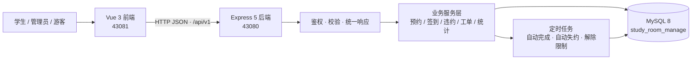
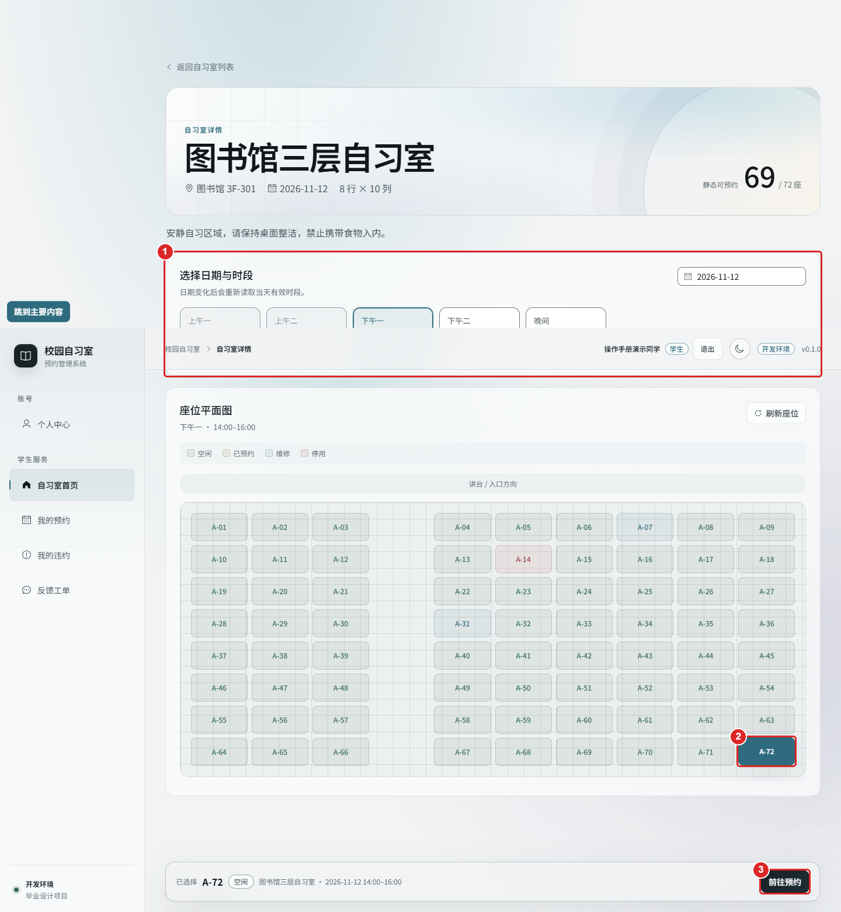
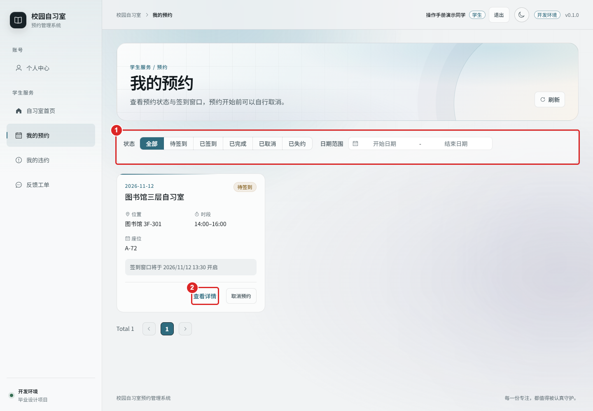
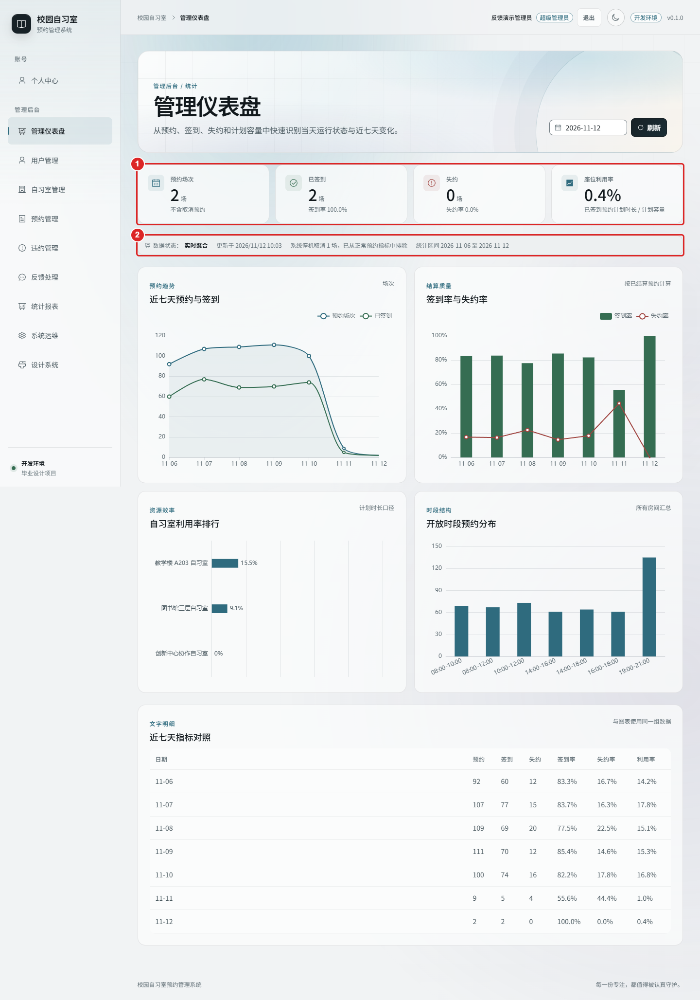
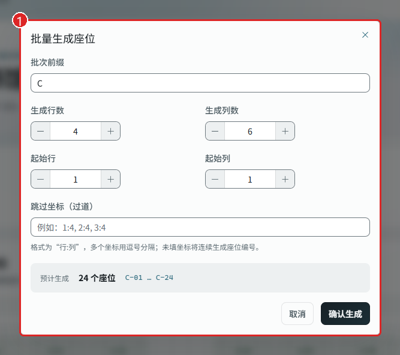
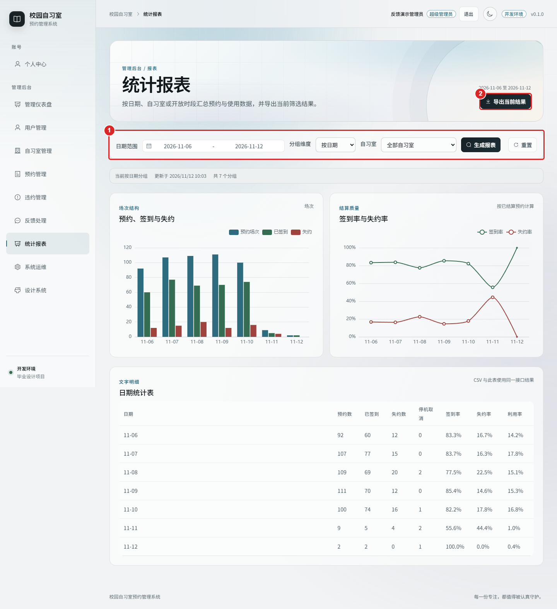
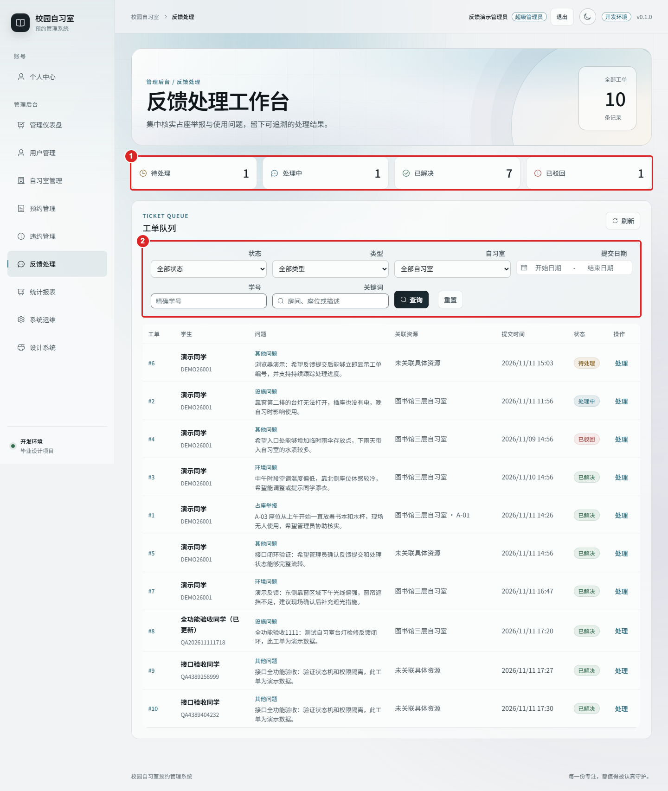

<div align="center">


<br>

<h1>校园自习室预约管理系统</h1>

<p><strong>把“抢座”变成一条可预约、可签到、可追溯的状态机</strong></p>

<p>
  
  
  
  
  
  
</p>

<p><sub>莫愁前路无知己，天下谁人不识君。</sub><br>
<sub>—— 高适《别董大》</sub></p>

</div>

---

## 这是什么

一个面向高校图书馆 / 自习室的前后端分离预约系统，也是一份完整的本科毕业设计工程。

- **学生端**：查空座 → 按日期时段选座 → 提交预约 → 扫码签到 → 查看记录 / 取消 / 违约与反馈
- **管理端**：自习室、开放时段、座位批量维护 → 预约查询与人工核验 → 违约撤销 → 工单处理 → 统计报表与系统设置
- **工程侧**：JWT 鉴权、统一响应、幂等提交、唯一索引防重、定时任务、审计留痕、可视化统计

## 功能一览

| 角色 | 能力 |
| --- | --- |
| 学生 | 注册登录、资料与密码、座位平面图选座、预约提交/取消、二维码签到、我的预约、违约查询、反馈工单 |
| 管理员 | 自习室 CRUD、时段配置、座位批量生成与维修、全量预约查询、人工核验、取消预约、违约撤销、工单处理、实时看板与报表 |
| 系统 | 角色与状态管理、审计日志、系统配置、健康检查与就绪探针、定时任务（自动完成 / 自动失约 / 限制解除） |

## 技术栈

| 层 | 选型 |
| --- | --- |
| 前端 | Vue 3.5 · TypeScript · Vite 8 · Pinia · Vue Router · Element Plus · ECharts · Axios |
| 后端 | Node.js 24 · Express 5 · Sequelize 6 · MySQL 8 · JWT · bcryptjs · express-validator · node-cron · dayjs |
| 工程 | pnpm workspace · ESLint · Prettier · 前后端双 typecheck / build · WPS 导出论文 PDF |

## 系统架构



## 关键设计

1. **预约是一台显式状态机**：`pending → checked_in → completed`，分支 `cancelled` / `no_show`，每次转移写入状态日志。
2. **用数据库保证“一座一时段一条有效预约”**：`active_slot_key` 生成列 + 唯一索引，把并发抢座收敛为存储层约束，而不是应用层先查后写。
3. **签到窗口由服务端计算并落库**：开始前 30 分钟至开始后 15 分钟，二维码带签名与随机数，校验归属房间与一次性使用。
4. **创建预约幂等**：请求携带幂等键，重复提交不会产生第二条记录。
5. **历史可读**：自习室名称、位置、座位编号在预约中保存快照，资源改名或调整不影响历史记录。
6. **审计与追溯**：管理端写操作记录操作人、前后值、请求标识，工单与违约支持撤销留痕。

## 界面预览

| 学生选座 | 我的预约 | 管理看板 |
| --- | --- | --- |
|  |  |  |

| 座位批量维护 | 统计报表 | 工单处理 |
| --- | --- | --- |
|  |  |  |

> 完整 67 张图文演示见 [`docs/assets/user-guide/`](docs/assets/user-guide/) 与[操作手册](docs/校园自习室预约管理系统操作手册.md)。

## 快速开始

环境：Node.js 24、pnpm 11.10、MySQL 8（可用 Docker）。

```powershell
# 1. 安装依赖
pnpm --dir backend install --frozen-lockfile
pnpm --dir frontend install --frozen-lockfile

# 2. 准备环境变量
if (-not (Test-Path backend/.env))  { Copy-Item backend/.env.example backend/.env }
if (-not (Test-Path frontend/.env)) { Copy-Item frontend/.env.example frontend/.env }

# 3. 初始化数据库（建库、建账号，保留已有数据卷）
pnpm --dir backend db:prepare

# 4. 同时启动前后端
pnpm dev
```

- 前端：<http://localhost:43081/home>
- 健康检查：`GET http://127.0.0.1:43080/api/v1/health`、`GET /api/v1/ready`

## 项目结构

```text
.
├─ frontend/          Vue 3 页面、路由、Pinia 状态与请求封装
├─ backend/           Express 接口、Sequelize 模型与数据库准备工具
├─ docs/              开发文档、模块文档、操作手册、验收报告、演示截图
│  ├─ modules/        M01–M08 模块文档
│  └─ assets/         README 封面与 67 张界面截图
├─ thesis/            毕业论文（drafts 源稿 / figures 插图 / final 终稿 / reports 校验记录）
├─ scripts/           论文排版链：图渲染、DOCX 生成、PDF 导出、版式校验
└─ package.json       根脚本（dev / build）
```

## 文档

| 文档 | 内容 |
| --- | --- |
| [操作手册](docs/校园自习室预约管理系统操作手册.md) | 游客 / 学生 / 管理员 / 超级管理员全流程图文 |
| [开发文档](docs/校园自习室预约管理系统开发文档.md) | 架构、数据表、接口、页面与业务规则 |
| [模块文档](docs/modules/README.md) | M01 认证 · M02 自习室 · M03 预约签到 · M04 违约 · M05 工单 · M06 统计 · M07 运维 · M08 设计系统 |
| [全功能验收报告](docs/全功能演示验收报告-2026-11-11.md) | 56 项接口检查、49 项后端测试、3 项前端时间规则测试 |
| [生命周期补充验收](docs/预约生命周期补充验收报告-2026-11-12.md) | 16 项状态机与定时任务检查 |

## 测试与验收

| 项目 | 结果 |
| --- | --- |
| 真实接口检查 | 56 项通过 |
| 后端测试 | 49 项通过 |
| 前端时间规则 | 3 项通过 |
| 生命周期补充检查 | 16 项通过（窗口内扫码、人工核验、自动完成、自动失约、停机豁免、限制→撤销→恢复） |
| 构建 | 前后端 typecheck / lint / build 通过 |

未覆盖：摄像头硬件扫码、完整自习时长耐久测试、端到端持续集成。

## 论文

毕业论文与代码同仓维护，终稿见：

- [论文终稿.pdf](thesis/final/论文终稿.pdf)（125 页）
- [论文终稿.docx](thesis/final/论文终稿.docx)
- [版式比对记录](thesis/reports/版式比对.md) · [参考文献核对](thesis/reports/文献核对.md)

排版链条：`scripts/render_diagrams.py` → `scripts/build_thesis_docx.py` → `scripts/export_pdf_ascii.ps1`，校验脚本 `thesis_check.py`。

## 开发约定

- 前端统一从 `frontend/src/utils/request.ts` 发请求，前缀 `/api/v1`，超时 15 秒。
- 后端路由集中在 `backend/src/routes/index.ts`，按模块拆分；ESM 源码相对导入带 `.js`。
- 表结构变更走迁移脚本，不调用 Sequelize `sync()`；应用账号只授予项目库读写权限。
- `.env` 不入库，`VITE_` 变量会进入浏览器产物，只放公开配置。

## 说明

本项目为课程 / 毕业设计作品，代码与文档用于学习与答辩演示；如需引用或复用，请注明出处。
