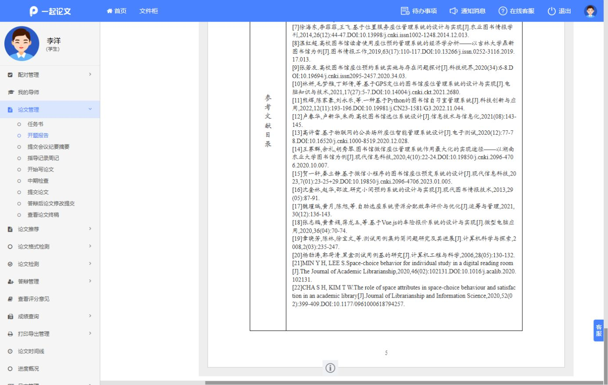

# 开题报告核查记录

核查日期：2026年11月17日。对应[开题报告](开题报告.md)，包括五项正文和22条参考文献。

网页六个填写字段与本稿一致，右侧预览已确认包含全部内容。网站只填写，未提交或保存草稿；刷新后可能丢失，恢复时使用本稿。网站参考文献计数显示817/1500，不代表英文、数字和标点的总字符数；服务端字数校验和保存状态未经提交验证。

## 参考文献

依据[知网文献截图汇总PDF](知网文献截图/任务书参考文献_知网截图汇总.pdf)逐条核对作者、题名、刊物及截图可见的出版信息，并阅读截图中的摘要。核查范围不包括文献全文，不能据此宣称详细方法或结论均已验证。

本次网页稿有三处修订：

- 第12条：`2021,(08):143-145`规范为`2021(08):143-145`。
- 第13条：`2020,(12):77-78`规范为`2020(12):77-78`。
- 第22条：补入截图可见的`DOI:10.1177/0961000618794257.`。原题录缺少该DOI属于信息不完整，不是与截图冲突。

第1条保留`2020,1(03):13-20`。[期刊官网“引用本文”](http://bjb.tjl.tj.cn/CN/10.16384/j.cnki.lwas.2020.03.003)明确列出`2020, 1(3): 13-20`，支持卷号1。此前仅因知网截图没有显示卷号而判断该卷号错误，现已撤回。截图未显示某字段，不等于该字段错误。

| 编号 | 截图支持的研究主题 | 题录核查结果与边界 |
| --- | --- | --- |
| 1 | 高校图书馆空间预约服务调查 | 可见题录对应；卷号1另有期刊官网明确支持。 |
| 2 | 清华大学智能座位管理系统 | 可见题录对应；截图未显示29卷，保留原字段，未独立确认。 |
| 3 | 座位预约系统现状与实现 | 可见题录与摘要主题对应。 |
| 4 | 中国药科大学在线预约案例 | 可见题录与摘要主题对应。 |
| 5 | 自习区系统升级改造 | 可见题录与摘要主题对应。 |
| 6 | 座位管理系统设计与实现 | 可见题录与摘要主题对应。 |
| 7 | 座位管理中的位置服务 | 可见题录对应；不能由此推断持续在场识别效果。 |
| 8 | 预约使用行为的经济学分析 | 可见题录与摘要主题对应。 |
| 9 | 预约系统实施及问题 | 可见题录与摘要主题对应。 |
| 10 | GPS定位座位管理 | 可见题录对应；不能由此推断具体部署精度。 |
| 11 | Python自习室管理系统 | 可见题录与摘要主题对应。 |
| 12 | 高校图书馆选位系统 | 可见题录对应；已规范年份与期号间的标点。 |
| 13 | 物联网座位管理 | 可见题录对应；已规范标点；摘要未证明具体传感器或持续检测机制。 |
| 14 | 微信座位系统服务应用 | 可见题录与摘要主题对应。 |
| 15 | 微信小程序座位预定 | 可见题录与摘要主题对应。 |
| 16 | 研究小间预约 | 可见题录对应；截图未显示29卷，保留原字段，未独立确认。 |
| 17 | 选座资源分配效率评价优化 | 可见题录与摘要主题对应。 |
| 18 | Vue.js业务系统案例 | 支持应用案例表述，不能证明Vue 3特定API。 |
| 19 | 测试用例集约简 | 可见题录对应；截图未显示2卷，保留原字段，未独立确认。 |
| 20 | 黑盒测试用例基 | 可见题录对应；截图未显示28卷，保留原字段，未独立确认。 |
| 21 | 个人学习空间选择 | 可见题录对应；102131是文章编号，保留单个编号。 |
| 22 | 空间属性、空间选择与满意度 | 补充截图确认完整题名；已补全DOI。 |

所有截图证据均保存在上述原始PDF中。正文按用户要求采用作者姓名叙述，研究现状不带数字引用序号，参考文献保留1—22编号；是否符合学院最终引用格式，以学院规范为准。

两处综合表达仍需注意证据边界：本轮未比较不同位置服务或物联网方案的具体投入与维护成本；空间选择论文也不能直接证明必须保留时段维度。这些内容属于本课题的设计考虑，不能作为已核实的文献结论。

## 项目功能与规则

关键陈述已与源码核对。以下链接指向对应实现，源码存在不等于本轮重新运行了测试。

| 开题稿陈述 | 代码依据 | 核查边界 |
| --- | --- | --- |
| 学生、管理员和超级管理员三种角色 | [用户模型](../backend/src/models/user.model.ts)、[路由权限](../backend/src/routes/index.ts) | 使用角色与权限有实现依据。 |
| 按日期时段查询座位与维护资源 | [自习室服务](../backend/src/services/study-room.service.ts)、[座位页面](../frontend/src/views/studyRoom/StudyRoomDetailView.vue) | 有查询、资源维护与界面实现。 |
| 个人记录归属与管理权限 | [预约服务](../backend/src/services/reservation.service.ts) | 服务端校验角色与记录归属。 |
| 参数配置与固定规则分开 | [运行设置](../backend/src/services/operational-settings.service.ts)、[时间规则](../backend/src/lib/reservation-time.ts) | 每日上限等可配置，签到窗口不是全部可配置。 |
| 学生取消存在时间和状态限制 | [预约服务](../backend/src/services/reservation.service.ts) | 已开始时段不能按学生普通取消规则处理。 |
| 并发冲突、重复请求与数据约束 | [预约服务](../backend/src/services/reservation.service.ts)、[预约表迁移](../backend/src/migrations/006-create-reservation-tables.ts) | 有事务、锁、幂等键及唯一约束，不据此宣称特定吞吐量或绝无缺陷。 |
| 预约快照与状态日志 | [预约服务](../backend/src/services/reservation.service.ts) | 主记录和初始日志在同一事务组织。 |
| 二维码和人工签到 | [签到服务](../backend/src/services/check-in.service.ts)、[签到令牌](../backend/src/lib/check-in-token.ts) | 校验归属、状态和窗口，签到不等于持续在场检测。 |
| 失约、停机补偿及到期完成 | [预约状态任务](../backend/src/jobs/reservation-state.job.ts)、[时间规则](../backend/src/lib/reservation-time.ts) | 区分正常运行与异常停机，不写成所有超时一律处罚。 |
| 限制期满恢复预约资格 | [违约服务](../backend/src/services/violation.service.ts) | 按限制截止时间判断，不是专门的限制到期定时任务。 |
| 管理动作留痕 | [签到服务](../backend/src/services/check-in.service.ts)、[预约服务](../backend/src/services/reservation.service.ts)、[违约服务](../backend/src/services/violation.service.ts) | 人工签到、管理取消和违约撤销有审计记录。 |
| 反馈分类与处理流转 | [反馈模型](../backend/src/models/feedback-ticket.model.ts)、[反馈服务](../backend/src/services/feedback.service.ts) | 有工单分类与状态流转。 |
| 日期、房间、时段统计与CSV导出 | [统计服务](../backend/src/services/statistics.service.ts)、[统计控制器](../backend/src/controllers/statistics.controller.ts) | 预约量、签到率及其他使用指标应分别说明口径。 |

Vue 3、TypeScript、Vite、Pinia、Vue Router、Element Plus、Axios、ECharts，以及Node.js、Express、Sequelize、MySQL、JWT均能对应项目依赖或实现。没有将Vue.js应用案例当作Vue 3特定API的依据。

## 进度与结果表述

学院关键节点按用户提供的时间截图核对。开发子阶段是研究安排，不是根据提交记录还原的实际完成历史。选题意义中的管理收益属于目标与预期用途，没有真实部署效果数据，不能宣称已经取得确定的利用率、满意度或效率改善。

本轮没有新增调查、实验或性能数值，也没有重新运行项目测试。测试内容属于拟验证范围；功能、规则与实际管理效果应分别评价。

## 网页预览

最新预览包含全部22条文献；本次修订在第12、13、22条。

