# 校园自习室预约管理系统操作手册

版本：V1.0 · 编写日期：2026 年 11 月 12 日 · 适用版本：当前项目 v0.1.0

适用对象：游客、学生、管理员、超级管理员 · 业务时区：Asia/Shanghai（北京时间）

本手册按实际菜单和页面操作编写。先在下方找到自己的角色，再按章节中的步骤操作。图片中的红色编号和框线用于定位操作区域；图片可单独打开查看原尺寸。

**图片说明：** 无特别标记的图片采集于 2026 年 11 月 12 日的本地系统。标注“历史演示”的图片保留原来的日期、账号、规则数值和编号，仅用于说明对应页面及结果，不与本次示例拼接为同一笔业务。配置弹窗截图表示填写位置，不代表已经提交。签到二维码及原始签到数据已遮盖。

## 目录

- [1. 访问系统与通用操作](#s1)
- [2. 注册、登录与个人中心](#s2)
- [3. 学生端：查询自习室与预约](#s3)
- [4. 学生端：签到](#s4)
- [5. 学生端：违约与预约限制](#s5)
- [6. 学生端：反馈工单](#s6)
- [7. 管理端：用户管理](#s7)
- [8. 管理端：自习室、开放时段与座位](#s8)
- [9. 管理端：预约与签到码](#s9)
- [10. 管理端：违约管理](#s10)
- [11. 管理端：反馈处理](#s11)
- [12. 管理端：仪表盘与统计报表](#s12)
- [13. 系统运维与超级管理员设置](#s13)
- [14. 设计系统展示页](#s14)
- [15. 自动业务与常见问题](#s15)
- [附录 A：角色—页面—操作—章节—截图覆盖表](#coverage)
- [附录 B：示例与截图核对说明](#evidence)

## 角色权限与功能索引

| 角色 | 可以使用的功能 | 推荐阅读 |
| --- | --- | --- |
| 游客 | 浏览开放自习室及座位信息、注册、登录、主题切换 | 第 1—3 章 |
| 学生 | 个人中心、自习室查询、创建和取消本人预约、签到、本人违约查询、反馈提交与结果查询 | 第 1—6、15 章 |
| 管理员 | 个人中心、仪表盘、用户管理、自习室与座位管理、预约管理、人工核验、签到码、违约规则与撤销、反馈处理、报表、系统状态与配置查看、设计系统 | 第 7—15 章及第 2 章 |
| 超级管理员 | 管理员的全部管理功能，另可新建管理员、修改“系统运维”中的全局业务参数 | 第 7.4、13.2 节 |

管理员登录后进入管理仪表盘，学生登录后进入自习室首页。学生业务操作使用学生账号演示，管理账号不作为学生预约或提交反馈。**普通管理员可以在“违约管理”页保存违约规则；“系统运维”中的全局参数表单仅超级管理员可修改。**

## 1. 访问系统与通用操作

### 1.1 打开系统、游客浏览与桌面导航

**用途与角色：** 所有角色用于访问系统；游客可先查看开放空间。

**前置条件：** 前后端和数据库已由维护人员启动。本地演示地址为 [自习室首页](http://localhost:43081/home)，正式使用时改为学校提供的地址。启动步骤见[项目文档索引](README.md#本地启动)。

1. 在浏览器地址栏输入系统地址，进入自习室首页。
2. 使用左侧菜单切换页面。未登录时显示“浏览自习室、登录、注册”；登录后显示当前角色的菜单。
3. 在页面右上角确认当前姓名和角色，避免用错账号。
4. 游客点击自习室卡片的“查看座位”浏览详情；需要预约时先登录学生账号。

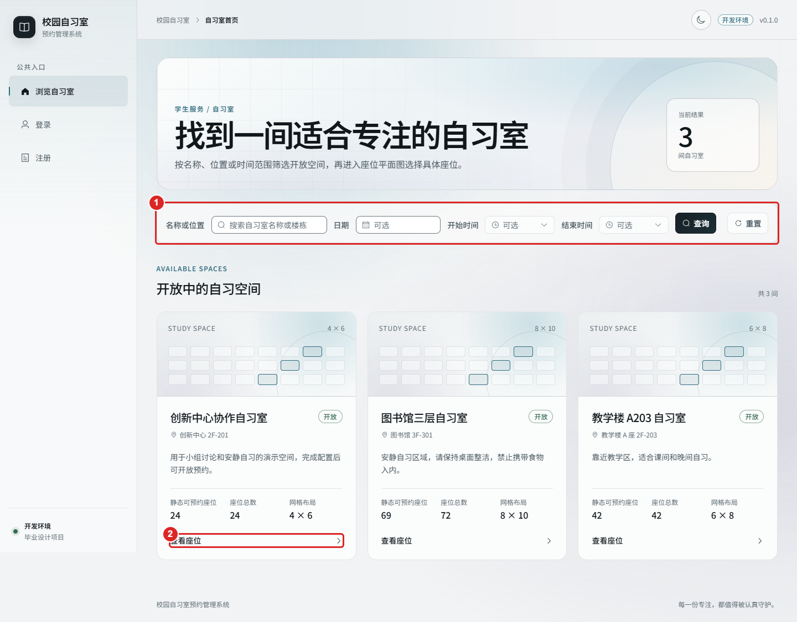

*图01：①首页筛选区域；②卡片上的“查看座位”。卡片中的静态可预约座位数不等于某一具体时段的实时空位数。*

**结果：** 显示符合条件的开放自习室；左侧菜单指示当前页面。关闭或停用的自习室不会作为正常开放空间提供预约。

### 1.2 手机端导航与深浅主题

1. 手机或窄屏下，点击页面左上角的菜单按钮，展开“主导航”。
2. 点击所需菜单项，页面跳转后抽屉自动收起；也可关闭抽屉继续查看原页面。
3. 点击右上角太阳/月亮图标切换浅色或深色主题，再次点击可切回。

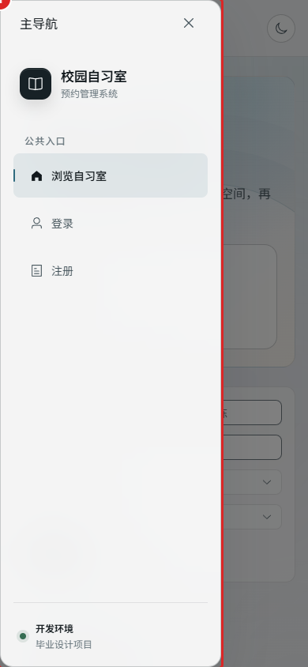

*图03：①手机端“主导航”；实际菜单随登录角色变化。*

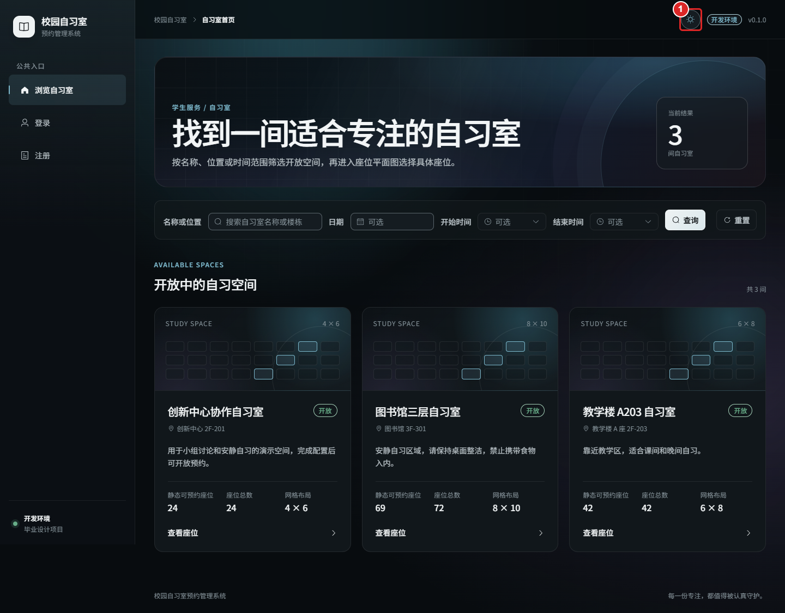

*图02：①主题切换按钮。主题切换不会提交表单或改变业务记录。*

**结果：** 可在窄屏中访问同一组角色菜单，界面显示为所选主题。手机摄像头签到的权限与访问地址要求见第 4 章。

### 1.3 查询、重置、分页与重新加载

1. 在列表顶部填写条件，例如名称、学号、日期或状态，再点击“查询”；报表页对应按钮为“生成报表”。
2. 点击“重置”清除筛选并按页面默认条件重新读取。
3. 多页列表在底部点击页码、上一页或下一页；提供每页条数选择时可切换 10、20、50 条等页面选项。
4. 看到“刷新”“刷新座位”时，可点击读取最新状态；看到“重试”或“重新加载”时，先检查网络，再点击重试。

**结果与注意：** 查询只影响当前列表，不修改数据；没有符合条件的数据时显示空列表，不代表系统故障。分页只在数据量达到显示条件时出现。筛选和分页示例见图21、图32、图37。

## 2. 注册、登录与个人中心

### 2.1 注册学生账号

**用途与角色：** 游客创建学生账号。管理账号由超级管理员创建，不通过学生注册获得。

1. 点击“注册”，或访问 `/register`。
2. 填写下表字段，核对两次密码一致。
3. 点击“注册”提交；有字段错误时，按提示修改后重新提交。
4. 出现“注册成功，请登录”后，用新用户名和密码登录。

| 字段 | 填写要求 |
| --- | --- |
| 学号 | 必填，4—32 位字母、数字或连字符，不与已有学号重复 |
| 用户名 | 必填，4—32 位字母、数字或下划线，不与已有用户名重复 |
| 显示名称 | 必填，2—64 个字符，用于界面显示 |
| 邮箱 | 可选，填写时需符合邮箱格式 |
| 密码 | 8—32 位可打印半角字符，至少包含字母和数字，不含空格 |
| 确认密码 | 与密码完全一致 |

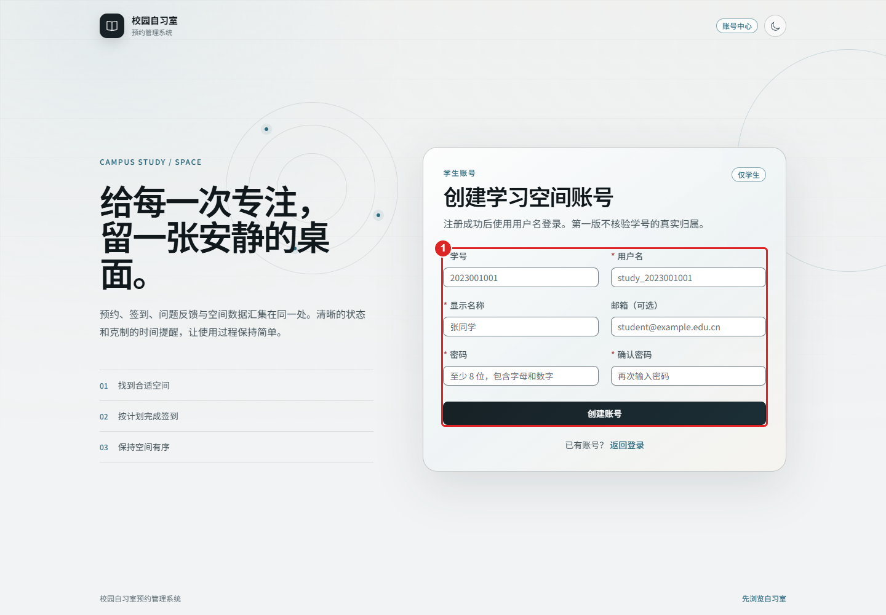

*图05：①注册信息填写区域。示例截图未填写真实密码。*

**结果与注意：** 注册成功生成学生账号并跳转登录页。学号或用户名已存在时，更换信息或使用已有账号登录；不要连续重复点击提交。

### 2.2 登录、会话失效与退出

1. 打开 `/login`，输入**用户名** 及密码，不将显示名称当作登录用户名。
2. 点击“登录”。学生进入自习室首页；管理员和超级管理员进入管理仪表盘。
3. 登录失败时按提示核对账号、密码和停用状态；账号被停用需联系管理员处理。
4. 使用结束后点击业务页面右上角的“退出”。

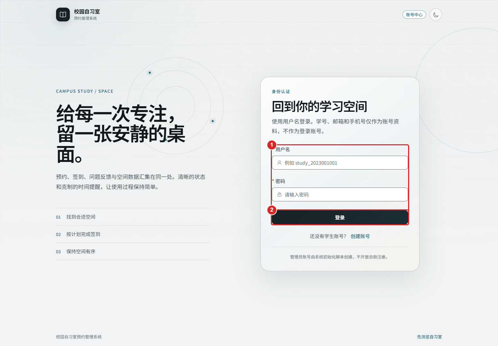

*图04：①用户名与密码；②登录按钮。*

**结果与注意：** 退出后返回登录页。登录失效时需重新登录；更改密码后所有设备上的原会话均失效。恢复被停用账号也需要重新登录，旧会话不会自动恢复。公共设备使用结束务必退出。

### 2.3 查看与修改个人资料

**角色与入口：** 已登录的学生及管理人员，左侧“个人中心”→“个人资料”。

1. 查看顶部学号、用户名、身份、有效违约次数及预约权限。
2. 在“个人资料”中修改显示名称、邮箱、手机号或头像地址。
3. 头像填写可访问的图片 URL，非本地文件路径；无需头像可清空地址。
4. 点击“保存资料”，等待成功提示，再核对页面显示。

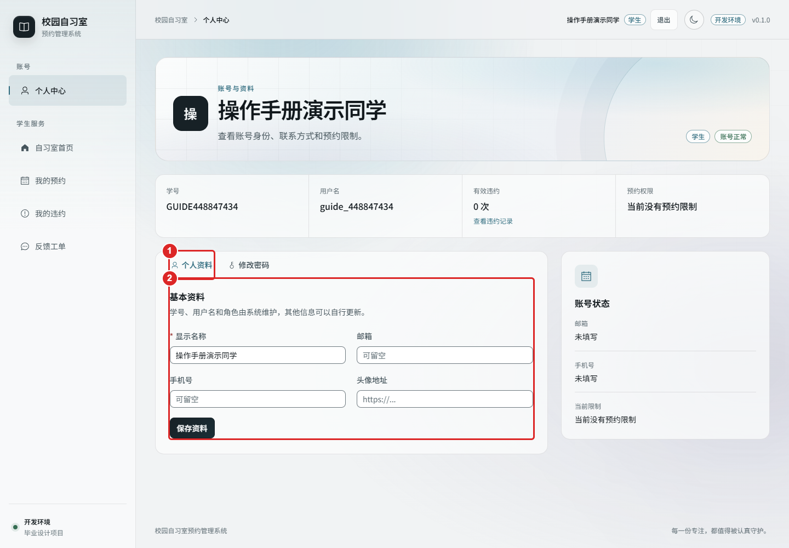

*图07：①个人资料标签；②可编辑资料区域。*

**结果与注意：** 保存后更新个人展示信息。学号、用户名和角色由系统维护，不在个人资料表单中修改。学生可点击“查看违约记录”进一步查看限制来源。

### 2.4 修改密码

1. 在个人中心切换“修改密码”。
2. 输入当前密码、新密码和确认新密码；新密码遵循注册时的密码要求。
3. 点击“修改密码”，根据错误提示修正当前密码或两次输入不一致等问题。
4. 成功后重新登录，使用新密码进入系统。

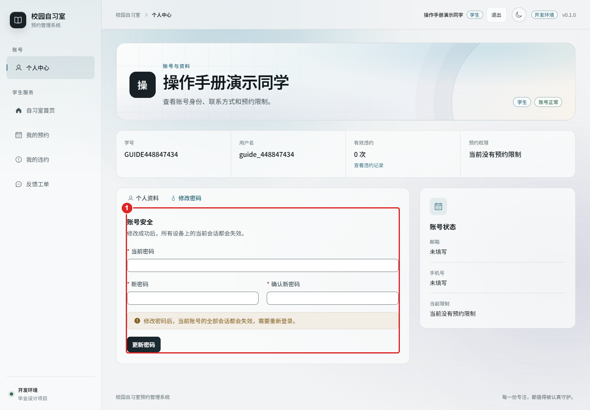

*图08：①当前密码、新密码、确认密码及提交区域。*

**结果与注意：** 原密码及原登录会话失效。本手册截图只展示空表单，不展示或修改已有使用者的密码。

## 3. 学生端：查询自习室与预约

### 3.1 查询自习室与查看座位状态

**入口：**“自习室首页” `/home`。游客可浏览；提交预约需学生登录。

1. 在首页输入“名称或位置”，按需选择日期和开始、结束时间，再点击“查询”。时间条件用于筛选空间，具体预约仍需在详情页选择完整开放时段。
2. 点击目标自习室的“查看座位”，进入 `/study-rooms/自习室编号`。
3. 在详情页选择预约日期，再点击一个尚未开始的开放时段。
4. 查看座位平面图和图例；需要最新结果时点击“刷新座位”。

| 显示状态 | 含义及可操作性 |
| --- | --- |
| 空闲／可用 | 当前日期、时段可选择；最终以提交时校验为准 |
| 已预约 | 该时段已被占用，不能选择 |
| 维修 | 暂不提供预约，可查看相关说明 |
| 停用 | 不提供预约 |
| 空白网格 | 过道或未设置座位的位置，不可选择 |

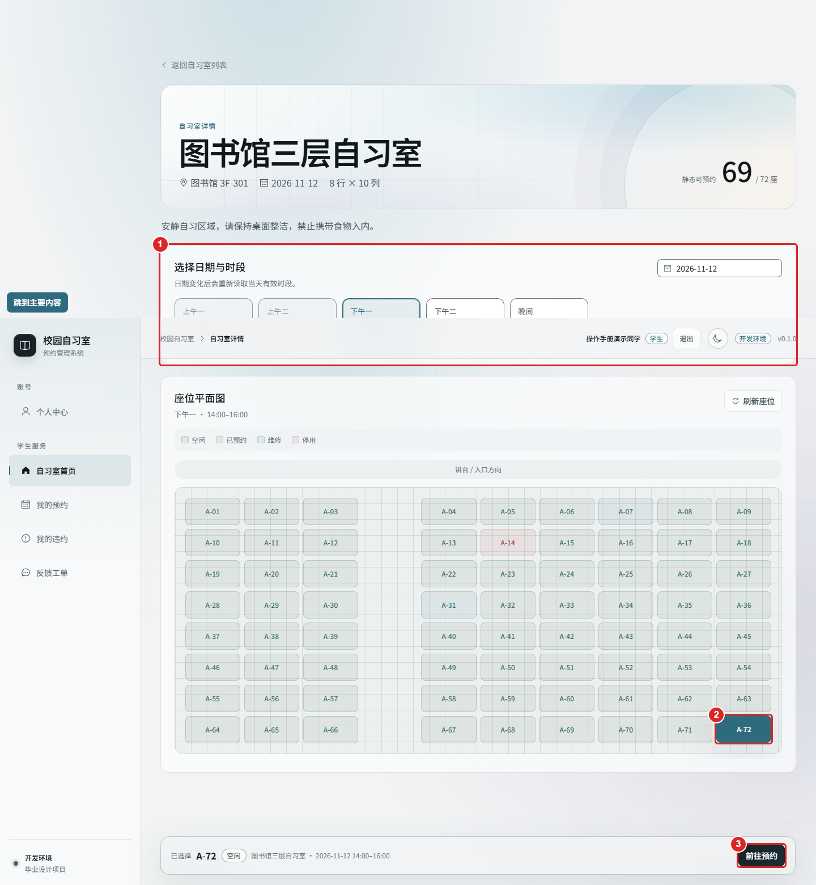

*图09：①日期及时段；②已选座位；③“前往预约”。本次示例为图书馆三层自习室 A-72；具体空位会随使用情况变化。*

**结果与注意：** 选中后底部显示自习室、日期、时段和座位。已开始的时段不可再创建预约；无有效开放时段或日期未到资源生效日时，更换日期或联系管理员。

### 3.2 确认并提交预约

**前置条件：** 学生账号正常且不处于预约限制期，所选时段未开始，有可用座位，未超过当日有效预约上限且无重叠预约。

1. 选中空闲座位，点击“前往预约”。
2. 在确认页逐项核对日期、时段、座位、自习室及页面规则。
3. 点击“提交预约”，等待“预约创建成功”，不要重复点击。
4. 记录成功页中的预约编号、签到窗口；点击“查看预约详情”或“我的预约”继续操作。

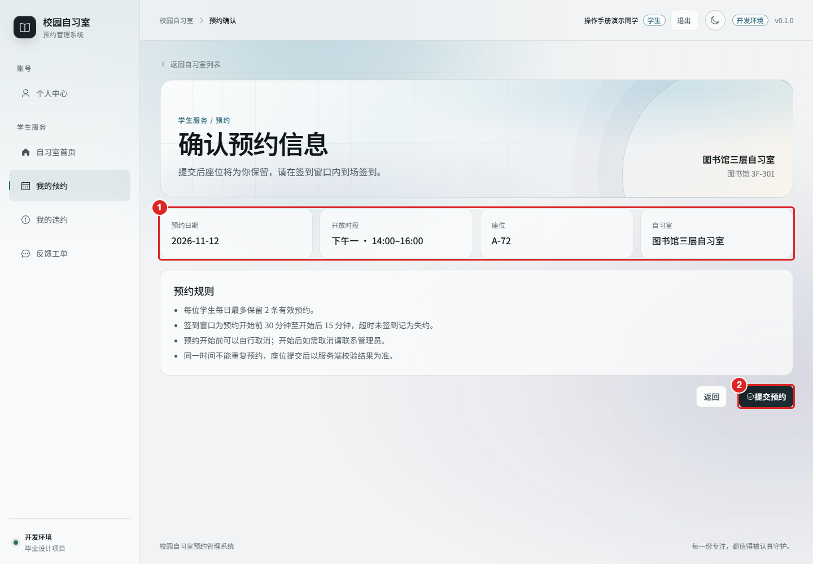

*图10：①预约信息；②“提交预约”。确认页中的“每日最多 2 条”是当前页面展示文案，实际有效预约上限以管理员配置及提交结果为准。*

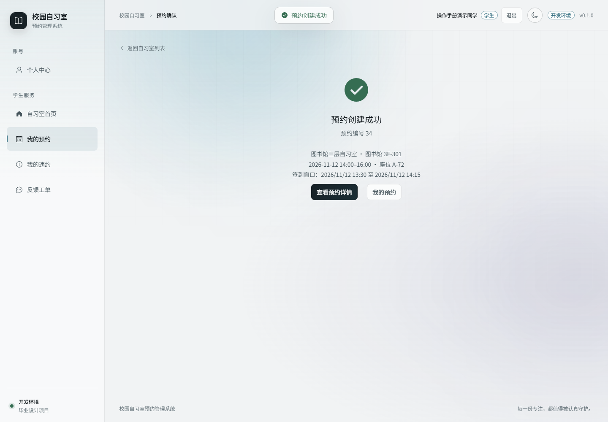

*图11：本次学生示例创建成功的预约 #34；与图09、图10及后续本人取消截图对应。*

**结果与注意：** 新预约状态为“待签到”，相应座位在该时段被占用。若被他人抢先预约或出现冲突，使用确认页的“刷新座位状态”“重新选择座位”，重新核对后提交；页面选中座位本身不等于已成功预约。

### 3.3 查询我的预约、详情与状态时间线

1. 点击“我的预约” `/reservations`。
2. 按日期或状态筛选，必要时翻页查看。
3. 点击预约卡片的“查看详情”，进入 `/reservations/预约编号`。
4. 核对预约位置、座位、时间、状态、签到窗口、签到时间和签到方式。
5. 向下查看“状态时间线”，了解本人、管理员或系统执行过的状态变更。

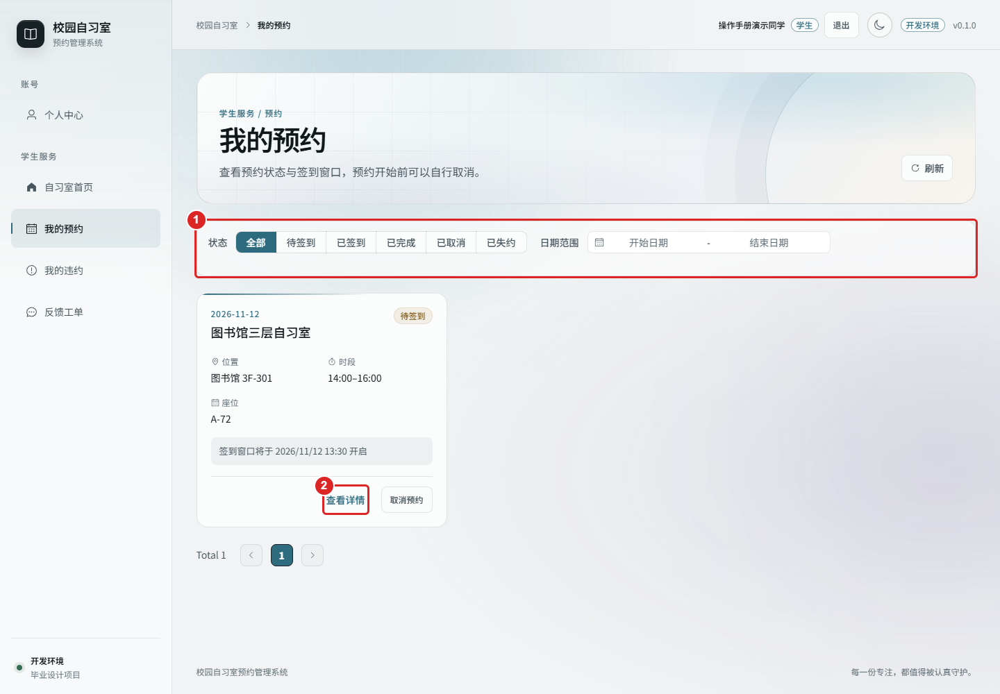

*图12：①状态筛选；②“查看详情”。预约状态包括待签到、已签到、已完成、已取消和已失约。*

**结果与注意：** 学生只查看本人的预约。点击“刷新”读取最新状态；页面时间均按北京时间显示。创建成功页不是预约详情页，需点击相应按钮进入详情。

### 3.4 取消本人预约

**前置条件：** 预约仍为“待签到”，并且尚未到预约开始时间。

1. 从“我的预约”点击“取消预约”，或进入详情后点击同名按钮。
2. 在弹窗中核对取消对象，可选填取消原因；填写时需为 2—255 个字符。
3. 点击“确认取消”；不取消则点击“返回”。
4. 在详情中核对“已取消”状态、取消说明和时间线。

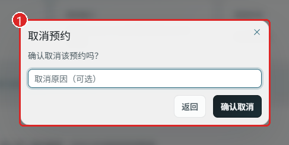

*图13：取消确认弹窗；学生原因可不填写。*

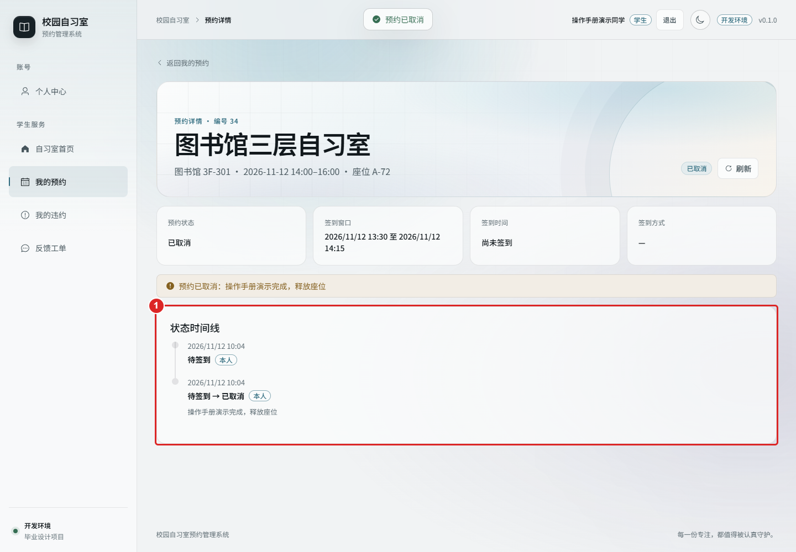

*图14：①预约 #34 的取消结果和时间线，原因是“操作手册演示完成，释放座位”。*

**结果与注意：** 取消后释放该预约的座位占用。已开始的预约学生不能自行取消，需联系管理员；已签到、已完成、已失约的预约不能通过此操作取消。已取消记录仍保留用于查询。

## 4. 学生端：签到

### 4.1 查看签到窗口

**入口：**“我的预约”→“查看详情”→“扫码签到”。

1. 打开待签到预约详情，确认自习室及座位。
2. 查看“签到窗口”及“未到签到时间／窗口已开启／窗口已关闭”提示。
3. 在窗口内到场，使用对应自习室的签到二维码。

当前签到窗口为**预约开始前 30 分钟至开始后 15 分钟**。例如 14:00 开始的预约，窗口为 13:30—14:15；实际操作以预约详情显示的绝对时间为准。管理员人工核验同样受窗口限制。

### 4.2 摄像头扫码、上传二维码与粘贴签到数据

| 方式 | 操作步骤 | 完成表现 |
| --- | --- | --- |
| 摄像头扫码 | 在窗口内点击“扫一扫”→“开启摄像头扫码”，允许浏览器摄像头权限，对准本自习室二维码；不继续时点击“停止扫描”或“收起” | 识别后自动提交，成功后预约显示“已签到” |
| 上传二维码图片 | 点击“扫一扫”→“上传二维码图片”，选择清晰完整的二维码图片 | 识别后自动提交，无需再手动粘贴 |
| 粘贴签到数据 | 将管理员提供的完整原始数据粘贴到输入框；也可点“读取剪贴板”，再点“提交签到” | 成功后清空输入，详情显示签到时间与方式 |

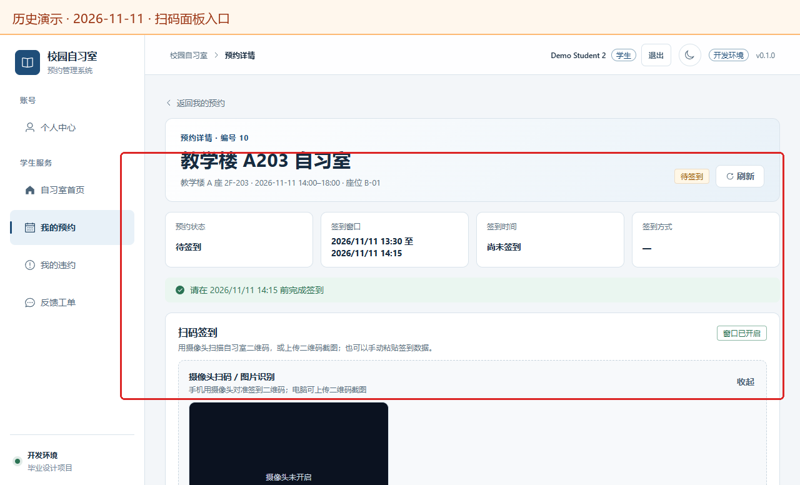

*图60（历史演示，2026-11-11）：预约详情中的扫码区域。该图用于定位入口，不表示本次重新调用摄像头成功。*

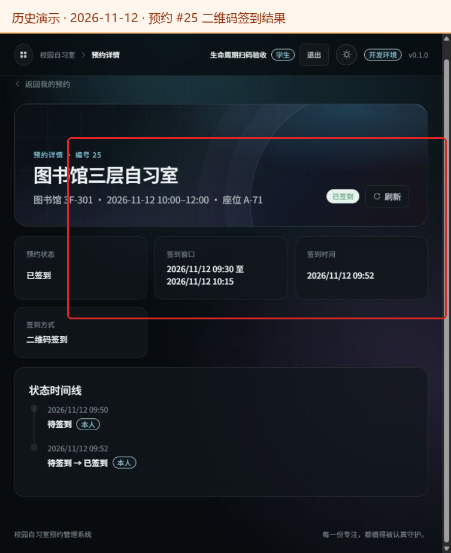

*图59（历史演示，2026-11-12）：独立验收账号的预约 #25 已签到，详情显示“二维码签到”和签到时间；与本手册预约 #34、#35 无关。*

**结果与注意：** 成功后显示“已签到”，时间线增加签到事件。二维码长期有效不意味着任意时间均可签到，仍须满足预约、房间及签到窗口校验；不要编辑签到数据中的字段。

摄像头需设备支持并获得浏览器授权。电脑可直接使用上传图片；手机访问远端站点应由维护人员提供 HTTPS 地址，手机上的 `localhost` 不指向演示电脑。摄像头被拒绝时改用上传图片或联系管理员核验，不能以修改系统时间绕过窗口。

## 5. 学生端：违约与预约限制

**用途与入口：** 学生点击“我的违约” `/violations`，查看本人有效违约、当前规则及限制状态。

1. 查看页面顶部的有效违约次数、违约阈值和预约权限；限制期内显示截止时间。
2. 选择全部、有效或已撤销等页面状态条件，查看对应记录。
3. 核对发生时间、来源预约、自习室、座位及撤销说明。
4. 对记录有疑问时，通过反馈工单说明预约编号、发生时间和核实依据。
5. 管理员处理后点击“刷新”，重新核对记录及预约权限。

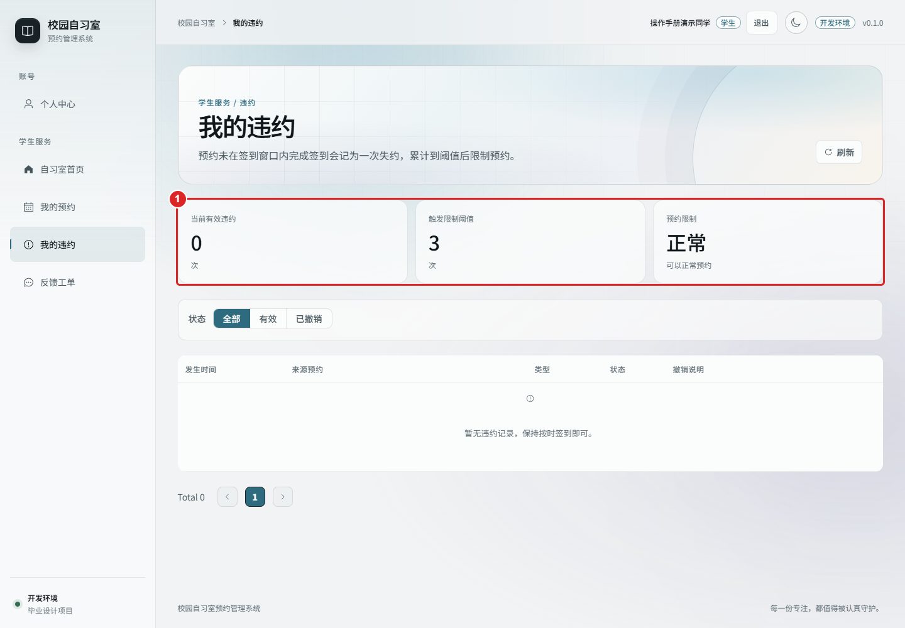

*图15：①本次演示账号无违约、当前阈值为 3 次，预约权限正常。实际规则可能调整。*

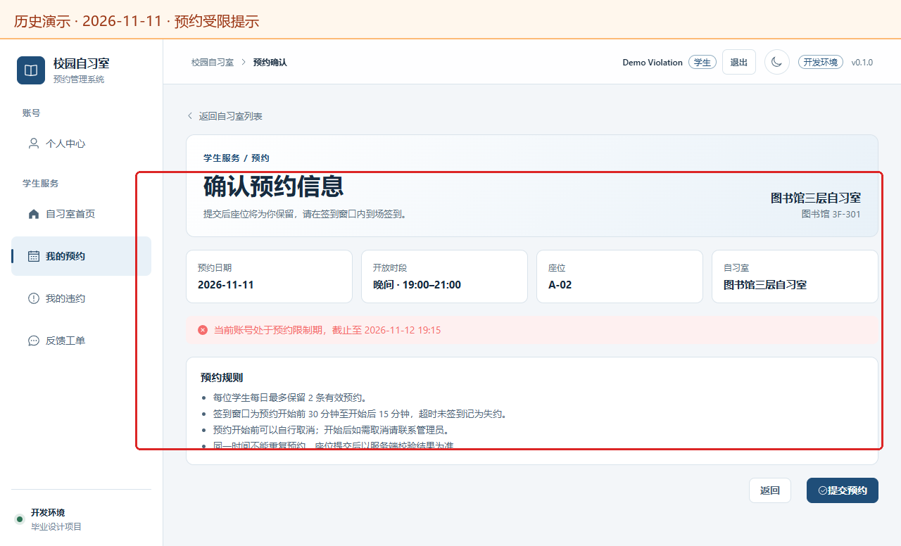

*图61（历史演示，2026-11-11）：限制期内预约被拒绝的提示；图中历史规则或时间不作为当前默认值。*

**结果与注意：** 正常调度下超过签到截止时间未签到，会由系统记录失约；达到阈值后限制**新增预约**。限制到期不自动删除历史违约记录。撤销后是否解除限制取决于剩余有效次数，详见第 10 章。

## 6. 学生端：反馈工单

### 6.1 提交反馈、关联自习室与座位

**入口：**“反馈工单” `/feedback`→“提交反馈”。需学生登录。

1. 选择“占座举报、设施问题、环境问题、其他问题”之一。
2. 按问题关联自习室；需要具体座位时，先选自习室再选座位。占座举报必须选择自习室和座位，其他类型可按实际关联。
3. 填写 5—1000 个字符的问题描述，包含时间、位置、现象及必要编号。
4. 点击“提交反馈”，等待成功提示和工单编号。
5. 点击“查看我的反馈”直接查看刚提交工单；需要另报问题时点击“继续提交”。

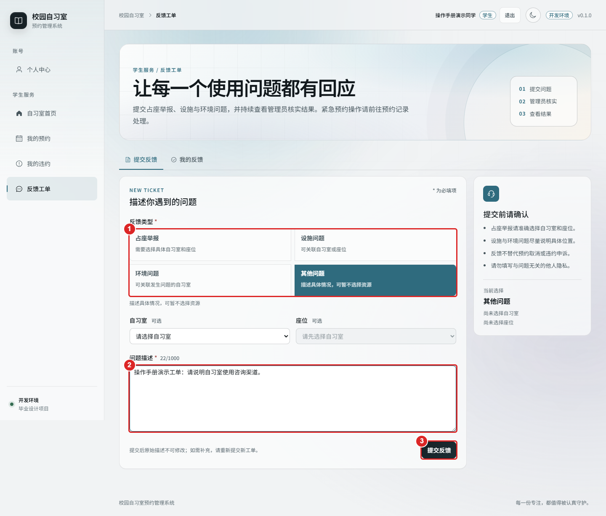

*图16：①反馈类型；②问题描述；③提交按钮。本次示例为使用渠道咨询。*

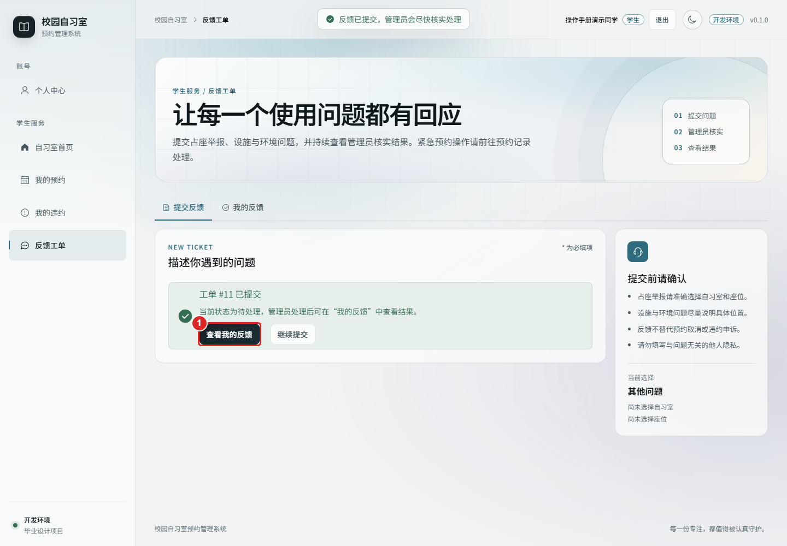

*图17：①“查看我的反馈”，可直接进入刚提交的工单详情。*

**结果与注意：** 新工单为“待处理”。提交后原始描述不可编辑；补充内容需重新提交并注明原工单编号。维修或停用的座位也可以关联反馈，不代表可以预约。超过频率限制时稍后再试。

### 6.2 查询工单与查看处理结果

1. 切换“我的反馈”，按状态、类型筛选后点击“查询”；点击“重置”恢复默认。
2. 点击目标记录的“详情”，核对问题描述、关联资源、提交、开始及结束时间。
3. 查看“管理员处理结果”。待处理或处理中时可稍后刷新。
4. “已驳回”时阅读原因，需要补充事实可另提新工单并引用原编号。

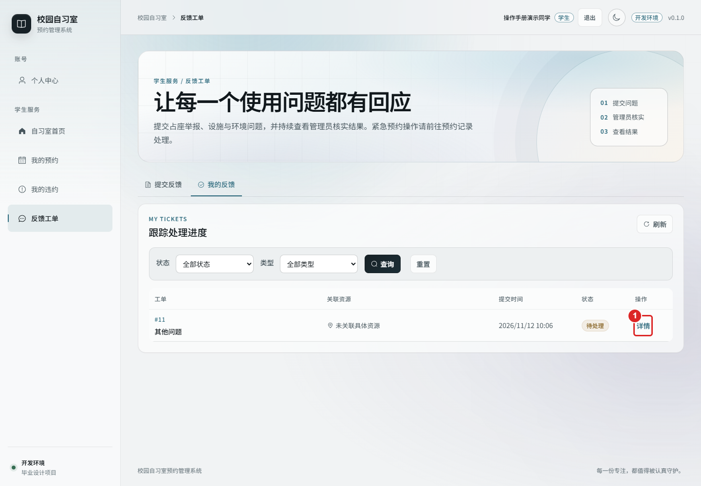

*图18：①工单详情入口，可在列表查看状态及关联资源。*

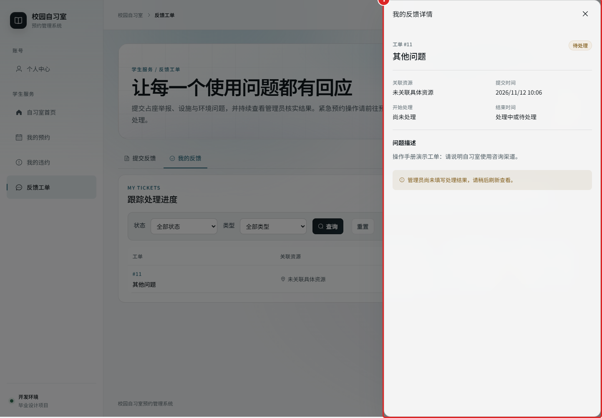

*图19：①本次咨询工单 #11 的待处理详情。*

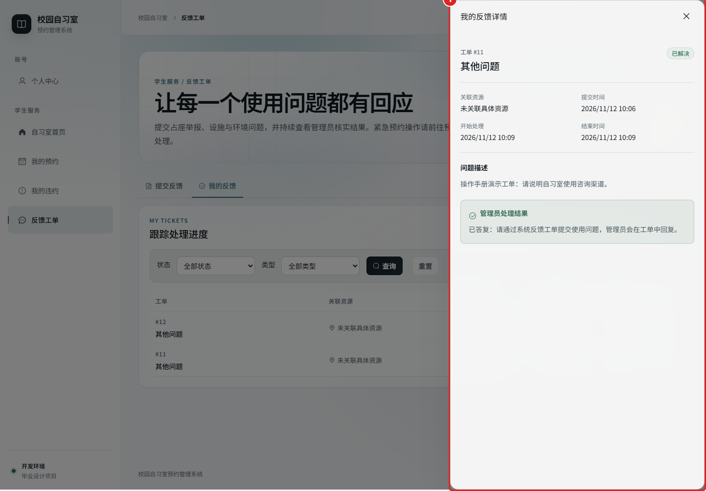

*图57：①工单 #11 已解决，学生可见管理员答复，与第 11 章处理示例对应。*

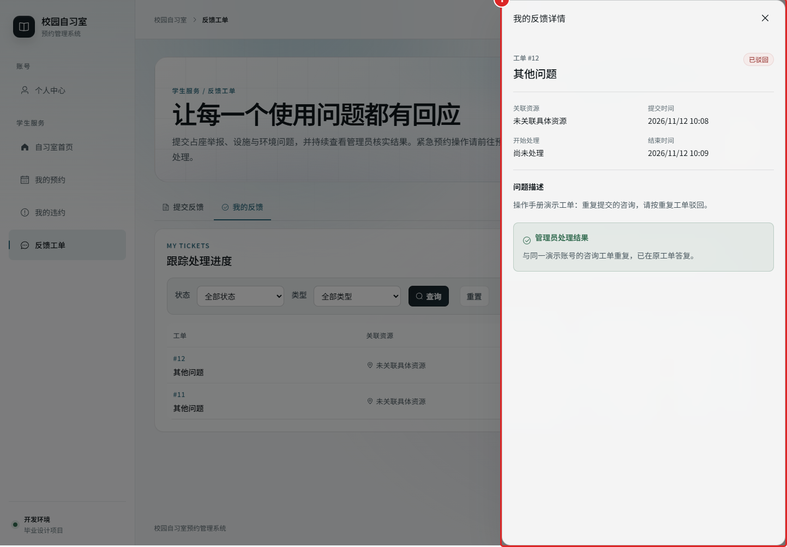

*图58：①重复咨询工单 #12 已驳回，可见驳回说明；它与 #11 是两张不同工单。*

**结果与注意：**“已解决”和“已驳回”均为结束状态，不能继续修改原工单。学生详情显示处理结果及关键时间；完整管理员处理时间线在管理端查看。

## 7. 管理端：用户管理

### 7.1 查询用户、查看详情及操作记录

**角色与入口：** 管理员、超级管理员，“用户管理” `/admin/users`。

1. 按需输入学号、用户名，选择角色、账号状态，再点击“查询”。
2. 查看列表中的身份与状态；使用底部分页查阅更多账号。
3. 点击“详情”，在“用户详情”抽屉中查看账号资料、违约及预约限制等信息。
4. 向下查看“操作记录”，核对操作人、动作、时间、原因等；记录加载失败时点击“重新加载”。

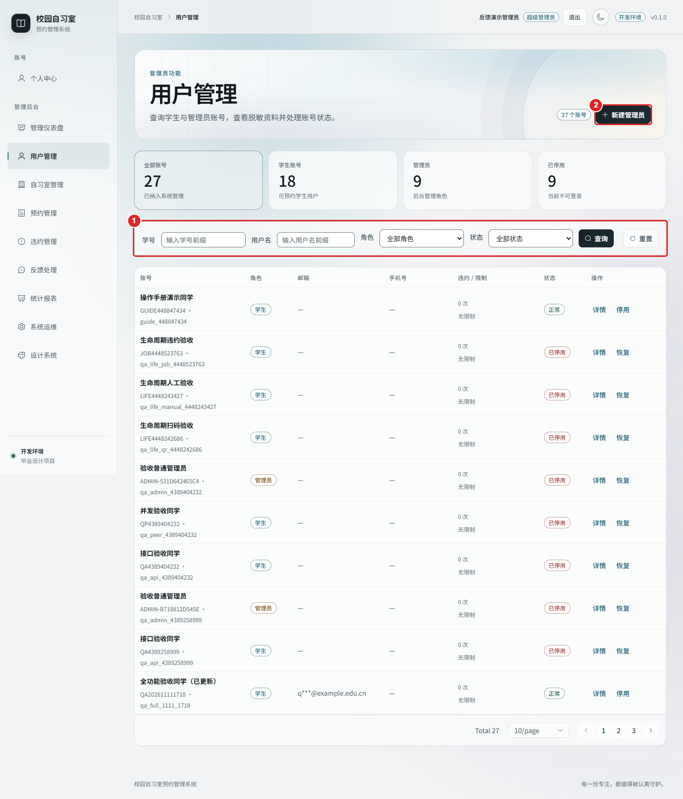

*图21：①筛选区；②“新建管理员”仅超级管理员显示。*

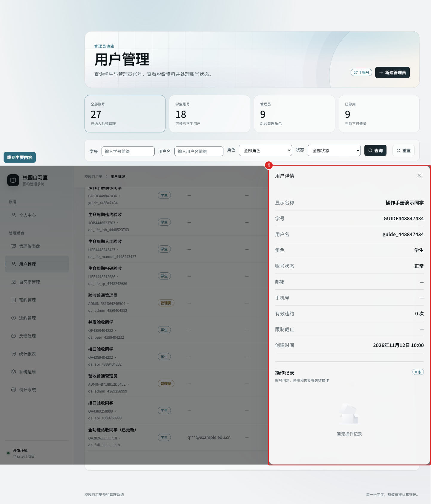

*图23：①用户详情抽屉。核对身份后再对目标用户执行管理操作。*

**结果：** 查看符合条件的账号和历史管理记录；查询、查看详情不会改变用户状态。

### 7.2 停用账号

**前置条件：** 目标账号正常，且不是当前登录管理账号；至少保留一个正常管理账号。

1. 在目标账号所在行点击“停用”。
2. 在“停用账号”弹窗核对显示名称、学号和用户名。
3. 填写 2—255 个字符的操作原因，点击“确认停用”；放弃则点“取消”。
4. 查看状态变为“停用”，行操作变为“恢复”。

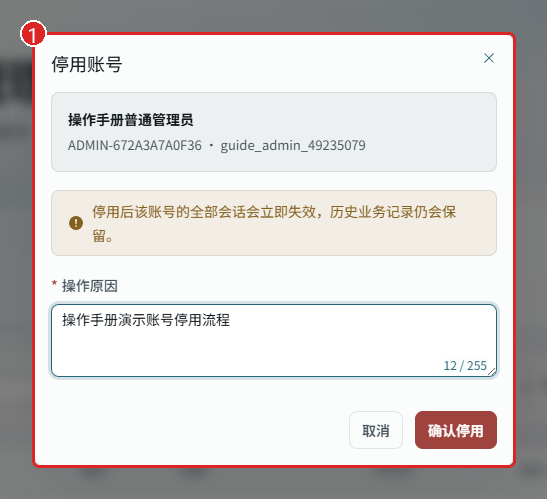

*图48：①本次专用普通管理员账号的停用确认，不涉及已有使用者账号。*

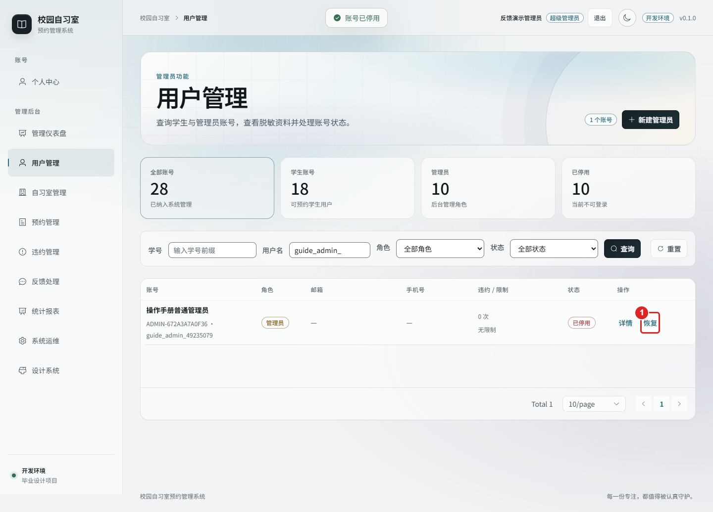

*图49：①停用后显示“恢复”入口。*

**结果与注意：** 目标用户全部原会话立即失效，历史业务记录保留。停用账号不是删除账号，也不替代处理其预约。系统禁止停用自己和停用最后一个正常管理账号。

### 7.3 恢复账号与核对操作记录

1. 查询“停用”状态用户，在目标行点击“恢复”。
2. 填写恢复原因，点击“确认恢复”。
3. 确认状态恢复正常，再通知用户重新登录。
4. 点击“详情”，核对停用和恢复两次操作记录。

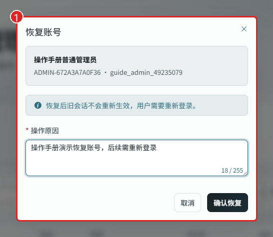

*图50：①恢复确认及原因。旧会话不会因恢复账号重新有效。*

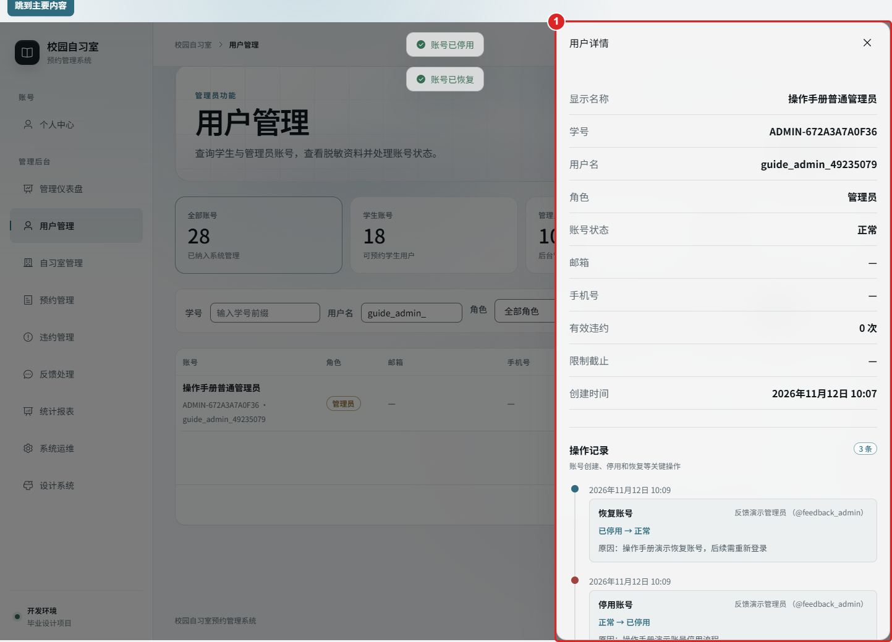

*图51：①专用演示账号的详情及操作记录。*

**结果：** 账号可重新登录，原业务记录保留；恢复原因和操作人可追溯。

### 7.4 超级管理员新建管理员

**角色：** 仅超级管理员。普通管理员页面不显示“新建管理员”。

1. 进入“用户管理”，点击“新建管理员”。
2. 填写用户名、显示名称、初始密码、确认密码；按需填写邮箱和手机号。
3. 用户名和密码遵循第 2 章规则，核对无误后点击“创建管理员”。
4. 成功后在列表中按用户名查询，确认角色为“管理员”，通过适当渠道交付初始登录信息。

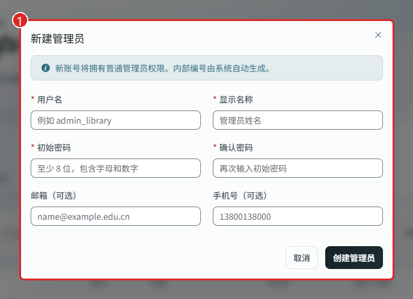

*图22：①新建管理员对话框。表单截图未提交、未展示密码。*

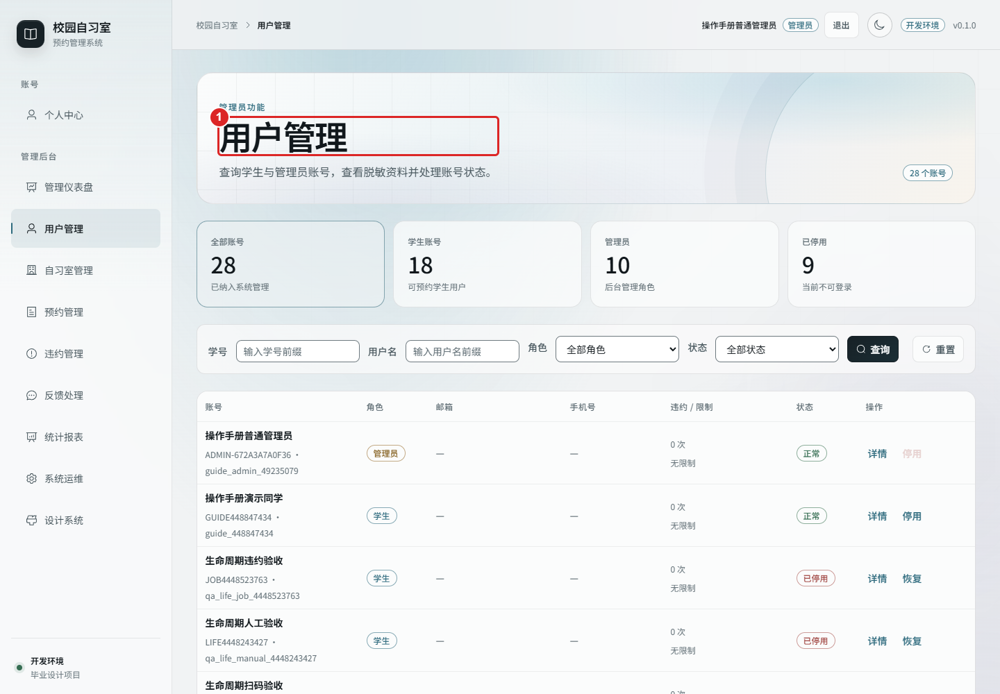

*图56：普通管理员可查询管理用户，但没有“新建管理员”入口。*

**结果与注意：** 此表单创建普通管理员，不提供任意选择超级管理员角色的功能。新管理员首次使用后可在个人中心修改初始密码。

## 8. 管理端：自习室、开放时段与座位

### 8.1 查询与新增自习室

**角色与入口：** 管理员、超级管理员，“自习室管理” `/admin/study-rooms`。

1. 根据名称或位置、房间状态查询，查看容量、网格和生效日期。
2. 点击“新增自习室”，填写名称、位置、使用说明及网格行列数。
3. 网格行数、列数均为 1—50 的整数；合理预留过道位置。
4. 点击“保存”，确认出现“自习室已创建，默认关闭”。
5. 继续配置开放时段、座位，再按第 8.2 节开放。

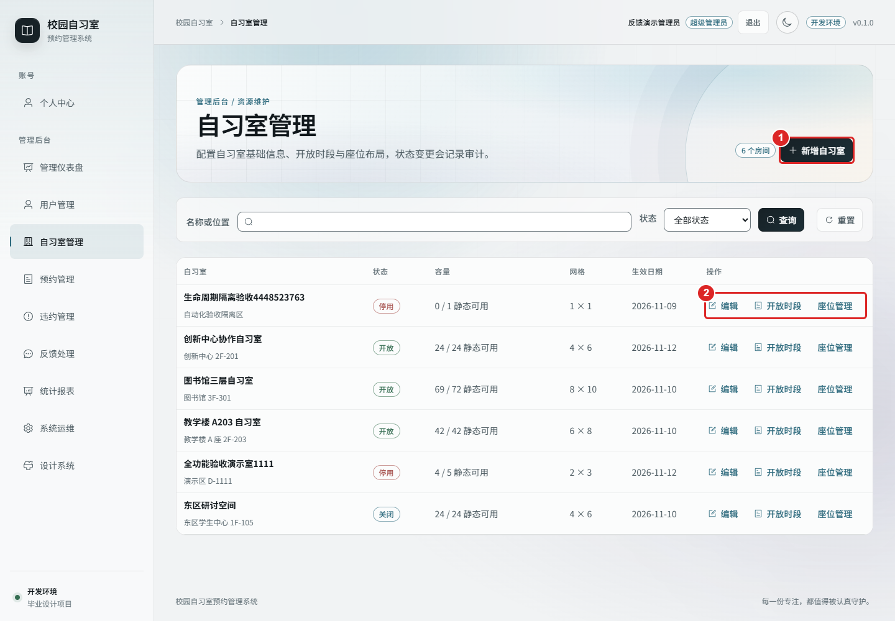

*图24：①新增入口；②同一房间的“编辑、开放时段、座位管理”。*

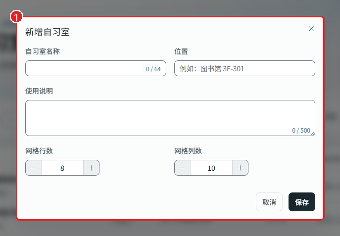

*图25：新增房间填写位置。保存后默认关闭，不会立即进入学生端可预约列表。*

**结果与注意：** 创建房间只建立基础资料，不会自动生成座位或开放时段。新增资源按页面生效日期使用，不以截图日期推算。

### 8.2 编辑资料、开放、关闭、停用与恢复

1. 在目标房间点击“编辑”，修改名称、位置、说明或网格。
2. 在“状态”选择“开放、关闭、停用”，点击“保存”。
3. 状态变更出现确认框时核对目标状态，点击“确认修改”。
4. 保存后核对列表状态和生效日期，必要时到学生端验证可见性。

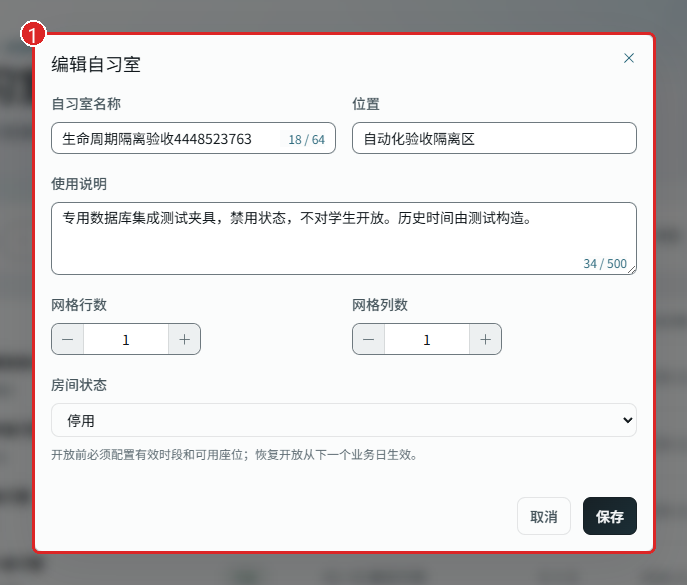

*图26：房间资料、网格与状态在同一编辑表单中维护。*

| 状态／动作 | 行为与约束 |
| --- | --- |
| 开放 | 必须在目标生效日具备有效启用时段及可用座位；重新开放通常从下一个上海业务日生效 |
| 关闭 | 暂不接受新预约；仍有待签到预约时，需先处理这些预约才能关闭 |
| 停用 | 停止提供该房间；仍有待签到预约时同样先处理 |
| 恢复 | 在编辑表单中选择“开放”，检查资源和生效日期后保存，没有独立“恢复房间”按钮 |
| 修改位置 | 存在活动预约时拒绝变更，以免预约地点发生歧义 |
| 缩小网格 | 先移动超出新范围的座位，再保存网格 |

**结果与注意：** 状态更新后保留原历史记录。房间若因无有效时段或可用座位自动关闭，需补足资源后重新开放；不应把自动关闭误认为保存失败。

### 8.3 新增、编辑、启用及停用开放时段

1. 在目标房间点击“开放时段”，查看时段名称、时间范围、状态及生效日期。
2. 点击“新增时段”，填写时段名称、开始时间、结束时间，并选择“启用”或“停用”。
3. 结束时间必须晚于开始时间；同一房间启用时段不得重叠，时间选项按半小时列出。
4. 点击“保存”，回到列表核对新增结果。
5. 编辑已有时段时点击对应“编辑”，修改名称、时间或状态后保存；启停也在该编辑表单中完成。

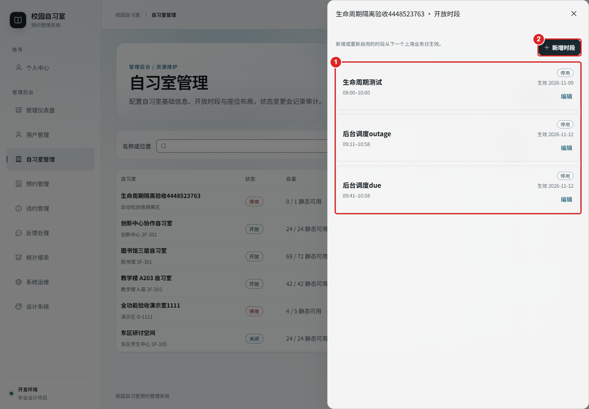

*图27：①时段列表；②新增入口。每条时段显示自己的生效日期。*

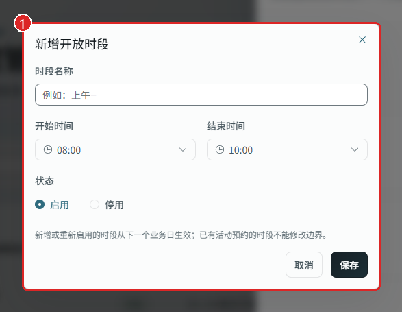

*图28：名称、开始与结束时间、启用／停用状态的填写位置。*

**结果与注意：** 新增或重新启用从下一个业务日生效。存在活动预约时不能修改起止时间；停用时段前需处理仍待签到的预约。停用最后一个有效时段可能使房间自动关闭。

### 8.4 查看布局与批量生成座位

1. 在目标房间点击“座位管理”，查看座位总数、静态可用、维修、停用及平面图。
2. 点击“批量生成”，输入批次前缀、生成行数、列数、起始行和起始列。
3. 需要预留过道时，在“跳过坐标（过道）”填写 `行:列`，多个坐标使用英文逗号，例如 `1:4, 2:4, 3:4`。
4. 查看预计生成数及编号范围，确认不超出网格、不与已有座位位置或编号冲突。
5. 点击“确认生成”，核对布局和数量。

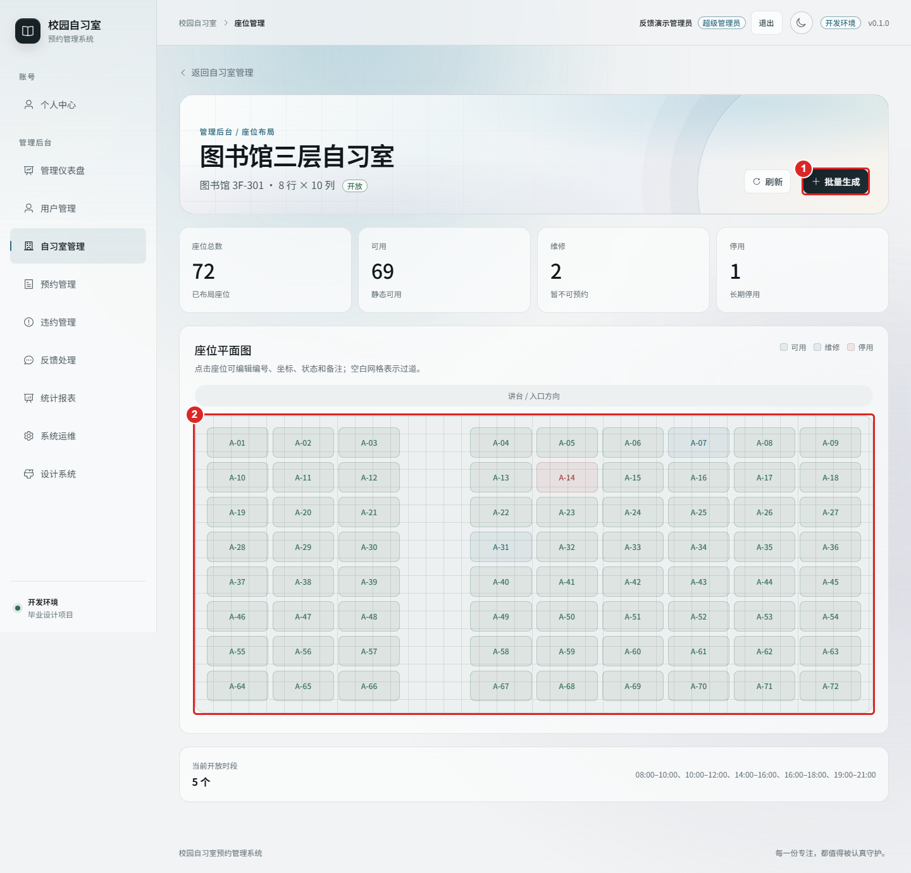

*图29：①批量生成；②座位布局，点击座位可编辑。后台静态可用数不代表某时段实时空位。*

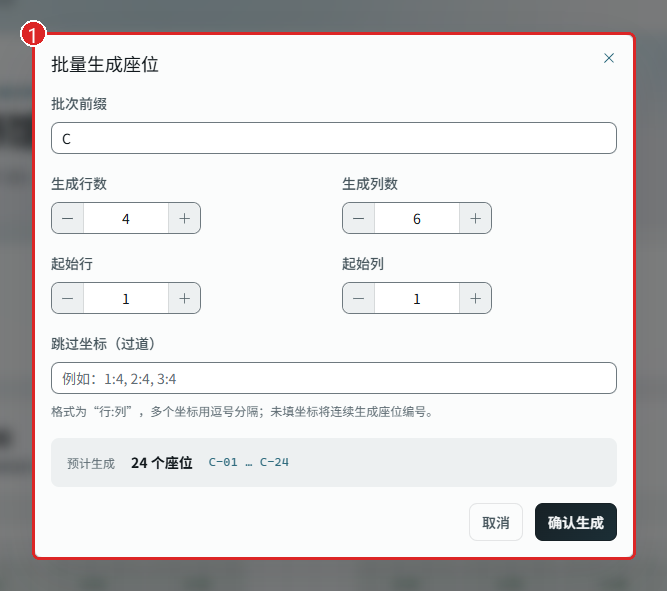

*图30：批次前缀、生成范围、跳过位置和预计生成数。*

**结果与注意：** 单批最多 500 个位置，至少保留一个座位；前缀为 1—8 位字母或数字，编号按预览连续生成。跳过坐标不得重复，应处于生成范围内。新座位从下一个业务日生效；表单截图只是填写示意，不代表在已有布局上又生成一批。

### 8.5 编辑座位、设置维修／停用及恢复

1. 点击平面图中的目标座位，在“编辑座位”中核对编号、行列坐标。
2. 按需修改编号、位置或备注，状态选择“可用、维修、停用”。
3. 设为“维修”时必须填写维修说明；恢复时选“可用”。
4. 点击“保存”，查看平面图状态和顶部数量变化。

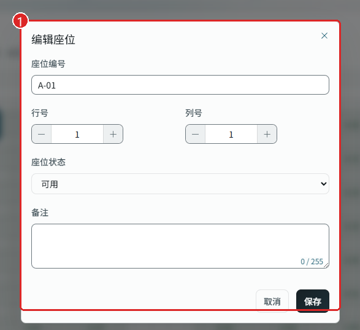

*图31：编号、坐标、状态及备注填写区域。*

**结果与注意：** 维修和停用座位不能被学生预约；恢复可用从下一个业务日生效。仍有待签到预约的座位需先处理预约再设为不可用；存在活动预约时不可修改编号或坐标。移除最后一个可用座位可能使房间自动关闭。

## 9. 管理端：预约与签到码

### 9.1 查询预约、查看详情与时间线

1. 点击“预约管理” `/admin/reservations`。
2. 输入精确学号，按需选择自习室、状态、日期范围，点击“查询”。
3. 在目标行点击“详情”，查看学生、房间、座位、签到窗口、签到情况和状态时间线。
4. 使用“重置”、刷新或分页浏览其他记录。

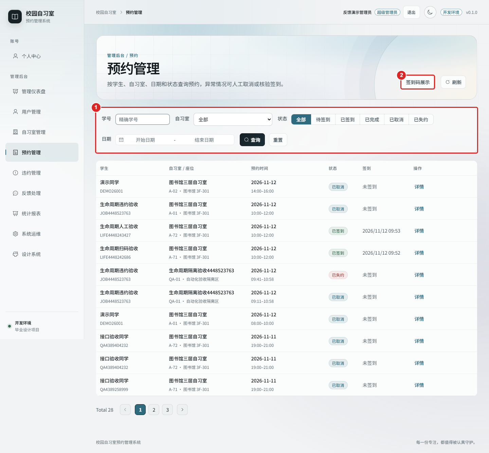

*图32：①查询区域；②“签到码展示”。列表中的管理动作随预约状态变化。*

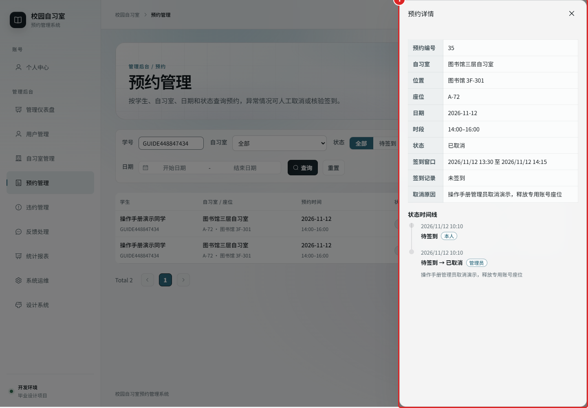

*图66：①本次专用学生账号预约的管理端详情，显示签到窗口与操作时间线。*

**结果与注意：** 管理端可查询不同学生的预约；执行取消和核验前务必核对学号及预约编号。

### 9.2 管理员取消预约

**前置条件：** 目标预约仍为待签到。管理员可以处理已开始但仍待签到的预约，不能取消已签到或其他终态预约。

1. 查询并定位目标预约，点击该行“取消”。
2. 核对弹窗中的学号、自习室和座位，填写 2—255 个字符的必填取消原因。
3. 点击“确认取消”，等待提示。
4. 在列表或详情查看“已取消”、操作原因和管理员时间线记录。

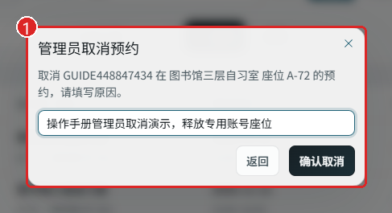

*图53：①本次专用学生账号预约 #35 的管理员取消确认，与学生自行取消的 #34 是不同记录。*

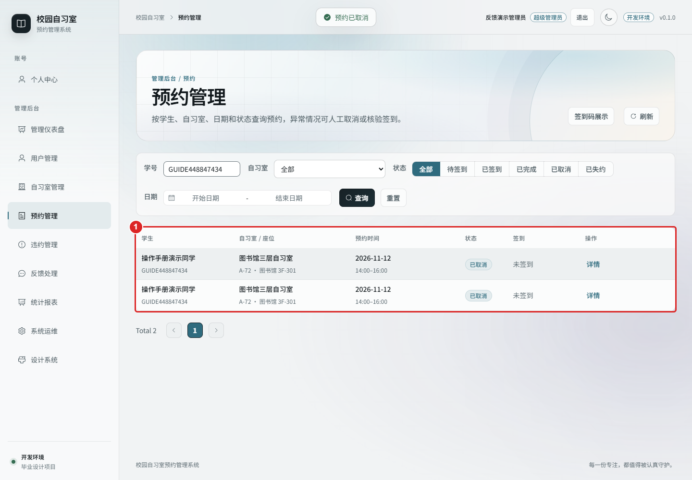

*图54：①专用账号两笔预约均已取消，当前演示不再占用这些座位。*

**结果：** 预约取消并释放座位，原因和操作者保留。不能用此操作把已签到记录改回未签到。

### 9.3 人工核验签到

**用途：** 学生无法自行扫码时，管理员到场核实身份后代为签到；预约须处于待签到状态且在签到窗口内。

1. 按学号找到预约，核对本人、预约房间和座位。
2. 点击“人工核验”，填写 2—255 个字符的核验原因。
3. 点击“确认签到”，查看成功提示。
4. 在详情中核对状态“已签到”、方式“管理员核验”、签到时间和时间线。

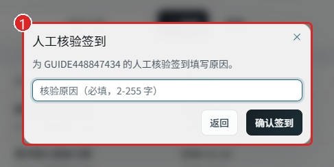

*图52：①人工核验确认窗口。本次仅展示填写位置，未对不在窗口内的 #35 强行签到。*

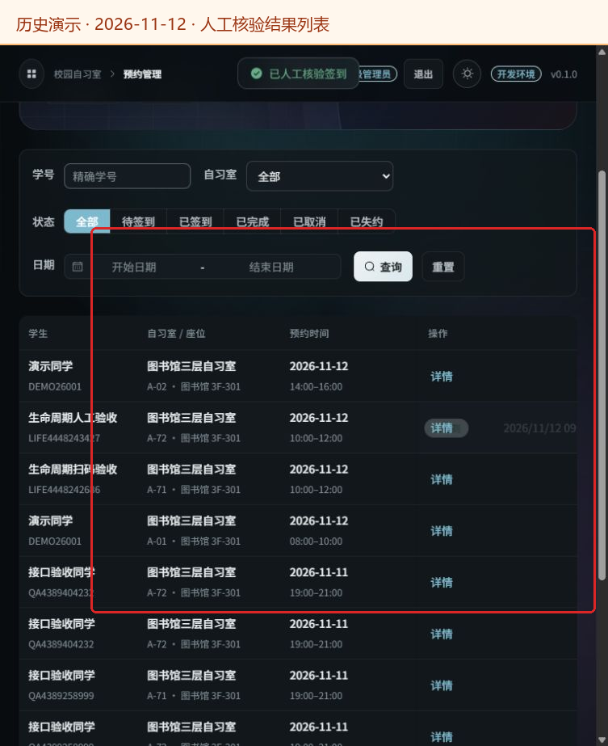

*图65（历史演示，2026-11-12）：历史验收中的人工核验成功后列表；本图与本次待签到示例不构成同一次操作。*

**注意：** 人工核验不会绕过签到窗口、预约状态或重复签到校验。窗口未开启或已关闭时按提示处理，不能通过填写原因强制成功。

### 9.4 展示、刷新及复制签到码

1. 在“预约管理”点击“签到码展示”，进入 `/admin/reservations/check-in-code`。
2. 选择自习室，核对显示的位置和房间编号。
3. 在现场展示对应二维码供学生扫码。
4. 需要重新读取时点击“立即刷新”；使用原始数据方式时点击“复制签到码数据”，交给该房间的学生在签到窗口内提交。

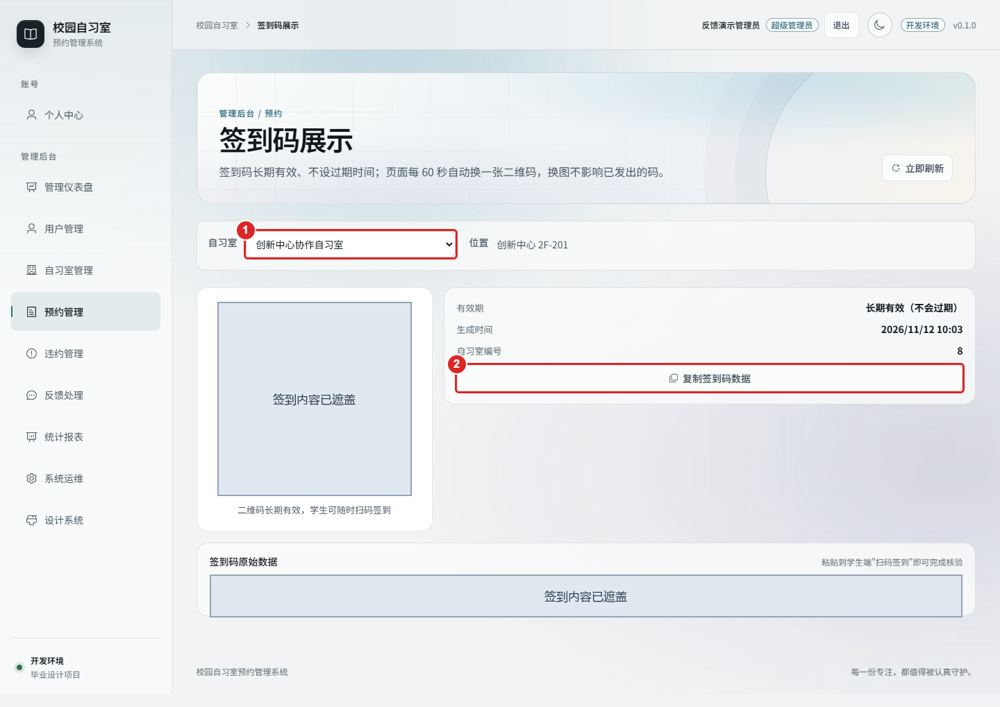

*图33：①自习室选择；②复制数据。二维码及下方原始签名数据已遮盖，图片不能直接用于签到。*

**结果与注意：** 页面显示所选房间的签到码及生成时间，并每 60 秒自动换图。当前产品的二维码长期有效，刷新或换图不使已经发出的码失效；学生仍需有对应房间的待签到预约并在窗口内签到。

## 10. 管理端：违约管理

### 10.1 配置违约规则

**角色与入口：** 管理员、超级管理员，“违约管理” `/admin/violations`。

1. 查看“规则配置”中的“违约阈值”和“限制天数”。
2. 根据管理要求填写阈值 1—20 次、限制天数 1—90 天，均为整数。
3. 点击“保存规则”，等待成功提示，再刷新核对。
4. 与学生沟通新的管理规则；不要将历史截图中的演示数值当作当前配置。

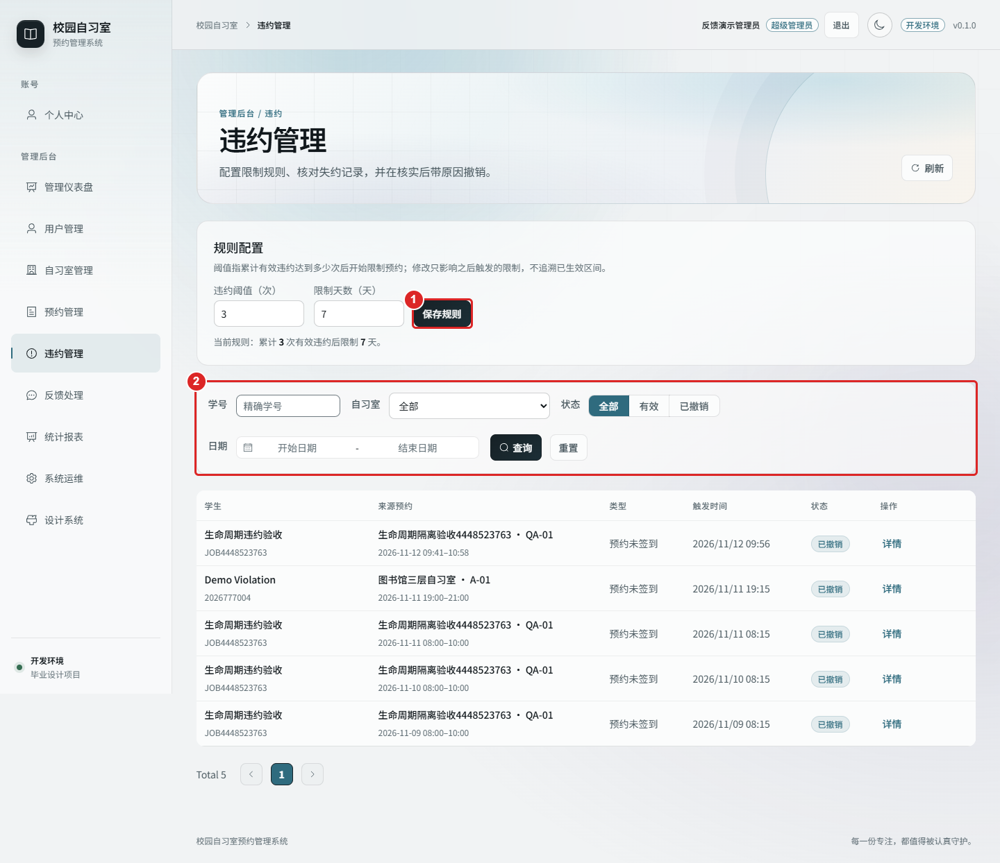

*图34：①保存规则；②违约记录筛选。普通管理员可通过本页维护这两项违约规则。*

**结果与注意：** 保存后规则供后续业务计算使用，不等于立即撤销历史违约或清空已有有效限制期。需要纠正具体记录时执行撤销；全局参数入口的权限另见第 13 章。

### 10.2 查询记录与查看详情

1. 输入学号，按需选择自习室、有效／已撤销状态、日期范围，点击“查询”。
2. 点击目标记录“详情”，核对学生、来源预约、预约时段、触发时间、说明和状态。
3. 对已撤销记录查看撤销时间及原因；点击“重置”恢复默认筛选。

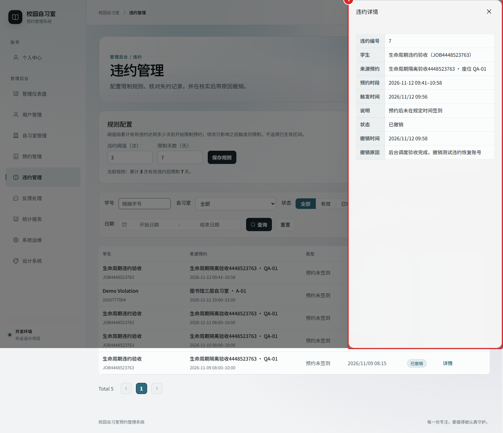

*图67：①现有违约记录的详情，包含来源预约、触发时间和撤销说明；本图用于说明字段，不与本次无违约的专用学生账号关联。*

**结果：** 确认违约所属学生与预约，避免撤销同名学生的其他记录。列表入口见图34，详情见图67；撤销前必须先核实事实。

### 10.3 撤销违约、核对限制解除

1. 在有效违约记录上点击“撤销”。
2. 填写 2—255 个字符的撤销原因，点击“确认撤销”。
3. 刷新列表，确认变为“已撤销”并保留撤销原因。
4. 请学生刷新“我的违约”或个人中心，核对有效次数和预约权限。

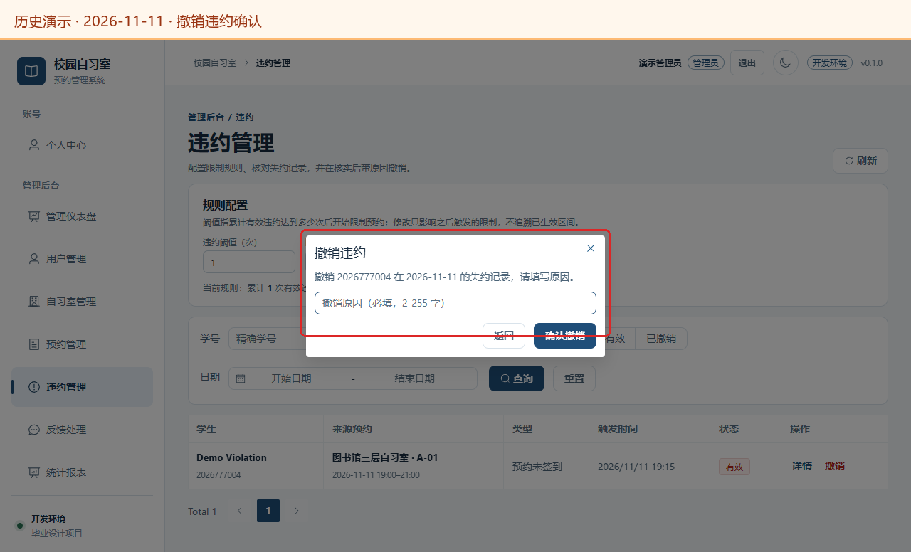

*图62（历史演示，2026-11-11）：撤销原因及确认位置。历史演示规则可能与当前规则不同。*

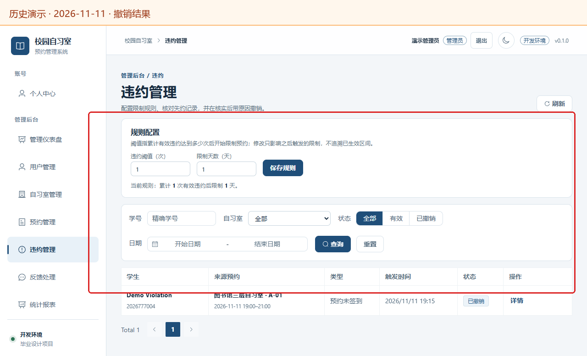

*图63（历史演示，2026-11-11）：原演示记录撤销后保留记录及说明，不是物理删除。*

*图64（历史演示，2026-11-11）：同一历史演示中，撤销后有效次数低于当时阈值，学生预约权限恢复。图中阈值 1 次不是当前默认值。*

**结果与注意：** 撤销后重新统计有效次数；低于当前阈值时清除预约限制，仍达到阈值时不能承诺立即恢复。违约撤销不会把原“已失约”预约改为“已签到”或恢复原座位。

## 11. 管理端：反馈处理

### 11.1 查看汇总、筛选队列与工单详情

1. 点击“反馈处理” `/admin/feedback`，查看待处理、处理中、已解决、已驳回汇总。
2. 点击状态汇总卡可切换对应状态；也可设置状态、类型、自习室、提交日期、学号和关键词，点击“查询”。
3. 点击目标记录的“处理”，在工单详情中核对学生、关联资源、问题描述和处理时间线。
4. 关闭抽屉返回队列，必要时刷新或重置筛选。

*图35：①状态汇总；②队列筛选。*

*图36：①详情抽屉，包含来源、描述、结果和处理时间线。*

**结果：** 可定位待处理任务及历史处理记录。最终操作以抽屉显示的当前状态为准，不同状态提供不同按钮。

### 11.2 开始处理并标记解决

**前置条件：** 工单为“待处理”，已核对来源及问题内容。

1. 在详情底部点击“开始处理”，在确认框再次点击“开始处理”。
2. 确认状态为“处理中”，按实际情况调查、维修或答复。
3. 点击“标记解决”，填写 2—1000 个字符的处理结果。
4. 点击“确认解决”，核对“已解决”、处理结果及时间线。
5. 学生在“我的反馈”查看同一工单，确认答复可见。

*图42：①开始处理；②驳回。本次工单 #11 来自第 6 章咨询示例。*

*图43：①“标记解决”，须先进入处理中，不能直接把待处理工单跳为已解决。*

*图44：①核实情况和最终答复填写位置。*

*图45：①工单 #11 的已解决详情；学生读取结果见图57。*

**结果与注意：** 工单进入结束状态，学生可立即查询结果。处理结果为必填；提交后不能再次修改原工单状态，应在确认前核对内容。

### 11.3 驳回工单并说明原因

**前置条件：** 工单为待处理或处理中，已核实需要驳回的原因。

1. 打开工单详情，点击“驳回”。
2. 在“处理结果”中填写 2—1000 个字符的驳回说明，写清事实及后续建议。
3. 点击“确认驳回”，查看“已驳回”和时间线。
4. 学生在“我的反馈”读取原因，必要时补充材料另报新工单。

*图46：①本次工单 #12 因重复咨询被驳回，原因指向已答复的原工单。*

*图47：①驳回结果；学生端显示见图58。*

**结果与注意：** 进入“已驳回”终态，不能再受理、解决或修改；原描述、结果和操作历史保留。

## 12. 管理端：仪表盘与统计报表

### 12.1 管理仪表盘

**角色与入口：** 管理员、超级管理员，“管理仪表盘” `/admin/dashboard`。

1. 选择统计日期，点击“刷新”。
2. 查看预约场次、已签到、失约和座位利用率指标卡。
3. 查看近七天预约与签到、签到率与失约率、自习室利用率排行、开放时段预约分布。
4. 对照页面下方“近七天指标对照”文字明细，读取准确数值。
5. 查看“实时聚合／历史冻结”和更新时间，判断数据所处阶段。

*图20：①指标卡；②数据状态。图表和文字明细来自同一组数据。*

**结果与注意：** 页面用于查看运营情况，不提供修改统计值的入口。没有已结算预约时，相关比率显示“暂无数据”或“—”，不应将其解释为 0% 的异常率。

### 12.2 生成报表与导出 CSV

1. 点击“统计报表” `/admin/reports`。
2. 设置日期范围，选择“按日期、按自习室、按时段”分组及自习室范围。
3. 点击“生成报表”，查看图表、统计明细和当前筛选说明。
4. 确认范围正确后点击“导出当前结果”，等待浏览器下载 CSV。
5. 用电子表格软件打开下载文件，核对中文表头、日期范围及分组列；修改筛选后先重新生成，再导出。

*图37：①日期、维度和房间；②导出当前结果。本次实际下载文件为 `study-room-report-20261106-20261112.csv`。*

**结果与注意：** CSV 导出当前筛选对应的数据；无可导出数据、仍在加载或正在导出时按钮不可用。文件默认进入浏览器下载目录，文件名中的日期不固定。

### 12.3 指标口径

| 指标 | 阅读方法 |
| --- | --- |
| 预约数／预约场次 | 正常预约统计，不含取消预约；系统停机取消单独列示并从正常预约指标中排除 |
| 已签到 | 统计口径中的已签到场次，包含已完成预约对应的签到结果 |
| 已结算预约 | 已签到数 + 失约数，待签到预约不进入此分母 |
| 签到率 | 已签到数 ÷ 已结算预约数 |
| 失约率 | 失约数 ÷ 已结算预约数 |
| 利用率 | 已签到预约的计划座位分钟数 ÷ 可用计划座位分钟数，不是摄像头测得的实际在座时长 |
| 历史冻结 | 历史日期已生成固定统计快照；与当前实时业务记录不可简单逐条混算 |

**注意：** 表格百分比与 CSV 中的小数可能采用不同显示形式，例如页面 80% 对应 CSV 的 `0.8000`。计划容量存在业务日快照，资源当日停用不意味着已生成计划容量立即归零。

## 13. 系统运维与超级管理员设置

### 13.1 查看运行状态、后台任务与请求 ID

**角色与入口：** 管理员、超级管理员，“系统运维” `/admin/system`。

1. 点击页面顶部“刷新状态”，读取 API、数据库连接、运行时长和任务启用状态。
2. 查看服务版本、业务日期、时区等信息；数据库不可用时先联系维护人员检查连接。
3. 在“后台任务”核对预约状态任务、统计快照任务的状态、最近完成时间、耗时、连续失败及最近错误。
4. 需要排查问题时点击请求 ID 旁的“复制”，连同问题发生时间、操作页面及错误提示交给维护人员。

*图38：系统状态、任务执行结果及请求 ID 复制入口。请求 ID 用于定位本次请求，不是用户账号或登录凭证。*

**结果与注意：** 刷新只读取状态，不会手动执行任务。页面未提供启动、停止或立即运行后台任务的按钮。任务“等待调度”不一定是故障；连续失败或长期无最近完成记录时由维护人员排查。

### 13.2 超级管理员修改全局业务参数

**角色：** 仅超级管理员可修改本页参数；普通管理员可读、不可保存。

1. 在“系统运维”向下找到“全局业务参数”。
2. 按下表填写整数值，结合学校实际规则调整。
3. 点击“保存设置”，处理字段错误后重新提交。
4. 成功后刷新核对值，再到相关业务页面检查提示和可用范围。

*图39：①全局业务参数表单及保存入口。截图只展示现有配置，没有为拍图变更全局规则。*

*图55：①普通管理员可查看值，但表单和“保存设置”不可用。*

| 参数 | 允许范围 | 用途 |
| --- | --- | --- |
| 预约窗口（天） | 1—30 | 控制可预约日期范围，以页面显示和提交校验为准 |
| 每日有效预约上限 | 1—10 | 限制同一学生同一日期的有效预约数，待签到和已签到计入 |
| 创建预约限流（次/分钟） | 1—100 | 限制短时间重复创建请求 |
| 取消预约限流（次/分钟） | 1—100 | 限制短时间重复取消请求 |
| 反馈提交（次/分钟） | 1—60 | 限制每分钟工单提交次数 |
| 反馈提交（次/小时） | 1—1000 | 限制每小时工单提交次数 |
| 违约限制阈值（次） | 1—20 | 控制累计有效违约达到多少次触发限制，与违约管理页维护同一规则 |
| 限制天数（天） | 1—90 | 控制违约限制时长，与违约管理页维护同一规则 |

**结果与注意：** 当前实例保存后生效；多实例部署可能存在最多约 30 秒缓存差异。这里不提供修改签到前后窗口、数据库密码、系统时钟等功能。改变规则不等同于撤销历史记录或保证立即重算已有有效限制期。

## 14. 设计系统展示页

**用途与角色：** 管理员、超级管理员通过“设计系统” `/admin/design-system` 查看界面规范与组件示例。

1. 打开页面，查看整体视觉介绍及页面内章节导航。
2. 浏览颜色、字体层级、座位状态、按钮、表单及视觉效果示例。
3. 需要比较深浅主题时使用右上角主题按钮。
4. 查看完毕后从左侧菜单返回业务页面。

*图40：①展示页介绍，部分展示区域自带深色设计背景，即使全站处于浅色主题也可能显示深色。*

**结果与注意：** 本页用于界面规范展示；示例座位、按钮和表单不代表真实预约、工单或系统参数，不应把点击展示组件当作完成业务操作。

## 15. 自动业务与常见问题

### 15.1 自动状态变化

| 自动行为 | 触发条件与页面表现 | 使用者如何核对 |
| --- | --- | --- |
| 自动失约 | 正常调度下，待签到预约超过签到截止时间后由后台任务转为已失约，生成有效违约记录 | 查看预约详情时间线及“我的违约”；不是到点在前端立即同步切换 |
| 已失约座位不再放出 | 同一失约预约对应的时段仍保持占用规则，不重新放出供抢约 | 不将“失约”等同于“取消” |
| 自动完成 | 已签到预约到结束时间后，后台任务将其更新为已完成 | 刷新预约详情，查看系统完成事件 |
| 预约限制到期 | 当前时间达到限制截止时间后，不再因该过期区间阻止新增预约 | 刷新个人中心／我的违约，再按当前预约规则提交；历史违约仍保留 |
| 撤销后解除限制 | 撤销导致有效次数低于当前阈值时清除限制 | 查看撤销说明、有效次数及预约权限 |
| 资源自动关闭 | 资源配置导致房间无有效时段或可用座位时，系统可能自动关闭房间 | 管理员查看保存提示、房间状态，补足资源后重新开放 |
| 停机补偿取消 | 调度恢复时，发现距离签到截止已超过当前实现的 30 分钟容错区间，可能按系统停机补偿取消处理而非追记失约 | 查看预约时间线和统计中的“停机取消”，异常时交维护人员核实 |

这些行为由服务器和调度执行，刷新只是读取结果。运行状态见第 13.1 节；无需也不能通过浏览器修改系统时间来验证。

### 15.2 常见提示与处理

| 现象／提示 | 建议处理 |
| --- | --- |
| 用户名或密码错误 | 确认使用用户名而非学号／显示名称，检查大小写；不要反复猜测密码 |
| 账号已停用 | 联系管理员核实并恢复；恢复后重新登录 |
| 登录已失效 | 重新登录；修改密码、退出或账号停用均会使原会话失效 |
| 无可预约日期／时段 | 确认预约窗口、资源生效日期及开放状态；当天已开始时段不可选 |
| 座位灰色或不可点 | 核对已预约、维修、停用等图例，选择其他可用座位，必要时刷新 |
| 座位被占用／预约冲突 | 刷新座位状态重新选择；同一学生重叠时段换座位仍会冲突 |
| 达到每日有效预约上限 | 查看当日待签到及已签到预约；确需调整时先取消允许取消的预约 |
| 预约受限 | 到“我的违约”查看截止时间及记录，有异议提交反馈核实 |
| 未到签到时间／窗口已关闭 | 以详情中的北京时间为准；人工核验也不能绕过窗口 |
| 摄像头不可用 | 允许摄像头权限，确认设备与 HTTPS；或上传二维码图片、使用完整签到数据、联系现场管理员 |
| 二维码识别失败 | 使用清晰完整图片，核对自习室；不要粘贴截图路径或删改原始数据 |
| 签到码格式错误／房间不符 | 重新获取预约房间对应的完整签到数据，勿手工拼接字段 |
| 操作过于频繁 | 等待限流时间经过后重试，避免连续点击 |
| 资源仍有待签到预约，不能修改 | 管理员先核对并处理关联预约，再关闭房间、停用时段或改变座位状态 |
| 工单不能再次修改 | 已解决／已驳回为终态；补充情况需新工单并注明原编号 |
| 导出按钮不可用 | 先完成“生成报表”，确认有结果且未在加载／导出中 |
| 当前账号无权访问 | 查看右上角角色；学生不能进入后台，普通管理员不能保存超级管理员参数 |
| 页面不存在 | 检查地址，使用“返回自习室首页”重新进入，避免使用失效链接 |
| 加载失败或数据库不可用 | 检查网络后点击重试；仍失败提供时间、页面及请求 ID 给维护人员 |

*图41：①学生访问管理页面时的权限提示，可返回工作台。*

*图06：①不存在的地址显示 404，点击页面按钮返回首页。*

## 附录 A：角色—页面—操作—章节—截图覆盖表

表中“图”对应本手册配图编号；通用查询、分页及重试合并说明，独立业务操作分别说明。历史图的适用边界见附录 B。

| 角色 | 页面／功能 | 已说明的操作 | 章节 | 截图 |
| --- | --- | --- | --- | --- |
| 所有角色 | 访问与导航 | 地址、游客入口、桌面菜单、身份核对 | 1.1 | 图01 |
| 所有角色 | 外观与窄屏 | 手机导航、深浅主题切换 | 1.2 | 图02、03 |
| 所有角色 | 通用列表 | 查询、重置、分页、刷新、错误重试 | 1.3 | 图21、32、37 |
| 游客 | 注册 | 字段要求、提交、重复信息提示 | 2.1 | 图05 |
| 所有账号 | 登录与退出 | 登录、角色落点、会话失效、退出 | 2.2 | 图04、07 |
| 学生／管理人员 | 个人中心 | 查看身份、限制、编辑资料、头像 URL | 2.3 | 图07 |
| 学生／管理人员 | 密码 | 原密码、新密码、确认、重新登录 | 2.4 | 图08 |
| 游客／学生 | 自习室 | 条件查询、详情、日期、时段、座位图例 | 3.1 | 图01、09 |
| 学生 | 创建预约 | 选座、确认、提交、成功与冲突处理 | 3.2 | 图09—11 |
| 学生 | 我的预约 | 状态筛选、详情、签到窗口、时间线 | 3.3 | 图12、14、59 |
| 学生 | 取消预约 | 原因可选、确认、结果、不可取消条件 | 3.4 | 图13、14 |
| 学生 | 签到 | 时间窗口、摄像头、图片上传、剪贴板、手动提交、结果 | 4 | 图59、60 |
| 学生 | 我的违约 | 有效／撤销筛选、限制截止、记录查询 | 5 | 图15、61、64 |
| 学生 | 提交反馈 | 类型、关联资源、描述、提交、继续提交 | 6.1 | 图16、17 |
| 学生 | 我的反馈 | 筛选、详情、待处理、解决结果、驳回原因 | 6.2 | 图18、19、57、58 |
| 管理人员 | 用户查询 | 学号、用户名、角色、状态、详情、审计记录 | 7.1 | 图21、23、51 |
| 管理人员 | 停用账号 | 核对对象、原因、确认、会话失效 | 7.2 | 图48、49 |
| 管理人员 | 恢复账号 | 原因、确认、重新登录、操作记录 | 7.3 | 图50、51 |
| 超级管理员 | 创建管理员 | 初始资料、密码、创建、权限差异 | 7.4 | 图22、56 |
| 管理人员 | 自习室维护 | 查询、新增、编辑、网格、开放／关闭／停用／恢复 | 8.1—8.2 | 图24—26 |
| 管理人员 | 开放时段 | 新增、编辑、启用、停用、生效日期、冲突 | 8.3 | 图27、28 |
| 管理人员 | 批量座位 | 布局、范围、前缀、跳过坐标、生成预览 | 8.4 | 图29、30 |
| 管理人员 | 编辑座位 | 编号、坐标、备注、维修、停用、恢复 | 8.5 | 图31 |
| 管理人员 | 后台预约 | 过滤、分页、详情、状态时间线 | 9.1 | 图32、54、66 |
| 管理人员 | 管理员取消 | 必填原因、确认、结果 | 9.2 | 图53、54 |
| 管理人员 | 人工签到 | 身份核验、原因、窗口、结果 | 9.3 | 图52、65 |
| 管理人员 | 签到码 | 房间选择、展示、刷新、复制、有效性说明 | 9.4 | 图33 |
| 管理人员 | 违约规则 | 阈值、天数、保存与历史限制边界 | 10.1 | 图34 |
| 管理人员 | 违约记录 | 查询、详情、撤销、原因、限制变化 | 10.2—10.3 | 图34、62—64、67 |
| 管理人员 | 工单队列 | 汇总卡、筛选、详情、处理时间线 | 11.1 | 图35、36 |
| 管理人员 | 受理与解决 | 开始处理、确认、填写结果、解决、学生读取 | 11.2 | 图42—45、57 |
| 管理人员 | 驳回工单 | 原因、确认、终态、学生读取 | 11.3 | 图46、47、58 |
| 管理人员 | 仪表盘 | 日期、刷新、指标、四类图表、文字明细、数据状态 | 12.1 | 图20 |
| 管理人员 | 统计报表 | 日期／房间／时段分组、生成、重置、导出、指标口径 | 12.2—12.3 | 图37 |
| 管理人员 | 系统状态 | 服务、数据库、运行信息、任务、请求 ID 复制 | 13.1 | 图38 |
| 超级管理员 | 全局配置 | 预约窗口、每日上限、创建／取消／反馈限流、违约规则、保存 | 13.2 | 图39 |
| 管理员 | 只读配置 | 普通管理员参数查看与保存限制 | 13.2 | 图55 |
| 管理人员 | 设计系统 | 章节导航、颜色、字体、组件与主题示例 | 14 | 图40 |
| 学生／管理人员 | 自动业务 | 失约、完成、限制到期、撤销解除、自动关闭、停机补偿 | 15.1 | 图14、38、59、61、64 |
| 所有角色 | 异常页面 | 无权访问、404、加载失败及操作错误 | 15.2 | 图06、41 |

## 附录 B：示例与截图核对说明

| 示例组 | 内容与编号 | 图片与说明 |
| --- | --- | --- |
| 本次学生预约 | “操作手册演示同学”，图书馆三层自习室 A-72，预约 #34，创建后由本人取消 | 图09—14；为同一条记录，取消原因与时间线对应 |
| 本次管理员取消 | 同一专用学生账号的另一笔预约 #35，由管理员带原因取消 | 图52—54；人工核验窗口仅展示，未把该预约记为签到成功 |
| 本次反馈解决 | 同一学生的咨询工单 #11，待处理→处理中→已解决 | 图16—19、42—45、57；管理员和学生结果相互对应 |
| 本次反馈驳回 | 同一学生的重复咨询工单 #12，待处理→已驳回 | 图46、47、58；不是把 #11 再次改成驳回 |
| 本次账号管理 | “操作手册普通管理员”专用账号，停用后恢复，再次登录确认普通管理员权限 | 图48—51、55、56；未改变已有用户的状态或密码 |
| 历史签到 | 2026-11-12 独立验收账号的二维码及人工核验结果；扫码入口图来自 2026-11-11 | 图59、60、65；不与本次预约合并叙述，不表示本次重新实测摄像头 |
| 历史违约 | 2026-11-11 的限制提示、撤销和学生权限恢复 | 图61—64；仅解释页面与操作结果，历史演示阈值和时间不作为当前值 |
| 本次报表下载 | 2026-11-06 至 2026-11-12 当前结果 CSV | 图37；已验证浏览器下载，未声称逐条核对全部历史业务数据 |
| 配置类页面 | 新建管理员、房间、时段、座位及全局参数表单 | 截图用于填写说明；未为拍图保存全局参数或修改已有房间配置 |

本手册通过当前路由、页面按钮、字段校验及业务规则核对功能覆盖，并实际演示上述预约取消、反馈处理、账号状态和下载操作。摄像头硬件、不同移动设备和等待真实时间推进的自动流程不因本手册配图而视为已全面验收。开发与验收资料见[模块文档索引](modules/README.md)及[全功能演示验收报告](全功能演示验收报告-2026-11-11.md)。
