# 第 3 章 需求分析

## 3.1 功能需求分析

系统的使用者分为学生与管理员两类。学生关注座位能否查到、能否约到、约上之后如何使用；管理员关注资源能否维护、异常能否处理、数据能否统计。两类角色的需求在功能上互不重叠，在数据上共用同一套预约记录，因此按角色划分功能模块，再按业务对象划分数据，是本章的基本思路。

学生端的功能可归纳为六个部分，其结构如图 3-1 所示。账户管理是使用系统的入口；座位查询与预约提交构成主流程；签到与取消是主流程的分支，决定预约能否实际使用；违约与反馈负责处理异常。六个部分之间存在先后依赖，图中的排列顺序与真实的业务流程一致。

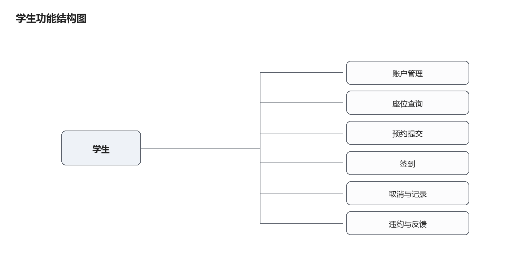

图 3-1 学生功能结构图

### 3.1.1 学生端功能需求分析

学生端的功能围绕一次完整的自习行为展开：进入系统、查找座位、提交预约、到场签到、结束离场，中途可能取消或失约。以下按功能逐项说明。

账户管理是使用系统的前提。学生使用学号、用户名与密码注册，登录后由服务端签发令牌，后续请求携带令牌访问受保护资源。账户管理还包括查看与修改个人资料、修改密码（需验证旧密码）以及退出登录。退出后令牌对应的会话被撤销，旧令牌立即失效。账户管理的用例关系如图 3-2 所示。

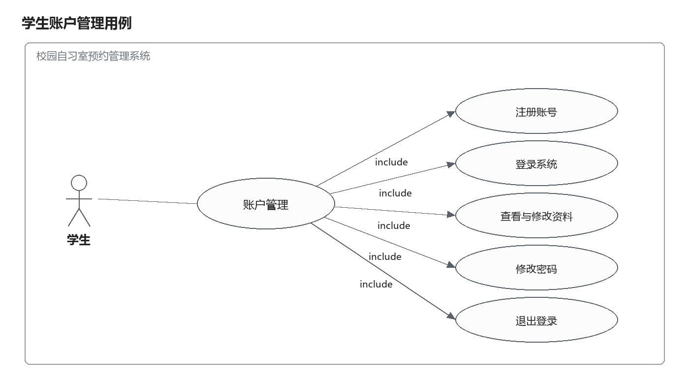

图 3-2 学生账户管理用例图

座位查询是使用频率最高的功能。学生可按名称与位置筛选自习室，查看开放时段与座位总数；进入某一自习室后，选择日期与时段，页面以平面图形式展示座位，区分空闲、已预约与维修三种状态。座位的可用性由服务端根据预约、维修状态与资源开放状态共同计算，前端不自行推断。座位查询的用例关系如图 3-3 所示。

图 3-3 学生座位查询用例图

预约提交把选中的座位与时段固定下来。学生提交自习室、座位、日期与时段四个参数，服务端在同一事务内完成资源状态复核、座位冲突校验、学生时间冲突校验、每日次数校验与违约限制校验，全部通过后写入预约与初始状态日志。请求需携带幂等键，重复提交不会产生第二条预约。预约提交的用例关系如图 3-4 所示。

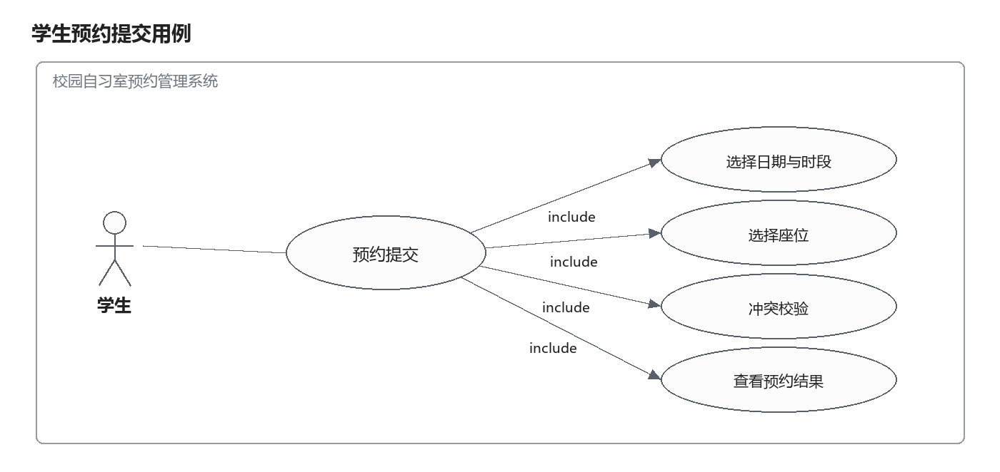

图 3-4 学生预约提交用例图

签到在预约开始前后的一段窗口内完成。学生进入预约详情页，页面展示签到二维码，学生用手机摄像头扫码或在同一设备上传二维码图片，识别后提交签到数据。服务端校验令牌、二维码签名、二维码归属自习室、当前时间是否落在窗口内、该用户是否存在待签到预约，五项全部满足才写入签到记录。同一预约重复签到返回冲突。签到的用例关系如图 3-5 所示。

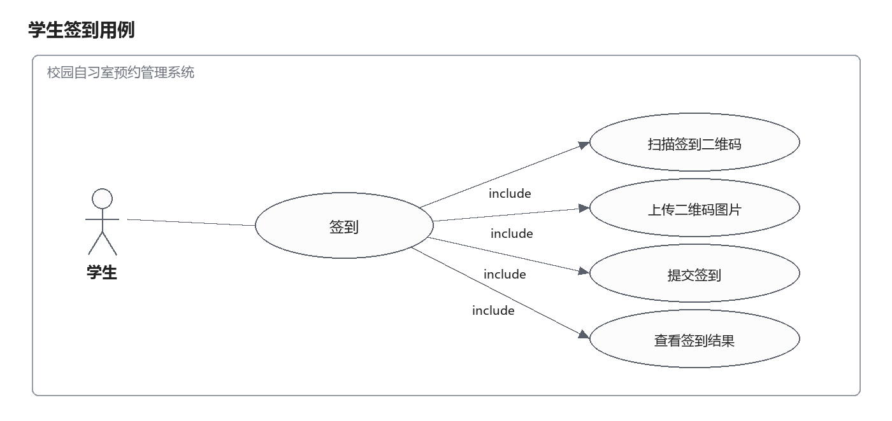

图 3-5 学生签到的用例图

取消预约在开始时间之前允许。学生取消后座位立即释放，该时段可被其他学生预约。开始时间之后取消入口关闭，系统按是否签到分别处理：已签到的等待结束转为完成，未签到的超窗后转为失约。取消操作需二次确认并记录原因。取消与记录查询的用例关系如图 3-6 所示。

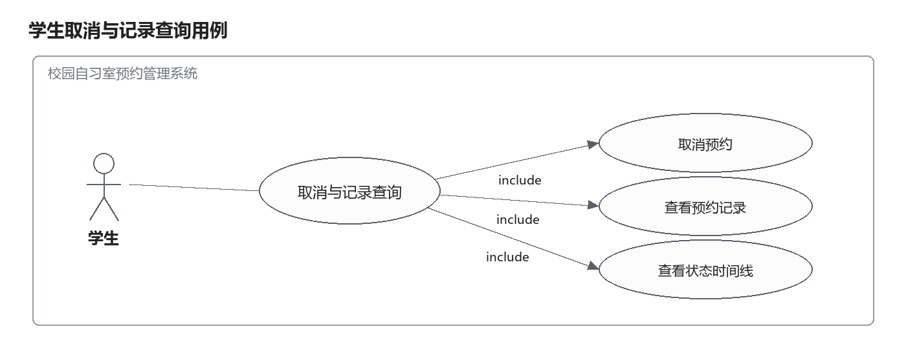

图 3-6 学生取消与记录查询用例图

违约查询与反馈举报面向异常情况。学生可在个人中心查看累计有效违约次数、每次失约的发生时间与原因，以及当前是否处于预约限制期、限制到何时结束。发现座位被长期占用无人使用时，学生可提交占座举报，填写自习室、座位与情况描述，提交后在“我的反馈”中查看处理状态与管理员填写的处理结果。违约与反馈的用例关系如图 3-7 所示。

图 3-7 学生违约与反馈用例图

学生端的功能边界需要明确。系统不提供“候补”与“自动换座”，座位一旦被预约即锁定到该时段，其他学生只能选择其他座位；这一点与图书馆的排队等座不同，原因是候补会带来通知成本与公平性争议。系统也不提供跨校区的座位查询，所有自习室属于同一校区，位置字段只用于筛选。这些省略不是能力不足，而是把范围限定在可维护的边界内。

异常路径同样属于需求的一部分。学生可能遇到的情形包括：选座时座位刚好被他人抢先预约、预约后临时有事需要取消、到场时忘记带手机、签到窗口已过但人已到场、发现座位被占。前两种由系统正常处理，第三种依赖管理员人工核验，第四种需要走违约撤销或申诉，第五种通过反馈工单流转。把这些路径列清楚，才能在设计中为每一种留出入口，而不是只实现顺利情况下的流程。

### 3.1.2 管理端功能需求分析

管理端的功能可归为六个方面，其结构如图 3-8 所示。资源部分由自习室、开放时段与座位三层构成；业务部分围绕预约与违约展开；服务部分处理反馈与运营数据。六个方面共用同一套数据，但在权限上彼此隔离，管理员只能在自己的职责范围内操作。

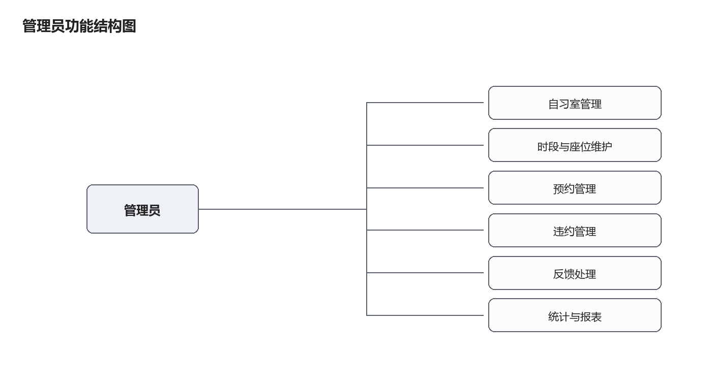

图 3-8 管理员功能结构图

管理端的功能围绕资源的可维护性与异常的可处理性展开。管理员不参与具体预约，但需要保证资源状态正确、异常记录可追溯、运行数据可观察。

自习室是整个业务的容器。管理员可新增自习室，填写名称、位置与平面行列数，并决定其状态是开放、关闭还是停用；可编辑已有自习室的信息；新增时默认关闭，配置完成后才开放。自习室管理的用例关系如图 3-9 所示。

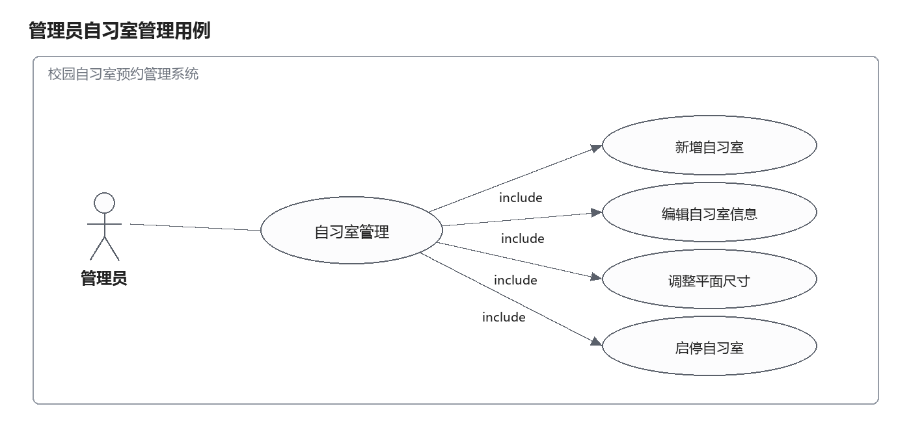

图 3-9 管理员自习室管理用例图

自习室之下是时段与座位。管理员为每个自习室配置若干开放时段，要求开始早于结束、长度在 30 分钟到 4 小时之间、同房间内时段不重叠；可按批次批量生成座位，指定前缀与行列范围，系统跳过已占用的坐标；也可把单个座位设为维修或停用。时段与座位维护的用例关系如图 3-10 所示。

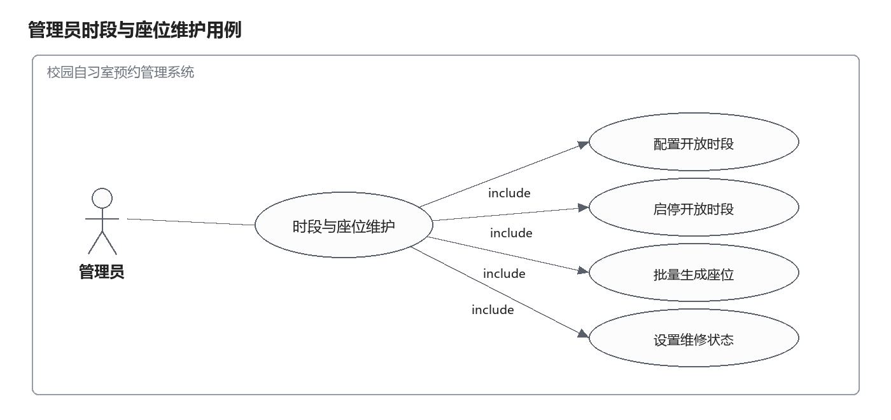

图 3-10 管理员时段与座位维护用例图

预约管理面向日常查询与异常处理：多条件查询全量预约，查看预约详情与状态时间线，对二维码不可用的学生执行人工核验签到，取消待签到的异常预约并填写原因。预约管理的用例关系如图 3-11 所示。

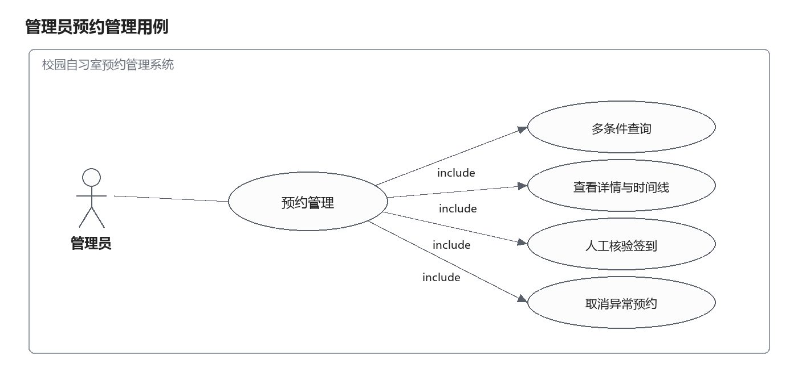

图 3-11 管理员预约管理用例图

违约管理包括查询违约记录、配置失约阈值与限制天数、撤销违约记录。规则调整只影响之后新触发的限制，撤销必须填写原因，撤销后重新计算有效违约数并按阈值决定是否解除限制。违约管理的用例关系如图 3-12 所示。

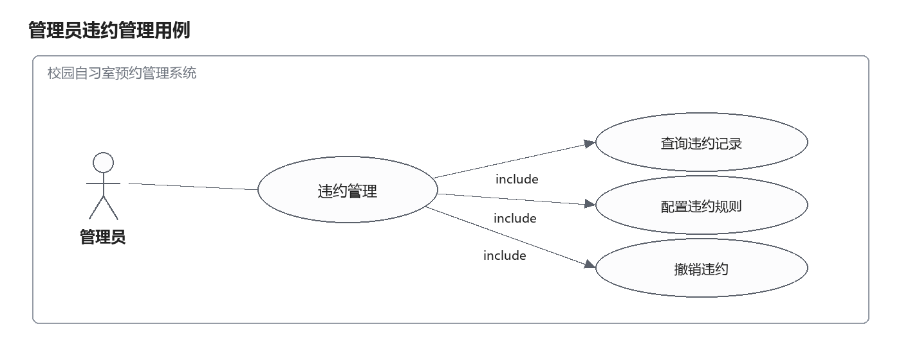

图 3-12 管理员违约管理用例图

反馈处理面向占座举报与问题反馈：查看工单列表与详情，受理工单，填写处理结果并关闭，对不合理的工单执行驳回。处理结果对提交学生可见，状态变更需与审计记录同事务写入。反馈处理的用例关系如图 3-13 所示。

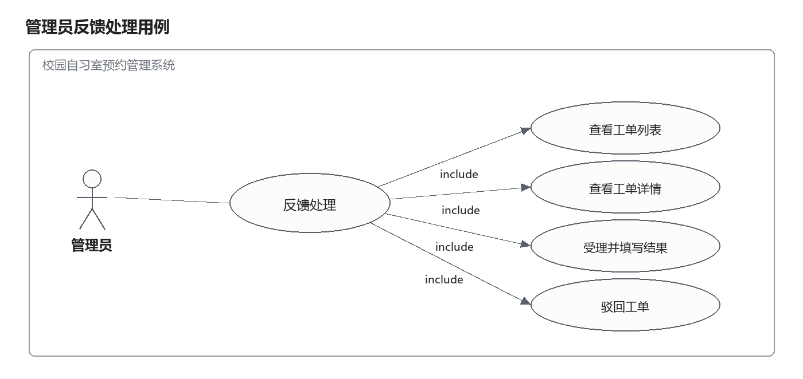

图 3-13 管理员反馈处理用例图

统计与系统设置面向运营与运维：查看仪表盘指标，按日期范围查看趋势，导出 CSV，调整预约窗口、每日上限与违约阈值等参数，查看定时任务运行状态与审计日志。统计与系统设置的用例关系如图 3-14 所示。

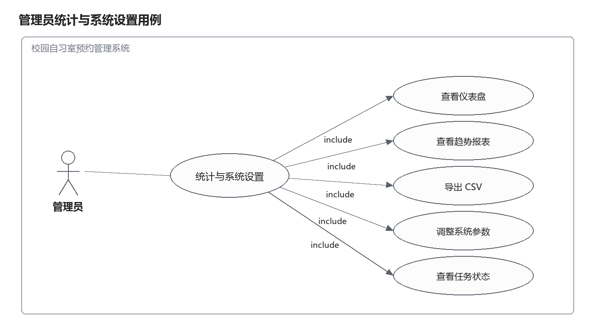

图 3-14 管理员统计与系统设置用例图

### 3.1.3 角色与权限划分

系统设置学生、管理员、超级管理员三种角色。超级管理员仅在创建管理员账号时具备额外权限，其余操作与管理员一致。权限按功能维度划分，未登录用户只能访问自习室与座位的公开查询，学生只能操作本人数据，管理员可操作全量数据但不能读取密码与令牌。角色与功能的对应关系如表 3-1 所示。

表 3-1 角色与功能权限矩阵

| 功能 | 未登录 | 学生 | 管理员 |
| --- | --- | --- | --- |
| 自习室与座位公开查询 | 允许 | 允许 | 允许 |
| 注册、登录 | 允许 | 允许 | 允许 |
| 创建、取消、签到预约 | 禁止 | 仅本人 | 禁止 |
| 查询本人预约、违约、反馈 | 禁止 | 仅本人 | 按条件查询 |
| 修改个人资料与密码 | 禁止 | 允许 | 允许 |
| 自习室、时段、座位维护 | 禁止 | 禁止 | 允许 |
| 预约查询与人工核验 | 禁止 | 禁止 | 允许 |
| 违约规则配置与撤销 | 禁止 | 禁止 | 允许 |
| 反馈工单处理 | 禁止 | 禁止 | 允许 |
| 统计报表与导出 | 禁止 | 禁止 | 允许 |
| 系统参数与运维状态 | 禁止 | 禁止 | 允许 |

## 3.2 业务规则与状态流转

预约是系统中最核心的业务对象，它的状态决定了座位是否被占用、学生能否签到、管理员能否取消。系统为预约定义了五个状态：待签到、已签到、已完成、已取消、已失约。状态之间的转换由服务端按规则执行，前端只能提交动作，不能直接提交目标状态。状态流转关系如图 3-15 所示。

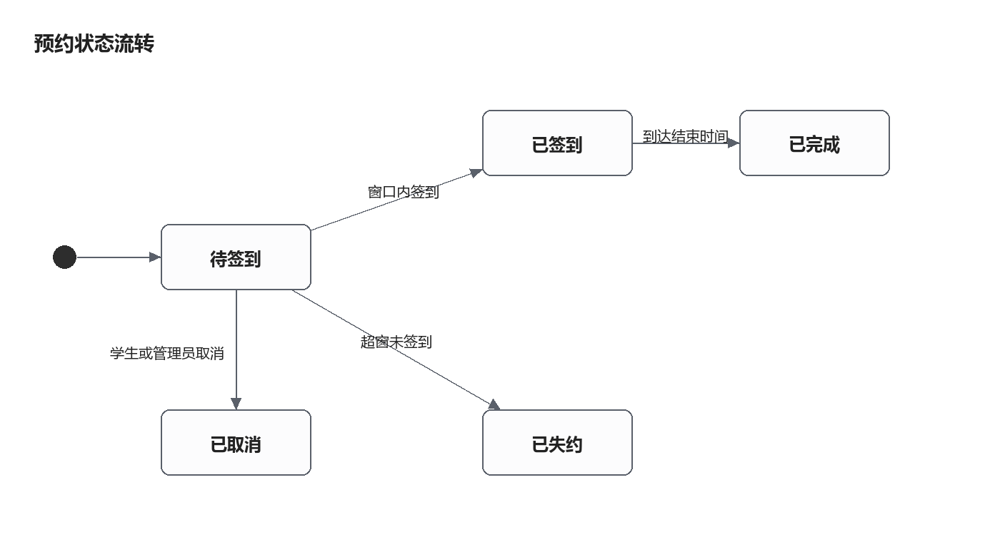

图 3-15 预约状态流转图

各状态之间的迁移条件如表 3-2 所示。迁移表中“执行者”一列区分了学生、管理员与系统定时任务，目的是明确每种动作的权限来源。

表 3-2 预约状态迁移表

| 当前状态 | 触发动作 | 目标状态 | 执行者 | 约束条件 |
| --- | --- | --- | --- | --- |
| 待签到 | 窗口内签到 | 已签到 | 学生 | 时间落在开始前 30 分钟至开始后 15 分钟 |
| 待签到 | 学生取消 | 已取消 | 学生 | 当前时间早于开始时间 |
| 待签到 | 管理员取消 | 已取消 | 管理员 | 必须填写原因 |
| 待签到 | 超窗未签到 | 已失约 | 系统 | 当前时间晚于开始后 15 分钟 |
| 待签到 | 停机豁免 | 已取消 | 系统 | 超窗超过 30 分钟，不记违约 |
| 已签到 | 到达结束时间 | 已完成 | 系统 | 当前时间晚于结束时间 |
| 已签到 | 管理员取消 | 已取消 | 管理员 | 本轮版本不支持，需人工处理 |

围绕状态机，系统设定了五条硬规则，它们在服务端被逐条执行，任一不满足即拒绝请求。

第一，同一座位在同一日期同一时段只能存在一条有效预约。有效预约指待签到或已签到状态，已取消、已完成、已失约的记录不占用座位。该规则由数据库的唯一索引保证，索引建在由座位、日期与时段拼接生成的列上，只有有效状态写入值，其他状态写入空值。

第二，同一学生在时间区间重叠时不能拥有两条有效预约。判定采用区间相交的方式，即已有预约的开始时间早于新预约的结束时间，且已有预约的结束时间晚于新预约的开始时间。相邻但不重叠的时段可以连续预约。

第三，每名学生每天的有效预约数量存在上限，默认 2 条。上限由系统配置表定义，管理员可调整，学生在提交前可在页面上看到剩余次数。

第四，预约后未在窗口内签到即判为失约。失约由定时任务写入，每条预约最多产生一条违约记录，重复执行任务不会重复计数。

第五，累计有效违约次数达到阈值后进入预约限制期，默认 3 次限制 7 天。限制期内学生无法提交新预约，限制到期自动解除；管理员撤销违约后若有效违约数低于阈值，限制立即清空。

时间口径是上述规则的共同前提。数据库中的日期时间字段按 UTC 存储与比较，业务日期、时段起止与签到窗口按东八区解释。校验以业务日期加时段起止组合成具体时刻后再转换为 UTC，界面展示时再转换回东八区。跨日场景在预约、签到与统计三处均有独立测试用例覆盖，避免出现八小时偏移。

## 3.3 非功能需求分析

非功能需求决定了系统在真实环境中的可用程度，本节按安全、性能、易用与可维护四个方面说明，并尽量给出可验证的口径。

安全性方面，密码必须以哈希形式存储，数据库中不出现明文；令牌只能由服务端签发与校验，载荷中不含敏感信息；权限检查在服务端完成，前端隐藏按钮不作为权限手段；接口对密码、令牌与完整个人信息做脱敏处理，错误响应不返回数据库错误细节；登录、注册、预约与反馈接口设置频率限制，防止暴力尝试与重复提交。

性能方面，普通查询接口在本地环境下的响应时间应控制在 500 毫秒以内，预约提交因涉及事务与加锁，响应时间允许放宽到 1 秒。列表接口必须分页，单页最大 100 条；统计查询按日期范围限制在 366 天以内，避免无界查询拖慢数据库。座位状态查询涉及多表关联，需要依赖索引避免全表扫描。

易用性方面，所有页面需具备加载中、无数据、请求失败与无权限四种状态；表单在提交前给出即时校验提示，服务端返回的错误信息应能被用户理解，例如座位冲突提示“该座位在所选时段已被预约”，而不是返回错误码；危险操作（取消预约、停用资源、撤销违约）需二次确认并展示操作结果。

可维护性方面，业务按模块拆分，模块之间只通过稳定字段与公开服务方法交互；数据库结构由编号迁移脚本管理，每次变更同时提供回滚说明；前后端各自通过类型检查、代码规范检查与构建，提交前必须全部通过。可观测性方面，服务端记录请求方法、路径、状态码与耗时，关键业务事件（预约创建、签到、失约、撤销）写入状态日志或审计日志，日志中不出现密码、令牌与完整个人敏感信息。

## 3.4 需求优先级与实现范围

需求数量确定之后，还需要回答“先做哪些”。本文按“是否影响核心流程的正确性”把功能分为三级：P0 是缺失即导致流程无法成立的功能，P1 是影响体验但可延后一版的功能，P2 是运营增强功能。优先级划分的结果如表 3-3 所示。

表 3-3 需求优先级划分

| 优先级 | 功能 | 判断依据 |
| --- | --- | --- |
| P0 | 注册登录、座位查询、预约创建、签到、取消、失约判定、违约限制 | 缺任一项，预约流程无法成立 |
| P0 | 自习室与座位维护、预约查询、人工核验签到 | 资源不可维护或异常无法处理时系统不可用 |
| P1 | 违约撤销、反馈工单、统计报表与导出 | 影响管理效率，但不阻断学生使用 |
| P1 | 配置在线调整、审计日志、任务状态查看 | 影响运维便利性 |
| P2 | 消息提醒、移动端适配、多校区 | 依赖外部通道或更大改造 |

按此划分，第一版实现覆盖全部 P0 与 P1 功能，P2 项列入后续计划。需要说明的是，统计报表虽然列为 P1，但其依赖的容量快照与冻结任务在 P0 阶段就必须建好，否则历史数据无法补齐——这类“功能可延后、数据结构不可延后”的依赖，是划分实现顺序时容易忽略的地方。

## 3.5 业务规则的取值说明

三条规则的具体数值需要给出理由，否则规则看起来是随意设定的。

签到窗口取“开始前 30 分钟至开始后 15 分钟”。窗口过窄会把迟到几分钟的学生直接判为失约，引发争议；窗口过宽则失去约束意义，学生可以在时段中途甚至接近结束时才签到，座位在这段时间内实际处于空置状态。取开始前 30 分钟，是考虑到学生通常提前到达并在附近等候；取开始后 15 分钟，是给学生留出从教学楼步行到自习室的时间。

每日有效预约上限取 2 条。上限设为 1 条过于严格，学生上午与下午各复习一段是常见需求；上限设为 3 条以上则容易出现“占坑”行为，与约束机制的初衷相悖。2 条既能覆盖一天两段自习的典型场景，也让多占座位变得没有收益。

违约阈值取 3 次、限制天数取 7 天。阈值过低会让偶发的意外（临时有事、交通延误）直接触发限制，误伤概率高；阈值过高则对习惯性失约缺乏威慑。7 天与一个自然周对齐，限制期内学生仍可正常自习，只是无法预约，惩戒强度与过错程度大致匹配。

这三项数值都存放在配置表中，管理员可以调整。规则可配置的意义不在于让管理员频繁改动，而在于学校规模和作息差异较大时不必改代码即可适配；同时，已生效的限制区间按当时的规则保存，后续调整不会追溯改写，避免出现“改规则导致历史限制失效”的问题。
