# 4  系统设计

## 4.1 系统总体设计

系统按业务域划分为八个模块：认证与用户、自习室与座位、预约与签到、违约管理、反馈工单、统计与报表、系统基础与运维、设计与视觉规范。模块划分的依据是数据归属与变更频率，而不是页面菜单：认证与用户管理账号与会话，自习室与座位管理资源，预约与签到管理时段占用，违约与反馈管理异常，统计与报表只读其他模块的数据，系统基础提供配置、日志与任务调度，视觉规范为页面提供统一的样式约定。

模块之间存在明确的依赖方向。系统基础与运维位于底层，提供配置、数据库连接、错误处理与定时任务；认证与用户向上提供用户标识、角色与资源归属判断；自习室与座位提供房间、时段、座位与可用性计算；预约与签到依赖前三者，并向下游输出预约状态、签到记录与时间快照；违约管理消费预约产生的失约事件，统计与报表消费预约、签到与违约的结果。依赖单向流动，避免了循环调用。系统功能结构如图 4-1 所示。

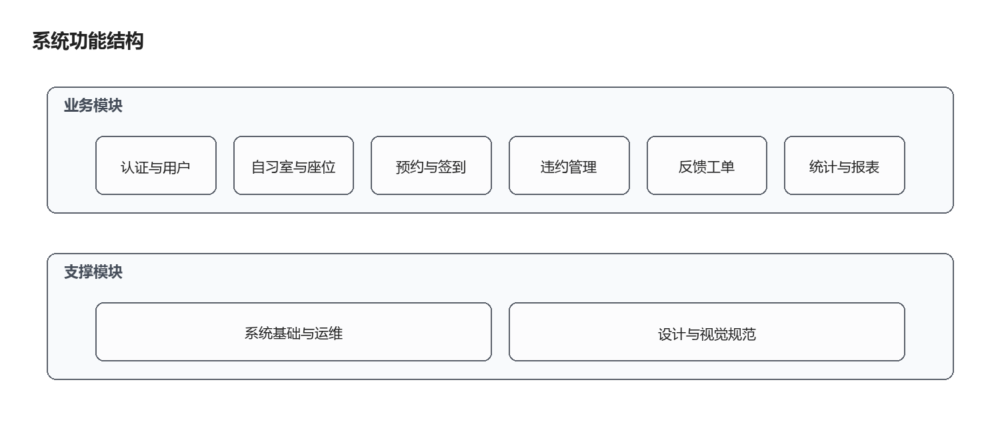

图 4-1 系统功能结构图

## 4.2 系统架构设计

### 4.2.1 总体架构

系统采用前后端分离的三层结构。表现层是运行在浏览器中的单页应用，负责页面渲染、交互反馈与路由控制；业务服务层是 Express 应用，负责认证、校验、业务规则与事务；数据访问层由 Sequelize 模型与 MySQL 组成，负责持久化与约束。三层之间通过 HTTP 上的 JSON 接口通信，接口统一以 `/api/v1` 为前缀。

一次典型的预约请求依次经过：浏览器发起请求并携带令牌，请求进入 Express 路由，认证中间件解析令牌并校验会话，权限中间件检查角色，校验中间件检查参数，控制器把请求转交服务层，服务层开启事务、按固定顺序加锁、复核资源状态与冲突条件，数据访问层执行写入，事务提交后返回统一响应。任一环节失败，响应以统一结构返回错误码与提示，事务回滚。系统架构如图 4-2 所示。

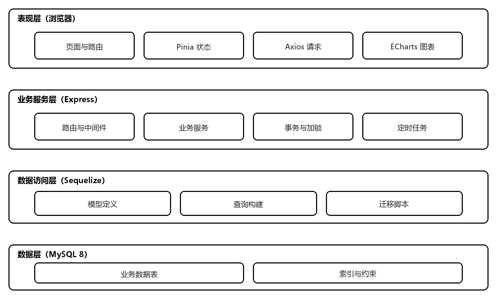

图 4-2 系统三层架构图

### 4.2.2 前端设计

前端路由按角色分为三组。公开路由包括登录、注册与自习室浏览；学生路由包括首页、自习室详情、预约记录、预约详情、我的反馈与个人中心；管理员路由包括仪表盘、用户管理、自习室管理、座位管理、预约管理、违约管理、反馈处理、统计报表与系统设置。路由守卫在跳转前检查登录状态与角色，未通过时分别跳转登录页与无权限页。

状态管理遵循“够用即共享”的原则。登录用户、令牌与公开配置放入 Pinia，因为这些数据在路由守卫、请求拦截器与多个页面中都要使用；页面内部的筛选条件、分页参数与加载状态保留在组件内，避免全局状态膨胀。组件按复用范围分两层：基础组件包括状态标签、空状态、确认弹窗与分页封装；业务组件包括座位平面图、预约卡片与统计图表，其中座位平面图在选座页与管理端座位页共用，通过属性区分是否可编辑。

### 4.2.3 后端设计

后端按职责分为四层。路由层声明路径、方法与中间件链；控制器层解析请求参数、调用服务并封装响应；服务层承载业务规则、事务与状态转换；模型层定义表结构、关联与查询。跨层的横切逻辑由中间件完成，包括认证、角色校验、参数校验、限流、请求日志与统一错误处理。

响应结构在全系统统一。成功时为 `{ code: “OK”, message, data }`，失败时为 `{ code, message, data: null }`，分页数据放在 `data` 中，形态为 `{ items, page, pageSize, total }`。错误码与 HTTP 状态的对应关系如表 4-1 所示。

表 4-1 统一错误码定义

| 错误码 | HTTP 状态 | 含义 |
| --- | --- | --- |
| OK | 200 / 201 | 成功 |
| BAD_REQUEST | 400 | 参数格式或枚举错误 |
| UNAUTHORIZED | 401 | 未登录或令牌失效 |
| FORBIDDEN | 403 | 角色不符或越权访问 |
| NOT_FOUND | 404 | 资源不存在 |
| CONFLICT | 409 | 状态冲突、重复预约、重复签到 |
| VALIDATION_ERROR | 422 | 字段校验失败 |
| RATE_LIMITED | 429 | 请求频率超限 |
| DATABASE_UNAVAILABLE | 503 | 数据库暂不可用 |
| INTERNAL_ERROR | 500 | 未处理异常 |

## 4.3 数据库设计

### 4.3.1 概念模型设计

数据库围绕“用户占用座位”这一核心关系展开。用户与预约是一对多，一个用户可拥有多条历史预约；自习室与时段是一对多，一个自习室可配置多个开放时段；座位属于自习室，一个自习室包含多个座位；预约同时关联用户、座位与时段，并额外保存房间名称、位置与座位编号的快照，以便资源更名后历史记录不发生变化；签到与预约是一对一，一条预约最多一条签到记录；状态日志与预约是一对多，记录每次状态转换；违约记录与预约是一对一，一条失约预约对应一条违约；反馈工单关联用户，可选关联自习室与座位；统计快照按日期、自习室与时段三个维度保存。整体实体关系如图 4-3 所示。

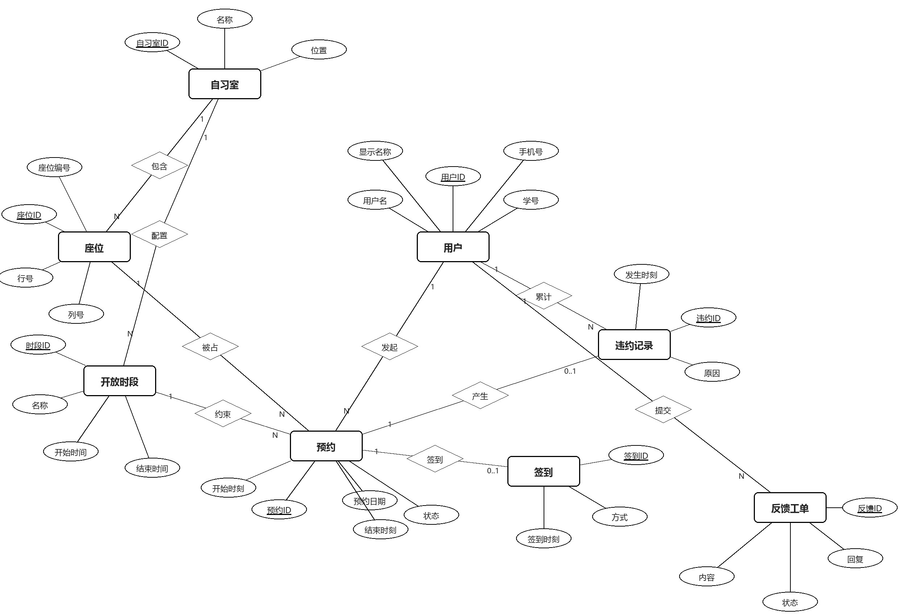

图 4-3 系统整体 E-R 图

在整体关系之外，本文为每个实体单独绘制了属性图，用于说明实体的字段构成。用户实体的属性如图 4-4 所示，会话实体如图 4-5 所示，审计日志如图 4-6 所示；资源三层中，自习室如图 4-7 所示，开放时段如图 4-8 所示，座位如图 4-9 所示；业务实体中，预约如图 4-10 所示，签到如图 4-11 所示，违约记录如图 4-12 所示，反馈工单如图 4-13 所示。属性图只列字段，不画联系，与整体图配合使用：整体图回答“实体之间如何关联”，属性图回答“实体由什么构成”。

实体划分遵循两条标准：是否具有独立的生命周期，以及是否被多处业务引用。以此衡量，“开放时段”不宜作为自习室的普通属性处理。时段的起止时间、可预约起始日期与启停状态都会单独调整，同一条时段又会被多条预约引用，若把它降级为自习室上的几个字段，调整一次时段就要连带修改全部历史预约的快照。座位同理：它需要单独记录平面坐标与维护状态，并在预约中固化快照，因此独立成实体。相反，“签到方式”“预约状态”只服务于某一条预约，生命周期完全依附于预约本身，因而保留为预约的字段而不拆表。这样处理的结果是实体数量控制在 14 个，既没有把属性强行提成实体，也没有把真正的实体压成字段。

把 10 个实体放在一起看，可以归为三类。用户域两个：用户与会话，负责身份与登录态；资源域三个：自习室、开放时段与座位，构成可预约的空间；业务域五个：预约、签到、状态日志、违约记录与反馈工单，记录一次预约从创建到结束的全过程。三类实体在字段设计上遵守同一组约定：时间统一用 `DATETIME` 并按 UTC 存储；状态一律用 `ENUM` 限定取值；凡是可能被后续变更影响的历史信息，都在业务表中保留快照字段；凡是能由数据库唯一索引表达的约束，都下沉到存储层，而不是只写在服务层。

联系基数由业务规则推导，而不是凭经验设定。用户与预约为 1:N，一名学生可以产生多条历史预约，但一条预约只属于一名学生；自习室与座位、自习室与时段各为 1:N，座位与时段都依附于某一房间；预约与签到为 1:1，一条预约只允许签到一次，这一点由签到表的唯一索引兜底；预约与状态日志为 1:N，一次预约在完整生命周期中会产生“待签到—已签到—已完成”等多条记录；预约与违约为 1:1，只有失约的预约才生成违约记录；用户与反馈工单为 1:N。统计快照与业务表之间不设外键，它按日期与资源维度独立汇总，属于分析型数据，避免与业务表的事务相互牵连。

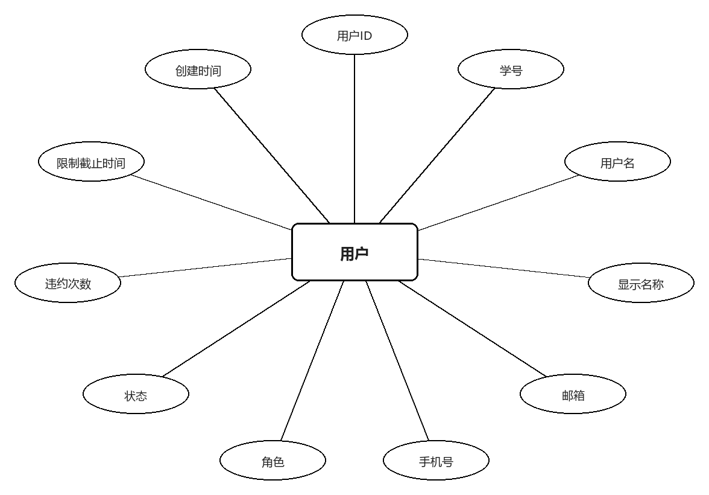

图 4-4 用户实体属性图

用户实体的属性如图 4-4 所示。从字段作用看，用户表可以分成四组。身份组是 `student_no`、`username` 与 `email`，三者都建唯一索引，其中学号用于实名与签到校验，用户名用于登录，邮箱用于找回；凭据组只有 `password_hash`，保存 bcrypt 结果，长度为 100 是为兼容 60 字符的哈希与后续可能更换的算法。权限组是 `role` 与 `status`，前者区分学生、管理员与超级管理员，后者区分正常与停用，停用只拒绝登录，不删除历史数据。风控组是 `violation_count`、`restriction_started_at` 与 `restriction_until`，三个字段合起来表达“累计违约次数与限制期”，放在用户表而不是单开一张限制表，是因为每次预约创建都要读取，单表少一次连接。`last_login_at` 只服务于运营查看活跃度，不参与任何规则判断。用户表不设软删除标记，停用即 `status=disabled`，历史预约与违约仍可关联到该用户。登录失败只累加失败次数并做限流，不写审计；只有管理员级别的账号变更才进入审计表。账号停用后其有效会话一并撤销，避免停用后仍能凭旧令牌访问。用户创建时由服务端校验学号格式与唯一性，重复注册直接返回冲突，不进入后续流程。

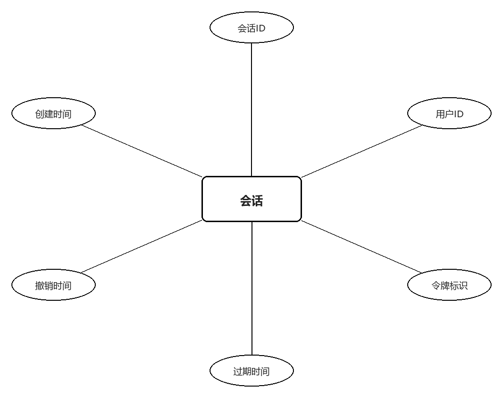

图 4-5 会话实体属性图

会话实体的属性如图 4-5 所示。会话表是 JWT 的补充。JWT 本身无状态，签发后无法撤回，因此系统在登录时同时写入一条会话记录，把令牌中的 `jti` 存为唯一键；每次鉴权除了校验签名，还按 `jti` 查一次会话，检查 `expires_at` 是否过期、`revoked_at` 是否为空。注销时只需写入 `revoked_at`，令牌立即失效，不必等待自然过期。`id` 使用 36 位字符而不是自增整数，是为了与会话标识的生成方式保持一致，避免分布式部署时依赖数据库自增。会话记录按用户与创建时间建索引，便于“退出全部设备”这类操作按用户批量撤销。按用户维度还能回答“当前有几台设备在线”，运营排查异常登录时不必翻查应用日志。会话记录按用户与创建时间建索引，支持按用户批量撤销；过期记录由定时任务清理，保留最近 30 天用于排查异常登录。同一用户允许多条有效会话，便于多设备同时在线；退出全部设备时按用户批量写入撤销时间。会话表只保留必要字段，不存设备指纹，减少个人信息的存储面。会话过期时间与令牌一致，刷新令牌时新建会话并撤销旧的，避免旧令牌继续可用。会话记录与令牌一一对应，令牌泄露时只需撤销该条会话，不影响其他设备。

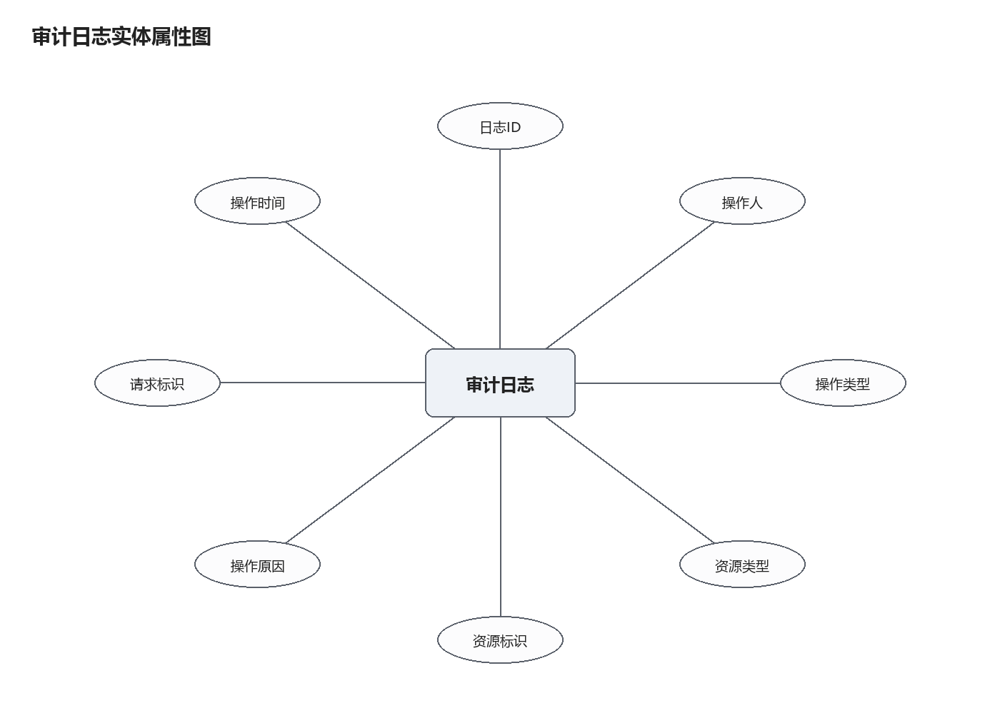

图 4-6 审计日志实体属性图

审计日志实体的属性如图 4-6 所示。审计日志只记录管理端的写操作，包括资源维护、预约人工核验、违约撤销与配置修改。`action` 保存动作名，`resource_type` 与 `resource_id` 定位被操作对象，`before_json` 与 `after_json` 保存变更前后快照。选择 JSON 而不是为每类资源建扩展表，是因为资源字段会变，而审计要求“当时的原样”，JSON 天然适合这种只读归档。`request_id` 与请求头中的追踪标识一致，同一次操作的业务日志与审计日志可以相互定位。`reason` 由管理员填写，用于事后解释“为什么撤销这条违约”。审计表不设更新与删除接口，写入后不可改。审计表按操作时间建索引，按人筛选时走 `operator_id` 与时间组合，避免全表扫描。审计记录保留期由运维配置，导出时按时间范围与资源类型筛选；`before_json` 为空表示新增，`after_json` 为空表示删除。审计查询默认按时间倒序分页，单页上限 100 条；导出功能只对超级管理员开放，避免批量外泄操作记录。审计写入与业务写入不在同一事务，业务成功而审计失败时记告警，不阻断主流程。审计记录不参与业务查询，单独归档，避免与预约表争用缓冲池。

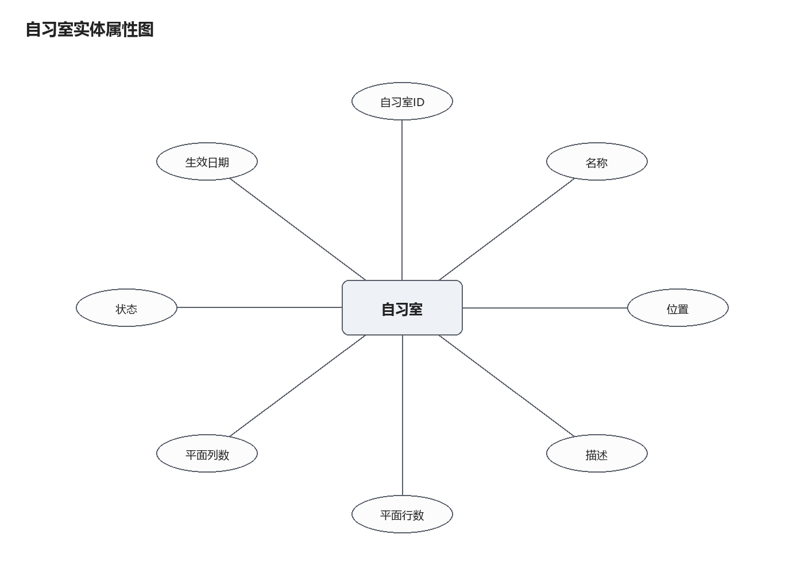

图 4-7 自习室实体属性图

自习室实体的属性如图 4-7 所示。自习室是资源层的根。`grid_rows` 与 `grid_columns` 决定选座页平面图的网格尺寸，座位的行列号不能超出该范围，前端据此渲染网格，后端在建座位时做越界校验。`status` 分开放、临时关闭与停用：临时关闭用于考试周调整，停用表示房间不再提供服务，两者都不删除数据。`bookable_from` 控制最早可预约日期，学期初统一放开，避免假期被提前占满。房间更名不影响历史预约，因为预约表保存了名称与位置快照。房间的位置字段用于列表展示与筛选，与快照中的位置一起保证历史预约可读。停用房间不再出现在学生端列表，但管理员仍可在后台查看其历史预约与统计。房间描述用于学生端展示，长度上限 500 足以覆盖开放时间、注意事项等说明。房间状态与时段状态是两级开关：房间停用后其下所有时段一并不可预约；房间开放而某时段停用，则只影响该时段。房间平面图的行列数在创建时确定，后续调整只能通过迁移脚本修改，避免已有座位的坐标失效。房间删除前必须无座位、无时段、无有效预约，由外键与状态字段双重限制。房间的开放与停用由管理员手动切换，切换记录写入审计，便于追溯调整时间。房间列表按状态与名称排序，停用房间排在最后，学生端默认过滤停用项。

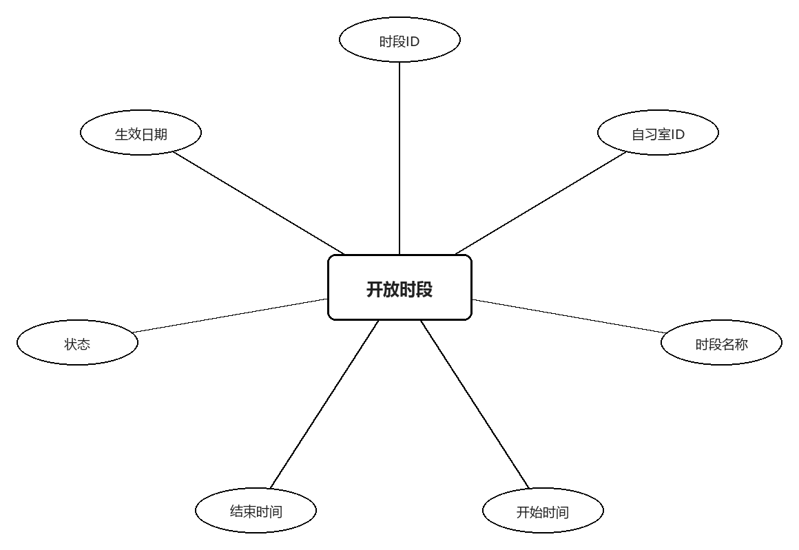

图 4-8 开放时段实体属性图

开放时段实体的属性如图 4-8 所示。时段表达的是一天内的可用区间。`start_time` 与 `end_time` 使用 `TIME` 类型而不是 `DATETIME`，因为时段每天复用，具体日期由预约表的 `reserve_date` 决定，两者组合才是一条完整的时间区间。`label` 是展示名称，如“上午”“下午”，前端直接显示而不做时间拼接。`bookable_from` 允许某个时段晚于房间开放，便于分阶段启用；`status` 用于临时关闭某一时段。同一房间的时段之间允许重叠，重叠判定放在预约创建时按具体日期计算，而不是在建时段时禁止，这符合“上午与下午可以交叉排课”的实际需要。时段名称允许重复，唯一性由房间与起止时间共同约束，避免误建同义时段。时段停用后不再参与预约创建，但已产生的预约仍按原时段展示，不做追溯修改。同一房间的时段数量不设硬上限，前端按开始时间排序；两个时段完全重叠时，创建预约任一命中即视为同一可用区间。时段与房间的归属关系不可跨房间移动；需要调整时新建时段并停用旧的，历史预约仍指向旧时段。时段的启停不影响其下已有预约，只影响新的预约创建。时段名称与起止时间共同构成展示标识，前端按开始时间排序后渲染时间轴。时段被停用后仍保留在历史预约详情中，学生看到的是当时的时段名称与起止时间。

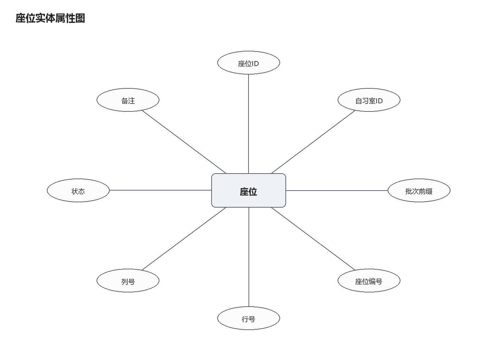

图 4-9 座位实体属性图

座位实体的属性如图 4-9 所示。座位的唯一性由两组索引保证：`room_id` 与 `seat_no` 组合唯一，防止编号重复；`room_id`、`row_no`、`column_no` 组合唯一，防止平面坐标重叠。`batch_prefix` 记录批量生成的批次，便于按批维护或回滚。`status` 分可用、维修与停用：维修中的座位不出现在可选列表，已有预约仍保留，由管理员改约或取消。`bookable_from` 让新座位可以延后开放。座位位置与编号在预约时写入快照，座位后续被移动或改名，历史记录仍按当时的位置显示。批量生成接口在写入前先按批次前缀检查重复，避免一次请求内编号冲突导致整批回滚。座位编号支持字母数字组合，前缀用于区分楼层或区域，前端按前缀分组展示。维修状态由管理员手工切换，切换时不影响已有预约，只影响后续可选列表。座位坐标从 1 开始计数，与前端网格一一对应；批量生成先校验行列范围，再按前缀加序号生成编号，整批在同一事务提交。座位停用前需确认无有效预约，接口会返回冲突提示，由管理员先处理预约再停用。座位编号在同一房间内唯一，跨房间可以重复，展示时以房间分组。座位的行列坐标用于平面图定位，编号用于列表与签到码，两者都不允许为空。座位维修由管理员登记开始与结束时间，维修期间该座位不参与可用性计算。

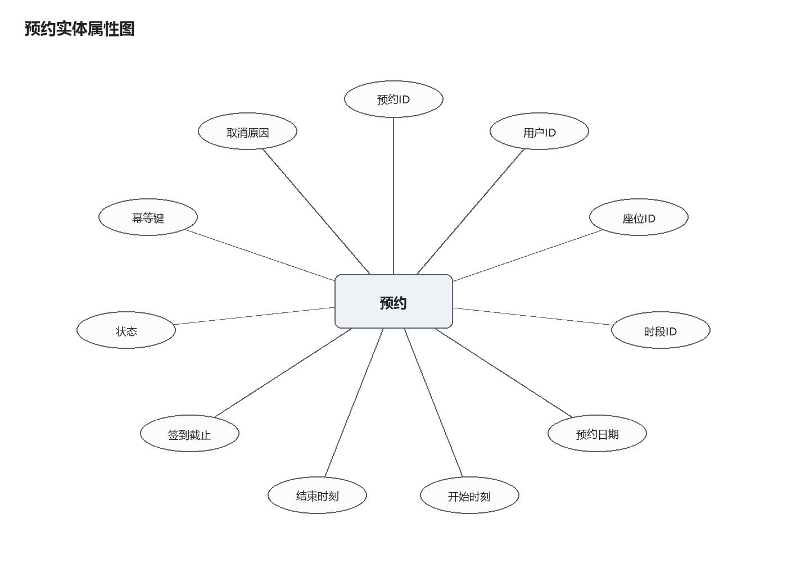

图 4-10 预约实体属性图

预约实体的属性如图 4-10 所示。预约表字段最多，可以分成五组。关联组是 `user_id`、`room_id`、`seat_id` 与 `slot_id`，四个外键共同确定“谁在哪个房间的哪个时段的哪个座位”。快照组是 `room_name_snapshot`、`room_location_snapshot` 与 `seat_no_snapshot`，只在创建时写入。时间组是 `reserve_date`、`start_at`、`end_at`，以及签到窗口的 `check_in_open_at` 与 `check_in_deadline`，窗口在创建时按规则算好并落库，避免运行时反复计算。状态组是 `status`，取值为待签到、已签到、已完成、已取消、已失约五态。控制组是 `idempotency_key`、`cancel_reason`、`cancelled_by` 与 `cancelled_at`，以及生成列 `active_slot_key`。生成列只在待签到与已签到状态下取“座位:日期:时段”，其余状态为空，配合唯一索引实现“同一座位同一时段仅一条有效预约”。预约创建时四个外键同时校验存在性，任一缺失即返回 404；快照字段由服务端读取，不接受前端传入。预约表按月归档历史数据，归档表结构一致，查询时按日期路由。

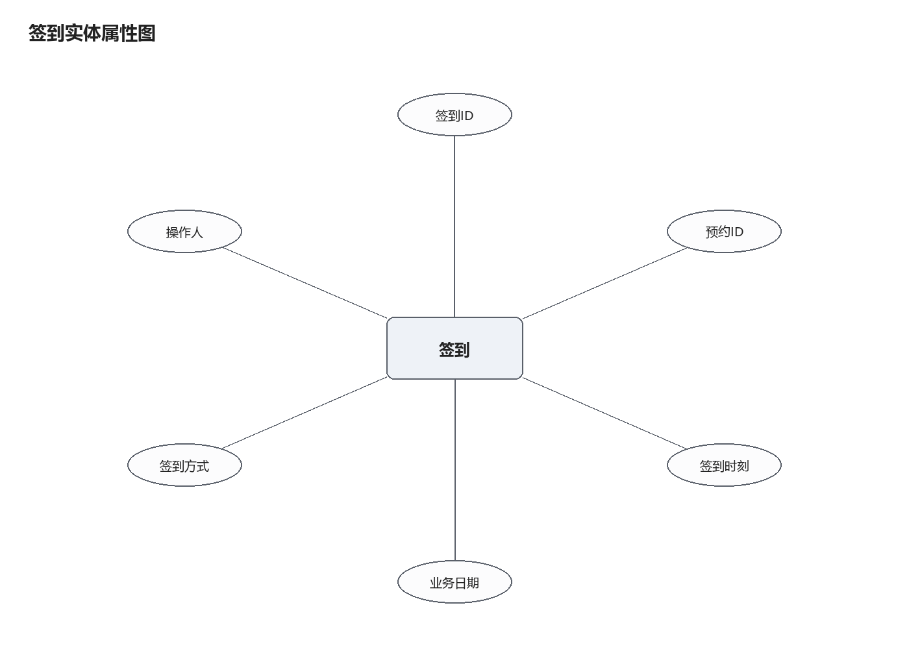

图 4-11 签到实体属性图

签到实体的属性如图 4-11 所示。签到表以 `reservation_id` 为唯一键，一条预约只能签到一次，重复提交由唯一索引直接拒绝。`checked_in_at` 记录实际核验时刻，与预约中的签到窗口比较即可判断是否超窗；`business_date` 单独保存业务日期，便于按天统计，避免每次从时间戳截取。`method` 区分扫码与人工核验，`operator_id` 只在人工核验时填写，用于事后追溯是哪位管理员放行。`nonce` 保存二维码中的随机数，服务端校验其未被使用过，防止同一张码被截图后重复签到。签到成功后预约状态与签到记录在同一事务内更新，任一步失败都不会留下“已签到但状态未变”的中间态。业务日期与预约日期必须一致，由服务端校验，避免跨天签到被计入错误的一天。重复扫码时接口返回已签到而不是报错，前端据此直接跳转预约详情。签到成功后写入业务日期供统计使用；人工核验必须填写操作人，扫码签到则记录二维码随机数以支持追溯。签到接口对同一预约重复调用返回成功而不是冲突，前端据此幂等刷新页面。签到时间与预约窗口比较时统一换算为 UTC，避免时区差异导致误判。签到窗口的判定以服务端时间为准，客户端时间仅用于提示，防止改本地时间绕过。签到记录的唯一性也阻止同一预约被两个人分别签到，争议时以签到时间为准。

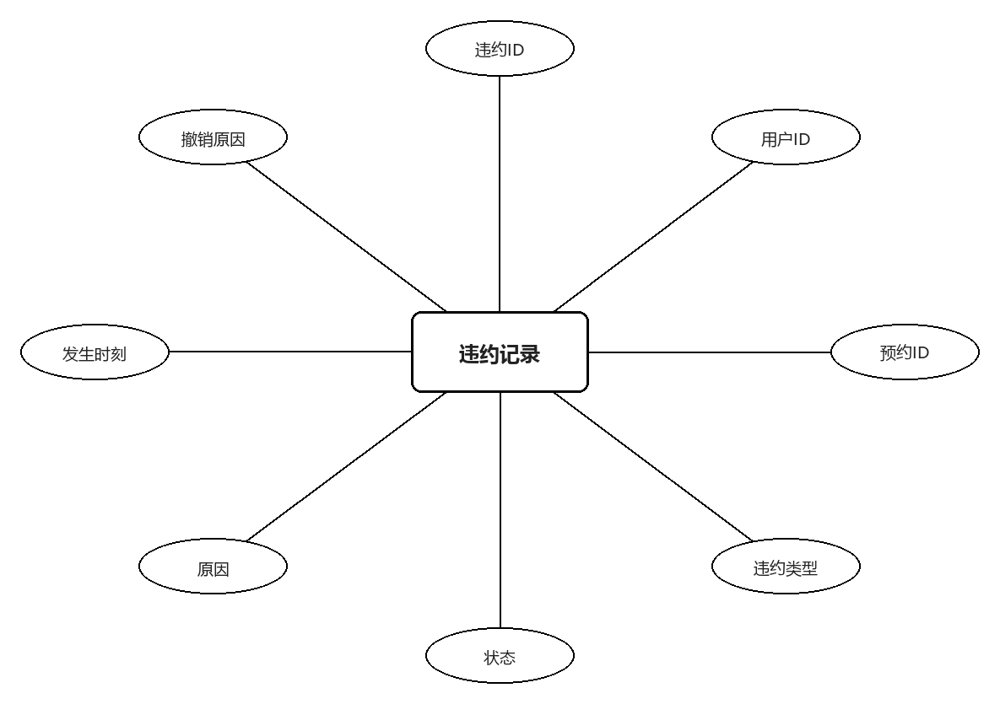

图 4-12 违约记录实体属性图

违约记录实体的属性如图 4-12 所示。违约记录由定时任务在签到窗口截止后自动生成，`reservation_id` 唯一保证一条预约最多一条违约。`type` 目前只有失约一种，保留枚举是为将来扩展“超时占用”等类型。`status` 分有效与撤销：管理员撤销时写入 `resolved_by`、`resolved_at` 与 `resolution_reason`，记录保留但不再计入用户违约次数，既留痕又不误伤。`occurred_at` 是判定发生时刻，统计与限制期计算都以它为准，而不是记录创建时间。同一条预约的违约记录与状态日志在同一个事务里写入，保证“失约”这一事实在两张表中同时可见。违约类型目前不区分严重程度，阈值判断只看有效条数，规则简单也便于解释。同一用户当天的多条违约按条累计，达到阈值后由定时任务写入限制期。违约生成时同步更新用户计数与限制期，撤销时同样回写；用户侧计数与违约明细在同一事务内保持一致。违约阈值与限制天数来自配置表，调整阈值不影响已生成的违约记录，只影响后续判定。用户违约次数以有效违约记录为准，撤销后立即回退，不做增量缓存。违约记录生成后立即生效，限制期从生成时刻起算，到期由定时任务解除。违约记录不提供删除接口，撤销是唯一处理方式，保证统计口径稳定。

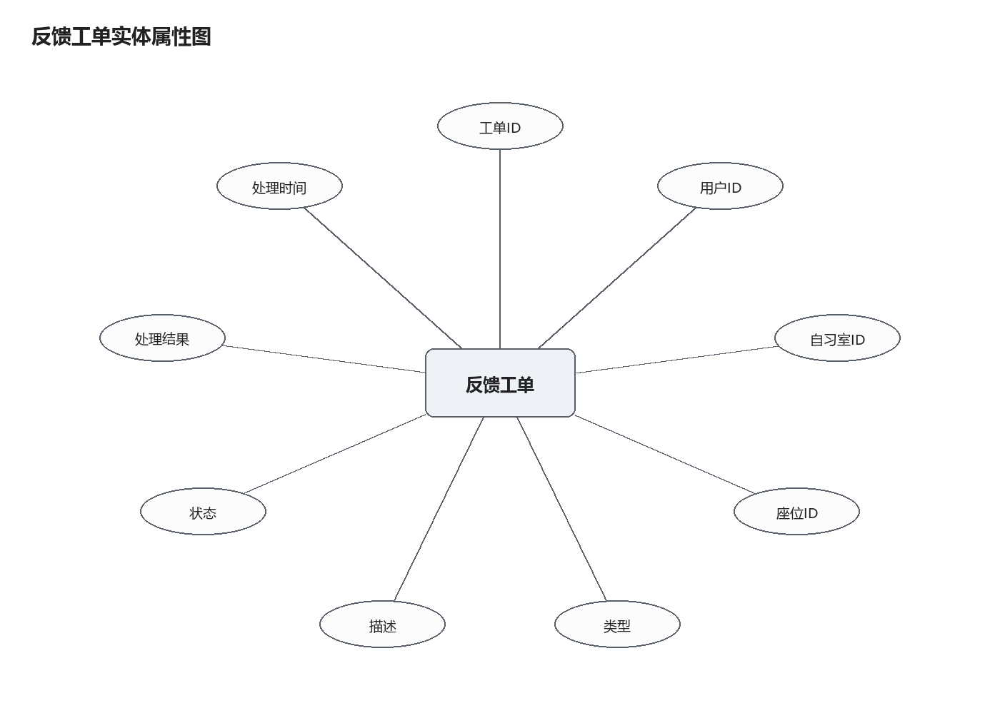

图 4-13 反馈工单实体属性图

反馈工单实体的属性如图 4-13 所示。反馈工单是学生与管理员之间的处理通道。`room_id` 与 `seat_id` 都可空，但填写座位时必须同时填写自习室，这条关系由检查约束表达；同时保存名称与编号快照，座位调整后工单仍能指向当时的对象。`type` 区分占座、设备、环境与其他，`description` 存正文。`status` 分待处理、处理中、已完结与驳回，`result` 保存处理结果，`handled_by`、`processed_at` 与 `closed_at` 记录处理链路。工单不设到座位的强制外键，避免座位删除后工单无法保留。工单状态流转由管理员操作，学生只能查看；`type` 为占座类时要求填写座位，设备与环境类只填自习室；已完结工单不允许再次修改。工单暂不支持附件，描述文本上限由字段类型决定；处理结果对提交学生可见，内部备注不落库。工单关闭后保留七天再进入归档表，便于学生查看处理结果。工单只在提交与关闭时通知学生，处理中的状态变化不推送，减少打扰。工单处理结果写入后不可覆盖，如需补充由管理员追加说明，保持对话式记录。

按业务域拆分，用户与会话的局部关系如图 4-14 所示，资源三层的局部关系如图 4-15 所示，预约与签到、状态日志的局部关系如图 4-16 所示，违约与反馈的局部关系如图 4-17 所示，统计快照的局部关系如图 4-18 所示。

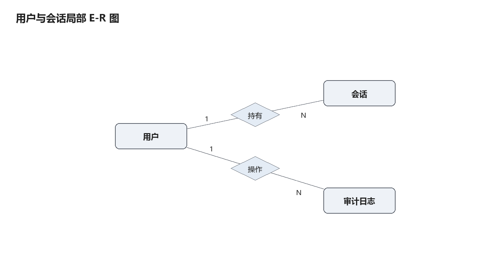

图 4-14 用户与会话局部 E-R 图

用户与会话之间的局部关系只涉及两个实体，联系类型与参与角色在图中标出；完整关系见前面的整体 E-R 图。

两条联系的方向不同：会话依附于用户，删除用户前必须先撤销其会话，因此外键为 `RESTRICT`；用户并不依赖会话存在，未登录用户同样是一条合法记录。局部图省略了审计与业务实体，只保留这一对关系，用来说明“账号—登录态”的分层。

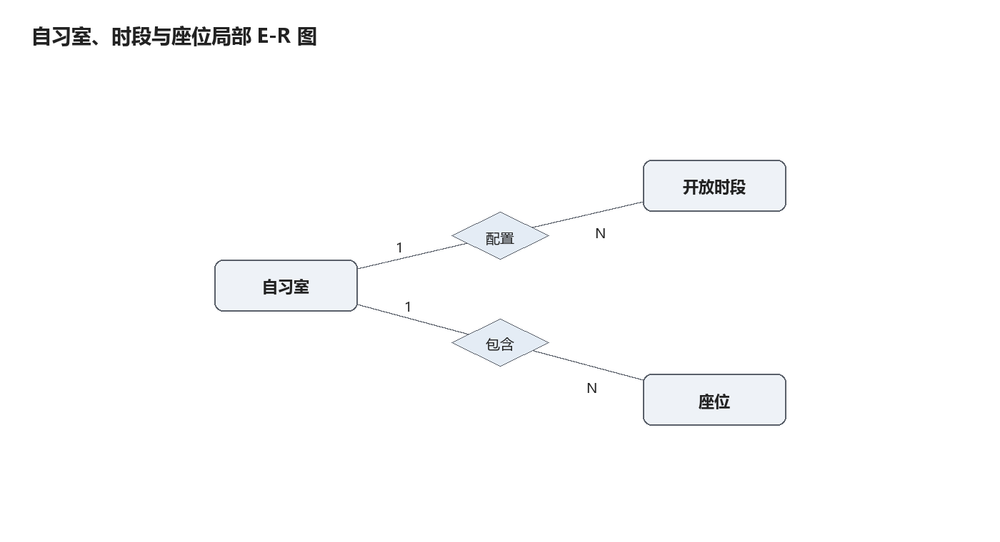

图 4-15 自习室、时段与座位局部 E-R 图

自习室、时段与座位三者的局部关系只保留资源层的实体，房间与座位之间为一对多，时段与房间之间同样为一对多。

三层都是 1:N，但删除顺序相反：先删座位，再删时段，最后删自习室。图中省去了预约，是因为预约对三者的引用属于业务层，画在一起会让资源结构看不清。局部图的用途是确认外键方向与级联策略，而不是展示全貌。

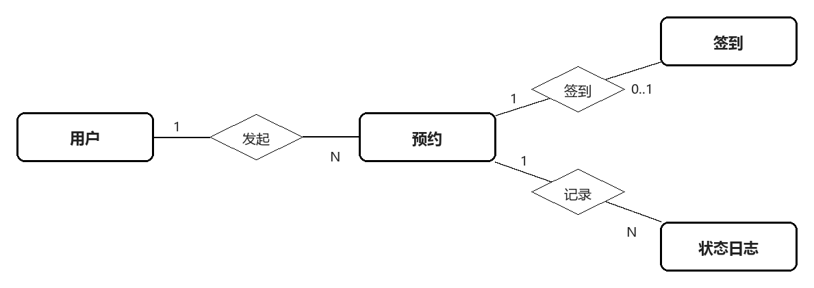

图 4-16 预约、签到与状态日志局部 E-R 图

预约与签到、状态日志之间的局部关系围绕一条预约展开，签到与预约一对一，状态日志与预约一对多。

签到是一对一，状态日志是一对多。把三者画在一起，是为了说明“一次预约的生命周期如何被记录”：状态日志记录每次转移，签到只记录到场那一刻，两者互补，缺一不可。

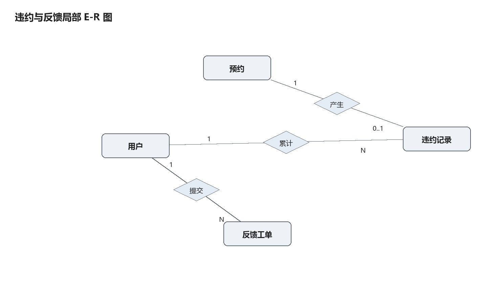

图 4-17 违约与反馈局部 E-R 图

违约记录与反馈工单分别挂在预约与用户之下，前者的联系基数为 1:1，后者为 1:N。

违约挂在预约上，是因为失约的主体是某一次预约而不是用户；反馈挂在用户上，是因为工单可能不对应任何预约。两条联系的基数不同，正是“历史事实”与“服务请求”两类数据的差别。

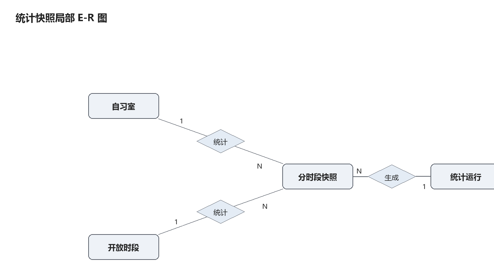

图 4-18 统计快照局部 E-R 图

统计快照按日期、自习室与时段三个维度汇总，与业务表之间不设外键，属于独立的分析型数据。

快照与业务表之间不设外键，是为了让统计独立于业务变更：房间改名、座位调整、时段停用都不影响已经冻结的历史数据。三个维度组成唯一键，保证同一天同一房间同一时段只有一份快照。

### 4.3.2 逻辑表设计

主键统一采用自增 `BIGINT UNSIGNED`，只有会话表用 36 位字符串。前者便于索引紧凑、插入有序；后者需要与令牌中的 `jti` 对应并在分布式场景下保持唯一，用 UUID 比自增更合适。业务上天然唯一的字段（学号、用户名、邮箱、座位编号、时段组合）不另设代理键，而是直接加唯一索引，避免出现“业务键与代理键两套唯一性”并存的情况。

字段类型的选择兼顾取值范围与查询成本。状态类字段使用 `ENUM` 而不是字符串，既限制了非法取值，也让索引更短；名称、位置、备注等长度差异大的字段用 `VARCHAR`，并按实际长度上限设定，避免全部用 `TEXT` 造成行外存储；变更快照用 `JSON`，因为不同资源需要记录的字段不同，事先固定列并不现实；金额类字段暂不存在，若后续加入，应使用 `DECIMAL` 而不是浮点。时间字段统一为 `DATETIME` 并按 UTC 存储，展示时在前端按本地时区转换，这样定时任务与统计口径不会因部署机器时区而漂移。

资源相关的三张表通过外键串成“房间—时段—座位”的层级，但预约并不只依赖外键，还额外保存了名称与位置快照。原因是资源改名、座位调整都属于正常运维，而历史预约必须保持当时的样子；如果只存外键，报表与导出会随资源变化而变化，历史数据就失去了可比性。快照字段只在创建预约时写入，之后不随资源更新，这一点在后面的接口设计中作为约束固定下来。

表 4-2 用户表（users）字段设计

| 字段名 | 数据类型 | 主键 | 可空 | 说明 |
| --- | --- | --- | --- | --- |
| id | BIGINT UNSIGNED | 是 | 否 | 用户主键 |
| student_no | VARCHAR(32) | 否 | 否 | 学号，唯一 |
| username | VARCHAR(32) | 否 | 否 | 登录用户名，唯一 |
| display_name | VARCHAR(64) | 否 | 否 | 显示名称 |
| email | VARCHAR(128) | 否 | 是 | 邮箱，唯一 |
| phone | VARCHAR(20) | 否 | 是 | 联系方式 |
| avatar_url | VARCHAR(512) | 否 | 是 | 头像地址 |
| password_hash | VARCHAR(100) | 否 | 否 | 密码哈希 |
| role | ENUM | 否 | 否 | student / admin / super_admin |
| status | ENUM | 否 | 否 | active / disabled |
| violation_count | INT UNSIGNED | 否 | 否 | 累计有效违约数 |
| restriction_started_at | DATETIME | 否 | 是 | 限制开始时间 |
| restriction_until | DATETIME | 否 | 是 | 限制截止时间 |
| last_login_at | DATETIME | 否 | 是 | 最后登录时间 |
| created_at | DATETIME | 否 | 否 | 创建时间 |
| updated_at | DATETIME | 否 | 否 | 更新时间 |

表 4-3 会话表（user_sessions）字段设计

| 字段名 | 数据类型 | 主键 | 可空 | 说明 |
| --- | --- | --- | --- | --- |
| id | CHAR(36) | 是 | 否 | 会话标识 |
| user_id | BIGINT UNSIGNED | 否 | 否 | 所属用户 |
| jti | CHAR(36) | 否 | 否 | 令牌唯一标识，唯一 |
| expires_at | DATETIME | 否 | 否 | 过期时间 |
| revoked_at | DATETIME | 否 | 是 | 撤销时间 |
| created_at | DATETIME | 否 | 否 | 创建时间 |

表 4-4 审计日志表（audit_logs）字段设计

| 字段名 | 数据类型 | 主键 | 可空 | 说明 |
| --- | --- | --- | --- | --- |
| id | BIGINT UNSIGNED | 是 | 否 | 主键 |
| operator_id | BIGINT UNSIGNED | 否 | 否 | 操作人 |
| action | VARCHAR(64) | 否 | 否 | 操作类型 |
| resource_type | VARCHAR(64) | 否 | 否 | 资源类型 |
| resource_id | BIGINT UNSIGNED | 否 | 否 | 资源标识 |
| before_json | JSON | 否 | 是 | 变更前快照 |
| after_json | JSON | 否 | 是 | 变更后快照 |
| reason | VARCHAR(255) | 否 | 是 | 操作原因 |
| request_id | VARCHAR(64) | 否 | 是 | 请求追踪标识 |
| created_at | DATETIME | 否 | 否 | 操作时间 |

表 4-5 自习室表（study_rooms）字段设计

| 字段名 | 数据类型 | 主键 | 可空 | 说明 |
| --- | --- | --- | --- | --- |
| id | BIGINT UNSIGNED | 是 | 否 | 主键 |
| name | VARCHAR(64) | 否 | 否 | 自习室名称 |
| location | VARCHAR(128) | 否 | 否 | 位置 |
| description | VARCHAR(500) | 否 | 是 | 描述 |
| grid_rows | SMALLINT UNSIGNED | 否 | 否 | 平面图行数 |
| grid_columns | SMALLINT UNSIGNED | 否 | 否 | 平面图列数 |
| status | ENUM | 否 | 否 | open / closed / disabled |
| bookable_from | DATE | 否 | 否 | 可预约起始日期 |
| created_at | DATETIME | 否 | 否 | 创建时间 |
| updated_at | DATETIME | 否 | 否 | 更新时间 |

表 4-6 开放时段表（room_time_slots）字段设计

| 字段名 | 数据类型 | 主键 | 可空 | 说明 |
| --- | --- | --- | --- | --- |
| id | BIGINT UNSIGNED | 是 | 否 | 主键 |
| room_id | BIGINT UNSIGNED | 否 | 否 | 所属自习室 |
| label | VARCHAR(32) | 否 | 否 | 时段名称 |
| start_time | TIME | 否 | 否 | 开始时间 |
| end_time | TIME | 否 | 否 | 结束时间 |
| status | ENUM | 否 | 否 | active / inactive |
| bookable_from | DATE | 否 | 否 | 可预约起始日期 |
| created_at | DATETIME | 否 | 否 | 创建时间 |
| updated_at | DATETIME | 否 | 否 | 更新时间 |

表 4-7 座位表（seats）字段设计

| 字段名 | 数据类型 | 主键 | 可空 | 说明 |
| --- | --- | --- | --- | --- |
| id | BIGINT UNSIGNED | 是 | 否 | 主键 |
| room_id | BIGINT UNSIGNED | 否 | 否 | 所属自习室 |
| batch_prefix | VARCHAR(8) | 否 | 否 | 批次前缀 |
| seat_no | VARCHAR(32) | 否 | 否 | 座位编号 |
| row_no | SMALLINT UNSIGNED | 否 | 否 | 行号 |
| column_no | SMALLINT UNSIGNED | 否 | 否 | 列号 |
| status | ENUM | 否 | 否 | available / maintenance / disabled |
| bookable_from | DATE | 否 | 否 | 可预约起始日期 |
| remark | VARCHAR(255) | 否 | 是 | 备注 |
| created_at | DATETIME | 否 | 否 | 创建时间 |
| updated_at | DATETIME | 否 | 否 | 更新时间 |

表 4-8 预约表（reservations）字段设计

| 字段名 | 数据类型 | 主键 | 可空 | 说明 |
| --- | --- | --- | --- | --- |
| id | BIGINT UNSIGNED | 是 | 否 | 主键 |
| user_id | BIGINT UNSIGNED | 否 | 否 | 预约学生 |
| room_id | BIGINT UNSIGNED | 否 | 否 | 自习室 |
| seat_id | BIGINT UNSIGNED | 否 | 否 | 座位 |
| slot_id | BIGINT UNSIGNED | 否 | 否 | 开放时段 |
| room_name_snapshot | VARCHAR(64) | 否 | 否 | 自习室名称快照 |
| room_location_snapshot | VARCHAR(128) | 否 | 否 | 位置快照 |
| seat_no_snapshot | VARCHAR(32) | 否 | 否 | 座位编号快照 |
| reserve_date | DATE | 否 | 否 | 预约日期 |
| start_at | DATETIME | 否 | 否 | 开始时刻 |
| end_at | DATETIME | 否 | 否 | 结束时刻 |
| check_in_open_at | DATETIME | 否 | 否 | 签到窗口开始 |
| check_in_deadline | DATETIME | 否 | 否 | 签到窗口截止 |
| status | ENUM | 否 | 否 | pending / checked_in / completed / cancelled / no_show |
| idempotency_key | VARCHAR(64) | 否 | 是 | 幂等键 |
| cancel_reason | VARCHAR(255) | 否 | 是 | 取消原因 |
| cancelled_by | BIGINT UNSIGNED | 否 | 是 | 取消操作人 |
| cancelled_at | DATETIME | 否 | 是 | 取消时间 |
| active_slot_key | VARCHAR(96) | 否 | 是 | 生成列，有效预约时非空 |
| created_at | DATETIME | 否 | 否 | 创建时间 |
| updated_at | DATETIME | 否 | 否 | 更新时间 |

表 4-9 签到表（check_ins）字段设计

| 字段名 | 数据类型 | 主键 | 可空 | 说明 |
| --- | --- | --- | --- | --- |
| id | BIGINT UNSIGNED | 是 | 否 | 主键 |
| reservation_id | BIGINT UNSIGNED | 否 | 否 | 预约标识，唯一 |
| checked_in_at | DATETIME | 否 | 否 | 签到时刻 |
| business_date | DATE | 否 | 否 | 业务日期 |
| method | ENUM | 否 | 否 | qr / manual |
| nonce | CHAR(36) | 否 | 是 | 二维码随机数 |
| operator_id | BIGINT UNSIGNED | 否 | 是 | 人工核验操作人 |
| remark | VARCHAR(255) | 否 | 是 | 备注 |
| created_at | DATETIME | 否 | 否 | 创建时间 |

表 4-10 预约状态日志表（reservation_status_logs）字段设计

| 字段名 | 数据类型 | 主键 | 可空 | 说明 |
| --- | --- | --- | --- | --- |
| id | BIGINT UNSIGNED | 是 | 否 | 主键 |
| reservation_id | BIGINT UNSIGNED | 否 | 否 | 预约标识 |
| from_status | ENUM | 否 | 是 | 变更前状态 |
| to_status | ENUM | 否 | 否 | 变更后状态 |
| actor_type | ENUM | 否 | 否 | user / admin / system |
| actor_id | BIGINT UNSIGNED | 否 | 是 | 操作人标识 |
| reason | VARCHAR(255) | 否 | 是 | 原因 |
| occurred_at | DATETIME | 否 | 否 | 发生时刻 |

表 4-11 违约记录表（violations）字段设计

| 字段名 | 数据类型 | 主键 | 可空 | 说明 |
| --- | --- | --- | --- | --- |
| id | BIGINT UNSIGNED | 是 | 否 | 主键 |
| user_id | BIGINT UNSIGNED | 否 | 否 | 违约学生 |
| reservation_id | BIGINT UNSIGNED | 否 | 否 | 关联预约，唯一 |
| type | ENUM | 否 | 否 | 违约类型，当前为 no_show |
| status | ENUM | 否 | 否 | active / revoked |
| reason | VARCHAR(255) | 否 | 否 | 违约原因 |
| occurred_at | DATETIME | 否 | 否 | 发生时刻 |
| resolved_by | BIGINT UNSIGNED | 否 | 是 | 撤销操作人 |
| resolved_at | DATETIME | 否 | 是 | 撤销时间 |
| resolution_reason | VARCHAR(255) | 否 | 是 | 撤销原因 |
| created_at | DATETIME | 否 | 否 | 创建时间 |
| updated_at | DATETIME | 否 | 否 | 更新时间 |

表 4-12 反馈工单表（feedback_tickets）字段设计

| 字段名 | 数据类型 | 主键 | 可空 | 说明 |
| --- | --- | --- | --- | --- |
| id | BIGINT UNSIGNED | 是 | 否 | 主键 |
| user_id | BIGINT UNSIGNED | 否 | 否 | 提交学生 |
| room_id | BIGINT UNSIGNED | 否 | 是 | 自习室 |
| seat_id | BIGINT UNSIGNED | 否 | 是 | 座位 |
| room_name_snapshot | VARCHAR(64) | 否 | 是 | 自习室名称快照 |
| seat_no_snapshot | VARCHAR(32) | 否 | 是 | 座位编号快照 |
| type | ENUM | 否 | 否 | occupied_seat / equipment / environment / other |
| description | TEXT | 否 | 否 | 情况描述 |
| status | ENUM | 否 | 否 | pending / processing / resolved / rejected |
| result | TEXT | 否 | 是 | 处理结果 |
| handled_by | BIGINT UNSIGNED | 否 | 是 | 处理人 |
| processed_at | DATETIME | 否 | 是 | 受理时间 |
| closed_at | DATETIME | 否 | 是 | 关闭时间 |
| created_at | DATETIME | 否 | 否 | 创建时间 |
| updated_at | DATETIME | 否 | 否 | 更新时间 |

表 4-13 系统配置表（system_settings）字段设计

| 字段名 | 数据类型 | 主键 | 可空 | 说明 |
| --- | --- | --- | --- | --- |
| key | VARCHAR(100) | 是 | 否 | 配置键 |
| value_json | JSON | 否 | 否 | 配置值 |
| description | VARCHAR(255) | 否 | 是 | 说明 |
| updated_by | BIGINT UNSIGNED | 否 | 是 | 更新人 |
| updated_at | DATETIME | 否 | 否 | 更新时间 |

表 4-14 分时段指标快照表（daily_slot_metrics）字段设计

| 字段名 | 数据类型 | 主键 | 可空 | 说明 |
| --- | --- | --- | --- | --- |
| id | BIGINT UNSIGNED | 是 | 否 | 主键 |
| stat_date | DATE | 否 | 否 | 统计日期 |
| room_id | BIGINT UNSIGNED | 否 | 否 | 自习室 |
| room_name_snapshot | VARCHAR(64) | 否 | 否 | 名称快照 |
| slot_id | BIGINT UNSIGNED | 否 | 否 | 时段 |
| slot_label | VARCHAR(32) | 否 | 否 | 时段名称快照 |
| slot_start_time | TIME | 否 | 否 | 时段开始快照 |
| slot_end_time | TIME | 否 | 否 | 时段结束快照 |
| bookable_seat_count | INT UNSIGNED | 否 | 否 | 可预约座位数 |
| available_seat_minutes | BIGINT UNSIGNED | 否 | 否 | 可开放座位分钟 |
| reservation_count | INT UNSIGNED | 否 | 否 | 预约数 |
| checked_in_count | INT UNSIGNED | 否 | 否 | 签到数 |
| no_show_count | INT UNSIGNED | 否 | 否 | 失约数 |
| outage_cancelled_count | INT UNSIGNED | 否 | 否 | 停机取消数 |
| used_seat_minutes | BIGINT UNSIGNED | 否 | 否 | 已用座位分钟 |
| finalized_at | DATETIME | 否 | 是 | 冻结时间 |
| created_at | DATETIME | 否 | 否 | 创建时间 |
| updated_at | DATETIME | 否 | 否 | 更新时间 |

快照表按“日期 + 自习室 + 时段”唯一，一份快照只生成一次。生成时机分为两步：当日零点后写入容量快照，记录当时的可预约座位数与可开放座位分钟；次日凌晨冻结前一日的预约数、签到数、失约数与已用座位分钟，写入 finalized_at 后不再更新。分成两步而不是一次算完，是因为当天的预约仍在变化，若提前冻结，晚间的预约会被漏计；而容量快照必须提前固化，否则资源调整后，历史利用率就没有统一的分母。统计运行表记录每天的快照是否生成与冻结，定时任务据此判断是否重跑，避免重复计算。

表 4-15 统计运行表（daily_statistics_runs）字段设计

| 字段名 | 数据类型 | 主键 | 可空 | 说明 |
| --- | --- | --- | --- | --- |
| stat_date | DATE | 是 | 否 | 统计日期 |
| capacity_snapshotted_at | DATETIME | 否 | 否 | 容量快照生成时间 |
| finalized_at | DATETIME | 否 | 是 | 冻结时间 |
| created_at | DATETIME | 否 | 否 | 创建时间 |
| updated_at | DATETIME | 否 | 否 | 更新时间 |

### 4.3.3 索引与约束设计

本系统的数据完整性主要依赖三类约束：唯一约束、外键约束与检查约束。

唯一约束承担了最核心的并发安全职责。`users` 对学号、用户名与邮箱建立唯一索引；`seats` 对同一自习室内的座位编号与平面坐标建立唯一索引，防止批量生成时产生重号；`reservations` 在生成列 `active_slot_key` 上建立唯一索引，该列只在预约处于待签到或已签到状态时取“座位:日期:时段”的值，其他状态取空值，从而把“同一座位同一时段只能有一条有效预约”表达为数据库层面的约束，而不是应用层的查询判断；`violations` 对 `reservation_id` 建立唯一索引，保证一条预约最多一条违约记录；`check_ins` 对 `reservation_id` 建立唯一索引，保证一次预约只能签到一次。

外键约束统一使用 `ON DELETE RESTRICT` 与 `ON UPDATE RESTRICT`。预约、签到、违约、反馈与审计记录属于历史数据，即使所属资源停用也必须保留，因此禁止级联删除。资源需要下线时通过状态字段停用，而不是删除行。

检查约束用于表达字段间的业务关系。`reservations` 要求签到窗口的开始时刻早于截止时刻，且截止时刻不晚于预约结束时刻；`feedback_tickets` 要求座位为空时自习室可以不填，但填写座位时必须填写自习室。

索引设计兼顾查询与维护成本。预约表按“用户与日期”、“自习室、日期与时段”、“座位与日期”三个组合建立索引，分别支撑“我的预约”、“房间时段统计”与“座位占用检查”；另按“状态与签到截止”、“状态与结束时间”建立索引，支撑定时任务的范围扫描。主要索引如表 4-16 所示。

组合索引的字段顺序按“等值条件在前、范围条件在后”排列。以预约表为例，`user_id + reserve_date + status` 支持按学生与日期查列表，`status` 放在最后是因为它只有少数几个取值，区分度低，放在前面会让索引在范围扫描时失效；`status + check_in_deadline` 则相反，`status` 作为等值条件放在首位，`check_in_deadline` 作为范围条件放在其后，定时任务每分钟扫描“待签到且已过截止时刻”的记录时可以只读索引的一小段。索引并非越多越好：每增加一个索引，插入预约时就要多维护一棵 B 树，写放大随之上升；因此只在真实查询路径需要的组合上建索引，不为“可能用到”的场景预留。

外键与索引存在联动。为外键列建索引不是数据库强制要求，但删除或更新父表行时，数据库需要检查子表引用，缺少索引会导致全表扫描；本系统为所有外键列显式建立索引，既服务连接查询，也避免运维操作时出现长事务。删除策略统一为 `RESTRICT`，配合状态字段下线资源，意味着任何一次删除都不会牵连历史数据，这一约束在测试中通过“尝试删除已有预约的房间”用例验证。

表 4-16 主要索引设计

| 表 | 索引名 | 字段 | 类型 | 用途 |
| --- | --- | --- | --- | --- |
| users | users_student_no_unique | student_no | 唯一 | 学号去重 |
| users | users_role_status_id | role, status, id | 普通 | 后台按角色状态筛选 |
| seats | seats_room_seat_no_unique | room_id, seat_no | 唯一 | 座位编号去重 |
| seats | seats_room_position_unique | room_id, row_no, column_no | 唯一 | 平面坐标去重 |
| reservations | uk_reservations_active_slot | active_slot_key | 唯一 | 同座位同时段唯一占用 |
| reservations | uk_reservations_user_idempotency | user_id, idempotency_key | 唯一 | 幂等提交 |
| reservations | idx_reservations_user_date_status | user_id, reserve_date, status | 普通 | 我的预约查询 |
| reservations | idx_reservations_room_date_slot_status | room_id, reserve_date, slot_id, status | 普通 | 房间时段统计 |
| reservations | idx_reservations_status_deadline | status, check_in_deadline | 普通 | 超时失约扫描 |
| reservations | idx_reservations_status_end | status, end_at | 普通 | 到期完成扫描 |
| violations | uk_violations_reservation | reservation_id | 唯一 | 一约一违约 |
| violations | idx_violations_user_status | user_id, status | 普通 | 用户违约统计 |
| feedback_tickets | idx_feedback_status_created | status, created_at | 普通 | 工单列表 |
| daily_slot_metrics | uk_daily_slot_metrics_slot | stat_date, room_id, slot_id | 唯一 | 快照唯一 |

## 4.4 接口设计

接口遵循 REST 风格，资源名词使用复数，动作通过 HTTP 方法表达。认证接口公开，其余接口需在请求头携带 `Authorization: Bearer <token>`。列表接口统一支持 `page`、`pageSize` 与筛选参数，`pageSize` 上限为 100；日期参数使用 `YYYY-MM-DD`，时间参数使用带时区的 ISO 8601 字符串；枚举值使用英文稳定值，展示文字由前端映射。

预约创建接口需额外携带 `Idempotency-Key` 请求头，服务端以“用户 + 幂等键”建立唯一约束，网络重试时返回同一条预约而不是新建。系统共定义 50 个接口，本节按模块列出核心的 30 个，如表 4-17 所示。

错误码与 HTTP 状态保持一一对应，前端只依赖 `code` 分支，不解析提示文案。这样做的原因是文案会调整，而分支逻辑不应随之改动。401 与 403 分开处理：401 表示令牌无效或过期，前端清理本地状态并跳转登录；403 表示身份有效但角色不足，只提示无权访问，不跳转，否则会把“学生误入管理页”当成掉线处理。409 专用于状态冲突，例如重复预约、重复签到与已取消后再次签到，前端据此提示刷新而不是重试。

列表接口的分页与筛选参数在服务层统一解析，避免每个控制器各写一套。`page` 从 1 开始，`pageSize` 默认 10、上限 100，超过上限按 100 处理而不是报错，防止前端传参失误导致请求被拒；日期范围最多 31 天，统计接口放宽到 90 天，超出范围返回参数错误。响应中的 `total` 由单独的计数查询得到，与数据查询共用同一组筛选条件，不使用 `SQL_CALC_FOUND_ROWS`，以免在大表上产生额外开销。

表 4-17 核心接口总览

| 模块 | 方法 | 路径 | 说明 | 权限 |
| --- | --- | --- | --- | --- |
| 认证 | POST | /auth/register | 注册学生账号 | 公开 |
| 认证 | POST | /auth/login | 登录并签发令牌 | 公开 |
| 认证 | POST | /auth/logout | 注销当前会话 | 登录 |
| 认证 | GET | /me | 查询当前用户 | 登录 |
| 认证 | PATCH | /me | 修改个人资料 | 登录 |
| 认证 | PATCH | /me/password | 修改密码 | 登录 |
| 资源 | GET | /study-rooms | 查询自习室列表 | 公开 |
| 资源 | GET | /study-rooms/:roomId | 查询详情与时段 | 公开 |
| 资源 | GET | /study-rooms/:roomId/seats | 查询座位状态 | 公开 |
| 资源 | POST | /admin/study-rooms | 新增自习室 | 管理员 |
| 资源 | PATCH | /admin/study-rooms/:roomId | 修改或停用 | 管理员 |
| 资源 | POST | /admin/study-rooms/:roomId/time-slots | 新增时段 | 管理员 |
| 资源 | PATCH | /admin/time-slots/:slotId | 启停时段 | 管理员 |
| 资源 | POST | /admin/study-rooms/:roomId/seats | 批量生成座位 | 管理员 |
| 资源 | PATCH | /admin/seats/:seatId | 修改座位状态 | 管理员 |
| 预约 | POST | /reservations | 创建预约 | 学生 |
| 预约 | GET | /me/reservations | 查询本人预约 | 学生 |
| 预约 | GET | /reservations/:id | 查看预约详情 | 本人/管理员 |
| 预约 | POST | /reservations/:id/cancel | 取消预约 | 本人/管理员 |
| 预约 | POST | /reservations/:id/check-in | 提交签到 | 学生 |
| 预约 | GET | /admin/check-in-codes | 生成签到码 | 管理员 |
| 预约 | POST | /admin/reservations/:id/check-in | 人工核验签到 | 管理员 |
| 预约 | GET | /admin/reservations | 查询全部预约 | 管理员 |
| 违约 | GET | /me/violations | 查询本人违约 | 学生 |
| 违约 | GET | /admin/violations | 查询违约记录 | 管理员 |
| 违约 | PATCH | /admin/violations/:id | 撤销违约 | 管理员 |
| 违约 | PUT | /admin/violation-rules | 修改违约规则 | 管理员 |
| 反馈 | POST | /feedback-tickets | 提交反馈 | 学生 |
| 反馈 | GET | /admin/feedback-tickets | 查询工单 | 管理员 |
| 统计 | GET | /admin/statistics/overview | 查询统计概览 | 管理员 |

## 4.5 系统非功能性设计

安全设计从四个层面展开。传输层要求生产环境启用 HTTPS；认证层使用 JWT 加会话表，令牌失效与主动注销都能立即生效；授权层按“认证—用户状态—角色—资源归属”的顺序检查，预约、违约与反馈等资源还要校验归属关系；数据层对密码做哈希存储，对响应与日志做脱敏，错误信息不返回数据库细节。系统还对接入频率做了限制，登录、注册、预约与反馈接口分别设置窗口与阈值。

性能设计围绕查询与写入两条路径。读路径上，列表接口强制分页，统计查询限定日期范围，座位状态查询依赖组合索引；写路径上，预约创建只在必要时加锁，锁的粒度限定在用户行与座位行，房间与时段使用共享锁，减少相互阻塞。统计模块采用快照策略：每天零点后生成当日的容量快照，次日凌晨冻结前一日数据，历史利用率不再随资源调整而变化，也避免了对大表的实时聚合。

可用性设计考虑异常与恢复。数据库不可用时，就绪检查返回 503，但 HTTP 服务仍可响应，恢复后自动重新检测；定时任务单次失败只记录错误，下一周期重试，重复执行不会重复计数；服务中断超过 30 分钟时，超窗预约按停机豁免转为取消而不是失约，避免把系统故障的后果转嫁给学生。

可扩展性设计体现在配置与结构两方面。预约窗口天数、每日上限、违约阈值与限制天数存放在配置表中，调整参数不需要改代码；数据库结构由编号迁移脚本管理，新增字段或索引以追加迁移的方式完成；模块边界清晰，后续接入消息通知、移动端或多校区时，可以在不改动预约核心逻辑的前提下扩展。

部署形态也影响设计。系统按单机部署规划：前端构建为静态资源，由 Web 服务器托管；后端以单个 Node.js 进程运行，通过环境变量读取数据库连接与密钥；数据库独立部署，应用与数据库之间只通过连接池通信。这样的形态在单校区、数百名日活学生的规模下足够，运维成本也低。若扩展到多实例，需要把会话状态从进程内存移到数据库或缓存，把定时任务改为单实例执行或加分布式锁，这两处是当前设计中最先需要改动的地方。设计阶段把这些边界写清楚，比事后补救更有价值。

## 4.6 关键设计取舍

系统中有若干处存在两种以上可行方案，最终的选择与其说是技术优劣，不如说是对场景的判断。把取舍写清楚，比只写结果更有意义。

**单页应用与多页应用。** 多页方案在每次跳转时重新加载页面，服务端渲染模板，开发模型简单，但选座页需要频繁刷新座位状态，整页刷新会造成闪烁，也会丢失已选的日期与时段。单页应用把路由与状态留在浏览器内，座位状态可以局部更新，代价是需要处理首次加载体积与路由守卫的复杂度。本系统的核心交互集中在选座与签到两处，局部更新的收益大于首屏体积的损失，因此选择单页方案；同时把图表等重组件改为按需加载，控制首屏负担。

**关系数据库与文档数据库。** 文档数据库的灵活结构适合字段频繁变化的场景，但座位预约的核心约束是“同一座位同一日期时段只有一条有效预约”，这是一个可以用唯一索引精确表达的关系约束。文档数据库需要在应用层用条件更新与重试实现类似效果，失败模式更多。系统最终选择 MySQL，用生成列加唯一索引把约束下沉到存储层，应用层只需要处理冲突异常。

**数据库约束与应用层校验。** 有人主张把校验全部放在服务层，理由是数据库约束的报错信息不友好。本系统的做法是两者并存：服务层负责给出可读的错误提示，数据库约束负责兜底。并发场景下，两个请求可能同时通过服务层校验，只有数据库的唯一约束能最终裁决。若只依赖服务层，就必须引入串行化的锁，代价更大。

**实时聚合与快照。** 统计报表可以每次查询时实时聚合预约表，实现简单，但存在两个问题：数据量增长后查询变慢；资源停用或座位调整后，历史利用率会被重新计算，报表失去可比性。系统采用“当日实时、历史快照”的混合方式：当天数据实时聚合，历史数据读取冻结的快照。这样既保证了当天的时效性，也让已经发生的统计不再变化。

**定时任务与惰性判定。** 预约是否失约，可以在查询时按当前时间惰性判定，也可以由定时任务主动推进状态。惰性判定的问题是状态只在被查询时才变化，管理员看到的数据与数据库中的实际状态不一致，统计也会漏算；定时任务则能在无人访问时完成状态推进，代价是需要处理任务中断与重复执行。系统选择定时任务，并用条件更新保证幂等，同时为中断超过 30 分钟的情况设计了停机豁免，避免把系统故障的后果记到学生账上。
