# 5  详细设计与实现

本章按功能模块说明实现。每个功能点统一按“功能描述—业务流程—接口定义—关键代码—界面实现”五段展开，便于对照同一套结构理解不同模块。代码取自项目实际实现，为控制篇幅删去了日志、类型声明与重复的校验样板，保留完整控制流。

## 5.1 学生端功能

### 5.1.1 账户管理

**（一）功能描述**

注册时学生填写学号、用户名、显示名称与密码，服务端校验学号与用户名的唯一性，密码经哈希后写入用户表。登录时提交用户名与密码，校验通过后签发令牌并写入一条会话记录。令牌随后的每次请求由中间件解析，校验签名、过期时间与会话状态；注销时把会话标记为撤销，旧令牌立即失效。修改密码需要提供旧密码，成功后撤销该用户的全部会话，强制重新登录。

**（二）业务流程**

登录流程如图 5-1 所示。前端提交账号密码，服务端比对哈希，成功后签发令牌并写入会话，响应同时返回用户信息与角色，前端据此决定跳转到学生首页还是管理端仪表盘。

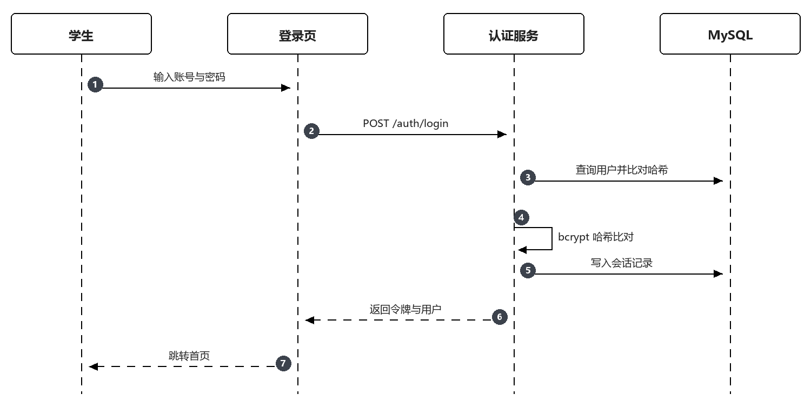

图 5-1 学生登录时序图

**（三）接口定义**

表 5-1 账户管理接口

| 接口 | 方法 | 路径 | 说明 | 请求参数 | 响应数据 |
| --- | --- | --- | --- | --- | --- |
| 注册 | POST | /auth/register | 学生注册 | studentNo, username, displayName, password | 用户标识 |
| 登录 | POST | /auth/login | 登录 | username, password | token, user |
| 注销 | POST | /auth/logout | 退出登录 | 无 | 无 |
| 查询当前用户 | GET | /me | 获取登录用户 | 无 | user |
| 修改资料 | PATCH | /me | 更新昵称与联系方式 | displayName, phone | user |
| 修改密码 | PATCH | /me/password | 校验旧密码后更新 | oldPassword, newPassword | 无 |

**（四）关键代码**

代码 5-1 登录校验与令牌签发

```ts
export async function login(input: LoginInput) {
  const user = await User.findOne({ where: { username: input.username } })
  if (!user) throw new AppError('UNAUTHORIZED', '账号或密码错误')
  if (user.status === 'disabled') throw new AppError('FORBIDDEN', '账号已停用，请联系管理员')

  const matched = await bcrypt.compare(input.password, user.passwordHash)
  if (!matched) throw new AppError('UNAUTHORIZED', '账号或密码错误')

  const jti = randomUUID()
  const expiresAt = dayjs().add(TOKEN_TTL_MINUTES, 'minute').toDate()
  await UserSession.create({ id: randomUUID(), userId: user.id, jti, expiresAt })

  const token = jwt.sign(
    { sub: user.id, role: user.role, jti },
    env.JWT_SECRET,
    { expiresIn: `${TOKEN_TTL_MINUTES}m` }
  )
  await user.update({ lastLoginAt: new Date() })
  return { token, user: toPublicUser(user) }
}
```

**（五）界面实现**

登录页如图 5-2 所示。页面包含用户名与密码两个输入框、登录按钮与注册入口，登录失败时在表单下方给出统一提示“账号或密码错误”，不区分账号不存在与密码错误，避免账号枚举。提交过程中按钮置灰，防止重复点击。

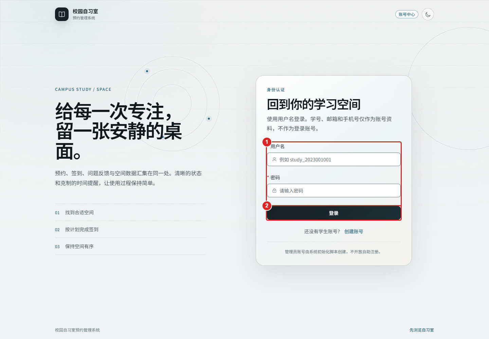
图 5-2 学生登录页面

注册页如图 5-3 所示。页面要求填写学号、用户名、显示名称与两次密码，学号与用户名在失焦时即校验唯一性，重复时在输入框下方提示。注册成功后自动跳转登录页，不直接进入系统，避免注册即登录带来的会话歧义。

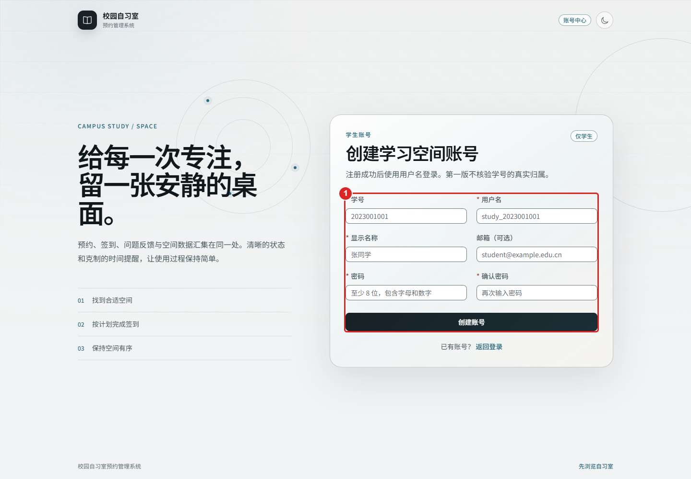

图 5-3 学生注册页面

### 5.1.2 自习室与座位查询

**（一）功能描述**

学生进入首页后看到自习室卡片列表，卡片展示名称、位置、开放状态与可预约座位数。进入详情页后选择日期与时段，页面按自习室配置的行列数渲染座位平面图，每个座位按状态着色：空闲、已预约、维修。座位状态由服务端计算，规则是：座位本身状态为维修或停用则不可选，所属自习室关闭则整间不可选，该座位在该日期时段存在有效预约则显示已预约。

**（二）业务流程**

座位查询流程如图 5-4 所示。前端先取自习室详情与有效时段，再按日期与时段请求座位状态，服务端查询该时段下所有有效预约并标记对应座位，返回座位列表与汇总数量。

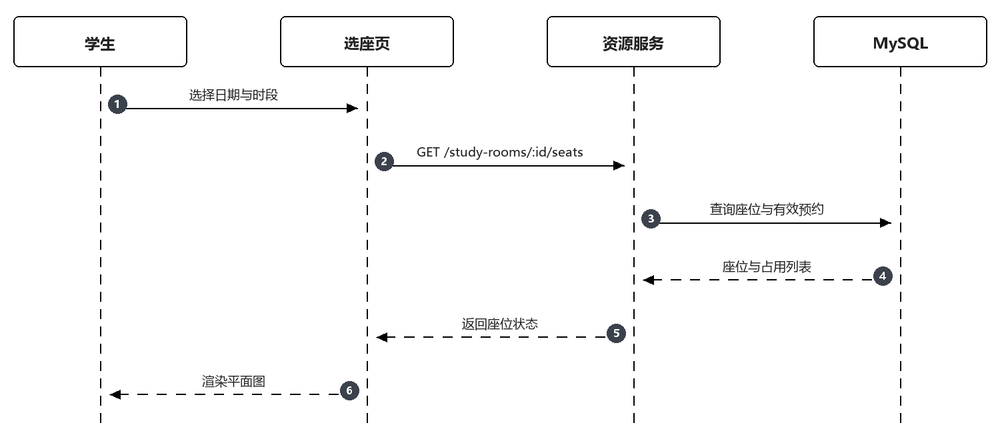

图 5-4 座位可用性查询时序图

**（三）接口定义**

表 5-2 自习室与座位查询接口

| 接口 | 方法 | 路径 | 说明 | 请求参数 | 响应数据 |
| --- | --- | --- | --- | --- | --- |
| 自习室列表 | GET | /study-rooms | 按名称与位置筛选 | keyword, status, page | items, total |
| 自习室详情 | GET | /study-rooms/:roomId | 详情与有效时段 | date | room, slots |
| 座位状态 | GET | /study-rooms/:roomId/seats | 指定日期时段座位 | date, slotId | seats, summary |

**（四）关键代码**

代码 5-2 座位可用性计算

```ts
export async function listSeatStatus(roomId: number, date: string, slotId: number) {
  const room = await StudyRoom.findByPk(roomId)
  if (!room) throw new AppError('NOT_FOUND', '自习室不存在')

  const slots = await RoomTimeSlot.findAll({ where: { roomId, status: 'active' } })
  const slot = slots.find((item) => item.id === slotId)
  if (!slot) throw new AppError('BAD_REQUEST', '时段不属于该自习室')

  const seats = await Seat.findAll({
    where: { roomId },
    order: [['rowNo', 'ASC'], ['columnNo', 'ASC']]
  })
  const occupied = await Reservation.findAll({
    attributes: ['seatId'],
    where: { roomId, reserveDate: date, slotId, status: ['pending', 'checked_in'] }
  })
  const taken = new Set(occupied.map((row) => row.seatId))
  const roomUsable = room.status === 'open' && room.bookableFrom <= date

  return seats.map((seat) => {
    const usable = roomUsable && seat.status === 'available' && seat.bookableFrom <= date
    return {
      seatId: seat.id,
      seatNo: seat.seatNo,
      row: seat.rowNo,
      column: seat.columnNo,
      status: !usable ? (seat.status === 'available' ? 'disabled' : seat.status)
        : taken.has(seat.id) ? 'reserved' : 'available'
    }
  })
}
```

**（五）界面实现**

选座页如图 5-5 所示。页面上方是日期与时段选择，下方是座位平面图，图例标明空闲、已预约与维修三种颜色。点击可用座位后，底部出现“确认预约”按钮；点击已预约座位则不响应，避免误操作。

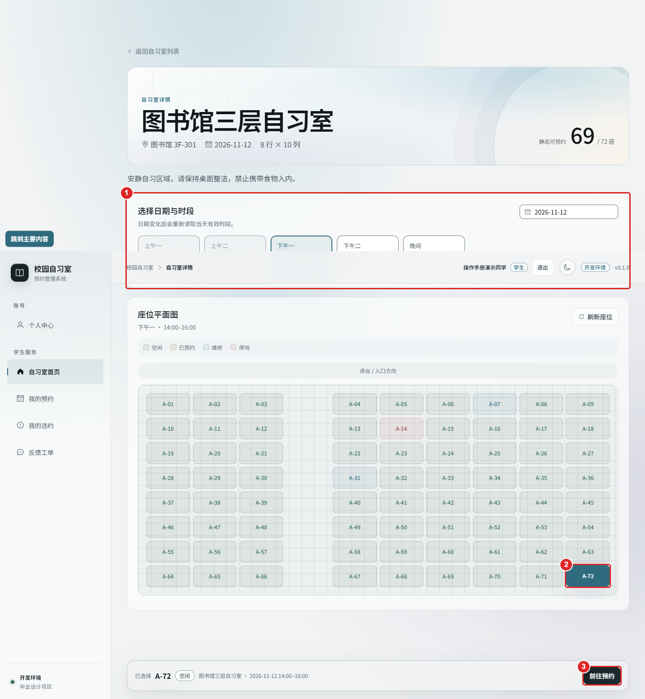
图 5-5 学生选座页面

首页如图 5-6 所示。页面按卡片列出可预约的自习室，展示名称、位置、开放状态与当日可用座位数；顶部为日期与时间范围筛选，切换后卡片上的可用数随之刷新。

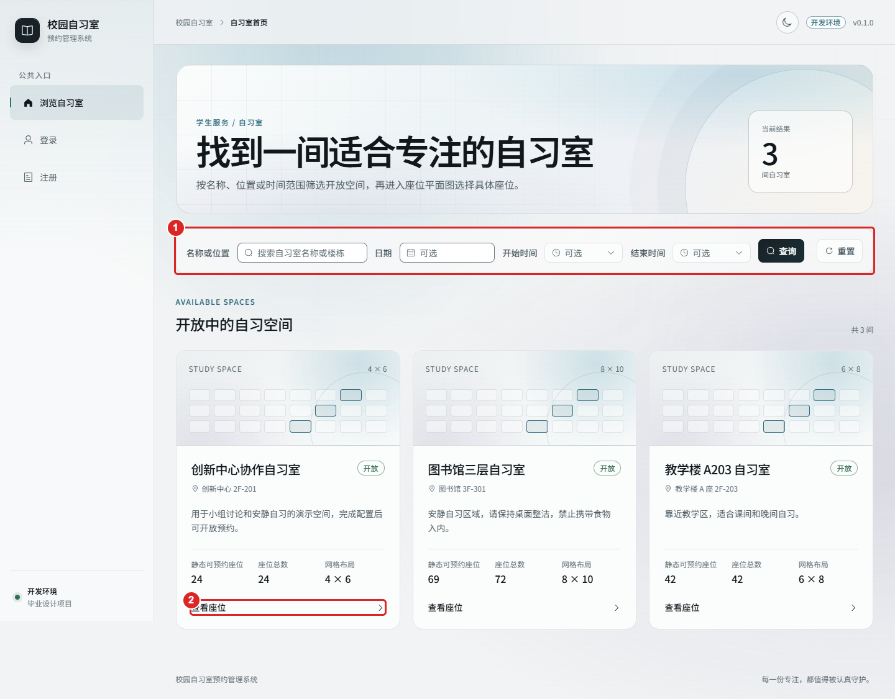

图 5-6 学生首页

### 5.1.3 预约提交

**（一）功能描述**

学生在确认页提交预约，参数包括自习室、座位、日期与时段。服务端在同一事务内依次完成：锁定用户行并校验账号状态与限制期；校验当日有效预约数未达上限；共享锁定自习室与时段并复核状态；排他锁定座位并复核状态；检查该座位在该日期时段是否已有有效预约；检查该学生在该时段是否已有重叠预约；写入预约与初始状态日志。任一条件不满足则回滚并返回对应错误码。

**（二）业务流程**

预约创建流程如图 5-7 所示。请求携带幂等键，服务端先查幂等键是否已存在，存在则直接返回原预约；不存在则开启事务执行上述校验与写入，提交后返回预约标识与状态。

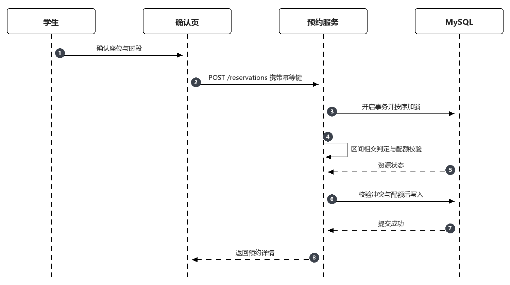

图 5-7 预约创建时序图

**（三）接口定义**

表 5-3 预约接口

| 接口 | 方法 | 路径 | 说明 | 请求参数 | 响应数据 |
| --- | --- | --- | --- | --- | --- |
| 创建预约 | POST | /reservations | 提交预约 | roomId, seatId, reserveDate, slotId | id, status, startAt, endAt |
| 我的预约 | GET | /me/reservations | 分页查询 | status, page | items, total |
| 预约详情 | GET | /reservations/:id | 详情与时间线 | 无 | reservation, logs |
| 取消预约 | POST | /reservations/:id/cancel | 取消 | reason | reservation |

**（四）关键代码**

代码 5-3 预约创建的事务与加锁

```ts
export async function createReservation(userId: number, input: CreateInput, key: string) {
  return sequelize.transaction(async (tx) => {
    const existed = await Reservation.findOne({
      where: { userId, idempotencyKey: key }, transaction: tx
    })
    if (existed) return existed

    const now = new Date()
    const user = await User.findByPk(userId, { transaction: tx, lock: tx.LOCK.UPDATE })
    if (user.restrictionUntil && user.restrictionUntil > now) {
      throw new AppError('FORBIDDEN', '当前账号处于预约限制期')
    }
    const room = await StudyRoom.findByPk(input.roomId, { transaction: tx, lock: tx.LOCK.SHARE })
    const slot = await RoomTimeSlot.findByPk(input.slotId, { transaction: tx, lock: tx.LOCK.SHARE })
    if (!room || !slot || slot.roomId !== room.id) throw new AppError('BAD_REQUEST', '资源不匹配')
    if (room.status !== 'open' || slot.status !== 'active') {
      throw new AppError('CONFLICT', '当前资源不可预约')
    }

    const seat = await Seat.findByPk(input.seatId, { transaction: tx, lock: tx.LOCK.UPDATE })
    if (!seat || seat.roomId !== room.id || seat.status !== 'available') {
      throw new AppError('CONFLICT', '该座位暂不可预约')
    }

    const { startAt, endAt } = resolveSlotWindow(input.reserveDate, slot, env.TZ)
    await assertNoOverlap(userId, startAt, endAt, tx)
    await assertDailyQuota(userId, input.reserveDate, tx)

    const reservation = await Reservation.create({
      userId, roomId: room.id, seatId: seat.id, slotId: slot.id,
      roomNameSnapshot: room.name, roomLocationSnapshot: room.location,
      seatNoSnapshot: seat.seatNo, reserveDate: input.reserveDate,
      startAt, endAt,
      checkInOpenAt: subMinutes(startAt, 30),
      checkInDeadline: addMinutes(startAt, 15),
      status: 'pending', idempotencyKey: key
    }, { transaction: tx })

    await ReservationStatusLog.create({
      reservationId: reservation.id, fromStatus: null, toStatus: 'pending',
      actorType: 'user', actorId: userId, occurredAt: new Date()
    }, { transaction: tx })

    return reservation
  })
}
```

**（五）界面实现**

预约确认页如图 5-8 所示。页面汇总自习室、座位、日期与时段，显示签到窗口的起止时间与取消规则，底部为确认按钮。提交成功后跳转预约详情，失败时按错误码给出提示，座位冲突提示“该座位在所选时段已被预约”，并刷新座位图。

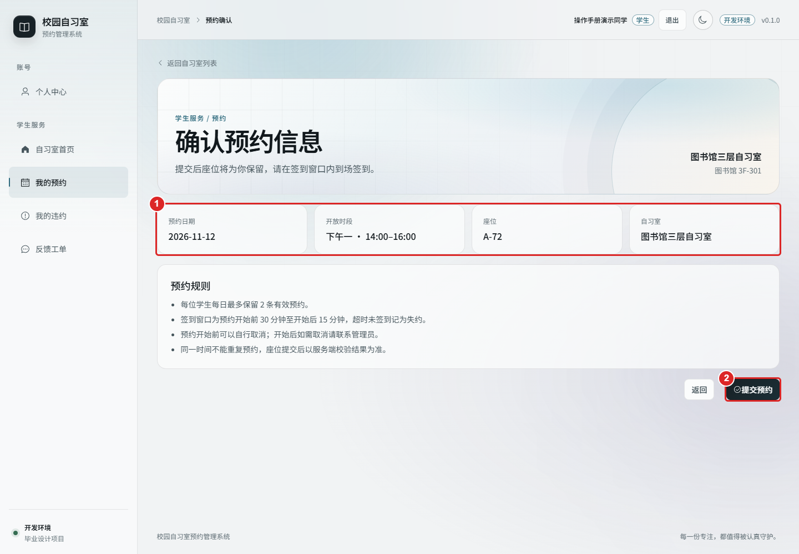

图 5-8 预约确认页面

冲突判定是本节最容易出错的地方，值得单独说明。最初的实现把判定写成“新预约的开始时间既不早于已有结束、也不晚于已有开始”，看起来覆盖了重叠，实际上漏掉了三种情形：起点相同、一个区间包含另一个、以及部分交叉。漏判的原因是把时间点与时间区间混用了。

正确的判定是区间相交：只要满足“已有开始 < 新结束 且 已有结束 > 新开始”，两个区间就必然重叠；反之，若新预约恰好从已有结束时刻开始，则两个条件之一不成立，判定为不重叠，符合“相邻可连约”的规则。这条判定同时用于两个对象：一是座位，检查该座位在该日期时段是否已有有效预约；二是学生，检查该学生在该时间区间是否已有其他预约。两处使用同一个函数，避免一处改对、另一处仍是旧逻辑。

判定完成后还要依赖唯一索引兜底。两个并发请求可能同时通过区间校验，此时只有数据库能裁决。服务层捕获唯一键冲突后转换为 409，并把“座位冲突”与“用户冲突”区分为不同提示，前者提示换座，后者提示调整时间。这一区分对用户是有意义的：看到“座位已被预约”，学生会换一个座位；看到“与已有预约重叠”，学生需要先处理已有预约。

### 5.1.4 签到

**（一）功能描述**

签到支持两种方式：学生用手机摄像头扫描管理员端展示的自习室二维码，或上传二维码图片由前端识别，识别结果包含自习室标识、随机数、签发时间与签名；管理员在二维码不可用时执行人工核验。服务端对扫码签到校验五项内容：令牌有效且为本人、签名正确、二维码归属的自习室与预约一致、当前时间落在签到窗口内、该预约处于待签到状态。校验通过后写入签到记录并把预约置为已签到。

**（二）业务流程**

签到流程如图 5-9 所示。前端识别二维码后提交解析出的字段，服务端重算签名并比对，随后校验窗口与预约状态，写入签到记录与状态日志。

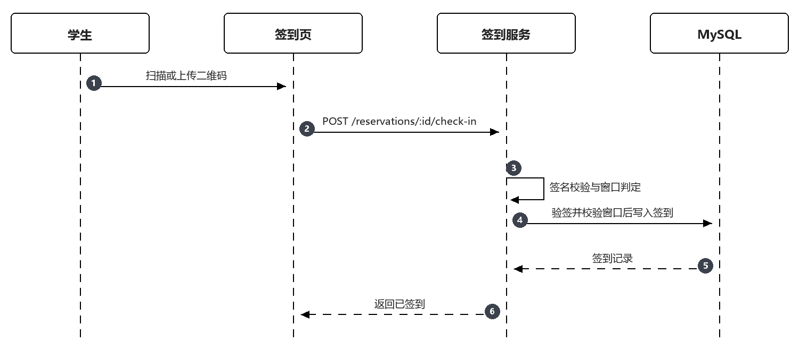

图 5-9 学生签到时序图

**（三）接口定义**

表 5-4 签到接口

| 接口 | 方法 | 路径 | 说明 | 请求参数 | 响应数据 |
| --- | --- | --- | --- | --- | --- |
| 生成签到码 | GET | /admin/check-in-codes | 按自习室生成 | roomId | roomId, nonce, issuedAt, signature |
| 学生签到 | POST | /reservations/:id/check-in | 提交签到数据 | roomId, nonce, issuedAt, signature | reservation |
| 人工核验 | POST | /admin/reservations/:id/check-in | 管理员核验 | remark | reservation |

**（四）关键代码**

代码 5-4 签到校验

```ts
export async function checkIn(reservationId: number, payload: QrPayload, userId: number) {
  const reservation = await Reservation.findByPk(reservationId)
  if (!reservation || reservation.userId !== userId) {
    throw new AppError('FORBIDDEN', '无权操作该预约')
  }
  if (reservation.status !== 'pending') {
    throw new AppError('CONFLICT', '该预约已签到或已结束')
  }

  const expected = signQr(payload.roomId, payload.nonce, payload.issuedAt, env.QR_SECRET)
  if (expected !== payload.signature) throw new AppError('BAD_REQUEST', '签到码无效')
  if (payload.roomId !== reservation.roomId) throw new AppError('BAD_REQUEST', '签到码不属于该自习室')

  const now = new Date()
  if (now < reservation.checkInOpenAt) throw new AppError('CONFLICT', '尚未到签到时间')
  if (now > reservation.checkInDeadline) throw new AppError('CONFLICT', '已超过签到截止时间')

  return sequelize.transaction(async (tx) => {
    await CheckIn.create({
      reservationId: reservation.id,
      checkedInAt: now,
      businessDate: reservation.reserveDate,
      method: 'qr',
      nonce: payload.nonce
    }, { transaction: tx })

    await reservation.update({ status: 'checked_in' }, { transaction: tx })
    await ReservationStatusLog.create({
      reservationId: reservation.id, fromStatus: 'pending', toStatus: 'checked_in',
      actorType: 'user', actorId: userId, occurredAt: now
    }, { transaction: tx })
    return reservation
  })
}
```

**（五）界面实现**

签到页如图 5-10 所示。页面展示当前预约的座位、时段与签到窗口，中部为二维码图案，下方提供“打开摄像头”与“上传图片”两个入口。签到成功后页面切换为已签到状态并显示签到时间；失败时给出具体原因，如“尚未到签到时间”或“已超过签到截止时间”。

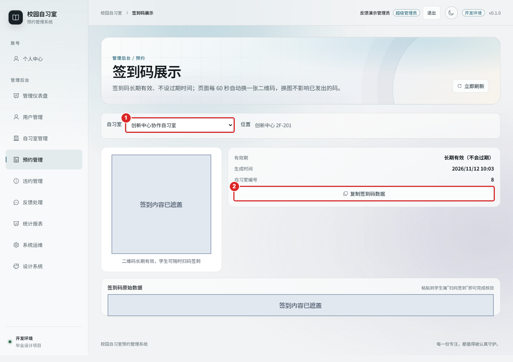

图 5-10 签到与签到码页面

### 5.1.5 取消与状态流转

**（一）功能描述**

学生在预约开始前可以取消。取消时服务端复核预约归属与状态，记录取消原因与操作时间，把状态置为已取消并写入状态日志，座位随即释放。开始时间之后取消入口关闭。所有状态变更统一由一个状态转换函数完成，该函数校验“当前状态是否允许迁移到目标状态”，并保证状态日志与主记录在同一事务内写入。

**（二）业务流程**

取消流程如图 5-11 所示。前端二次确认后提交取消请求，服务端校验时间与状态，更新预约并释放座位，返回最新的状态与时间线。

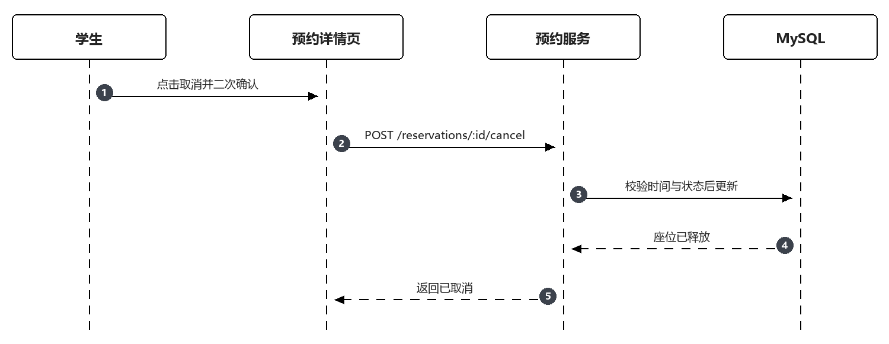

图 5-11 学生取消预约时序图

**（三）接口定义**

表 5-5 取消与状态接口

| 接口 | 方法 | 路径 | 说明 | 请求参数 | 响应数据 |
| --- | --- | --- | --- | --- | --- |
| 取消预约 | POST | /reservations/:id/cancel | 学生或管理员取消 | reason | reservation |
| 预约详情 | GET | /reservations/:id | 含状态时间线 | 无 | reservation, logs |

**（四）关键代码**

代码 5-5 状态转换

```ts
const ALLOWED: Record<ReservationStatus, ReservationStatus[]> = {
  pending: ['checked_in', 'cancelled', 'no_show'],
  checked_in: ['completed'],
  completed: [],
  cancelled: [],
  no_show: []
}

export async function transit(
  reservation: Reservation,
  to: ReservationStatus,
  actor: { type: 'user' | 'admin' | 'system'; id?: number },
  reason: string | null,
  tx: Transaction
) {
  if (!ALLOWED[reservation.status].includes(to)) {
    throw new AppError('CONFLICT', '当前状态不允许该操作')
  }
  const from = reservation.status
  await reservation.update({ status: to }, { transaction: tx })
  await ReservationStatusLog.create({
    reservationId: reservation.id, fromStatus: from, toStatus: to,
    actorType: actor.type, actorId: actor.id ?? null,
    reason, occurredAt: new Date()
  }, { transaction: tx })
  return reservation
}
```

**（五）界面实现**

取消确认弹窗如图 5-12 所示。弹窗说明“取消后座位将立即释放，且不可恢复”，要求填写取消原因，确认按钮为危险色。取消成功后列表中的状态标签变为已取消，详情页时间线新增一条记录，标明操作人与时间。

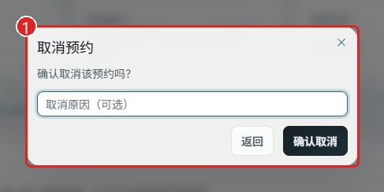
图 5-12 取消预约确认弹窗

我的预约列表如图 5-13 所示。列表按状态分为待签到、已签到、已完成、已取消、已失约五类，支持按状态筛选；每条记录显示自习室、座位、日期时段与操作入口，待签到的记录提供签到与取消两个按钮。

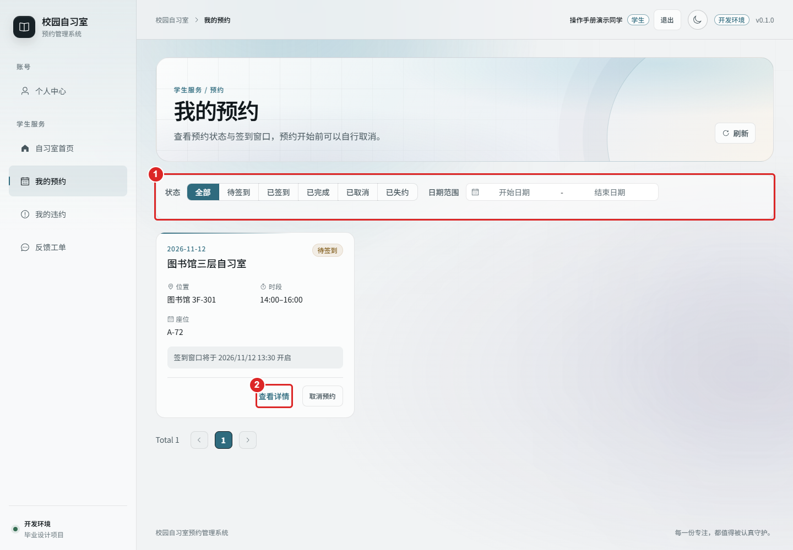

图 5-13 我的预约列表

### 5.1.6 违约查询与反馈

**（一）功能描述**

学生在个人中心查看违约情况，包括累计有效违约次数、每次失约的发生时间与原因、当前是否处于限制期以及限制截止时间。若因占座问题需要反馈，学生可提交工单，选择类型（占座、设备、环境、其他），填写描述并可指定自习室与座位，提交后可在“我的反馈”中查看状态与管理员填写的处理结果。

**（二）业务流程**

反馈提交流程如图 5-14 所示。提交时服务端校验描述长度与资源归属，写入工单并记录资源快照，工单进入待处理状态，等待管理员受理。

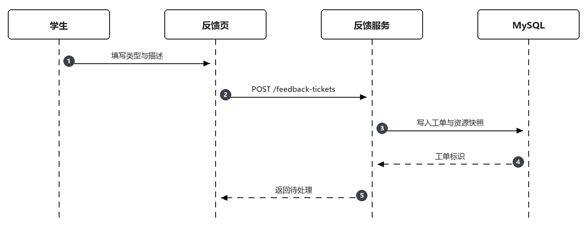

图 5-14 反馈提交时序图

**（三）接口定义**

表 5-6 违约与反馈接口

| 接口 | 方法 | 路径 | 说明 | 请求参数 | 响应数据 |
| --- | --- | --- | --- | --- | --- |
| 我的违约 | GET | /me/violations | 违约记录与限制期 | page | items, restriction |
| 提交反馈 | POST | /feedback-tickets | 新建工单 | type, description, roomId, seatId | ticket |
| 我的反馈 | GET | /me/feedback-tickets | 工单列表 | status, page | items, total |
| 工单详情 | GET | /me/feedback-tickets/:id | 详情与结果 | 无 | ticket |

**（四）关键代码**

代码 5-6 违约写入与限制刷新

```ts
export async function createFromNoShow(reservationId: number, tx: Transaction) {
  const reservation = await Reservation.findByPk(reservationId, { transaction: tx, lock: tx.LOCK.UPDATE })
  if (!reservation || reservation.status !== 'no_show') return null

  const exists = await Violation.findOne({ where: { reservationId }, transaction: tx })
  if (exists) return exists

  const violation = await Violation.create({
    userId: reservation.userId,
    reservationId,
    type: 'no_show',
    status: 'active',
    reason: '预约后未在规定时间签到',
    occurredAt: reservation.checkInDeadline
  }, { transaction: tx })

  const user = await User.findByPk(reservation.userId, { transaction: tx, lock: tx.LOCK.UPDATE })
  const rule = await getViolationRule(tx)
  const activeCount = await Violation.count({
    where: { userId: user.id, status: 'active' }, transaction: tx
  })
  await user.update({ violationCount: activeCount }, { transaction: tx })

  if (activeCount >= rule.threshold) {
    await user.update({
      restrictionStartedAt: user.restrictionStartedAt ?? new Date(),
      restrictionUntil: addDays(new Date(), rule.restrictDays)
    }, { transaction: tx })
  }
  return violation
}
```

**（五）界面实现**

反馈提交页如图 5-15 所示。页面上方为类型选择，中部为情况描述文本框，下方可选择关联的自习室与座位，提交后跳转“我的反馈”列表。列表按状态标注待处理、处理中、已解决、已驳回，点击进入详情可看到处理结果与处理时间。

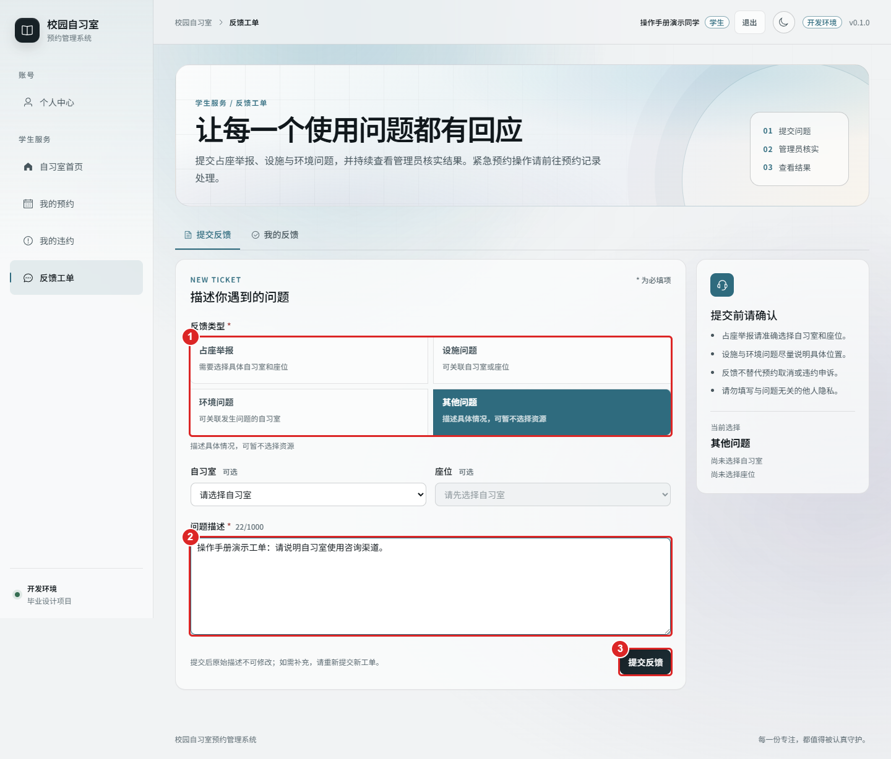

图 5-15 提交反馈页面
