## 5.2 管理端功能

### 5.2.1 统计与报表

**（一）功能描述**

管理端仪表盘展示当日与近七日的核心指标：预约量、签到率、失约率与座位利用率。指标按日期范围与自习室筛选，趋势接口返回按日聚合的时间序列，报表页以表格展示分时段的明细，并支持把当前筛选条件导出为 CSV。利用率的分母来自当日容量快照，分子来自已签到预约的实际使用时长。

**（二）业务流程**

统计聚合流程如图 5-16 所示。请求进入后，服务端先校验日期范围不超过 366 天，再按维度选择当前日实时聚合或读取已冻结的历史快照，两者拼接后返回。

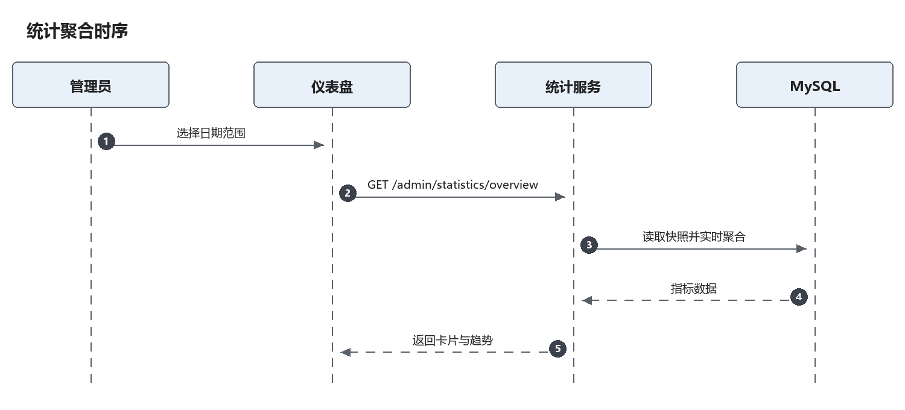

图 5-16 统计聚合时序图

**（三）接口定义**

表 5-7 统计与报表接口

| 接口 | 方法 | 路径 | 说明 | 请求参数 | 响应数据 |
| --- | --- | --- | --- | --- | --- |
| 概览 | GET | /admin/statistics/overview | 核心指标卡片 | date, roomId | metrics |
| 趋势 | GET | /admin/statistics/trend | 按日序列 | startDate, endDate, roomId | series |
| 导出 | GET | /admin/statistics/export | CSV 下载 | 同趋势参数 | CSV 流 |

**（四）关键代码**

代码 5-7 分时段指标聚合

```ts
export async function aggregateRange(startDate: string, endDate: string, roomId?: number) {
  const rows = await DailySlotMetrics.findAll({
    where: {
      statDate: { [Op.between]: [startDate, endDate] },
      ...(roomId ? { roomId } : {})
    },
    order: [['statDate', 'ASC'], ['slotStartTime', 'ASC']]
  })

  return rows.map((row) => {
    const valid = row.checkedInCount + row.noShowCount + row.outageCancelledCount
    return {
      statDate: row.statDate,
      roomName: row.roomNameSnapshot,
      slotLabel: row.slotLabel,
      reservationCount: row.reservationCount,
      checkInRate: valid === 0 ? 0 : round((row.checkedInCount) / valid, 4),
      noShowRate: valid === 0 ? 0 : round(row.noShowCount / valid, 4),
      utilization: row.availableSeatMinutes === 0
        ? 0
        : round(row.usedSeatMinutes / row.availableSeatMinutes, 4),
      finalized: Boolean(row.finalizedAt)
    }
  })
}
```

**（五）界面实现**

仪表盘如图 5-17 所示。顶部为四张指标卡片，中部为预约量与签到率的双轴趋势图，下方为分时段利用率柱状图与最近预约列表。切换日期范围时图表同步刷新，历史日期的数据标注为已冻结。

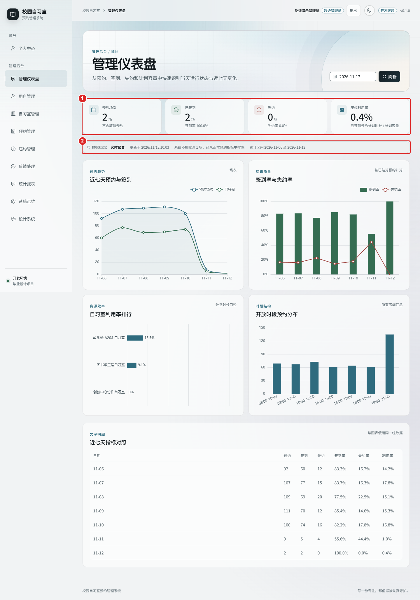
图 5-17 管理端仪表盘

统计报表页如图 5-18 所示。页面上方为日期范围与自习室筛选，中部为与仪表盘一致的趋势图，下方为分时段明细表，列出自习室、时段、预约数、签到数、失约数与利用率，右下角提供 CSV 导出按钮。

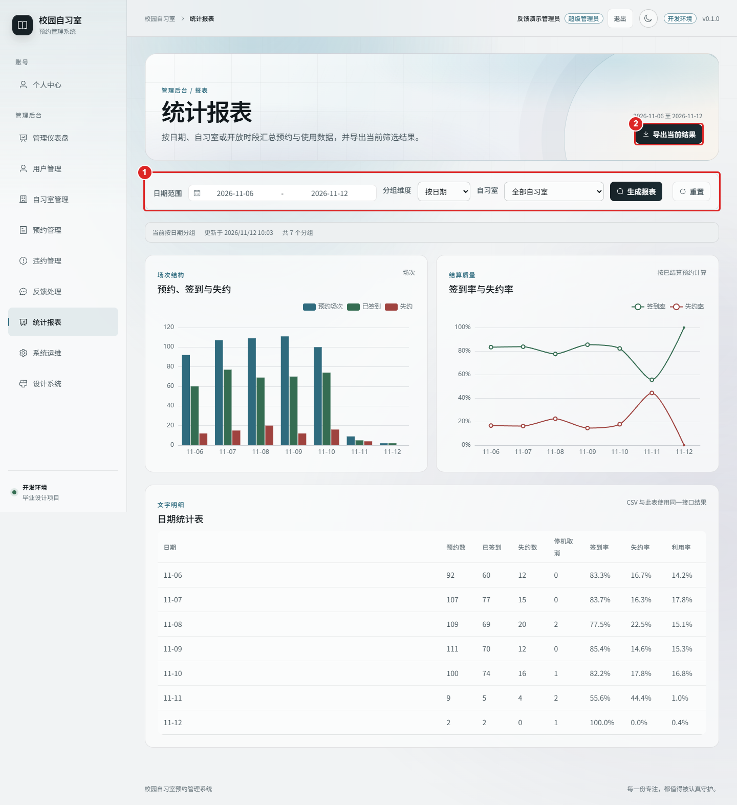

图 5-18 统计报表页面

### 5.2.2 自习室与座位维护

**（一）功能描述**

管理员可新增自习室，填写名称、位置、描述与平面图行列数，并设置状态。自习室新建后默认为关闭状态，配置好时段与座位后再开放。开放时段在自习室内维护，要求开始早于结束、长度在 30 分钟到 4 小时之间、同一自习室内时段不重叠。座位支持按批次批量生成：指定批次前缀与行列范围，系统按“前缀-序号”规则生成座位编号与坐标，已存在的编号或坐标自动跳过。单个座位可设为维修或停用，维修中的座位不参与预约。

**（二）业务流程**

批量生成座位流程如图 5-19 所示。服务端先校验批次前缀在自习室内唯一，再在事务中逐行插入，遇到唯一键冲突则跳过该坐标，最后返回生成数量与跳过数量。

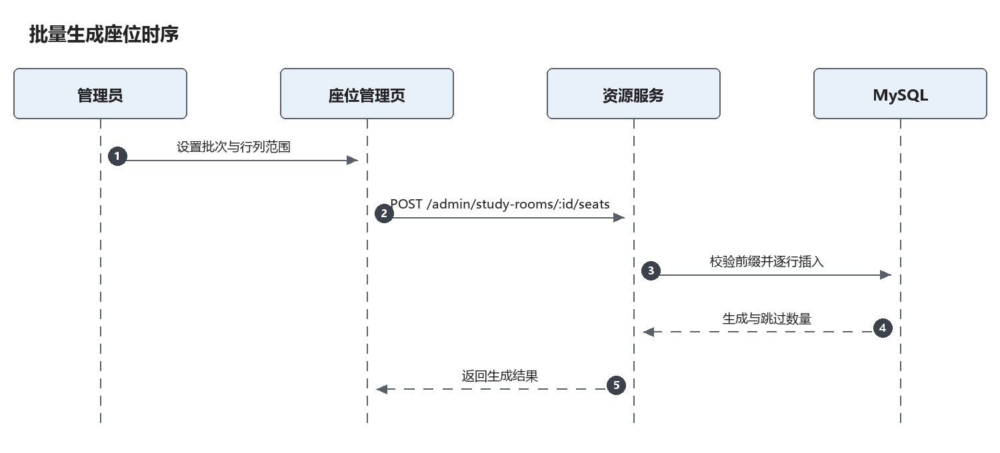

图 5-19 批量生成座位时序图

**（三）接口定义**

表 5-8 资源维护接口

| 接口 | 方法 | 路径 | 说明 | 请求参数 | 响应数据 |
| --- | --- | --- | --- | --- | --- |
| 新增自习室 | POST | /admin/study-rooms | 创建 | name, location, gridRows, gridColumns | room |
| 修改自习室 | PATCH | /admin/study-rooms/:roomId | 修改或停用 | 同新增，可选 | room |
| 新增时段 | POST | /admin/study-rooms/:roomId/time-slots | 配置时段 | label, startTime, endTime | slot |
| 启停时段 | PATCH | /admin/time-slots/:slotId | 修改状态 | status | slot |
| 批量生成座位 | POST | /admin/study-rooms/:roomId/seats | 按批次生成 | batchPrefix, rowFrom, rowTo, columnFrom, columnTo | created, skipped |
| 修改座位 | PATCH | /admin/seats/:seatId | 维修或停用 | status, remark | seat |

**（四）关键代码**

代码 5-8 座位批量生成

```ts
export async function createSeatBatch(roomId: number, input: SeatBatchInput) {
  const room = await StudyRoom.findByPk(roomId)
  if (!room) throw new AppError('NOT_FOUND', '自习室不存在')
  if (input.rowTo > room.gridRows || input.columnTo > room.gridColumns) {
    throw new AppError('VALIDATION_ERROR', '批次范围超出平面图尺寸')
  }

  const prefixUsed = await Seat.findOne({ where: { roomId, batchPrefix: input.batchPrefix } })
  if (prefixUsed) throw new AppError('CONFLICT', '批次前缀已存在')

  let created = 0
  let skipped = 0
  await sequelize.transaction(async (tx) => {
    for (let row = input.rowFrom; row <= input.rowTo; row += 1) {
      for (let column = input.columnFrom; column <= input.columnTo; column += 1) {
        const seatNo = `${input.batchPrefix}-${String(row)}${String(column).padStart(2, '0')}`
        const [seat, isNew] = await Seat.findOrCreate({
          where: { roomId, seatNo },
          defaults: { roomId, batchPrefix: input.batchPrefix, seatNo, rowNo: row, columnNo: column, status: 'available', bookableFrom: input.bookableFrom },
          transaction: tx
        })
        if (isNew) created += 1
        else skipped += 1
      }
    }
  })
  return { created, skipped }
}
```

**（五）界面实现**

座位管理页如图 5-20 所示。页面以平面图展示所有座位，维修中的座位以灰色标注并可点击切换；工具栏提供“批量生成”按钮，弹窗内填写批次前缀、行列范围与生效日期；右侧显示当前自习室的座位统计与时段列表。

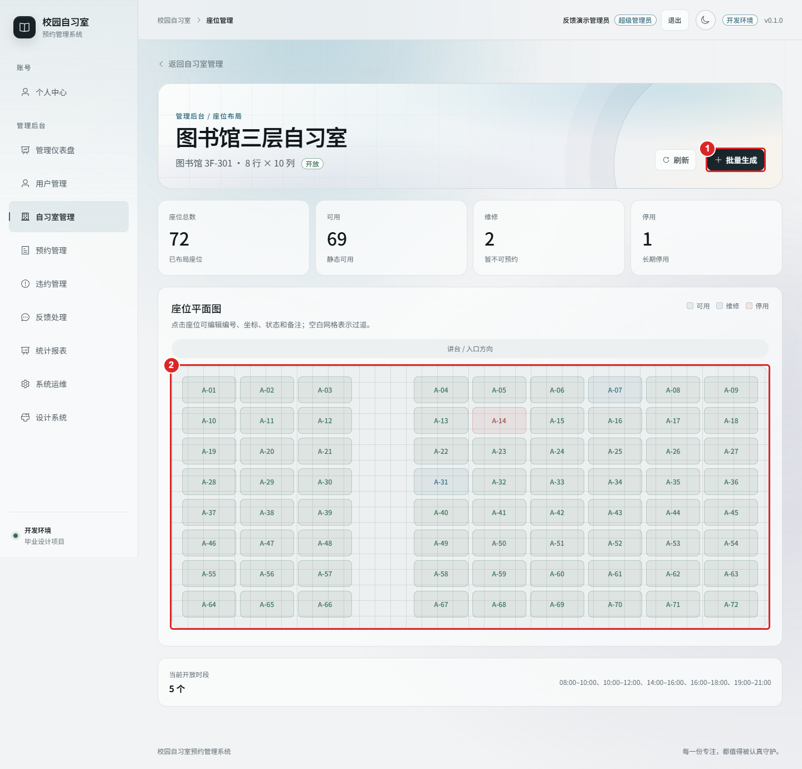
图 5-20 座位管理页面

时段配置页如图 5-21 所示。页面列出自习室下的全部时段，显示名称、起止时间与状态，可新增时段、启用或停用；新增时校验开始早于结束、长度在 30 分钟到 4 小时之间、与同时段不重叠。

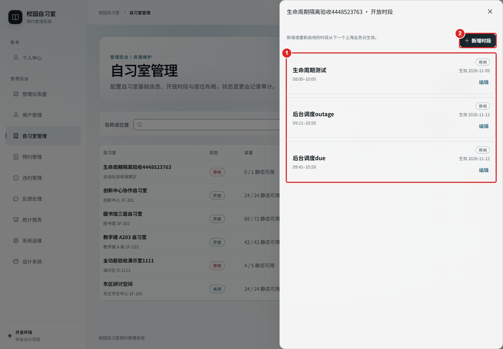

图 5-21 开放时段配置页面

### 5.2.3 预约管理

**（一）功能描述**

管理员可查询全量预约，按日期、自习室、状态与学生筛选，查看预约详情与完整状态时间线。对二维码不可用的情况，管理员可在详情页执行人工核验签到，签到方式记为人工并记录操作人。对异常预约，管理员可取消待签到状态的预约，取消必须填写原因，取消后记入状态日志。

**（二）业务流程**

人工核验签到流程如图 5-22 所示。管理员在详情页点击“人工签到”，服务端校验预约状态为待签到且当前时间在窗口内，写入签到记录并把状态置为已签到，操作人记入签到表。

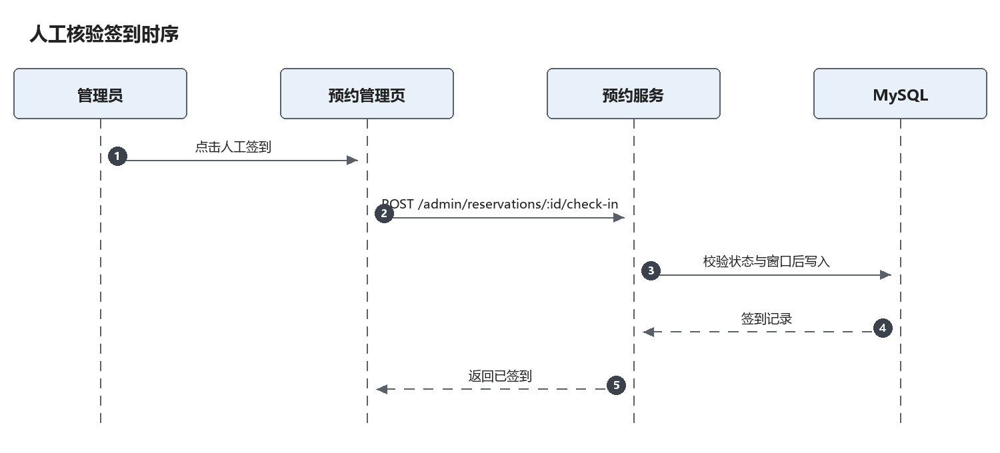

图 5-22 人工核验签到时序图

**（三）接口定义**

表 5-9 预约管理接口

| 接口 | 方法 | 路径 | 说明 | 请求参数 | 响应数据 |
| --- | --- | --- | --- | --- | --- |
| 预约列表 | GET | /admin/reservations | 多条件查询 | date, roomId, status, keyword, page | items, total |
| 预约详情 | GET | /reservations/:id | 详情与时间线 | 无 | reservation, logs |
| 人工签到 | POST | /admin/reservations/:id/check-in | 核验签到 | remark | reservation |
| 管理员取消 | POST | /reservations/:id/cancel | 取消并记录原因 | reason | reservation |

**（四）关键代码**

代码 5-9 管理员取消预约

```ts
export async function adminCancel(reservationId: number, adminId: number, reason: string) {
  if (!reason || reason.trim().length < 2) {
    throw new AppError('VALIDATION_ERROR', '请填写取消原因')
  }
  return sequelize.transaction(async (tx) => {
    const reservation = await Reservation.findByPk(reservationId, {
      transaction: tx, lock: tx.LOCK.UPDATE
    })
    if (!reservation) throw new AppError('NOT_FOUND', '预约不存在')
    if (reservation.status !== 'pending') {
      throw new AppError('CONFLICT', '只能取消待签到预约')
    }

    await reservation.update({
      status: 'cancelled',
      cancelReason: reason,
      cancelledBy: adminId,
      cancelledAt: new Date()
    }, { transaction: tx })

    await ReservationStatusLog.create({
      reservationId, fromStatus: 'pending', toStatus: 'cancelled',
      actorType: 'admin', actorId: adminId, reason, occurredAt: new Date()
    }, { transaction: tx })
    return reservation
  })
}
```

**（五）界面实现**

预约管理页如图 5-23 所示。页面上方为筛选区，支持日期范围、自习室、状态与关键字组合查询；表格列包含学生、自习室、座位、时段、状态与操作；操作列提供详情、人工签到与取消三个入口，取消时弹出原因输入框。

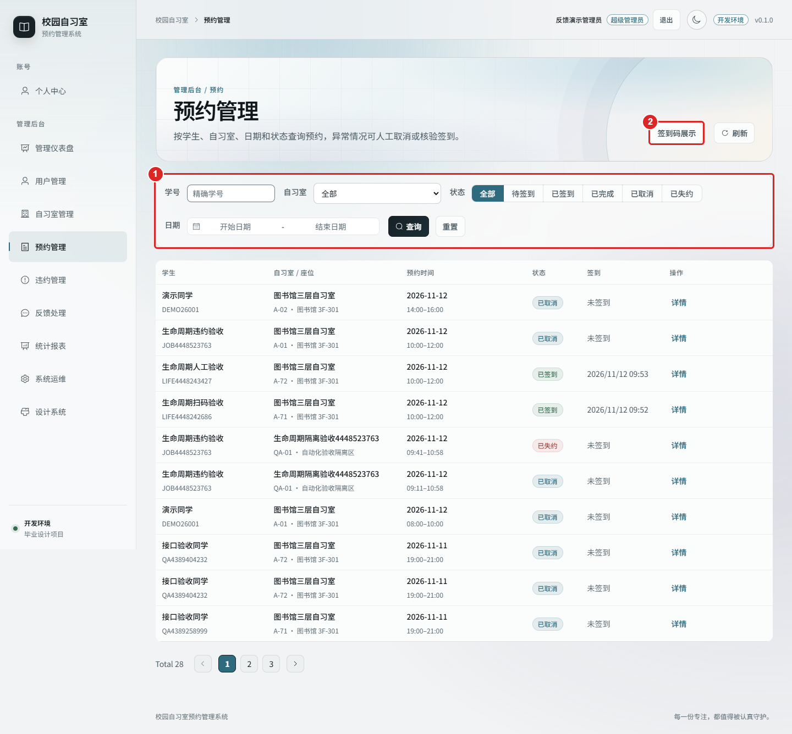
图 5-23 预约管理页面

预约详情页如图 5-24 所示。页面左侧为预约信息与资源快照，右侧为状态时间线，按时间顺序列出每次状态变更的操作人、时间与原因；底部提供人工签到与取消两个操作入口。

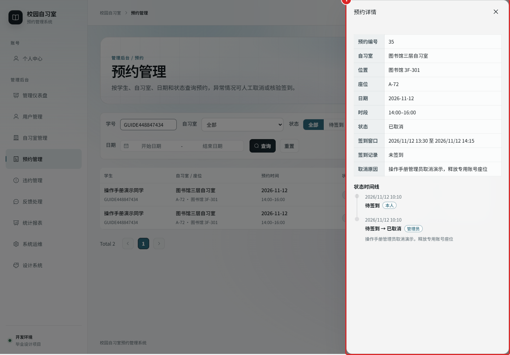

图 5-24 预约详情与状态时间线

### 5.2.4 违约管理

**（一）功能描述**

违约管理包括记录查看、规则配置与撤销三部分。管理员可按学生与状态查询违约记录，查看违约原因、发生时间与关联预约；可在线调整失约阈值与限制天数，调整只对之后新触发的限制生效，已生效的限制区间保持不变；可撤销违约，撤销时必须填写原因，撤销后重新统计有效违约数，低于阈值时清空该学生的预约限制，但原预约的失约状态不改变。

**（二）业务流程**

撤销违约流程如图 5-25 所示。服务端锁定用户行，更新违约记录状态并记录撤销人与原因，重新计算有效违约数，按阈值决定是否清空限制，最后写入审计日志。

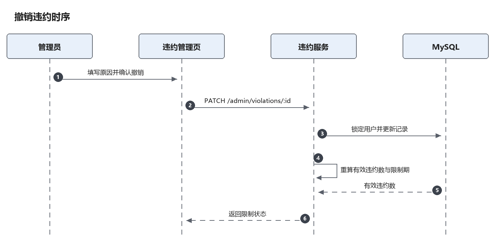

图 5-25 撤销违约时序图

**（三）接口定义**

表 5-10 违约管理接口

| 接口 | 方法 | 路径 | 说明 | 请求参数 | 响应数据 |
| --- | --- | --- | --- | --- | --- |
| 违约列表 | GET | /admin/violations | 查询记录 | userId, status, page | items, total |
| 撤销违约 | PATCH | /admin/violations/:id | 撤销 | resolutionReason | violation |
| 查询规则 | GET | /admin/violation-rules | 当前规则 | 无 | threshold, restrictDays |
| 修改规则 | PUT | /admin/violation-rules | 更新规则 | threshold, restrictDays | rule |

**（四）关键代码**

代码 5-10 撤销违约与限制期重算

```ts
export async function revokeViolation(violationId: number, adminId: number, reason: string) {
  return sequelize.transaction(async (tx) => {
    const violation = await Violation.findByPk(violationId, { transaction: tx, lock: tx.LOCK.UPDATE })
    if (!violation) throw new AppError('NOT_FOUND', '违约记录不存在')
    if (violation.status === 'revoked') throw new AppError('CONFLICT', '该记录已撤销')

    const user = await User.findByPk(violation.userId, { transaction: tx, lock: tx.LOCK.UPDATE })
    await violation.update({
      status: 'revoked', resolvedBy: adminId, resolvedAt: new Date(), resolutionReason: reason
    }, { transaction: tx })

    const activeCount = await Violation.count({
      where: { userId: user.id, status: 'active' }, transaction: tx
    })
    const rule = await getViolationRule(tx)
    const updates: Partial<User> = { violationCount: activeCount }
    if (activeCount < rule.threshold) {
      updates.restrictionStartedAt = null
      updates.restrictionUntil = null
    }
    await user.update(updates, { transaction: tx })
    await writeAudit(tx, adminId, 'violation.revoke', violation.id, reason)
    return violation
  })
}
```

**（五）界面实现**

违约管理页如图 5-26 所示。页面分两个区域：上方为规则配置卡片，展示当前阈值与限制天数并提供编辑入口；下方为违约记录表，列出学生、原因、发生时间、状态与操作，撤销按钮弹出原因输入框，提交后记录状态变为已撤销并显示撤销人。

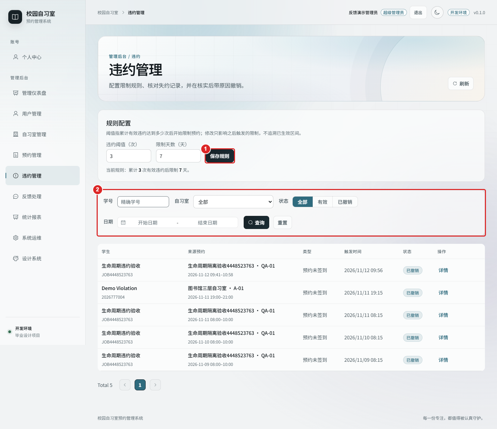

图 5-26 违约管理页面

### 5.2.5 反馈工单处理

**（一）功能描述**

管理员查看全部工单，按状态、类型与时间筛选，进入详情后可看到学生提交的描述、关联资源与提交时间。处理时先受理把状态置为处理中，核实后填写处理结果并关闭工单，结果对学生可见。工单状态只能按“待处理→处理中→已解决”或“待处理/处理中→已驳回”流转，跳过处理中直接解决会被拒绝。

**（二）业务流程**

工单处理流程如图 5-27 所示。服务端校验目标状态是否在允许集合内，更新状态、处理结果与处理时间，同时写入审计日志，学生在“我的反馈”中即可看到结果。

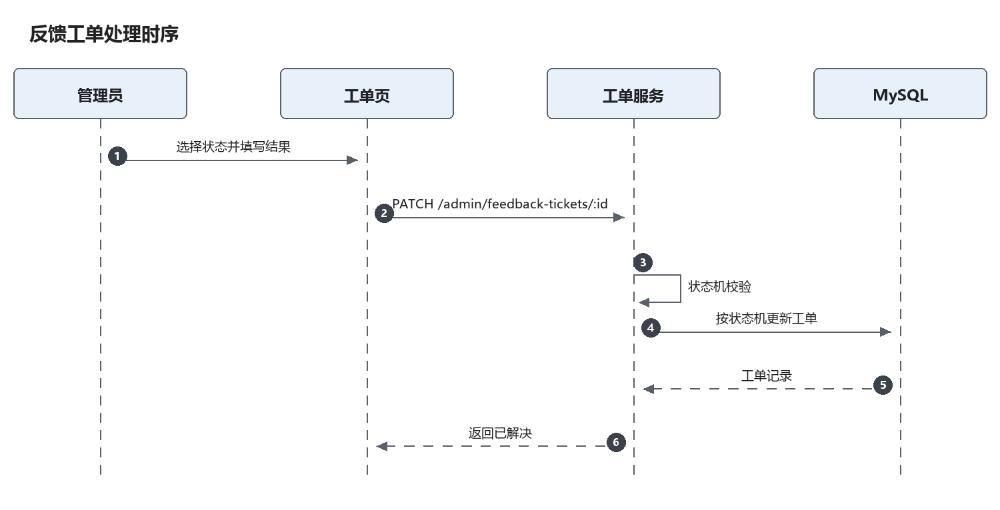

图 5-27 反馈工单处理时序图

**（三）接口定义**

表 5-11 反馈工单接口

| 接口 | 方法 | 路径 | 说明 | 请求参数 | 响应数据 |
| --- | --- | --- | --- | --- | --- |
| 工单列表 | GET | /admin/feedback-tickets | 查询 | status, type, page | items, total |
| 工单详情 | GET | /admin/feedback-tickets/:id | 详情 | 无 | ticket |
| 处理工单 | PATCH | /admin/feedback-tickets/:id | 状态与结果 | status, result | ticket |

**（四）关键代码**

代码 5-11 工单状态机

```ts
const TICKET_FLOW: Record<TicketStatus, TicketStatus[]> = {
  pending: ['processing', 'rejected'],
  processing: ['resolved', 'rejected'],
  resolved: [],
  rejected: []
}

export async function handleTicket(
  ticketId: number, adminId: number,
  input: { status: TicketStatus; result?: string }
) {
  return sequelize.transaction(async (tx) => {
    const ticket = await FeedbackTicket.findByPk(ticketId, { transaction: tx, lock: tx.LOCK.UPDATE })
    if (!ticket) throw new AppError('NOT_FOUND', '工单不存在')
    if (!TICKET_FLOW[ticket.status].includes(input.status)) {
      throw new AppError('CONFLICT', '不允许的状态变更')
    }
    if (input.status === 'resolved' && !input.result?.trim()) {
      throw new AppError('VALIDATION_ERROR', '请填写处理结果')
    }

    await ticket.update({
      status: input.status,
      result: input.result ?? ticket.result,
      handledBy: adminId,
      processedAt: ticket.processedAt ?? new Date(),
      closedAt: ['resolved', 'rejected'].includes(input.status) ? new Date() : null
    }, { transaction: tx })

    await writeAudit(tx, adminId, 'feedback.handle', ticket.id, input.status)
    return ticket
  })
}
```

**（五）界面实现**

工单详情页如图 5-28 所示。页面左侧为学生描述与关联资源，右侧为处理面板，包含状态选择、结果文本框与提交按钮。提交后状态标签更新，处理时间与处理人显示在信息区，学生在学生端可看到同一份结果。

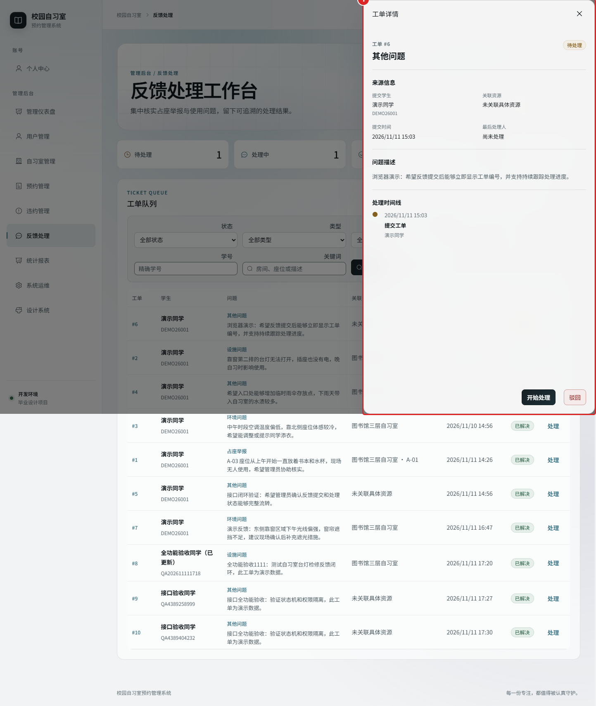
图 5-28 工单详情页面

处理完成后的工单如图 5-29 所示。状态标签变为已解决，处理结果、处理人与处理时间显示在信息区，学生在学生端可看到同一份结果与时间。

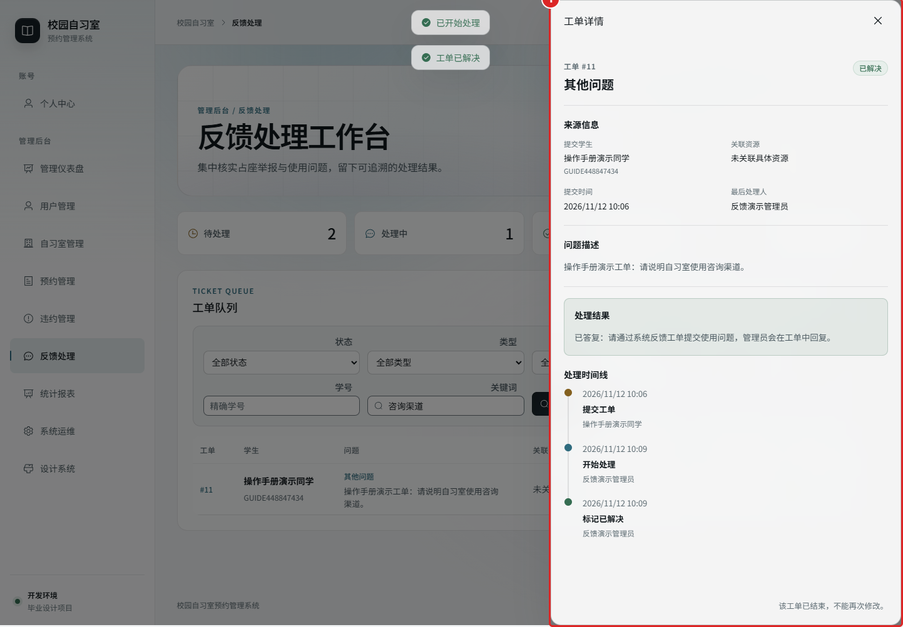

图 5-29 工单处理结果

### 5.2.6 系统设置与运维

**（一）功能描述**

系统设置页集中管理可调参数：预约窗口天数（默认 7 天，上限 30 天）、每日预约上限（默认 2 条）、违约阈值（默认 3 次）与限制天数（默认 7 天）。参数保存后写入配置表并立即生效，正在进行的预约不受影响。运维页展示服务与数据库状态、定时任务最近运行时间、各定时任务的待处理数量，并提供审计日志查询。配置变更与管理员关键操作均写入审计日志，记录操作人、变更前后值与原因。

**（二）业务流程**

配置保存流程如图 5-30 所示。服务端校验参数范围，写入配置表并记录变更前后值，同时刷新内存中的参数缓存，返回最新配置；前端在下次请求时即可感知新的预约窗口。

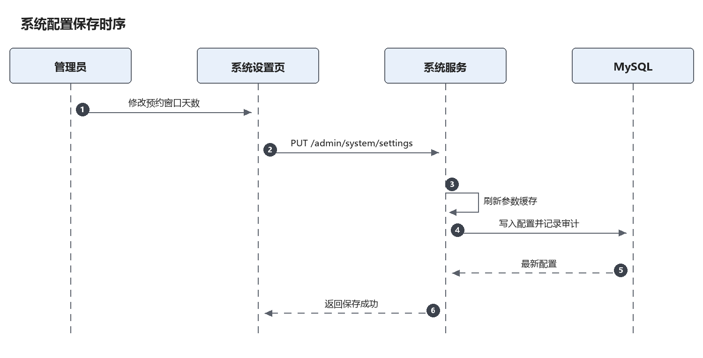

图 5-30 系统配置保存时序图

**（三）接口定义**

表 5-12 系统配置与运维接口

| 接口 | 方法 | 路径 | 说明 | 请求参数 | 响应数据 |
| --- | --- | --- | --- | --- | --- |
| 公开配置 | GET | /system/public-config | 学生端读取 | 无 | bookingWindowDays, dailyLimit |
| 查询配置 | GET | /admin/system/settings | 全部参数 | 无 | settings |
| 更新配置 | PUT | /admin/system/settings | 批量更新 | settings[] | settings |
| 运维状态 | GET | /admin/system/status | 服务与任务 | 无 | health, jobs |
| 健康检查 | GET | /health | 存活检查 | 无 | status |

**（四）界面实现**

系统设置页如图 5-31 所示。页面按业务分组展示参数，每项右侧为当前值与编辑控件，底部为保存按钮；保存前校验数值范围，超出范围时在输入框下方提示。运维状态区展示数据库连接、最近一次任务运行时间与积压数量，异常项以警示色标出。

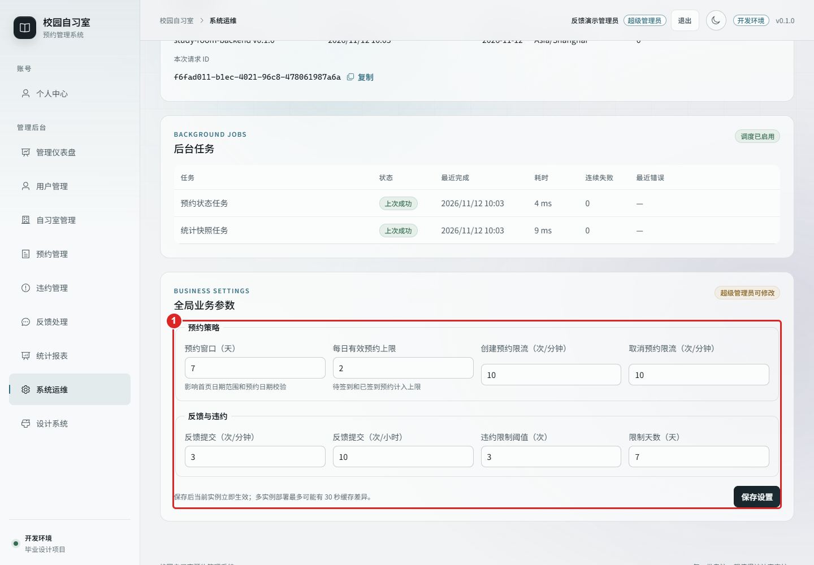
图 5-31 系统设置页面

运行状态区如图 5-32 所示。页面展示服务与数据库连通性、各定时任务最近一次运行时间与待处理数量，异常项以警示色标出；下方为审计日志入口，可按时间与操作人筛选。

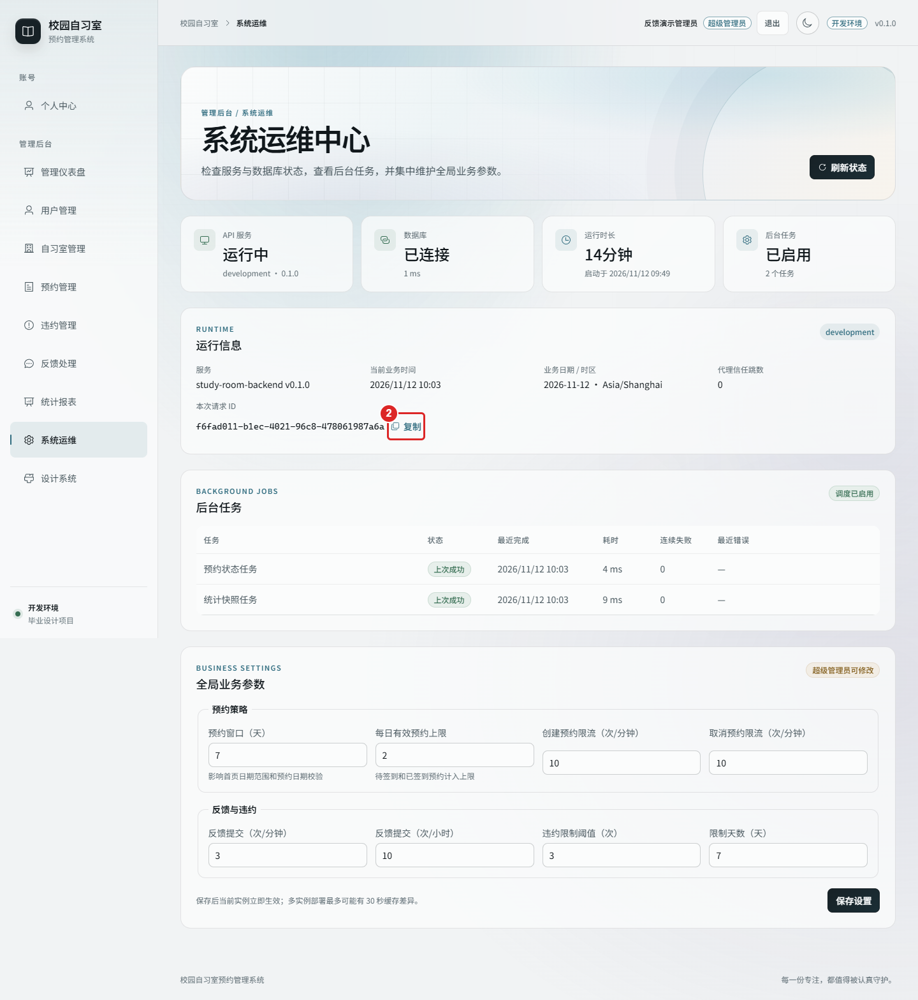

图 5-32 系统运行状态

## 5.3 关键问题处理

前面按功能说明了实现，但有几个问题横跨多个模块，单独放在某一节都不合适。本节集中说明这些问题的成因与处理方式。

### 5.3.1 并发预约的一致性保障

抢座是系统唯一存在真实并发的场景。开放预约的时刻，多名学生可能同时对同一座位提交请求。如果处理不当，会出现两种错误：两人都预约成功，导致同一座位被重复占用；或者两人都失败，座位空置而请求被拒。

系统的处理分三层。第一层是事务。预约创建、取消与管理员取消都在事务中执行，事务内完成校验与写入，异常时整体回滚，不会留下“预约写入了但状态日志没写”这类半成品数据。

第二层是加锁顺序。事务开始时按“用户→自习室→时段→座位”的固定顺序获取锁，用户行与座位行使用排他锁，自习室与时段使用共享锁。固定顺序的作用是避免死锁：如果两个事务分别先锁座位再锁用户，就可能形成互相等待。共享锁用在自习室与时段上，是因为这两个资源在预约中只读不改，多个事务可以同时持有，不必排队。

第三层是唯一约束。加锁之后仍可能存在问题：锁只能约束数据库中的行，而“同一座位同一日期时段唯一”是一个由多个字段组合而成的条件，无法直接用行锁表达。系统用生成列 `active_slot_key` 解决：该列在预约处于待签到或已签到状态时取“座位:日期:时段”的拼接值，其他状态取空值，再对该列建立唯一索引。写入时若违反约束，数据库返回唯一键冲突，服务层捕获后转换为 409，提示“该座位在所选时段已被预约”。

三层之间的关系是递进的：事务保证原子性，锁保证校验与写入之间资源状态不被打断，唯一约束保证即使前两层都被绕过也不会出现重复占用。实际测试中，两名用户同时提交同一座位，结果是一条 201、一条 409，符合预期。

### 5.3.2 时区与跨日处理

时间处理是预约系统最容易出错的地方。数据库中的 `DATETIME` 按 UTC 存储与比较，而学生看到的日期与时段是东八区时间。若在某一层混用两个口径，就会出现八小时偏移：例如学生在本地 23:59 提交的预约被记为第二天的记录，或者签到窗口在错误的时刻开启。

系统的做法是明确三个边界。存储边界：所有 `DATETIME` 一律为 UTC，Sequelize 连接与 MySQL 会话都固定 `+00:00`，不依赖服务器本地时区。业务边界：业务日期 `reserve_date` 是东八区的自然日，时段起止是东八区的本地时刻，两者组合成具体时刻后再转换为 UTC 写入 `start_at` 与 `end_at`。展示边界：接口返回带时区的 ISO 8601 字符串，前端按本地时区渲染。

签到窗口在预约创建时就被计算并写入 `check_in_open_at` 与 `check_in_deadline`，而不是在签到时按当前配置重新计算。这样做的原因是配置可能被调整，若按当前规则重算，历史预约的窗口会跟着变化，已经失效的预约可能重新变得可签到。窗口写入预约表后，签到校验只读取快照，行为稳定。

测试中对跨日场景单独设计了用例：在东八区 23:59 提交预约，检查业务日期是否仍为当日、`start_at` 的 UTC 值是否正确、次日查询时记录是否出现在正确日期下。这类问题在白天测试时不会暴露，必须构造边界时刻。

### 5.3.3 幂等与重复提交

预约接口是写操作，网络抖动或用户连点都可能造成重复提交。若每次提交都创建一条预约，学生可能在不知情的情况下占用多个座位，或者因为重复请求触发每日上限而被拒绝，体验很差。

系统要求创建预约时携带 `Idempotency-Key` 请求头，服务端在预约表上建立“用户 + 幂等键”的唯一索引。处理逻辑是：先按用户与幂等键查询，若已存在则直接返回原预约；不存在则执行创建。并发情况下两个相同请求可能同时查不到记录，此时唯一索引会使其中一个失败，失败方重新查询后返回已创建的记录。

前端在进入确认页时生成幂等键，同一次确认动作复用同一个键，用户返回列表再重新进入则生成新键。这样既保证重试不会重复创建，也不会把两次真实的预约误判为重复。

### 5.3.4 定时任务的幂等与停机恢复

定时任务每分钟执行一次，负责两件事：把超时未签到的预约转为失约，把已签到且到期的预约转为完成。任务由 cron 触发，可能因为服务重启、数据库不可用等原因中断。

任务的设计遵循三个原则。第一，条件更新。更新语句带上“当前状态仍为待签到”的条件，只有匹配才更新，重复执行不会把已处理的记录再处理一次。第二，同事务写日志。状态更新与状态日志在同一事务中完成，保证时间线不会缺失。第三，失败不重试堆积。单次执行出错只记录错误，等待下一周期重新扫描，避免错误累积成队列。

停机恢复单独处理。若服务中断时间较长，中断期间到期的预约会集中出现。这些预约的学生在停机期间无法签到，若一律判为失约显然不合理。系统规定：超窗时间超过 30 分钟的候选记录说明任务曾中断，将其转为已取消（操作人为系统）而不是失约，不生成违约记录，同时输出告警等待人工复核。这个阈值就是停机豁免。

### 5.3.5 统计快照与历史一致性

统计模块有一个容易被忽略的问题：如果每次查询都按当前资源聚合历史预约，那么自习室改名、座位停用、时段调整之后，历史数据会随之变化。昨天利用率还是 60%，今天因为减少了 5 个座位变成 75%，这样的报表无法用于比较。

系统采用快照策略。每天 00:05 由任务按日期、自习室与时段生成容量快照，记录当日的可预约座位数、开放分钟数与时段名称；次日 01:10 冻结前一天的数据，把预约数、签到数、失约数、停机取消数与已用座位分钟写入快照，并标记冻结时间。查询历史时读取快照而不是实时聚合，只有当天的数据才实时计算。

快照同时保存了名称与起止时间的副本。资源改名后，历史报表仍显示当时的名称，这与预约表中的快照字段是同一思路：把“当时的事实”固定下来，避免后续变更污染历史。

冻结任务还承担一个检查职责：冻结前确认当天的预约状态都已收敛，若仍有待签到记录说明任务异常，冻结会被推迟并告警，避免把未完成的数据固化。

### 5.3.6 错误处理与安全约束

错误处理的目标是让前端能区分“用户做错了”与“系统出问题了”。系统定义了十种错误码，覆盖参数错误、未登录、越权、资源不存在、状态冲突、校验失败、限流、数据库不可用与未知异常。前端按错误码分支：401 清除会话并跳转登录，403 提示无权限，409 展示冲突原因，422 定位到具体字段，其余统一提示稍后重试。

安全约束集中在中间件与服务层。认证中间件解析令牌并校验会话状态，注销后的令牌立即失效；权限中间件按角色判断，资源归属由服务层二次校验，避免“知道别人预约编号就能查看”的越权；校验中间件使用统一的规则描述字段类型与范围；限流中间件对登录、注册、预约与反馈分别设置窗口。密码使用 bcrypt 哈希，响应与日志不出现密码、令牌与完整个人信息，数据库错误不向前端透出。

这些处理并不复杂，但需要在每个入口保持一致。系统的做法是把它们写进中间件与统一响应封装，业务代码只关心成功分支与少数需要区分语义的冲突，从而避免每个接口重复实现一遍。

### 5.3.7 审计与可追溯

预约与违约涉及学生的使用权，管理员的一次误操作可能直接影响学生能否预约。因此系统对管理员的关键操作保留了审计记录，记录内容包括操作人、动作、资源类型与标识、变更前后的值、操作原因以及请求标识。

审计的写入时机与业务更新在同一事务中。以撤销违约为例，违约记录的状态、用户的限制区间与审计记录三者要么全部成功，要么全部回滚。这样做是为了避免出现“记录撤销了但没有痕迹”的情况。请求标识来自网关层为每次请求生成的编号，同一个编号可以关联到访问日志中的方法、路径与耗时，排查问题时能把业务记录与请求对上。

审计记录只追加、不修改、不删除。资源下线时通过状态字段停用，审计记录保留；用户注销后其操作记录仍保留，只是不再出现在常规列表中。记录中的变更前后值以 JSON 保存，只包含业务字段，不包含密码哈希、令牌与完整联系方式，避免审计表本身成为敏感信息的聚集地。

学生端不直接接触审计表，但通过状态时间线获得同等的可追溯性。预约详情页的时间线来自状态日志，每条记录标明变更前后的状态、操作人类型与时间。两条链路互补：状态日志面向学生，说明预约经历了什么；审计日志面向管理，说明管理员做了什么。

### 5.3.8 前端状态与加载性能

前端的问题不在于功能多少，而在于状态散落与首屏过重。页面数量增加之后，如果没有统一约定，每个页面都会各自处理加载中、无数据、请求失败与无权限四种状态，最终出现同一类提示在不同页面文案不一、行为不一的情况。

系统的处理是把四种状态收敛为可复用的组件。列表页与详情页统一使用状态容器：加载中显示骨架占位，无数据给出引导文案，请求失败提供重试按钮，无权限跳转提示页。组件只负责呈现，状态由页面根据请求结果设置。这样新增页面时不必重新设计交互，直接套用即可。

首屏体积主要来自图表库与组件库。图表只在管理端使用，但若在入口处静态引入，学生端也会被加载。系统把管理端路由改为动态导入，图表组件在进入仪表盘时才加载；组件库按需注册，未使用的组件不进入构建产物。测试中发现统计页面的图表资源约 558 KB，属于可接受范围，但仍列为后续优化项。

主题切换是另一个影响体验的细节。系统在全局样式中定义了颜色与间距变量，组件读取变量而不是写死色值，明暗主题切换时只改变量，页面无需重新渲染结构。图表同样从 CSS 变量读取配色，切换后重新设置一次配置即可。这一约定写进了视觉规范文档，避免新页面各自定义颜色导致主题切换失效。
