# 摘要

基于 Vue3 的校园自习室预约管理系统的设计与实现

专业：计算机科学与技术

学生：李洋　　指导老师：黄媛媛

摘要：高校自习室的座位数量由建筑空间决定，短期内难以随自习需求增长而扩张。传统管理依靠现场占座与人工登记：状态不可见、记录不可追溯，占座只能事后协调。线上预约把座位提前分配给具体学生，状态可查询，但若只提供入口而不约束结果，预约就退化为零成本的占位手段，座位从“占而不用”变成“约而不用”。

针对这一问题，本文设计并实现了一套校园自习室预约管理系统，把预约行为纳入可执行的状态规则。系统采用前后端分离架构，前端基于 Vue 3 与 TypeScript 构建单页应用，按学生端与管理端划分路由；后端基于 Node.js、Express 与 MySQL，按路由、控制器、服务、模型四层组织，业务规则与事务集中在服务层。

核心是把预约、签到、取消、失约、完成组织为五状态状态机，并配套四条约束：签到窗口为开始前 30 分钟至开始后 15 分钟；每日有效预约不超过 2 条；超窗未签到转为失约并记录；累计违约达阈值后进入限制期。为保证并发下的正确性，预约创建在单个事务内按“用户—自习室—时段—座位”的顺序加锁，加锁后重新校验资源状态；数据库在生成列上建立唯一索引，把“同一座位同一时段只能有一条有效预约”表达为存储层约束。签到环节采用带签名的长期有效二维码，学生端识别、服务端验签并校验窗口，二维码不可用时由管理员人工核验。

系统实现了账号管理、座位查询、预约提交、签到、取消、违约查询、反馈举报七项学生功能，以及资源维护、预约管理、违约管理、工单处理、统计报表、系统运维六项管理功能。测试阶段执行真实接口检查 56 项、后端测试 49 项、前端时间规则测试 3 项、生命周期补测 16 项，全部通过；测试中发现并修复了重叠预约漏拦截、已开始时段的误选、预约天数写死与签到码页面加载失败四个问题。结果表明，系统能够覆盖单校区自习室预约的完整流程，并在并发与异常场景下保持状态一致。

**关键词**：校园自习室；预约管理；Vue3；前后端分离；失约约束

# Abstract

Design and Implementation of a Campus Study Room Reservation Management System Based on Vue3

Major: Computer Science and Technology

Student: Li Yang　　Supervisor: Huang Yuanyuan

Abstract: The number of seats in university study rooms is fixed by building space and cannot expand with demand. Traditional management relies on on-site occupation and manual registration: seat availability is invisible, usage records are untraceable, and seat holding can only be handled afterwards. Online reservation assigns seats in advance and makes status queryable, but without constraints it degenerates into costless holding: seats change from occupied-but-unused to reserved-but-unused.

This paper designs and implements a campus study room reservation system that turns reservation behaviour into executable state rules. The front end is a Vue 3 and TypeScript single-page application; the back end uses Node.js, Express and MySQL in four layers, keeping business rules and transactions in the service layer.

The core is a five-state machine (pending, checked-in, cancelled, no-show, completed) with four constraints: a check-in window from 30 minutes before to 15 minutes after the start; at most two valid reservations per student per day; automatic no-show records; and a restriction period once violations reach a threshold. Reservation creation acquires locks in the order of user, room, slot and seat inside one transaction, re-validates after locking, and relies on a unique index to enforce one valid reservation per seat and slot. Check-in uses a signed QR code verified on the server, with manual verification as a fallback.

The system implements seven student and six administrator functions. Testing covered 56 interface checks, 49 back-end tests, 3 front-end time-rule tests and 16 lifecycle checks, all passed, and four defects were fixed. Results show the system covers the complete reservation process and keeps state consistent under concurrent conditions.

Key Words: campus study room; reservation management; Vue3; front-end and back-end separation; no-show constraint

# 1  绪论

## 1.1 研究背景与研究意义

### 1.1.1 研究背景

自习室是高校学生开展自主学习和备考复习的主要场所。近年来高校在校生规模持续扩大，考研、考证与课程复习带来的自习需求在学期中后段集中释放，而自习室的座位数量由建筑空间决定，短期内难以同步增加。座位因此成为一种典型的稀缺空间资源：总量有限、使用时段集中、需求在考试周前后出现明显峰值。当供给与需求之间的缺口只能靠现场排队和先到先得来消化时，资源分配的公平性和使用效率都会下降。

传统自习室管理依赖现场占座与人工登记。学生到馆后自行寻找空位，部分座位被书本、水杯长期占用而实际无人使用；管理人员依靠巡查判断座位是否在用，遇到争议只能口头协调。这种方式的局限在三个方面比较突出。第一，座位状态不可见。学生在去自习室之前无法判断是否还有空位，只能到现场碰运气，来回寻找的时间成本由学生承担。第二，使用记录不可追溯。哪些座位在什么时段被谁使用，人工登记难以完整保留，出现纠纷时缺少依据。第三，管理动作滞后。占座行为往往在被发现时才处理，处理结果依赖管理人员的现场判断，标准不统一。

线上预约改变了这一状况，但也带来新的问题。预约把座位的使用权提前分配给具体的学生，使座位状态可以在查询阶段就被观察到，同时也让不到场的行为第一次变得可度量。问题在于，如果系统只提供预约入口而不对预约结果施加约束，预约就会退化为一种没有成本的占位手段：学生同时预约多个座位、预约后因故不到场、到场后不签到，都会让被预约的座位在整个时段内保持空闲，其他学生却无法使用。座位资源的浪费从线下的“占而不用”转移为线上的“约而不用”，问题的形式变了，实质没有变。

这一转变还有一层不易察觉的后果：约束缺失会把管理成本转嫁给守规则的学生。愿意到场的学生发现提前预约反而抢不到座位，逐渐放弃使用预约系统，回到现场碰运气；而习惯性失约的学生不受任何影响。系统使用率下降的同时，失约率上升，管理者对系统的信任也随之下降。这说明预约系统的成败不取决于预约功能本身，而取决于它能否让“约了就来”成为理性的选择。

教育信息化为这类问题提供了技术条件。教育部在《教育信息化 2.0 行动计划》中提出推动信息技术与教育教学深度融合，提升教育治理能力<sup>[1]</sup>。高校的教务、场馆、一卡通等系统已普遍完成数字化，学生的身份认证、课表与在校状态都有统一的数据来源，这为座位预约系统的身份核验、时段划分与行为约束提供了基础。与此同时，前后端分离的开发模式、成熟的 Web 框架与关系型数据库，使得一套面向单校区、功能适度、便于部署的预约系统可以在有限的开发周期内完成。

在此背景下，本文设计并实现一套校园自习室预约管理系统。系统的重点不在于把选座流程搬到线上，而在于围绕预约行为建立一套可执行的状态规则：预约必须签到，超时未签到记为失约，失约累计到阈值后限制预约，限制期满自动恢复。规则由服务端统一执行，前端只负责呈现，从而把“约了不来”的行为成本显性化。这一思路与既有座位预约系统的差别，构成了本文的出发点。

### 1.1.2 研究意义

从理论层面看，本文讨论的是稀缺空间资源在校园场景下的分配机制。预约制在会议室、场馆、实验设备等场景已有较多应用，其核心是把“先到先得”的排队规则替换为“按时段分配”的规则，从而提高资源的可计划性。但预约制要真正发挥作用，必须配套约束机制：没有约束的预约只是把排队转移到了另一个环节。本文将预约、签到、失约记录与限制期组织为一个可执行的状态机，说明约束机制如何与资源分配规则耦合，可为同类校园资源的预约系统设计提供参照。

从实践层面看，系统对三类主体都有直接价值。对学生而言，座位状态在预约前即可查询，选座从“到场寻找”变为“提前确定”，减少了无效往返；签到与取消规则明确了权利边界，预约后无法到场时可以提前取消，不必担心占用资源。对管理人员而言，自习室、时段与座位的维护集中在后台完成，预约记录与失约记录自动留存，处理占座举报时有据可查，巡查工作量随之下降。对学校而言，座位使用数据被结构化保存，分时段的预约量、签到率与利用率可以按日统计，为自习室的开放时段调整与座位扩容提供依据。

### 1.2 相关研究现状

### 1.2.1 国内座位管理系统的建设实践

国内高校的座位管理信息化经历了从门禁控制到在线预约的过程。早期方案以图书馆为单位建设智能座位管理系统，把座位状态、读者身份与门禁数据结合，通过选座终端完成分配，清华大学的设计是其中较早的完整实践<sup>[2]</sup>。此后，预约从“能不能坐”转向“提前分配”，有研究梳理了预约系统在座位管理系统中的定位与实现路径<sup>[3]</sup>，也有工作把治理占座作为切入点，讨论启用座位管理系统的制度前提<sup>[4]</sup>。中国药科大学、华南农业大学等高校相继建设了面向本校的预约系统，前者以图书馆场景为主线梳理预约流程与读者规则<sup>[5]</sup>，后者侧重自动管理，把座位分配与现场管理结合<sup>[6]</sup>；面向自习区的改造则进一步把照明、门禁与座位状态联动<sup>[7]</sup>。

系统建成之后，研究重心逐渐从功能实现转向使用效果。有研究以单馆为例说明座位管理系统的设计与落地过程<sup>[8]</sup>，有研究从交互与选座流程出发分析现有选座系统的不足<sup>[9]</sup>，也有研究把座位预约纳入图书馆智能化管理的整体框架<sup>[10]</sup>。使用效果方面的结论并不一致：基于使用数据的计量分析发现，预约系统上线后座位周转率提高，但读者对规则的接受程度差异较大<sup>[11]</sup>；对实施过程的观察则指出，系统上线只是开始，规则执行与违约处理才是难点<sup>[12]</sup>；还有研究从应用推广角度讨论了预约系统在高校图书馆中的适用条件<sup>[13]</sup>。

技术实现上，定位与识别技术被用于判断“人是否在场”。有系统借助定位信息确认读者到馆状态<sup>[14]</sup>，也有实现把座位状态采集与后台管理结合，用较低成本完成状态同步<sup>[15]</sup>；选位系统的设计进一步把座位查询、预约与现场引导整合到同一界面<sup>[16]</sup>。物联网方案则把座位占用检测做成独立模块，通过传感器上报状态<sup>[17]</sup>。这些尝试的共同点是把“座位是否被使用”从人工判断变为可采集的数据。

### 1.2.2 移动端预约与空间服务的发展

移动端普及后，预约入口从终端机转向手机。基于微信小程序的座位预约系统利用小程序的轻量特性降低了使用门槛，学生无需安装应用即可完成选座与查询<sup>[18]</sup>；以云开发为基础的设计进一步把资讯发布与座位查询放在同一小程序内<sup>[19]</sup>，同类小程序在答题、报名等校园场景中的应用也验证了这种载体的可行性<sup>[20]</sup>。

预约对象也在扩展。研究小间等封闭空间的预约需要额外考虑容量与单次使用时长，其设计思路与座位预约不同<sup>[21]</sup>；对“双一流”高校图书馆的调查显示，信息共享空间的预约服务已较普遍，但各校在规则细节上差异明显<sup>[22]</sup>；面向多所高校的空间预约服务调查也得到类似结论，预约已从单一座位扩展到研讨间、研修间等多种空间<sup>[1]</sup>。

运营层面的探索同样值得注意。有研究分析了会员制在座位管理中的应用，试图用等级区分使用权限<sup>[23]</sup>；也有研究用多目标优化模型评价自助选座系统的资源分配效率，指出区域热度差异会影响公平性<sup>[24]</sup>。占座现象的成因与对策、图书馆综合实力与座位管理的关系等问题也有专门讨论<sup>[25][26]</sup>。疫情防控期间的特殊场景还促使部分图书馆重新评估座位管理系统的应急能力<sup>[27]</sup>。

### 1.2.3 现有研究的不足与本文的切入点

把已有工作放在一起看，技术实现已不是主要障碍：身份认证有成熟方案，座位状态可以用一张表表达，前后端分离让界面与规则可以分开演进。真正拉开差距的是对预约行为的治理程度。

已有系统在三个环节上普遍偏弱。其一是状态治理。预约成功之后，学生是否到场、是否按时离开缺少连续记录，预约记录与签到记录往往互不关联，时间线无法还原。其二是约束传导。失约被记录下来，却不影响下一次预约的资格，记录与权限之间没有通道。其三是历史稳定。资源调整之后，昨天的统计会被今天的口径重新计算，报表失去纵向比较的意义。这三点指向同一个问题：系统记录了行为，却没有让行为产生后果。

本文的切入点是把后果设计进流程：用状态机约束预约的生命周期，任何一次状态变化都留下日志；用签到与失约把“是否到场”变成可判定的事实，并把违约次数与预约资格绑定；用快照把历史统计与当前资源解耦。这三条并不新颖，但它们在同一套系统中的组合，构成了本文与已有实现的区别。

### 1.3 论文主要研究内容与组织结构

本文围绕校园自习室预约管理系统开展设计与实现，主要工作包括四个方面。

第一，梳理业务规则并建立状态机。以学生、管理员两类角色为线索，明确预约、签到、取消、失约、完成五个状态之间的转换条件，把签到窗口、每日预约上限、失约阈值与限制期等规则写成可执行的判定逻辑，而不是停留在需求描述层面。

第二，设计数据模型与约束。围绕用户、自习室、时段、座位、预约、签到、违约、反馈与统计建立 14 张数据表，用生成列上的唯一索引保证同一座位在同一时段只能存在一条有效预约，用快照字段保证资源更名或停用后历史记录不发生漂移。

第三，完成前后端实现。前端基于 Vue 3 与 TypeScript 构建单页应用，按学生端与管理端划分路由；后端基于 Express 与 Sequelize 组织路由、控制器、服务与数据访问四层，把事务、加锁与状态转换集中在服务层，通过定时任务处理超时预约与到期预约。

第四，验证系统行为。以功能用例、规则边界用例与非功能检查三类测试覆盖主要业务流程，重点验证并发抢座、重复签到、跨日时区与停机恢复等容易出错的场景。

全文共七章。第 1 章说明研究背景、意义与现状；第 2 章介绍所用关键技术；第 3 章完成需求分析，给出功能需求、业务规则与非功能需求；第 4 章进行系统设计，包括总体结构、架构、数据库与接口设计；第 5 章按功能模块说明详细设计与实现；第 6 章说明测试方法与结果；第 7 章总结工作并讨论不足与改进方向。

# 2  关键技术

本章介绍系统使用的技术与选型依据。同类系统常用技术栈与本文高度接近，因此对每项技术，本章不重复框架的一般介绍，而是说明它在本文中承担的具体职责、与替代方案的取舍，以及本项目中的实际配置方式。

## 2.1 前端关键技术

前端采用 Vue 3 的 Composition API 组织逻辑<sup>[28]</sup>，整体为单页应用架构。系统中需要处理的状态分为两类：一类是跨页面共享的登录用户、角色与全局配置，另一类是页面内部的筛选条件与加载状态。Composition API 允许把同一业务的状态与操作聚合为可复用的组合式函数，例如座位图的行列渲染与选中逻辑被抽为一个函数，在选座页与管理员座位页共用，避免了两处实现不一致。相比选项式 API，组合式写法在需要按业务而非按选项分组时更清晰，这也是本文选择它的直接原因。

语言层面使用 TypeScript。预约相关的数据结构嵌套较深，一条预约记录同时包含座位、自习室、时段与状态快照，接口返回后若字段名拼错，只有在运行到对应页面时才会暴露。TypeScript 在编译期检查接口类型与组件属性，把这类错误前移到开发阶段；后端的响应类型通过共享的类型定义描述，前后端对同一字段的理解保持一致。

构建工具使用 Vite。开发阶段需要频繁修改组件并立即查看效果，Vite 基于原生 ES 模块提供按需编译与热更新，启动时不打包全部依赖，编辑后的更新通常在数百毫秒内完成。项目在开发中曾遇到依赖预构建缓存失效导致签到码页面加载失败的问题，通过显式预构建 `qrcode` 与 `jsqr` 两个依赖解决，这类配置在构建工具的依赖优化选项中完成，不涉及业务代码。

状态管理使用 Pinia。登录态、当前用户信息与系统公开配置需要在路由守卫、页面组件与请求拦截器之间共享。若把这些状态放在组件内，路由切换后需要重复请求；若放入全局变量，又难以在刷新后恢复。Pinia 的 store 以模块划分，认证 store 负责 Token 与用户信息，配置 store 负责预约窗口、每日上限等公开参数，刷新时由路由守卫统一恢复，避免了各页面各自请求。

路由使用 Vue Router 4，并按角色分区。`/login`、`/register`、`/home` 等为公开或学生路由，`/admin/*` 为管理员路由。守卫在进入路由前检查登录状态与角色，未登录跳转登录页，角色不符跳转无权限页。需要说明的是，守卫只用于改善交互，真正的权限判定在服务端完成，前端不能作为安全边界。同类 Vue 应用也普遍采用组件化与路由分区的组织方式。

界面组件使用 Element Plus。系统包含大量表格、表单、弹窗与分页，使用统一组件库可以保证交互一致，也减少了自研控件的工作量。项目在组件库默认主题之上替换了颜色、圆角与间距变量，并支持明暗主题切换，主题变量集中定义在全局样式中，页面不重复维护色值。

图表使用 ECharts。管理端的仪表盘需要展示预约量趋势、签到率与分时段利用率，三者的数据结构不同，前者是时间序列，后两者是分类对比。ECharts 的配置式接口适合这类混合图表，且支持在主题切换时重新读取样式。图表颜色从 CSS 变量读取，而不是在图表配置中写死，明暗主题切换后图表随之更新。

数据交互使用 Axios。系统对错误处理有统一要求：401 需要清除会话并跳转登录，403 需要提示无权限，409 需要把冲突原因展示给用户，其余错误统一提示。这些处理集中在一个响应拦截器中完成，业务代码只关心成功分支。相比在每次请求中单独处理，拦截器减少了重复代码，也保证了错误提示的一致性。

签到环节使用 qrcode 与 jsQR。管理员端按自习室生成签到二维码，学生端通过摄像头或图片识别二维码中的签名数据。选择在浏览器内完成生成与识别，而不是调用云端识别接口，原因有两点：自习室内的网络条件不稳定，离线识别更可靠；签到码本身不含敏感信息，识别在本地完成不增加泄露风险。二维码内容由自习室标识、随机数、签发时间与签名组成，签名由服务端校验。

## 2.2 后端关键技术

运行时使用 Node.js 24。预约接口的请求量不大，但存在明显的并发峰值：开放预约的时刻会有多名学生同时提交。Node.js 的事件驱动模型适合处理大量短连接，单次请求内的数据库操作通过异步接口完成，不会因为等待 I/O 而阻塞其他请求。需要强调的是，并发安全不依赖运行时，而由数据库事务与唯一约束保证，这一点在第 4 章与第 5 章详细说明。

Web 框架使用 Express 5。系统按业务模块拆分路由文件，认证、自习室、预约、违约、反馈、统计与系统各自独立，路由层只做参数解析与响应封装，业务规则下沉到服务层。选择 Express 而非更重的框架，是因为项目规模有限，中间件机制已能满足认证、校验、限流与错误处理的需要，引入额外抽象反而增加理解成本。

数据库使用 MySQL 8。预约业务的核心约束是“同一座位在同一日期时段只能有一条有效预约”，这属于典型的关系约束，用数据库的唯一索引表达最直接、最可靠。相比文档数据库需要在应用层做条件查询与加锁，关系数据库可以在存储层拒绝冲突写入。系统用 InnoDB 的行锁与事务保证并发下的一致性，用生成列把“有效预约”的条件固化到索引中，具体设计见 4.3 节。

数据访问使用 Sequelize。项目需要 12 个显式迁移脚本管理表结构，Sequelize 的迁移机制与模型定义可以复用同一套字段描述，避免模型与建表语句脱节。事务通过 `sequelize.transaction` 管理，服务层在事务内完成加锁、校验与写入，异常时整体回滚。项目明确禁止在应用启动时调用 `sync()` 修改表结构，生产环境的表变更只能由迁移脚本完成。

身份认证使用 JWT 配合会话表。Token 的载荷只包含用户标识、角色与过期时间，不放入权限明细，避免 Token 体积过大。仅靠 Token 无法实现主动注销，因此每次登录额外写入一条会话记录，注销时把会话标记为撤销，中间件在解析 Token 后校验会话状态。这样既保留了无状态校验的效率，也支持退出登录后旧 Token 立即失效。

密码存储使用 bcryptjs。注册与改密时对密码加盐哈希，数据库中只保存哈希值，登录时比对哈希。系统的错误响应与日志中不出现密码或其哈希，接口返回的用户信息经过脱敏处理。

请求校验使用 express-validator。字段的类型、长度、枚举与日期范围在进入控制器之前完成校验，校验失败统一返回 422 与具体字段提示。前端虽然也做即时校验，但服务端校验不可省略，它是防止绕过前端提交非法数据的最后一道检查。

限流使用 express-rate-limit。登录、注册、预约与反馈接口设置频率上限，超限返回 429 并携带 `Retry-After`，前端据此提示等待时间。限流的意义在于抑制暴力尝试与重复提交，同时避免单个用户的高频请求挤占数据库连接。

定时任务使用 node-cron 调度。系统每分钟执行一次预约状态检查，把超时未签到的预约转为失约、把已签到且到期的预约转为完成。任务内所有时间判断以注入的当前时间为准，便于测试；更新使用带状态条件的语句，保证重复执行不会重复计数。

时间处理使用 dayjs。系统中的时间有两个口径：数据库中的 `DATETIME` 按 UTC 存储与比较，业务日期与界面展示按东八区。预约日期、时段起止与签到窗口的换算集中在少数几个工具函数中，避免各模块各自处理时区。跨日场景（如本地 23:59 提交）在测试中单独覆盖。

## 2.3 开发与运行环境

开发与运行环境如表 2-1 所示。前端通过 Vite 开发服务器启动，接口请求经代理转发到后端，避免开发阶段的跨域配置；后端通过 tsx 直接运行 TypeScript 源码，生产环境编译后由 Node.js 启动。

表 2-1 开发与运行环境

| 类别 | 配置 |
| --- | --- |
| 操作系统 | Windows 11 |
| 运行时 | Node.js 24 |
| 包管理 | pnpm 11 |
| 数据库 | MySQL 8（InnoDB，utf8mb4） |
| 前端构建 | Vite 8 |
| 开发工具 | Visual Studio Code |
| 浏览器 | Chrome / Edge 最新版 |
| 接口调试 | 项目内验收脚本与浏览器开发者工具 |

选择这套组合的直接原因是本地开发环境已经具备条件：MySQL 8 通过容器运行，Node.js 与 pnpm 已安装，无需额外申请服务器。间接原因是学校机房与自习室的网络环境以桌面浏览器为主，学生使用手机时主要走响应式页面而非独立应用，因此优先保证桌面端体验，移动端只做布局适配。若后续要开发小程序版本，前端代码中的接口封装与类型定义可以直接复用，这也是采用 TypeScript 与独立 API 层的收益之一。

# 3  需求分析

## 3.1 功能需求分析

系统的使用者分为学生与管理员两类。学生关注座位能否查到、能否约到、约上之后如何使用；管理员关注资源能否维护、异常能否处理、数据能否统计。两类角色的需求在功能上互不重叠，在数据上共用同一套预约记录，因此按角色划分功能模块，再按业务对象划分数据，是本章的基本思路。

学生端的功能可归纳为六个部分，其结构如图 3-1 所示。账户管理是使用系统的入口；座位查询与预约提交构成主流程；签到与取消是主流程的分支，决定预约能否实际使用；违约与反馈负责处理异常。六个部分之间存在先后依赖，图中的排列顺序与真实的业务流程一致。

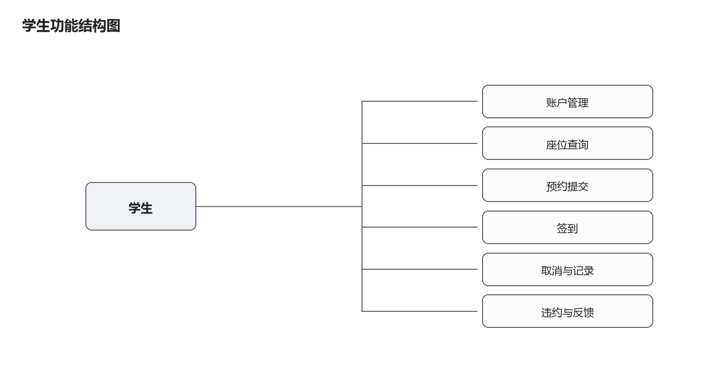

图 3-1 学生功能结构图

### 3.1.1 学生端功能需求分析

学生端的功能围绕一次完整的自习行为展开：进入系统、查找座位、提交预约、到场签到、结束离场，中途可能取消或失约。以下按功能逐项说明。

账户管理是使用系统的前提。学生使用学号、用户名与密码注册，登录后由服务端签发令牌，后续请求携带令牌访问受保护资源。账户管理还包括查看与修改个人资料、修改密码（需验证旧密码）以及退出登录。退出后令牌对应的会话被撤销，旧令牌立即失效。账户管理的用例关系如图 3-2 所示。

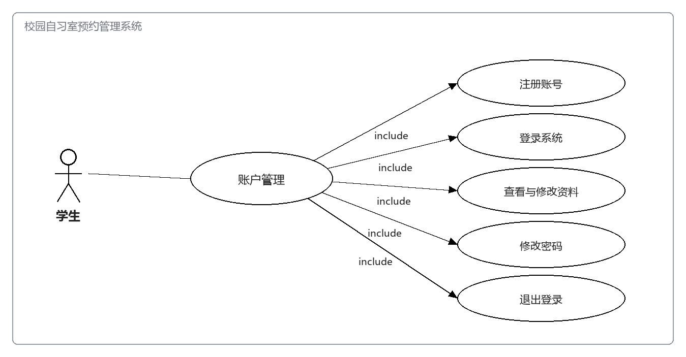

图 3-2 学生账户管理用例图

座位查询是使用频率最高的功能。学生可按名称与位置筛选自习室，查看开放时段与座位总数；进入某一自习室后，选择日期与时段，页面以平面图形式展示座位，区分空闲、已预约与维修三种状态。座位的可用性由服务端根据预约、维修状态与资源开放状态共同计算，前端不自行推断。座位查询的用例关系如图 3-3 所示。


图 3-3 学生座位查询用例图

预约提交把选中的座位与时段固定下来。学生提交自习室、座位、日期与时段四个参数，服务端在同一事务内完成资源状态复核、座位冲突校验、学生时间冲突校验、每日次数校验与违约限制校验，全部通过后写入预约与初始状态日志。请求需携带幂等键，重复提交不会产生第二条预约。预约提交的用例关系如图 3-4 所示。

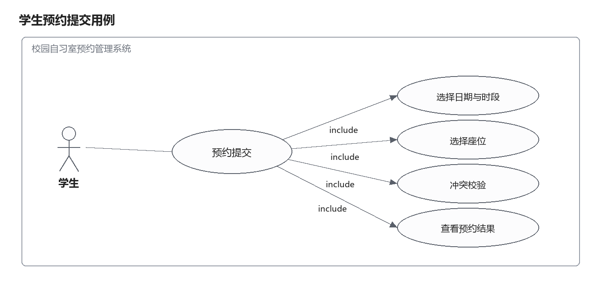

图 3-4 学生预约提交用例图

签到在预约开始前后的一段窗口内完成。学生进入预约详情页，页面展示签到二维码，学生用手机摄像头扫码或在同一设备上传二维码图片，识别后提交签到数据。服务端校验令牌、二维码签名、二维码归属自习室、当前时间是否落在窗口内、该用户是否存在待签到预约，五项全部满足才写入签到记录。同一预约重复签到返回冲突。签到的用例关系如图 3-5 所示。

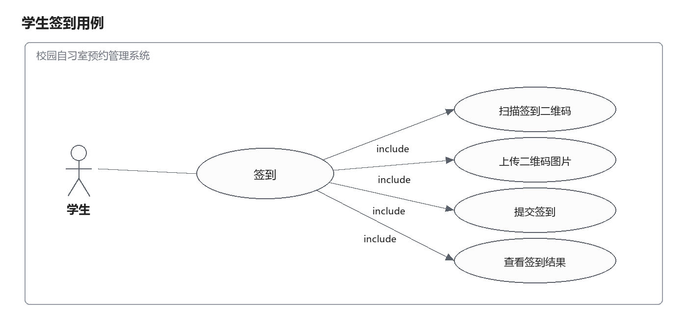

图 3-5 学生签到的用例图

取消预约在开始时间之前允许。学生取消后座位立即释放，该时段可被其他学生预约。开始时间之后取消入口关闭，系统按是否签到分别处理：已签到的等待结束转为完成，未签到的超窗后转为失约。取消操作需二次确认并记录原因。取消与记录查询的用例关系如图 3-6 所示。

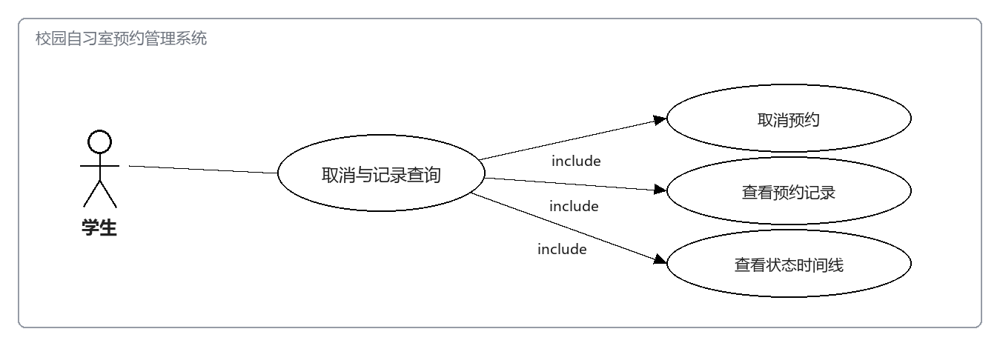

图 3-6 学生取消与记录查询用例图

违约查询与反馈举报面向异常情况。学生可在个人中心查看累计有效违约次数、每次失约的发生时间与原因，以及当前是否处于预约限制期、限制到何时结束。发现座位被长期占用无人使用时，学生可提交占座举报，填写自习室、座位与情况描述，提交后在“我的反馈”中查看处理状态与管理员填写的处理结果。违约与反馈的用例关系如图 3-7 所示。


图 3-7 学生违约与反馈用例图

学生端的功能边界需要明确。系统不提供“候补”与“自动换座”，座位一旦被预约即锁定到该时段，其他学生只能选择其他座位；这一点与图书馆的排队等座不同，原因是候补会带来通知成本与公平性争议。系统也不提供跨校区的座位查询，所有自习室属于同一校区，位置字段只用于筛选。这些省略不是能力不足，而是把范围限定在可维护的边界内。

异常路径同样属于需求的一部分。学生可能遇到的情形包括：选座时座位刚好被他人抢先预约、预约后临时有事需要取消、到场时忘记带手机、签到窗口已过但人已到场、发现座位被占。前两种由系统正常处理，第三种依赖管理员人工核验，第四种需要走违约撤销或申诉，第五种通过反馈工单流转。把这些路径列清楚，才能在设计中为每一种留出入口，而不是只实现顺利情况下的流程。

### 3.1.2 管理端功能需求分析

管理端的功能可归为六个方面，其结构如图 3-8 所示。资源部分由自习室、开放时段与座位三层构成；业务部分围绕预约与违约展开；服务部分处理反馈与运营数据。六个方面共用同一套数据，但在权限上彼此隔离，管理员只能在自己的职责范围内操作。

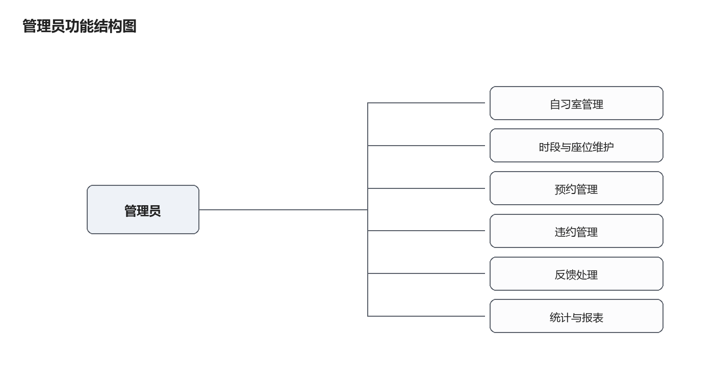

图 3-8 管理员功能结构图

管理端的功能围绕资源的可维护性与异常的可处理性展开。管理员不参与具体预约，但需要保证资源状态正确、异常记录可追溯、运行数据可观察。

自习室是整个业务的容器。管理员可新增自习室，填写名称、位置与平面行列数，并决定其状态是开放、关闭还是停用；可编辑已有自习室的信息；新增时默认关闭，配置完成后才开放。自习室管理的用例关系如图 3-9 所示。

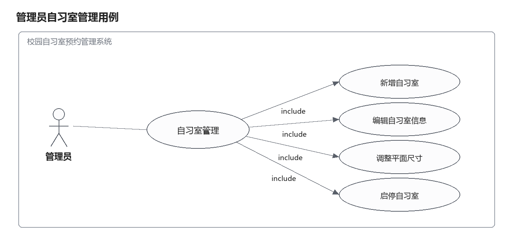

图 3-9 管理员自习室管理用例图

自习室之下是时段与座位。管理员为每个自习室配置若干开放时段，要求开始早于结束、长度在 30 分钟到 4 小时之间、同房间内时段不重叠；可按批次批量生成座位，指定前缀与行列范围，系统跳过已占用的坐标；也可把单个座位设为维修或停用。时段与座位维护的用例关系如图 3-10 所示。

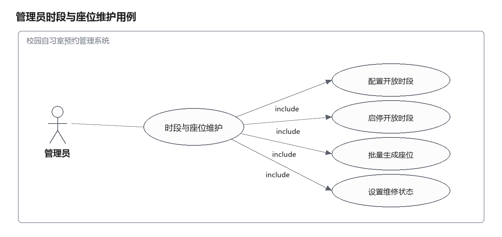

图 3-10 管理员时段与座位维护用例图

预约管理面向日常查询与异常处理：多条件查询全量预约，查看预约详情与状态时间线，对二维码不可用的学生执行人工核验签到，取消待签到的异常预约并填写原因。预约管理的用例关系如图 3-11 所示。

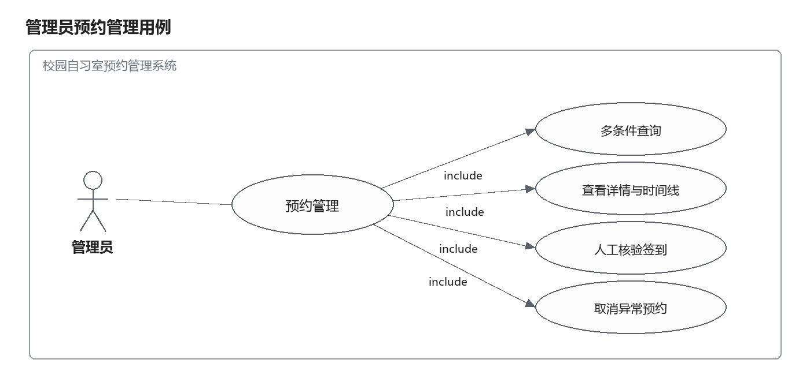

图 3-11 管理员预约管理用例图

违约管理包括查询违约记录、配置失约阈值与限制天数、撤销违约记录。规则调整只影响之后新触发的限制，撤销必须填写原因，撤销后重新计算有效违约数并按阈值决定是否解除限制。违约管理的用例关系如图 3-12 所示。

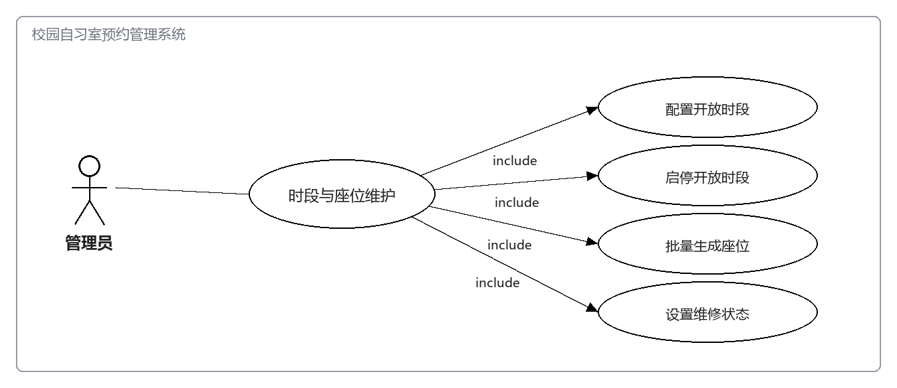

图 3-12 管理员违约管理用例图

反馈处理面向占座举报与问题反馈：查看工单列表与详情，受理工单，填写处理结果并关闭，对不合理的工单执行驳回。处理结果对提交学生可见，状态变更需与审计记录同事务写入。反馈处理的用例关系如图 3-13 所示。

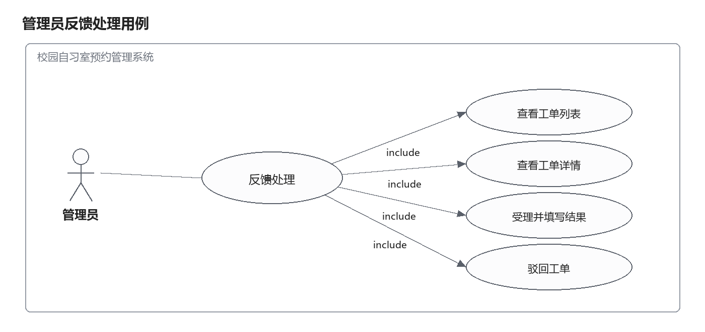

图 3-13 管理员反馈处理用例图

统计与系统设置面向运营与运维：查看仪表盘指标，按日期范围查看趋势，导出 CSV，调整预约窗口、每日上限与违约阈值等参数，查看定时任务运行状态与审计日志。统计与系统设置的用例关系如图 3-14 所示。

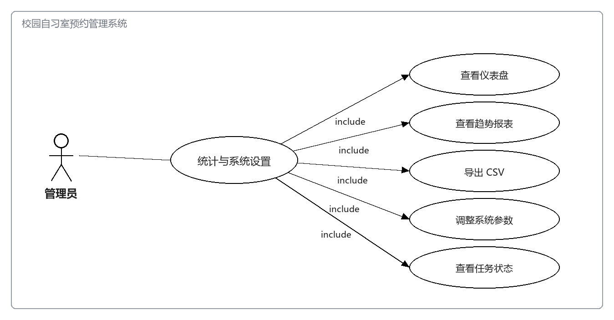

图 3-14 管理员统计与系统设置用例图

### 3.1.3 角色与权限划分

系统设置学生、管理员、超级管理员三种角色。超级管理员仅在创建管理员账号时具备额外权限，其余操作与管理员一致。权限按功能维度划分，未登录用户只能访问自习室与座位的公开查询，学生只能操作本人数据，管理员可操作全量数据但不能读取密码与令牌。角色与功能的对应关系如表 3-1 所示。

表 3-1 角色与功能权限矩阵

| 功能 | 未登录 | 学生 | 管理员 |
| --- | --- | --- | --- |
| 自习室与座位公开查询 | 允许 | 允许 | 允许 |
| 注册、登录 | 允许 | 允许 | 允许 |
| 创建、取消、签到预约 | 禁止 | 仅本人 | 禁止 |
| 查询本人预约、违约、反馈 | 禁止 | 仅本人 | 按条件查询 |
| 修改个人资料与密码 | 禁止 | 允许 | 允许 |
| 自习室、时段、座位维护 | 禁止 | 禁止 | 允许 |
| 预约查询与人工核验 | 禁止 | 禁止 | 允许 |
| 违约规则配置与撤销 | 禁止 | 禁止 | 允许 |
| 反馈工单处理 | 禁止 | 禁止 | 允许 |
| 统计报表与导出 | 禁止 | 禁止 | 允许 |
| 系统参数与运维状态 | 禁止 | 禁止 | 允许 |

## 3.2 业务规则与状态流转

预约是系统中最核心的业务对象，它的状态决定了座位是否被占用、学生能否签到、管理员能否取消。系统为预约定义了五个状态：待签到、已签到、已完成、已取消、已失约。状态之间的转换由服务端按规则执行，前端只能提交动作，不能直接提交目标状态。状态流转关系如图 3-15 所示。

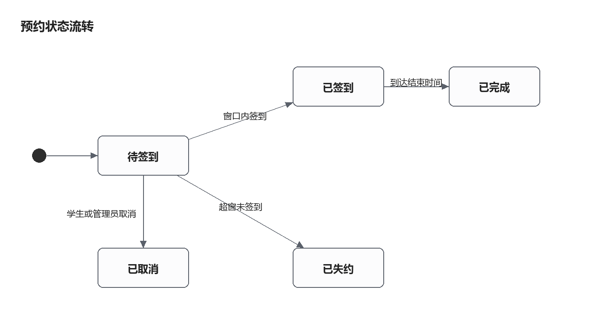

图 3-15 预约状态流转图

各状态之间的迁移条件如表 3-2 所示。迁移表中“执行者”一列区分了学生、管理员与系统定时任务，目的是明确每种动作的权限来源。

表 3-2 预约状态迁移表

| 当前状态 | 触发动作 | 目标状态 | 执行者 | 约束条件 |
| --- | --- | --- | --- | --- |
| 待签到 | 窗口内签到 | 已签到 | 学生 | 时间落在开始前 30 分钟至开始后 15 分钟 |
| 待签到 | 学生取消 | 已取消 | 学生 | 当前时间早于开始时间 |
| 待签到 | 管理员取消 | 已取消 | 管理员 | 必须填写原因 |
| 待签到 | 超窗未签到 | 已失约 | 系统 | 当前时间晚于开始后 15 分钟 |
| 待签到 | 停机豁免 | 已取消 | 系统 | 超窗超过 30 分钟，不记违约 |
| 已签到 | 到达结束时间 | 已完成 | 系统 | 当前时间晚于结束时间 |
| 已签到 | 管理员取消 | 已取消 | 管理员 | 本轮版本不支持，需人工处理 |

围绕状态机，系统设定了五条硬规则，它们在服务端被逐条执行，任一不满足即拒绝请求。

第一，同一座位在同一日期同一时段只能存在一条有效预约。有效预约指待签到或已签到状态，已取消、已完成、已失约的记录不占用座位。该规则由数据库的唯一索引保证，索引建在由座位、日期与时段拼接生成的列上，只有有效状态写入值，其他状态写入空值。

第二，同一学生在时间区间重叠时不能拥有两条有效预约。判定采用区间相交的方式，即已有预约的开始时间早于新预约的结束时间，且已有预约的结束时间晚于新预约的开始时间。相邻但不重叠的时段可以连续预约。

第三，每名学生每天的有效预约数量存在上限，默认 2 条。上限由系统配置表定义，管理员可调整，学生在提交前可在页面上看到剩余次数。

第四，预约后未在窗口内签到即判为失约。失约由定时任务写入，每条预约最多产生一条违约记录，重复执行任务不会重复计数。

第五，累计有效违约次数达到阈值后进入预约限制期，默认 3 次限制 7 天。限制期内学生无法提交新预约，限制到期自动解除；管理员撤销违约后若有效违约数低于阈值，限制立即清空。

时间口径是上述规则的共同前提。数据库中的日期时间字段按 UTC 存储与比较，业务日期、时段起止与签到窗口按东八区解释。校验以业务日期加时段起止组合成具体时刻后再转换为 UTC，界面展示时再转换回东八区。跨日场景在预约、签到与统计三处均有独立测试用例覆盖，避免出现八小时偏移。

## 3.3 非功能需求分析

非功能需求决定了系统在真实环境中的可用程度，本节按安全、性能、易用与可维护四个方面说明，并尽量给出可验证的口径。

安全性方面，密码必须以哈希形式存储，数据库中不出现明文；令牌只能由服务端签发与校验，载荷中不含敏感信息；权限检查在服务端完成，前端隐藏按钮不作为权限手段；接口对密码、令牌与完整个人信息做脱敏处理，错误响应不返回数据库错误细节；登录、注册、预约与反馈接口设置频率限制，防止暴力尝试与重复提交。

性能方面，普通查询接口在本地环境下的响应时间应控制在 500 毫秒以内，预约提交因涉及事务与加锁，响应时间允许放宽到 1 秒。列表接口必须分页，单页最大 100 条；统计查询按日期范围限制在 366 天以内，避免无界查询拖慢数据库。座位状态查询涉及多表关联，需要依赖索引避免全表扫描。

易用性方面，所有页面需具备加载中、无数据、请求失败与无权限四种状态；表单在提交前给出即时校验提示，服务端返回的错误信息应能被用户理解，例如座位冲突提示“该座位在所选时段已被预约”，而不是返回错误码；危险操作（取消预约、停用资源、撤销违约）需二次确认并展示操作结果。

可维护性方面，业务按模块拆分，模块之间只通过稳定字段与公开服务方法交互；数据库结构由编号迁移脚本管理，每次变更同时提供回滚说明；前后端各自通过类型检查、代码规范检查与构建，提交前必须全部通过。可观测性方面，服务端记录请求方法、路径、状态码与耗时，关键业务事件（预约创建、签到、失约、撤销）写入状态日志或审计日志，日志中不出现密码、令牌与完整个人敏感信息。

## 3.4 需求优先级与实现范围

需求数量确定之后，还需要回答“先做哪些”。本文按“是否影响核心流程的正确性”把功能分为三级：P0 是缺失即导致流程无法成立的功能，P1 是影响体验但可延后一版的功能，P2 是运营增强功能。优先级划分的结果如表 3-3 所示。

表 3-3 需求优先级划分

| 优先级 | 功能 | 判断依据 |
| --- | --- | --- |
| P0 | 注册登录、座位查询、预约创建、签到、取消、失约判定、违约限制 | 缺任一项，预约流程无法成立 |
| P0 | 自习室与座位维护、预约查询、人工核验签到 | 资源不可维护或异常无法处理时系统不可用 |
| P1 | 违约撤销、反馈工单、统计报表与导出 | 影响管理效率，但不阻断学生使用 |
| P1 | 配置在线调整、审计日志、任务状态查看 | 影响运维便利性 |
| P2 | 消息提醒、移动端适配、多校区 | 依赖外部通道或更大改造 |

按此划分，第一版实现覆盖全部 P0 与 P1 功能，P2 项列入后续计划。需要说明的是，统计报表虽然列为 P1，但其依赖的容量快照与冻结任务在 P0 阶段就必须建好，否则历史数据无法补齐——这类“功能可延后、数据结构不可延后”的依赖，是划分实现顺序时容易忽略的地方。

## 3.5 业务规则的取值说明

三条规则的具体数值需要给出理由，否则规则看起来是随意设定的。

签到窗口取“开始前 30 分钟至开始后 15 分钟”。窗口过窄会把迟到几分钟的学生直接判为失约，引发争议；窗口过宽则失去约束意义，学生可以在时段中途甚至接近结束时才签到，座位在这段时间内实际处于空置状态。取开始前 30 分钟，是考虑到学生通常提前到达并在附近等候；取开始后 15 分钟，是给学生留出从教学楼步行到自习室的时间。

每日有效预约上限取 2 条。上限设为 1 条过于严格，学生上午与下午各复习一段是常见需求；上限设为 3 条以上则容易出现“占坑”行为，与约束机制的初衷相悖。2 条既能覆盖一天两段自习的典型场景，也让多占座位变得没有收益。

违约阈值取 3 次、限制天数取 7 天。阈值过低会让偶发的意外（临时有事、交通延误）直接触发限制，误伤概率高；阈值过高则对习惯性失约缺乏威慑。7 天与一个自然周对齐，限制期内学生仍可正常自习，只是无法预约，惩戒强度与过错程度大致匹配。

这三项数值都存放在配置表中，管理员可以调整。规则可配置的意义不在于让管理员频繁改动，而在于学校规模和作息差异较大时不必改代码即可适配；同时，已生效的限制区间按当时的规则保存，后续调整不会追溯改写，避免出现“改规则导致历史限制失效”的问题。

# 4  系统设计

## 4.1 系统总体设计

系统按业务域划分为八个模块：认证与用户、自习室与座位、预约与签到、违约管理、反馈工单、统计与报表、系统基础与运维、设计与视觉规范。模块划分的依据是数据归属与变更频率，而不是页面菜单：认证与用户管理账号与会话，自习室与座位管理资源，预约与签到管理时段占用，违约与反馈管理异常，统计与报表只读其他模块的数据，系统基础提供配置、日志与任务调度，视觉规范为页面提供统一的样式约定。

模块之间存在明确的依赖方向。系统基础与运维位于底层，提供配置、数据库连接、错误处理与定时任务；认证与用户向上提供用户标识、角色与资源归属判断；自习室与座位提供房间、时段、座位与可用性计算；预约与签到依赖前三者，并向下游输出预约状态、签到记录与时间快照；违约管理消费预约产生的失约事件，统计与报表消费预约、签到与违约的结果。依赖单向流动，避免了循环调用。系统功能结构如图 4-1 所示。

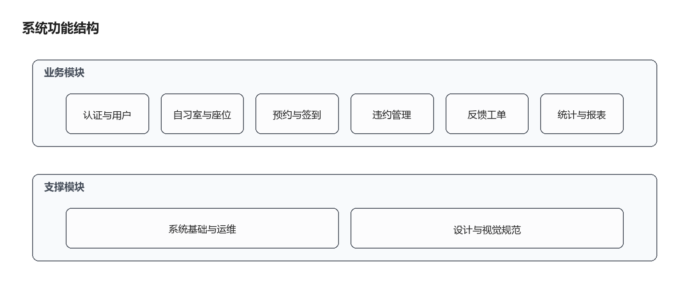

图 4-1 系统功能结构图

## 4.2 系统架构设计

### 4.2.1 总体架构

系统采用前后端分离的三层结构。表现层是运行在浏览器中的单页应用，负责页面渲染、交互反馈与路由控制；业务服务层是 Express 应用，负责认证、校验、业务规则与事务；数据访问层由 Sequelize 模型与 MySQL 组成，负责持久化与约束。三层之间通过 HTTP 上的 JSON 接口通信，接口统一以 `/api/v1` 为前缀。

一次典型的预约请求依次经过：浏览器发起请求并携带令牌，请求进入 Express 路由，认证中间件解析令牌并校验会话，权限中间件检查角色，校验中间件检查参数，控制器把请求转交服务层，服务层开启事务、按固定顺序加锁、复核资源状态与冲突条件，数据访问层执行写入，事务提交后返回统一响应。任一环节失败，响应以统一结构返回错误码与提示，事务回滚。系统架构如图 4-2 所示。

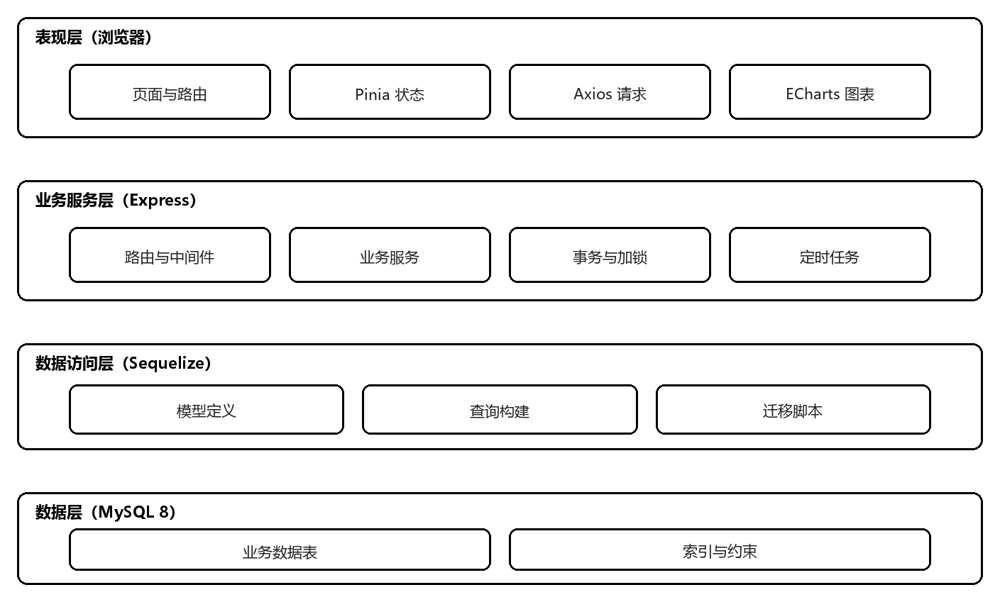

图 4-2 系统三层架构图

### 4.2.2 前端设计

前端路由按角色分为三组。公开路由包括登录、注册与自习室浏览；学生路由包括首页、自习室详情、预约记录、预约详情、我的反馈与个人中心；管理员路由包括仪表盘、用户管理、自习室管理、座位管理、预约管理、违约管理、反馈处理、统计报表与系统设置。路由守卫在跳转前检查登录状态与角色，未通过时分别跳转登录页与无权限页。

状态管理遵循“够用即共享”的原则。登录用户、令牌与公开配置放入 Pinia，因为这些数据在路由守卫、请求拦截器与多个页面中都要使用；页面内部的筛选条件、分页参数与加载状态保留在组件内，避免全局状态膨胀。组件按复用范围分两层：基础组件包括状态标签、空状态、确认弹窗与分页封装；业务组件包括座位平面图、预约卡片与统计图表，其中座位平面图在选座页与管理端座位页共用，通过属性区分是否可编辑。

### 4.2.3 后端设计

后端按职责分为四层。路由层声明路径、方法与中间件链；控制器层解析请求参数、调用服务并封装响应；服务层承载业务规则、事务与状态转换；模型层定义表结构、关联与查询。跨层的横切逻辑由中间件完成，包括认证、角色校验、参数校验、限流、请求日志与统一错误处理。

响应结构在全系统统一。成功时为 `{ code: “OK”, message, data }`，失败时为 `{ code, message, data: null }`，分页数据放在 `data` 中，形态为 `{ items, page, pageSize, total }`。错误码与 HTTP 状态的对应关系如表 4-1 所示。

表 4-1 统一错误码定义

| 错误码 | HTTP 状态 | 含义 |
| --- | --- | --- |
| OK | 200 / 201 | 成功 |
| BAD_REQUEST | 400 | 参数格式或枚举错误 |
| UNAUTHORIZED | 401 | 未登录或令牌失效 |
| FORBIDDEN | 403 | 角色不符或越权访问 |
| NOT_FOUND | 404 | 资源不存在 |
| CONFLICT | 409 | 状态冲突、重复预约、重复签到 |
| VALIDATION_ERROR | 422 | 字段校验失败 |
| RATE_LIMITED | 429 | 请求频率超限 |
| DATABASE_UNAVAILABLE | 503 | 数据库暂不可用 |
| INTERNAL_ERROR | 500 | 未处理异常 |

## 4.3 数据库设计

### 4.3.1 概念模型设计

数据库围绕“用户占用座位”这一核心关系展开。用户与预约是一对多，一个用户可拥有多条历史预约；自习室与时段是一对多，一个自习室可配置多个开放时段；座位属于自习室，一个自习室包含多个座位；预约同时关联用户、座位与时段，并额外保存房间名称、位置与座位编号的快照，以便资源更名后历史记录不发生变化；签到与预约是一对一，一条预约最多一条签到记录；状态日志与预约是一对多，记录每次状态转换；违约记录与预约是一对一，一条失约预约对应一条违约；反馈工单关联用户，可选关联自习室与座位；统计快照按日期、自习室与时段三个维度保存。整体实体关系如图 4-3 所示。

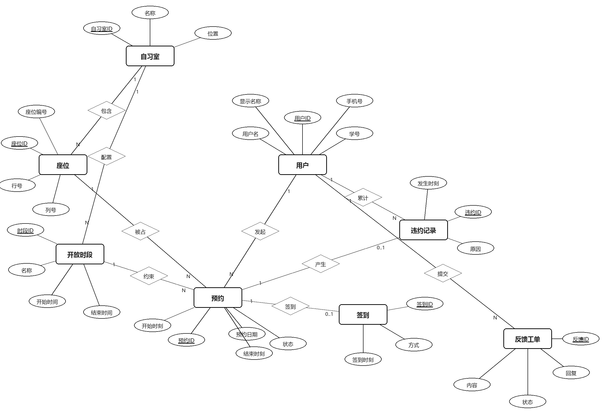

图 4-3 系统整体 E-R 图

在整体关系之外，本文为每个实体单独绘制了属性图，用于说明实体的字段构成。用户实体的属性如图 4-4 所示，会话实体如图 4-5 所示，审计日志如图 4-6 所示；资源三层中，自习室如图 4-7 所示，开放时段如图 4-8 所示，座位如图 4-9 所示；业务实体中，预约如图 4-10 所示，签到如图 4-11 所示，违约记录如图 4-12 所示，反馈工单如图 4-13 所示。属性图只列字段，不画联系，与整体图配合使用：整体图回答“实体之间如何关联”，属性图回答“实体由什么构成”。

实体划分遵循两条标准：是否具有独立的生命周期，以及是否被多处业务引用。以此衡量，“开放时段”不宜作为自习室的普通属性处理。时段的起止时间、可预约起始日期与启停状态都会单独调整，同一条时段又会被多条预约引用，若把它降级为自习室上的几个字段，调整一次时段就要连带修改全部历史预约的快照。座位同理：它需要单独记录平面坐标与维护状态，并在预约中固化快照，因此独立成实体。相反，“签到方式”“预约状态”只服务于某一条预约，生命周期完全依附于预约本身，因而保留为预约的字段而不拆表。这样处理的结果是实体数量控制在 14 个，既没有把属性强行提成实体，也没有把真正的实体压成字段。

联系基数由业务规则推导，而不是凭经验设定。用户与预约为 1:N，一名学生可以产生多条历史预约，但一条预约只属于一名学生；自习室与座位、自习室与时段各为 1:N，座位与时段都依附于某一房间；预约与签到为 1:1，一条预约只允许签到一次，这一点由签到表的唯一索引兜底；预约与状态日志为 1:N，一次预约在完整生命周期中会产生“待签到—已签到—已完成”等多条记录；预约与违约为 1:1，只有失约的预约才生成违约记录；用户与反馈工单为 1:N。统计快照与业务表之间不设外键，它按日期与资源维度独立汇总，属于分析型数据，避免与业务表的事务相互牵连。

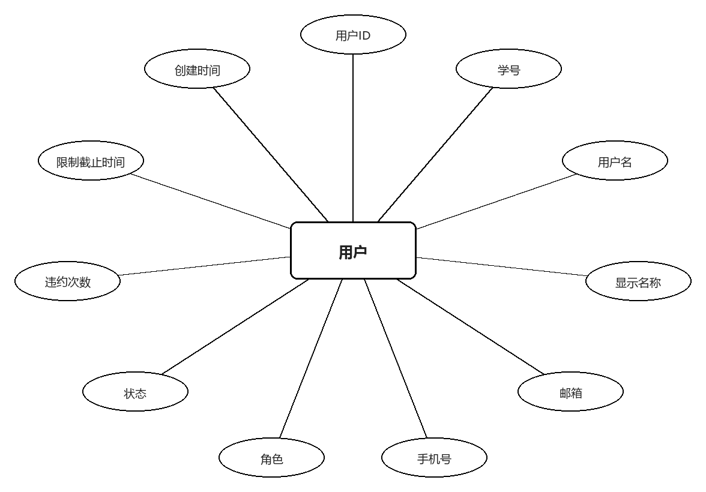

图 4-4 用户实体属性图

用户实体的属性如图 4-4 所示。`id` 为自增主键，`student_no` 与 `username` 各建唯一索引，作为登录与实名的唯一依据；`role` 与 `status` 用枚举限定取值范围；`violation_count`、`restriction_started_at` 与 `restriction_until` 三个字段共同支撑违约计数与限制期的判定，限制到期由定时任务清除，不需要额外的状态表。

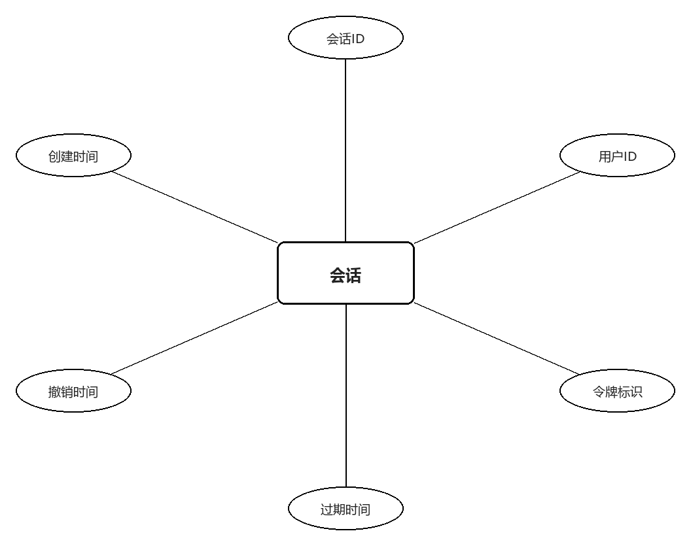

图 4-5 会话实体属性图

会话实体的属性如图 4-5 所示。`id` 用 36 位字符保存，便于与令牌中的 `jti` 对应；`jti` 唯一，用来定位具体令牌；`expires_at` 与 `revoked_at` 分别表示自然过期与主动注销，两者都为空之外的取值时，该会话立即失效，因此注销不必等待令牌过期。

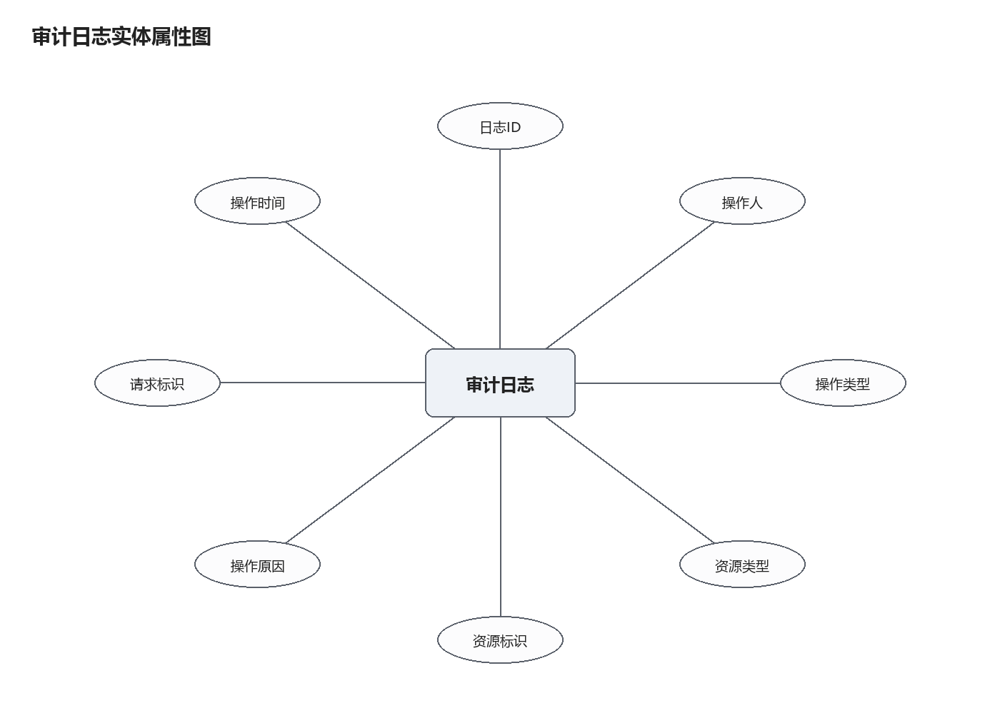

图 4-6 审计日志实体属性图

审计日志实体的属性如图 4-6 所示。`before_json` 与 `after_json` 以 JSON 保存变更前后的快照，字段增删不影响已有记录；`request_id` 与请求头中的追踪标识一致，便于把一次管理操作与后端日志串起来；`reason` 记录管理员填写的操作原因，用于事后追溯。

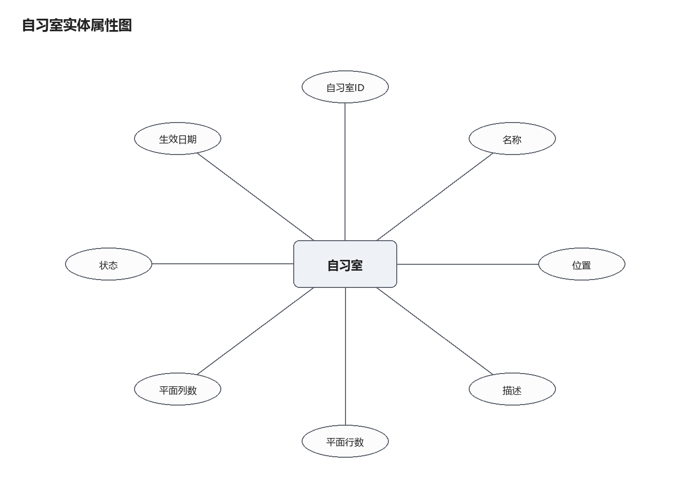

图 4-7 自习室实体属性图

自习室实体的属性如图 4-7 所示。`grid_rows` 与 `grid_columns` 决定选座页平面图的尺寸，座位坐标不能超出该范围；`bookable_from` 控制该房间最早可预约的日期，用于学期初统一放开；`status` 区分开放、临时关闭与停用，停用只改状态而不删除行，历史预约仍然可查。

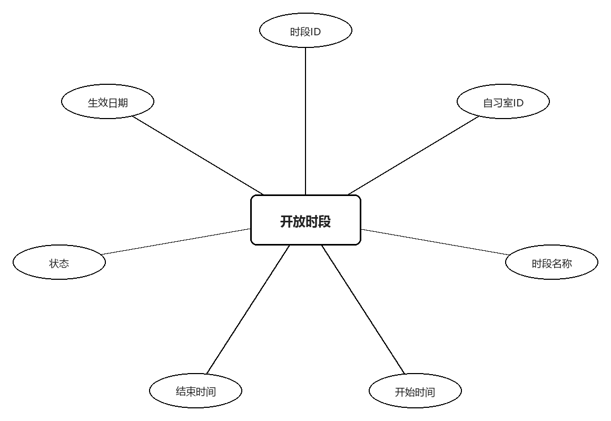

图 4-8 开放时段实体属性图

开放时段实体的属性如图 4-8 所示。`room_id` 指向所属自习室；`start_time` 与 `end_time` 使用 `TIME` 类型，只表示一天内的时刻，跨天场景由日期字段另行约束；`bookable_from` 让某个时段可以晚于房间整体开放，便于分段启用；`status` 用于临时关闭某一时段而不影响其他时段。

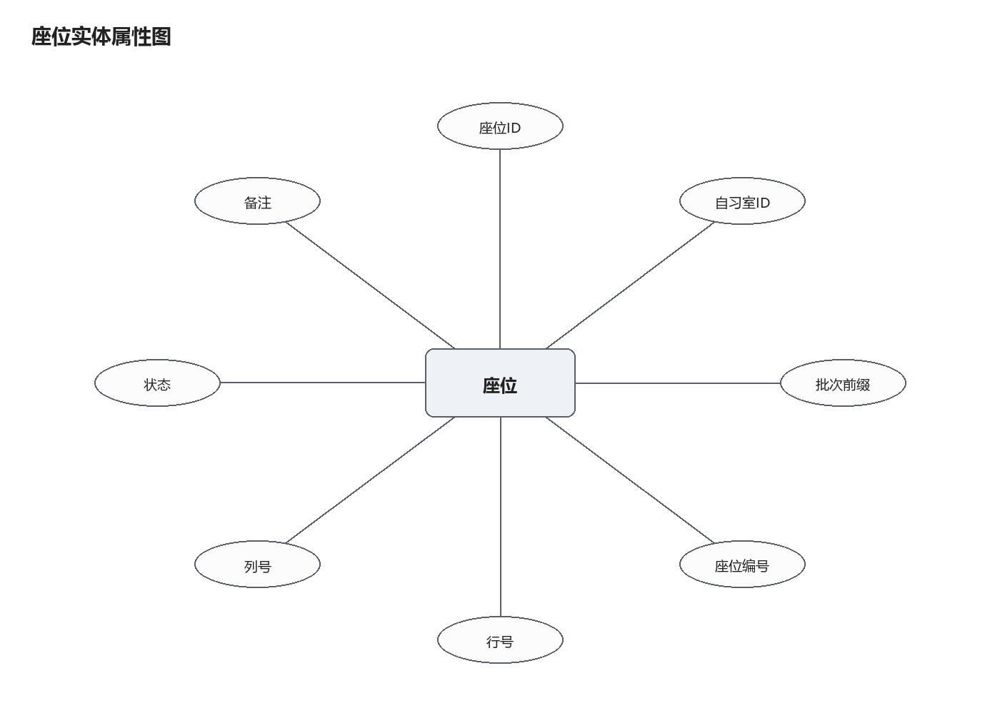

图 4-9 座位实体属性图

座位实体的属性如图 4-9 所示。`room_id`、`seat_no` 组合唯一，`room_id`、`row_no`、`column_no` 组合也唯一，前者防止编号重复，后者防止平面坐标重叠；`batch_prefix` 记录批量生成的批次，便于按批维护；`status` 区分可用、维修与停用，维修中的座位不出现在可选列表中。

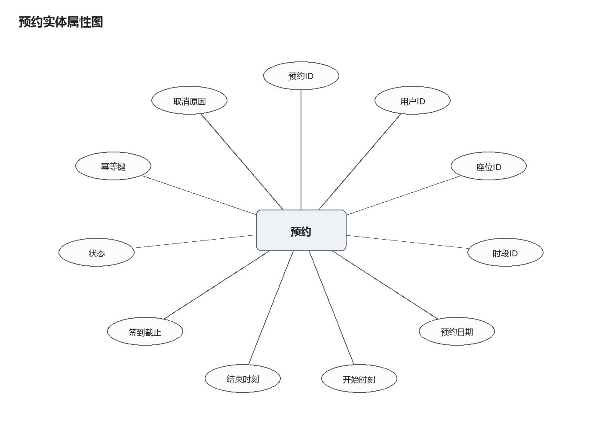

图 4-10 预约实体属性图

预约实体的属性如图 4-10 所示。`user_id`、`room_id`、`seat_id`、`slot_id` 为外键，其中前三个同时保存名称与编号快照，资源更名后历史记录不变；生成列 `active_slot_key` 只在待签到与已签到状态下取“座位:日期:时段”，其余状态为空，配合唯一索引实现“同座位同时段仅一条有效预约”；`check_in_deadline` 决定签到窗口的截止时刻，是失约判定的直接依据。

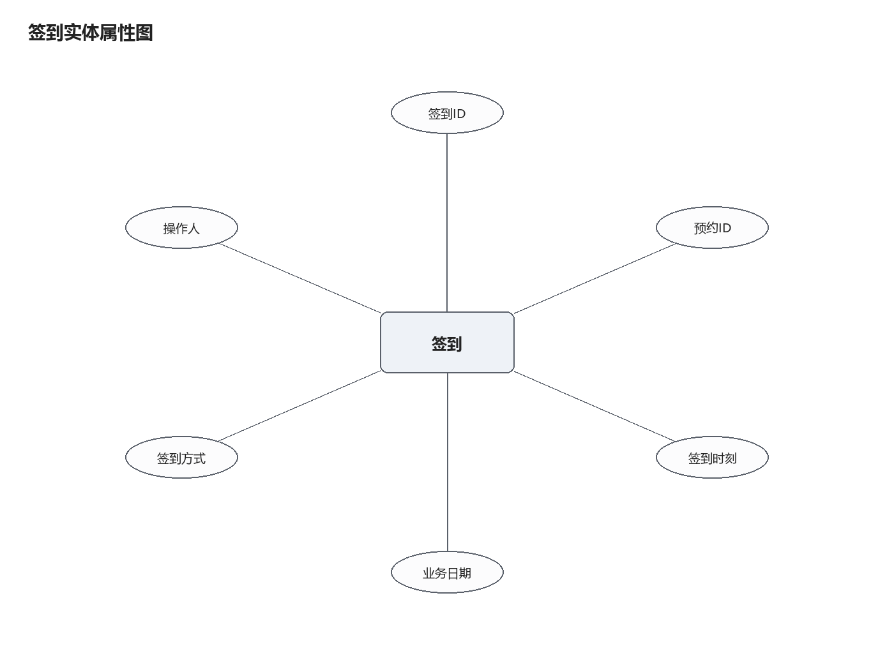

图 4-11 签到实体属性图

签到实体的属性如图 4-11 所示。`reservation_id` 唯一，保证一条预约只能签到一次；`method` 区分扫码与人工核验，便于统计两种通道的使用比例；`checked_in_at` 与操作人字段记录了核验时刻与执行者，出现争议时可以还原当时情形。

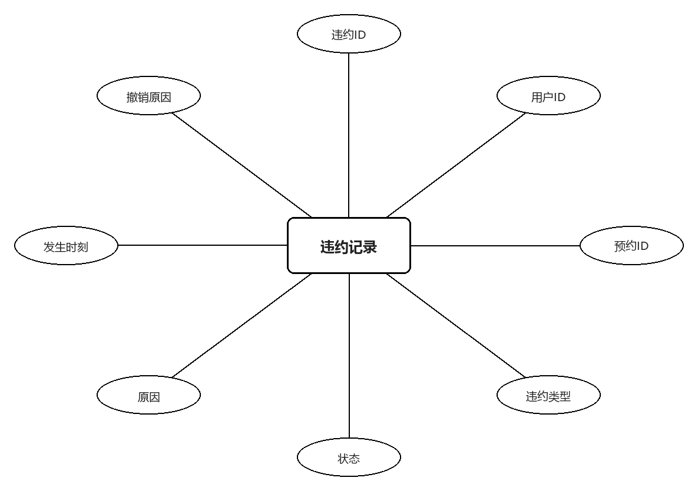

图 4-12 违约记录实体属性图

违约记录实体的属性如图 4-12 所示。`reservation_id` 唯一，一条预约最多产生一条违约；`status` 区分有效与撤销，管理员撤销后该记录仍保留，但不再计入用户的违约次数，这样既保留了处理痕迹，也不会误伤学生。

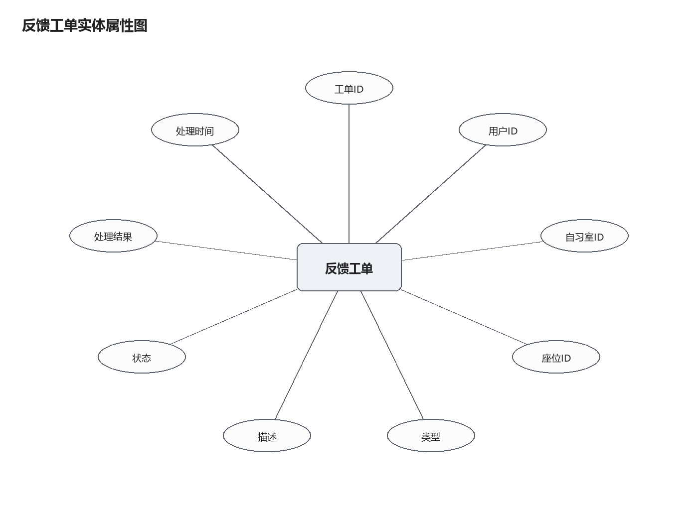

图 4-13 反馈工单实体属性图

反馈工单实体的属性如图 4-13 所示。`room_id` 与 `seat_id` 都可为空，但填写座位时必须同时填写自习室，这条约束由检查约束表达；`status` 表示待处理、处理中与已完结，`reply` 保存管理员回复；工单不设强制外键到座位，避免座位删除后工单无法追溯。

按业务域拆分，用户与会话的局部关系如图 4-14 所示，资源三层的局部关系如图 4-15 所示，预约与签到、状态日志的局部关系如图 4-16 所示，违约与反馈的局部关系如图 4-17 所示，统计快照的局部关系如图 4-18 所示。

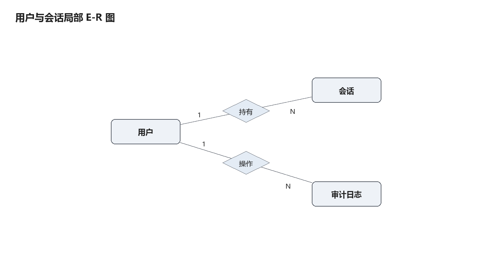

图 4-14 用户与会话局部 E-R 图

用户与会话之间的局部关系只涉及两个实体，联系类型与参与角色在图中标出；完整关系见前面的整体 E-R 图。

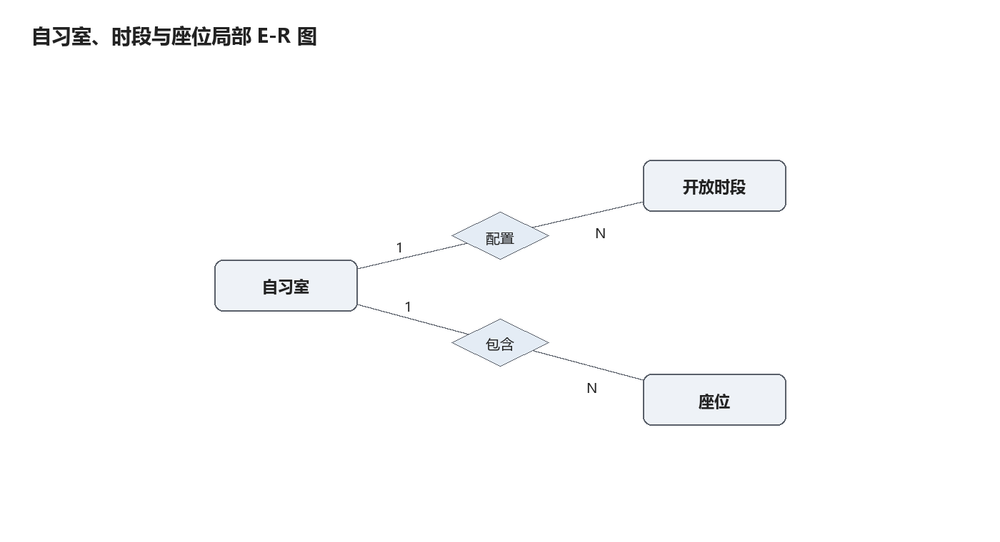

图 4-15 自习室、时段与座位局部 E-R 图

自习室、时段与座位三者的局部关系只保留资源层的实体，房间与座位之间为一对多，时段与房间之间同样为一对多。

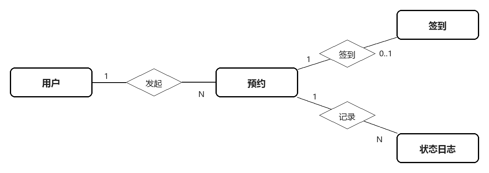

图 4-16 预约、签到与状态日志局部 E-R 图

预约与签到、状态日志之间的局部关系围绕一条预约展开，签到与预约一对一，状态日志与预约一对多。

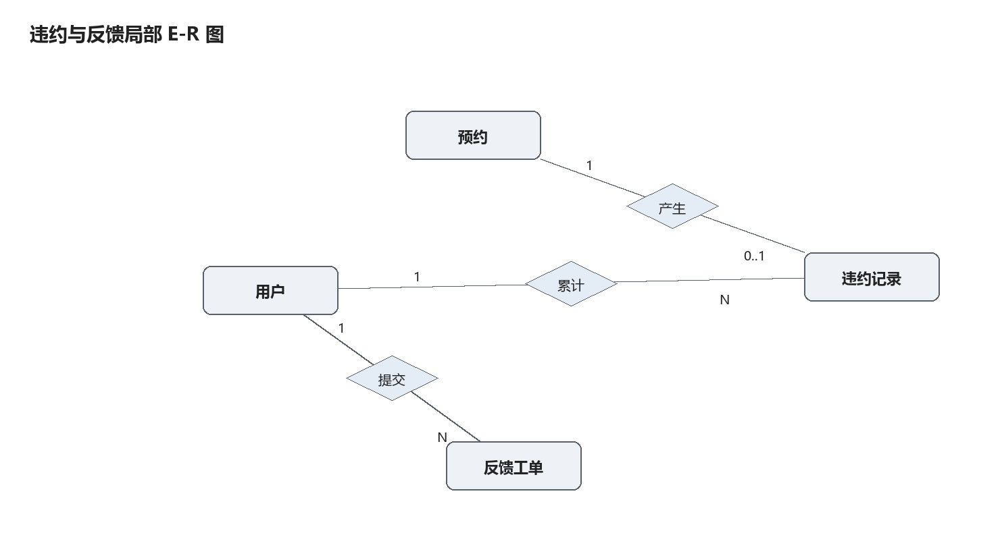

图 4-17 违约与反馈局部 E-R 图

违约记录与反馈工单分别挂在预约与用户之下，前者的联系基数为 1:1，后者为 1:N。

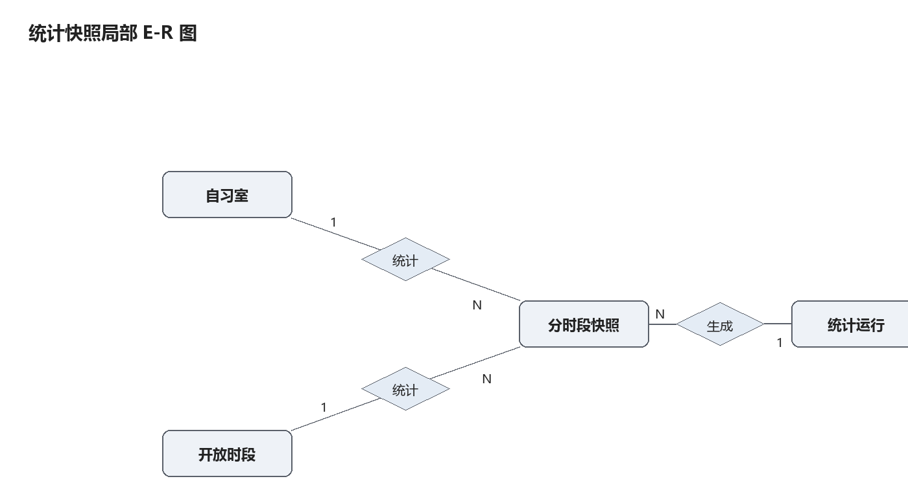

图 4-18 统计快照局部 E-R 图

统计快照按日期、自习室与时段三个维度汇总，与业务表之间不设外键，属于独立的分析型数据。

### 4.3.2 逻辑表设计

主键统一采用自增 `BIGINT UNSIGNED`，只有会话表用 36 位字符串。前者便于索引紧凑、插入有序；后者需要与令牌中的 `jti` 对应并在分布式场景下保持唯一，用 UUID 比自增更合适。业务上天然唯一的字段（学号、用户名、邮箱、座位编号、时段组合）不另设代理键，而是直接加唯一索引，避免出现“业务键与代理键两套唯一性”并存的情况。

字段类型的选择兼顾取值范围与查询成本。状态类字段使用 `ENUM` 而不是字符串，既限制了非法取值，也让索引更短；名称、位置、备注等长度差异大的字段用 `VARCHAR`，并按实际长度上限设定，避免全部用 `TEXT` 造成行外存储；变更快照用 `JSON`，因为不同资源需要记录的字段不同，事先固定列并不现实；金额类字段暂不存在，若后续加入，应使用 `DECIMAL` 而不是浮点。时间字段统一为 `DATETIME` 并按 UTC 存储，展示时在前端按本地时区转换，这样定时任务与统计口径不会因部署机器时区而漂移。

资源相关的三张表通过外键串成“房间—时段—座位”的层级，但预约并不只依赖外键，还额外保存了名称与位置快照。原因是资源改名、座位调整都属于正常运维，而历史预约必须保持当时的样子；如果只存外键，报表与导出会随资源变化而变化，历史数据就失去了可比性。快照字段只在创建预约时写入，之后不随资源更新，这一点在后面的接口设计中作为约束固定下来。

表 4-2 用户表（users）字段设计

| 字段名 | 数据类型 | 主键 | 可空 | 说明 |
| --- | --- | --- | --- | --- |
| id | BIGINT UNSIGNED | 是 | 否 | 用户主键 |
| student_no | VARCHAR(32) | 否 | 否 | 学号，唯一 |
| username | VARCHAR(32) | 否 | 否 | 登录用户名，唯一 |
| display_name | VARCHAR(64) | 否 | 否 | 显示名称 |
| email | VARCHAR(128) | 否 | 是 | 邮箱，唯一 |
| phone | VARCHAR(20) | 否 | 是 | 联系方式 |
| avatar_url | VARCHAR(512) | 否 | 是 | 头像地址 |
| password_hash | VARCHAR(100) | 否 | 否 | 密码哈希 |
| role | ENUM | 否 | 否 | student / admin / super_admin |
| status | ENUM | 否 | 否 | active / disabled |
| violation_count | INT UNSIGNED | 否 | 否 | 累计有效违约数 |
| restriction_started_at | DATETIME | 否 | 是 | 限制开始时间 |
| restriction_until | DATETIME | 否 | 是 | 限制截止时间 |
| last_login_at | DATETIME | 否 | 是 | 最后登录时间 |
| created_at | DATETIME | 否 | 否 | 创建时间 |
| updated_at | DATETIME | 否 | 否 | 更新时间 |

表 4-3 会话表（user_sessions）字段设计

| 字段名 | 数据类型 | 主键 | 可空 | 说明 |
| --- | --- | --- | --- | --- |
| id | CHAR(36) | 是 | 否 | 会话标识 |
| user_id | BIGINT UNSIGNED | 否 | 否 | 所属用户 |
| jti | CHAR(36) | 否 | 否 | 令牌唯一标识，唯一 |
| expires_at | DATETIME | 否 | 否 | 过期时间 |
| revoked_at | DATETIME | 否 | 是 | 撤销时间 |
| created_at | DATETIME | 否 | 否 | 创建时间 |

表 4-4 审计日志表（audit_logs）字段设计

| 字段名 | 数据类型 | 主键 | 可空 | 说明 |
| --- | --- | --- | --- | --- |
| id | BIGINT UNSIGNED | 是 | 否 | 主键 |
| operator_id | BIGINT UNSIGNED | 否 | 否 | 操作人 |
| action | VARCHAR(64) | 否 | 否 | 操作类型 |
| resource_type | VARCHAR(64) | 否 | 否 | 资源类型 |
| resource_id | BIGINT UNSIGNED | 否 | 否 | 资源标识 |
| before_json | JSON | 否 | 是 | 变更前快照 |
| after_json | JSON | 否 | 是 | 变更后快照 |
| reason | VARCHAR(255) | 否 | 是 | 操作原因 |
| request_id | VARCHAR(64) | 否 | 是 | 请求追踪标识 |
| created_at | DATETIME | 否 | 否 | 操作时间 |

表 4-5 自习室表（study_rooms）字段设计

| 字段名 | 数据类型 | 主键 | 可空 | 说明 |
| --- | --- | --- | --- | --- |
| id | BIGINT UNSIGNED | 是 | 否 | 主键 |
| name | VARCHAR(64) | 否 | 否 | 自习室名称 |
| location | VARCHAR(128) | 否 | 否 | 位置 |
| description | VARCHAR(500) | 否 | 是 | 描述 |
| grid_rows | SMALLINT UNSIGNED | 否 | 否 | 平面图行数 |
| grid_columns | SMALLINT UNSIGNED | 否 | 否 | 平面图列数 |
| status | ENUM | 否 | 否 | open / closed / disabled |
| bookable_from | DATE | 否 | 否 | 可预约起始日期 |
| created_at | DATETIME | 否 | 否 | 创建时间 |
| updated_at | DATETIME | 否 | 否 | 更新时间 |

表 4-6 开放时段表（room_time_slots）字段设计

| 字段名 | 数据类型 | 主键 | 可空 | 说明 |
| --- | --- | --- | --- | --- |
| id | BIGINT UNSIGNED | 是 | 否 | 主键 |
| room_id | BIGINT UNSIGNED | 否 | 否 | 所属自习室 |
| label | VARCHAR(32) | 否 | 否 | 时段名称 |
| start_time | TIME | 否 | 否 | 开始时间 |
| end_time | TIME | 否 | 否 | 结束时间 |
| status | ENUM | 否 | 否 | active / inactive |
| bookable_from | DATE | 否 | 否 | 可预约起始日期 |
| created_at | DATETIME | 否 | 否 | 创建时间 |
| updated_at | DATETIME | 否 | 否 | 更新时间 |

表 4-7 座位表（seats）字段设计

| 字段名 | 数据类型 | 主键 | 可空 | 说明 |
| --- | --- | --- | --- | --- |
| id | BIGINT UNSIGNED | 是 | 否 | 主键 |
| room_id | BIGINT UNSIGNED | 否 | 否 | 所属自习室 |
| batch_prefix | VARCHAR(8) | 否 | 否 | 批次前缀 |
| seat_no | VARCHAR(32) | 否 | 否 | 座位编号 |
| row_no | SMALLINT UNSIGNED | 否 | 否 | 行号 |
| column_no | SMALLINT UNSIGNED | 否 | 否 | 列号 |
| status | ENUM | 否 | 否 | available / maintenance / disabled |
| bookable_from | DATE | 否 | 否 | 可预约起始日期 |
| remark | VARCHAR(255) | 否 | 是 | 备注 |
| created_at | DATETIME | 否 | 否 | 创建时间 |
| updated_at | DATETIME | 否 | 否 | 更新时间 |

表 4-8 预约表（reservations）字段设计

| 字段名 | 数据类型 | 主键 | 可空 | 说明 |
| --- | --- | --- | --- | --- |
| id | BIGINT UNSIGNED | 是 | 否 | 主键 |
| user_id | BIGINT UNSIGNED | 否 | 否 | 预约学生 |
| room_id | BIGINT UNSIGNED | 否 | 否 | 自习室 |
| seat_id | BIGINT UNSIGNED | 否 | 否 | 座位 |
| slot_id | BIGINT UNSIGNED | 否 | 否 | 开放时段 |
| room_name_snapshot | VARCHAR(64) | 否 | 否 | 自习室名称快照 |
| room_location_snapshot | VARCHAR(128) | 否 | 否 | 位置快照 |
| seat_no_snapshot | VARCHAR(32) | 否 | 否 | 座位编号快照 |
| reserve_date | DATE | 否 | 否 | 预约日期 |
| start_at | DATETIME | 否 | 否 | 开始时刻 |
| end_at | DATETIME | 否 | 否 | 结束时刻 |
| check_in_open_at | DATETIME | 否 | 否 | 签到窗口开始 |
| check_in_deadline | DATETIME | 否 | 否 | 签到窗口截止 |
| status | ENUM | 否 | 否 | pending / checked_in / completed / cancelled / no_show |
| idempotency_key | VARCHAR(64) | 否 | 是 | 幂等键 |
| cancel_reason | VARCHAR(255) | 否 | 是 | 取消原因 |
| cancelled_by | BIGINT UNSIGNED | 否 | 是 | 取消操作人 |
| cancelled_at | DATETIME | 否 | 是 | 取消时间 |
| active_slot_key | VARCHAR(96) | 否 | 是 | 生成列，有效预约时非空 |
| created_at | DATETIME | 否 | 否 | 创建时间 |
| updated_at | DATETIME | 否 | 否 | 更新时间 |

表 4-9 签到表（check_ins）字段设计

| 字段名 | 数据类型 | 主键 | 可空 | 说明 |
| --- | --- | --- | --- | --- |
| id | BIGINT UNSIGNED | 是 | 否 | 主键 |
| reservation_id | BIGINT UNSIGNED | 否 | 否 | 预约标识，唯一 |
| checked_in_at | DATETIME | 否 | 否 | 签到时刻 |
| business_date | DATE | 否 | 否 | 业务日期 |
| method | ENUM | 否 | 否 | qr / manual |
| nonce | CHAR(36) | 否 | 是 | 二维码随机数 |
| operator_id | BIGINT UNSIGNED | 否 | 是 | 人工核验操作人 |
| remark | VARCHAR(255) | 否 | 是 | 备注 |
| created_at | DATETIME | 否 | 否 | 创建时间 |

表 4-10 预约状态日志表（reservation_status_logs）字段设计

| 字段名 | 数据类型 | 主键 | 可空 | 说明 |
| --- | --- | --- | --- | --- |
| id | BIGINT UNSIGNED | 是 | 否 | 主键 |
| reservation_id | BIGINT UNSIGNED | 否 | 否 | 预约标识 |
| from_status | ENUM | 否 | 是 | 变更前状态 |
| to_status | ENUM | 否 | 否 | 变更后状态 |
| actor_type | ENUM | 否 | 否 | user / admin / system |
| actor_id | BIGINT UNSIGNED | 否 | 是 | 操作人标识 |
| reason | VARCHAR(255) | 否 | 是 | 原因 |
| occurred_at | DATETIME | 否 | 否 | 发生时刻 |

表 4-11 违约记录表（violations）字段设计

| 字段名 | 数据类型 | 主键 | 可空 | 说明 |
| --- | --- | --- | --- | --- |
| id | BIGINT UNSIGNED | 是 | 否 | 主键 |
| user_id | BIGINT UNSIGNED | 否 | 否 | 违约学生 |
| reservation_id | BIGINT UNSIGNED | 否 | 否 | 关联预约，唯一 |
| type | ENUM | 否 | 否 | 违约类型，当前为 no_show |
| status | ENUM | 否 | 否 | active / revoked |
| reason | VARCHAR(255) | 否 | 否 | 违约原因 |
| occurred_at | DATETIME | 否 | 否 | 发生时刻 |
| resolved_by | BIGINT UNSIGNED | 否 | 是 | 撤销操作人 |
| resolved_at | DATETIME | 否 | 是 | 撤销时间 |
| resolution_reason | VARCHAR(255) | 否 | 是 | 撤销原因 |
| created_at | DATETIME | 否 | 否 | 创建时间 |
| updated_at | DATETIME | 否 | 否 | 更新时间 |

表 4-12 反馈工单表（feedback_tickets）字段设计

| 字段名 | 数据类型 | 主键 | 可空 | 说明 |
| --- | --- | --- | --- | --- |
| id | BIGINT UNSIGNED | 是 | 否 | 主键 |
| user_id | BIGINT UNSIGNED | 否 | 否 | 提交学生 |
| room_id | BIGINT UNSIGNED | 否 | 是 | 自习室 |
| seat_id | BIGINT UNSIGNED | 否 | 是 | 座位 |
| room_name_snapshot | VARCHAR(64) | 否 | 是 | 自习室名称快照 |
| seat_no_snapshot | VARCHAR(32) | 否 | 是 | 座位编号快照 |
| type | ENUM | 否 | 否 | occupied_seat / equipment / environment / other |
| description | TEXT | 否 | 否 | 情况描述 |
| status | ENUM | 否 | 否 | pending / processing / resolved / rejected |
| result | TEXT | 否 | 是 | 处理结果 |
| handled_by | BIGINT UNSIGNED | 否 | 是 | 处理人 |
| processed_at | DATETIME | 否 | 是 | 受理时间 |
| closed_at | DATETIME | 否 | 是 | 关闭时间 |
| created_at | DATETIME | 否 | 否 | 创建时间 |
| updated_at | DATETIME | 否 | 否 | 更新时间 |

表 4-13 系统配置表（system_settings）字段设计

| 字段名 | 数据类型 | 主键 | 可空 | 说明 |
| --- | --- | --- | --- | --- |
| key | VARCHAR(100) | 是 | 否 | 配置键 |
| value_json | JSON | 否 | 否 | 配置值 |
| description | VARCHAR(255) | 否 | 是 | 说明 |
| updated_by | BIGINT UNSIGNED | 否 | 是 | 更新人 |
| updated_at | DATETIME | 否 | 否 | 更新时间 |

表 4-14 分时段指标快照表（daily_slot_metrics）字段设计

| 字段名 | 数据类型 | 主键 | 可空 | 说明 |
| --- | --- | --- | --- | --- |
| id | BIGINT UNSIGNED | 是 | 否 | 主键 |
| stat_date | DATE | 否 | 否 | 统计日期 |
| room_id | BIGINT UNSIGNED | 否 | 否 | 自习室 |
| room_name_snapshot | VARCHAR(64) | 否 | 否 | 名称快照 |
| slot_id | BIGINT UNSIGNED | 否 | 否 | 时段 |
| slot_label | VARCHAR(32) | 否 | 否 | 时段名称快照 |
| slot_start_time | TIME | 否 | 否 | 时段开始快照 |
| slot_end_time | TIME | 否 | 否 | 时段结束快照 |
| bookable_seat_count | INT UNSIGNED | 否 | 否 | 可预约座位数 |
| available_seat_minutes | BIGINT UNSIGNED | 否 | 否 | 可开放座位分钟 |
| reservation_count | INT UNSIGNED | 否 | 否 | 预约数 |
| checked_in_count | INT UNSIGNED | 否 | 否 | 签到数 |
| no_show_count | INT UNSIGNED | 否 | 否 | 失约数 |
| outage_cancelled_count | INT UNSIGNED | 否 | 否 | 停机取消数 |
| used_seat_minutes | BIGINT UNSIGNED | 否 | 否 | 已用座位分钟 |
| finalized_at | DATETIME | 否 | 是 | 冻结时间 |
| created_at | DATETIME | 否 | 否 | 创建时间 |
| updated_at | DATETIME | 否 | 否 | 更新时间 |

快照表按“日期 + 自习室 + 时段”唯一，一份快照只生成一次。生成时机分为两步：当日零点后写入容量快照，记录当时的可预约座位数与可开放座位分钟；次日凌晨冻结前一日的预约数、签到数、失约数与已用座位分钟，写入 finalized_at 后不再更新。分成两步而不是一次算完，是因为当天的预约仍在变化，若提前冻结，晚间的预约会被漏计；而容量快照必须提前固化，否则资源调整后，历史利用率就没有统一的分母。统计运行表记录每天的快照是否生成与冻结，定时任务据此判断是否重跑，避免重复计算。

表 4-15 统计运行表（daily_statistics_runs）字段设计

| 字段名 | 数据类型 | 主键 | 可空 | 说明 |
| --- | --- | --- | --- | --- |
| stat_date | DATE | 是 | 否 | 统计日期 |
| capacity_snapshotted_at | DATETIME | 否 | 否 | 容量快照生成时间 |
| finalized_at | DATETIME | 否 | 是 | 冻结时间 |
| created_at | DATETIME | 否 | 否 | 创建时间 |
| updated_at | DATETIME | 否 | 否 | 更新时间 |

### 4.3.3 索引与约束设计

本系统的数据完整性主要依赖三类约束：唯一约束、外键约束与检查约束。

唯一约束承担了最核心的并发安全职责。`users` 对学号、用户名与邮箱建立唯一索引；`seats` 对同一自习室内的座位编号与平面坐标建立唯一索引，防止批量生成时产生重号；`reservations` 在生成列 `active_slot_key` 上建立唯一索引，该列只在预约处于待签到或已签到状态时取“座位:日期:时段”的值，其他状态取空值，从而把“同一座位同一时段只能有一条有效预约”表达为数据库层面的约束，而不是应用层的查询判断；`violations` 对 `reservation_id` 建立唯一索引，保证一条预约最多一条违约记录；`check_ins` 对 `reservation_id` 建立唯一索引，保证一次预约只能签到一次。

外键约束统一使用 `ON DELETE RESTRICT` 与 `ON UPDATE RESTRICT`。预约、签到、违约、反馈与审计记录属于历史数据，即使所属资源停用也必须保留，因此禁止级联删除。资源需要下线时通过状态字段停用，而不是删除行。

检查约束用于表达字段间的业务关系。`reservations` 要求签到窗口的开始时刻早于截止时刻，且截止时刻不晚于预约结束时刻；`feedback_tickets` 要求座位为空时自习室可以不填，但填写座位时必须填写自习室。

索引设计兼顾查询与维护成本。预约表按“用户与日期”、“自习室、日期与时段”、“座位与日期”三个组合建立索引，分别支撑“我的预约”、“房间时段统计”与“座位占用检查”；另按“状态与签到截止”、“状态与结束时间”建立索引，支撑定时任务的范围扫描。主要索引如表 4-16 所示。

组合索引的字段顺序按“等值条件在前、范围条件在后”排列。以预约表为例，`user_id + reserve_date + status` 支持按学生与日期查列表，`status` 放在最后是因为它只有少数几个取值，区分度低，放在前面会让索引在范围扫描时失效；`status + check_in_deadline` 则相反，`status` 作为等值条件放在首位，`check_in_deadline` 作为范围条件放在其后，定时任务每分钟扫描“待签到且已过截止时刻”的记录时可以只读索引的一小段。索引并非越多越好：每增加一个索引，插入预约时就要多维护一棵 B 树，写放大随之上升；因此只在真实查询路径需要的组合上建索引，不为“可能用到”的场景预留。

外键与索引存在联动。为外键列建索引不是数据库强制要求，但删除或更新父表行时，数据库需要检查子表引用，缺少索引会导致全表扫描；本系统为所有外键列显式建立索引，既服务连接查询，也避免运维操作时出现长事务。删除策略统一为 `RESTRICT`，配合状态字段下线资源，意味着任何一次删除都不会牵连历史数据，这一约束在测试中通过“尝试删除已有预约的房间”用例验证。

表 4-16 主要索引设计

| 表 | 索引名 | 字段 | 类型 | 用途 |
| --- | --- | --- | --- | --- |
| users | users_student_no_unique | student_no | 唯一 | 学号去重 |
| users | users_role_status_id | role, status, id | 普通 | 后台按角色状态筛选 |
| seats | seats_room_seat_no_unique | room_id, seat_no | 唯一 | 座位编号去重 |
| seats | seats_room_position_unique | room_id, row_no, column_no | 唯一 | 平面坐标去重 |
| reservations | uk_reservations_active_slot | active_slot_key | 唯一 | 同座位同时段唯一占用 |
| reservations | uk_reservations_user_idempotency | user_id, idempotency_key | 唯一 | 幂等提交 |
| reservations | idx_reservations_user_date_status | user_id, reserve_date, status | 普通 | 我的预约查询 |
| reservations | idx_reservations_room_date_slot_status | room_id, reserve_date, slot_id, status | 普通 | 房间时段统计 |
| reservations | idx_reservations_status_deadline | status, check_in_deadline | 普通 | 超时失约扫描 |
| reservations | idx_reservations_status_end | status, end_at | 普通 | 到期完成扫描 |
| violations | uk_violations_reservation | reservation_id | 唯一 | 一约一违约 |
| violations | idx_violations_user_status | user_id, status | 普通 | 用户违约统计 |
| feedback_tickets | idx_feedback_status_created | status, created_at | 普通 | 工单列表 |
| daily_slot_metrics | uk_daily_slot_metrics_slot | stat_date, room_id, slot_id | 唯一 | 快照唯一 |

## 4.4 接口设计

接口遵循 REST 风格，资源名词使用复数，动作通过 HTTP 方法表达。认证接口公开，其余接口需在请求头携带 `Authorization: Bearer <token>`。列表接口统一支持 `page`、`pageSize` 与筛选参数，`pageSize` 上限为 100；日期参数使用 `YYYY-MM-DD`，时间参数使用带时区的 ISO 8601 字符串；枚举值使用英文稳定值，展示文字由前端映射。

预约创建接口需额外携带 `Idempotency-Key` 请求头，服务端以“用户 + 幂等键”建立唯一约束，网络重试时返回同一条预约而不是新建。系统共定义 50 个接口，本节按模块列出核心的 30 个，如表 4-17 所示。

错误码与 HTTP 状态保持一一对应，前端只依赖 `code` 分支，不解析提示文案。这样做的原因是文案会调整，而分支逻辑不应随之改动。401 与 403 分开处理：401 表示令牌无效或过期，前端清理本地状态并跳转登录；403 表示身份有效但角色不足，只提示无权访问，不跳转，否则会把“学生误入管理页”当成掉线处理。409 专用于状态冲突，例如重复预约、重复签到与已取消后再次签到，前端据此提示刷新而不是重试。

列表接口的分页与筛选参数在服务层统一解析，避免每个控制器各写一套。`page` 从 1 开始，`pageSize` 默认 10、上限 100，超过上限按 100 处理而不是报错，防止前端传参失误导致请求被拒；日期范围最多 31 天，统计接口放宽到 90 天，超出范围返回参数错误。响应中的 `total` 由单独的计数查询得到，与数据查询共用同一组筛选条件，不使用 `SQL_CALC_FOUND_ROWS`，以免在大表上产生额外开销。

表 4-17 核心接口总览

| 模块 | 方法 | 路径 | 说明 | 权限 |
| --- | --- | --- | --- | --- |
| 认证 | POST | /auth/register | 注册学生账号 | 公开 |
| 认证 | POST | /auth/login | 登录并签发令牌 | 公开 |
| 认证 | POST | /auth/logout | 注销当前会话 | 登录 |
| 认证 | GET | /me | 查询当前用户 | 登录 |
| 认证 | PATCH | /me | 修改个人资料 | 登录 |
| 认证 | PATCH | /me/password | 修改密码 | 登录 |
| 资源 | GET | /study-rooms | 查询自习室列表 | 公开 |
| 资源 | GET | /study-rooms/:roomId | 查询详情与时段 | 公开 |
| 资源 | GET | /study-rooms/:roomId/seats | 查询座位状态 | 公开 |
| 资源 | POST | /admin/study-rooms | 新增自习室 | 管理员 |
| 资源 | PATCH | /admin/study-rooms/:roomId | 修改或停用 | 管理员 |
| 资源 | POST | /admin/study-rooms/:roomId/time-slots | 新增时段 | 管理员 |
| 资源 | PATCH | /admin/time-slots/:slotId | 启停时段 | 管理员 |
| 资源 | POST | /admin/study-rooms/:roomId/seats | 批量生成座位 | 管理员 |
| 资源 | PATCH | /admin/seats/:seatId | 修改座位状态 | 管理员 |
| 预约 | POST | /reservations | 创建预约 | 学生 |
| 预约 | GET | /me/reservations | 查询本人预约 | 学生 |
| 预约 | GET | /reservations/:id | 查看预约详情 | 本人/管理员 |
| 预约 | POST | /reservations/:id/cancel | 取消预约 | 本人/管理员 |
| 预约 | POST | /reservations/:id/check-in | 提交签到 | 学生 |
| 预约 | GET | /admin/check-in-codes | 生成签到码 | 管理员 |
| 预约 | POST | /admin/reservations/:id/check-in | 人工核验签到 | 管理员 |
| 预约 | GET | /admin/reservations | 查询全部预约 | 管理员 |
| 违约 | GET | /me/violations | 查询本人违约 | 学生 |
| 违约 | GET | /admin/violations | 查询违约记录 | 管理员 |
| 违约 | PATCH | /admin/violations/:id | 撤销违约 | 管理员 |
| 违约 | PUT | /admin/violation-rules | 修改违约规则 | 管理员 |
| 反馈 | POST | /feedback-tickets | 提交反馈 | 学生 |
| 反馈 | GET | /admin/feedback-tickets | 查询工单 | 管理员 |
| 统计 | GET | /admin/statistics/overview | 查询统计概览 | 管理员 |

## 4.5 系统非功能性设计

安全设计从四个层面展开。传输层要求生产环境启用 HTTPS；认证层使用 JWT 加会话表，令牌失效与主动注销都能立即生效；授权层按“认证—用户状态—角色—资源归属”的顺序检查，预约、违约与反馈等资源还要校验归属关系；数据层对密码做哈希存储，对响应与日志做脱敏，错误信息不返回数据库细节。系统还对接入频率做了限制，登录、注册、预约与反馈接口分别设置窗口与阈值。

性能设计围绕查询与写入两条路径。读路径上，列表接口强制分页，统计查询限定日期范围，座位状态查询依赖组合索引；写路径上，预约创建只在必要时加锁，锁的粒度限定在用户行与座位行，房间与时段使用共享锁，减少相互阻塞。统计模块采用快照策略：每天零点后生成当日的容量快照，次日凌晨冻结前一日数据，历史利用率不再随资源调整而变化，也避免了对大表的实时聚合。

可用性设计考虑异常与恢复。数据库不可用时，就绪检查返回 503，但 HTTP 服务仍可响应，恢复后自动重新检测；定时任务单次失败只记录错误，下一周期重试，重复执行不会重复计数；服务中断超过 30 分钟时，超窗预约按停机豁免转为取消而不是失约，避免把系统故障的后果转嫁给学生。

可扩展性设计体现在配置与结构两方面。预约窗口天数、每日上限、违约阈值与限制天数存放在配置表中，调整参数不需要改代码；数据库结构由编号迁移脚本管理，新增字段或索引以追加迁移的方式完成；模块边界清晰，后续接入消息通知、移动端或多校区时，可以在不改动预约核心逻辑的前提下扩展。

部署形态也影响设计。系统按单机部署规划：前端构建为静态资源，由 Web 服务器托管；后端以单个 Node.js 进程运行，通过环境变量读取数据库连接与密钥；数据库独立部署，应用与数据库之间只通过连接池通信。这样的形态在单校区、数百名日活学生的规模下足够，运维成本也低。若扩展到多实例，需要把会话状态从进程内存移到数据库或缓存，把定时任务改为单实例执行或加分布式锁，这两处是当前设计中最先需要改动的地方。设计阶段把这些边界写清楚，比事后补救更有价值。

## 4.6 关键设计取舍

系统中有若干处存在两种以上可行方案，最终的选择与其说是技术优劣，不如说是对场景的判断。把取舍写清楚，比只写结果更有意义。

**单页应用与多页应用。** 多页方案在每次跳转时重新加载页面，服务端渲染模板，开发模型简单，但选座页需要频繁刷新座位状态，整页刷新会造成闪烁，也会丢失已选的日期与时段。单页应用把路由与状态留在浏览器内，座位状态可以局部更新，代价是需要处理首次加载体积与路由守卫的复杂度。本系统的核心交互集中在选座与签到两处，局部更新的收益大于首屏体积的损失，因此选择单页方案；同时把图表等重组件改为按需加载，控制首屏负担。

**关系数据库与文档数据库。** 文档数据库的灵活结构适合字段频繁变化的场景，但座位预约的核心约束是“同一座位同一日期时段只有一条有效预约”，这是一个可以用唯一索引精确表达的关系约束。文档数据库需要在应用层用条件更新与重试实现类似效果，失败模式更多。系统最终选择 MySQL，用生成列加唯一索引把约束下沉到存储层，应用层只需要处理冲突异常。

**数据库约束与应用层校验。** 有人主张把校验全部放在服务层，理由是数据库约束的报错信息不友好。本系统的做法是两者并存：服务层负责给出可读的错误提示，数据库约束负责兜底。并发场景下，两个请求可能同时通过服务层校验，只有数据库的唯一约束能最终裁决。若只依赖服务层，就必须引入串行化的锁，代价更大。

**实时聚合与快照。** 统计报表可以每次查询时实时聚合预约表，实现简单，但存在两个问题：数据量增长后查询变慢；资源停用或座位调整后，历史利用率会被重新计算，报表失去可比性。系统采用“当日实时、历史快照”的混合方式：当天数据实时聚合，历史数据读取冻结的快照。这样既保证了当天的时效性，也让已经发生的统计不再变化。

**定时任务与惰性判定。** 预约是否失约，可以在查询时按当前时间惰性判定，也可以由定时任务主动推进状态。惰性判定的问题是状态只在被查询时才变化，管理员看到的数据与数据库中的实际状态不一致，统计也会漏算；定时任务则能在无人访问时完成状态推进，代价是需要处理任务中断与重复执行。系统选择定时任务，并用条件更新保证幂等，同时为中断超过 30 分钟的情况设计了停机豁免，避免把系统故障的后果记到学生账上。

# 5  详细设计与实现

本章按功能模块说明实现。每个功能点统一按“功能描述—业务流程—接口定义—关键代码—界面实现”五段展开，便于对照同一套结构理解不同模块。代码取自项目实际实现，为控制篇幅删去了日志、类型声明与重复的校验样板，保留完整控制流。

## 5.1 学生端功能

### 5.1.1 账户管理

**（一）功能描述**

注册时学生填写学号、用户名、显示名称与密码，服务端校验学号与用户名的唯一性，密码经哈希后写入用户表。登录时提交用户名与密码，校验通过后签发令牌并写入一条会话记录。令牌随后的每次请求由中间件解析，校验签名、过期时间与会话状态；注销时把会话标记为撤销，旧令牌立即失效。修改密码需要提供旧密码，成功后撤销该用户的全部会话，强制重新登录。

**（二）业务流程**

登录流程如图 5-1 所示。前端提交账号密码，服务端比对哈希，成功后签发令牌并写入会话，响应同时返回用户信息与角色，前端据此决定跳转到学生首页还是管理端仪表盘。

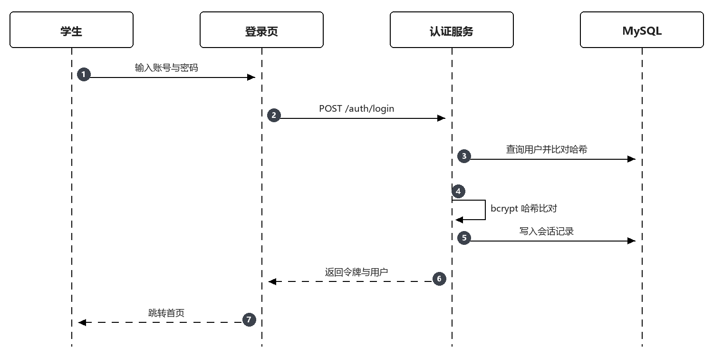

图 5-1 学生登录时序图

**（三）接口定义**

表 5-1 账户管理接口

| 接口 | 方法 | 路径 | 说明 | 请求参数 | 响应数据 |
| --- | --- | --- | --- | --- | --- |
| 注册 | POST | /auth/register | 学生注册 | studentNo, username, displayName, password | 用户标识 |
| 登录 | POST | /auth/login | 登录 | username, password | token, user |
| 注销 | POST | /auth/logout | 退出登录 | 无 | 无 |
| 查询当前用户 | GET | /me | 获取登录用户 | 无 | user |
| 修改资料 | PATCH | /me | 更新昵称与联系方式 | displayName, phone | user |
| 修改密码 | PATCH | /me/password | 校验旧密码后更新 | oldPassword, newPassword | 无 |

**（四）关键代码**

代码 5-1 登录校验与令牌签发

```ts
export async function login(input: LoginInput) {
  const user = await User.findOne({ where: { username: input.username } })
  if (!user) throw new AppError('UNAUTHORIZED', '账号或密码错误')
  if (user.status === 'disabled') throw new AppError('FORBIDDEN', '账号已停用，请联系管理员')

  const matched = await bcrypt.compare(input.password, user.passwordHash)
  if (!matched) throw new AppError('UNAUTHORIZED', '账号或密码错误')

  const jti = randomUUID()
  const expiresAt = dayjs().add(TOKEN_TTL_MINUTES, 'minute').toDate()
  await UserSession.create({ id: randomUUID(), userId: user.id, jti, expiresAt })

  const token = jwt.sign(
    { sub: user.id, role: user.role, jti },
    env.JWT_SECRET,
    { expiresIn: `${TOKEN_TTL_MINUTES}m` }
  )
  await user.update({ lastLoginAt: new Date() })
  return { token, user: toPublicUser(user) }
}
```

**（五）界面实现**

登录页如图 5-2 所示。页面包含用户名与密码两个输入框、登录按钮与注册入口，登录失败时在表单下方给出统一提示“账号或密码错误”，不区分账号不存在与密码错误，避免账号枚举。提交过程中按钮置灰，防止重复点击。

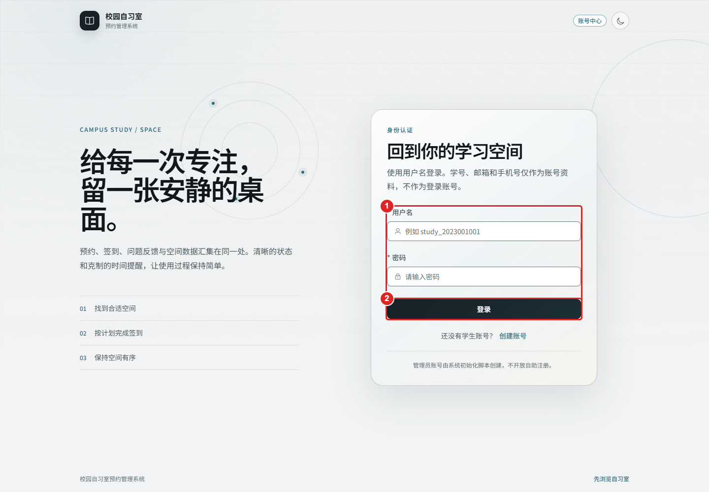
图 5-2 学生登录页面

注册页如图 5-3 所示。页面要求填写学号、用户名、显示名称与两次密码，学号与用户名在失焦时即校验唯一性，重复时在输入框下方提示。注册成功后自动跳转登录页，不直接进入系统，避免注册即登录带来的会话歧义。

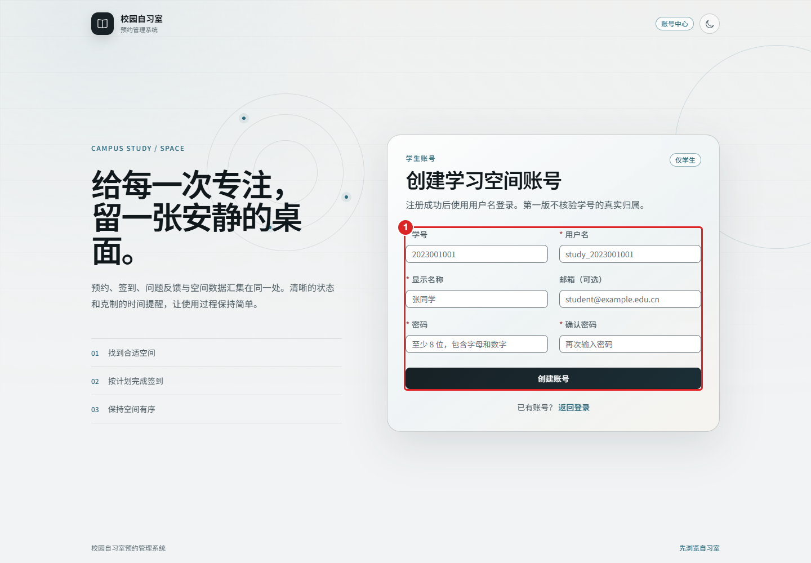

图 5-3 学生注册页面

### 5.1.2 自习室与座位查询

**（一）功能描述**

学生进入首页后看到自习室卡片列表，卡片展示名称、位置、开放状态与可预约座位数。进入详情页后选择日期与时段，页面按自习室配置的行列数渲染座位平面图，每个座位按状态着色：空闲、已预约、维修。座位状态由服务端计算，规则是：座位本身状态为维修或停用则不可选，所属自习室关闭则整间不可选，该座位在该日期时段存在有效预约则显示已预约。

**（二）业务流程**

座位查询流程如图 5-4 所示。前端先取自习室详情与有效时段，再按日期与时段请求座位状态，服务端查询该时段下所有有效预约并标记对应座位，返回座位列表与汇总数量。

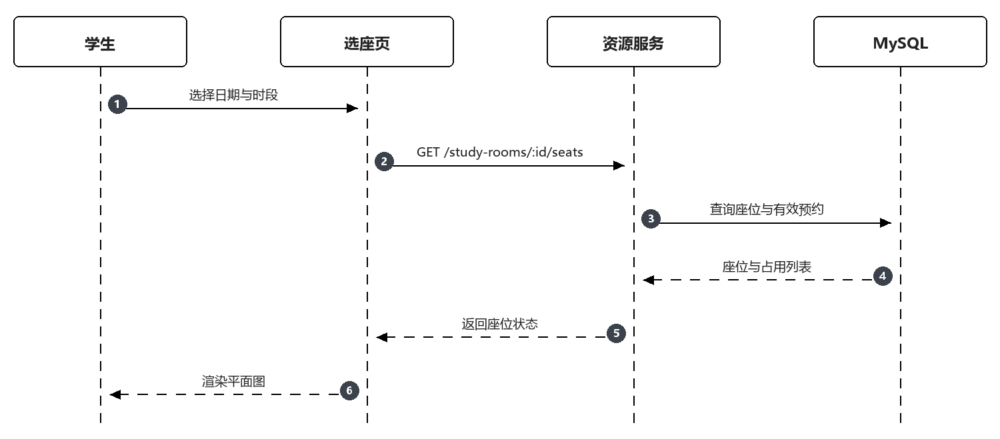

图 5-4 座位可用性查询时序图

**（三）接口定义**

表 5-2 自习室与座位查询接口

| 接口 | 方法 | 路径 | 说明 | 请求参数 | 响应数据 |
| --- | --- | --- | --- | --- | --- |
| 自习室列表 | GET | /study-rooms | 按名称与位置筛选 | keyword, status, page | items, total |
| 自习室详情 | GET | /study-rooms/:roomId | 详情与有效时段 | date | room, slots |
| 座位状态 | GET | /study-rooms/:roomId/seats | 指定日期时段座位 | date, slotId | seats, summary |

**（四）关键代码**

代码 5-2 座位可用性计算

```ts
export async function listSeatStatus(roomId: number, date: string, slotId: number) {
  const room = await StudyRoom.findByPk(roomId)
  if (!room) throw new AppError('NOT_FOUND', '自习室不存在')

  const slots = await RoomTimeSlot.findAll({ where: { roomId, status: 'active' } })
  const slot = slots.find((item) => item.id === slotId)
  if (!slot) throw new AppError('BAD_REQUEST', '时段不属于该自习室')

  const seats = await Seat.findAll({
    where: { roomId },
    order: [['rowNo', 'ASC'], ['columnNo', 'ASC']]
  })
  const occupied = await Reservation.findAll({
    attributes: ['seatId'],
    where: { roomId, reserveDate: date, slotId, status: ['pending', 'checked_in'] }
  })
  const taken = new Set(occupied.map((row) => row.seatId))
  const roomUsable = room.status === 'open' && room.bookableFrom <= date

  return seats.map((seat) => {
    const usable = roomUsable && seat.status === 'available' && seat.bookableFrom <= date
    return {
      seatId: seat.id,
      seatNo: seat.seatNo,
      row: seat.rowNo,
      column: seat.columnNo,
      status: !usable ? (seat.status === 'available' ? 'disabled' : seat.status)
        : taken.has(seat.id) ? 'reserved' : 'available'
    }
  })
}
```

**（五）界面实现**

选座页如图 5-5 所示。页面上方是日期与时段选择，下方是座位平面图，图例标明空闲、已预约与维修三种颜色。点击可用座位后，底部出现“确认预约”按钮；点击已预约座位则不响应，避免误操作。

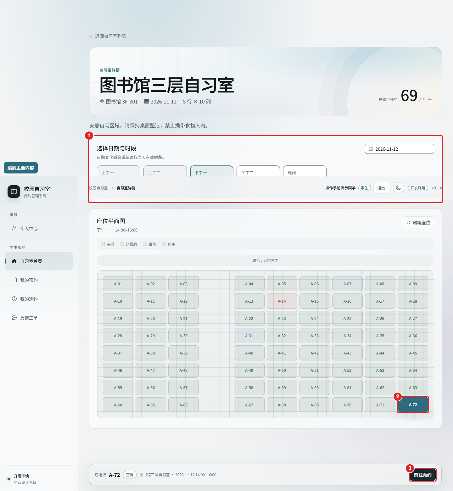
图 5-5 学生选座页面

首页如图 5-6 所示。页面按卡片列出可预约的自习室，展示名称、位置、开放状态与当日可用座位数；顶部为日期与时间范围筛选，切换后卡片上的可用数随之刷新。

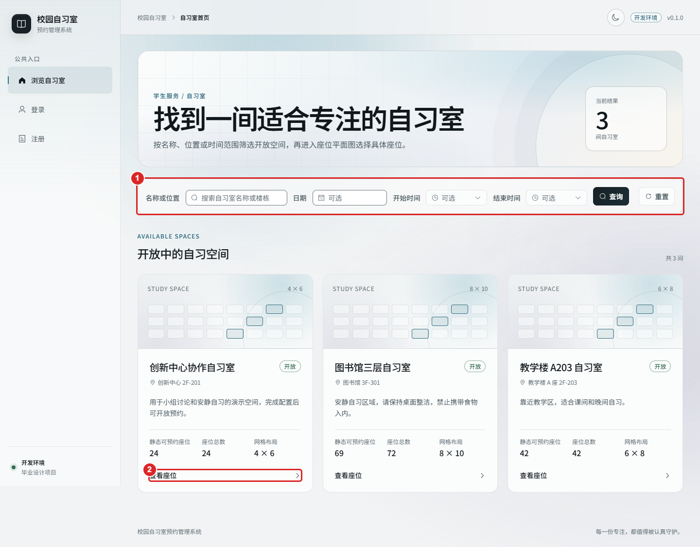

图 5-6 学生首页

### 5.1.3 预约提交

**（一）功能描述**

学生在确认页提交预约，参数包括自习室、座位、日期与时段。服务端在同一事务内依次完成：锁定用户行并校验账号状态与限制期；校验当日有效预约数未达上限；共享锁定自习室与时段并复核状态；排他锁定座位并复核状态；检查该座位在该日期时段是否已有有效预约；检查该学生在该时段是否已有重叠预约；写入预约与初始状态日志。任一条件不满足则回滚并返回对应错误码。

**（二）业务流程**

预约创建流程如图 5-7 所示。请求携带幂等键，服务端先查幂等键是否已存在，存在则直接返回原预约；不存在则开启事务执行上述校验与写入，提交后返回预约标识与状态。

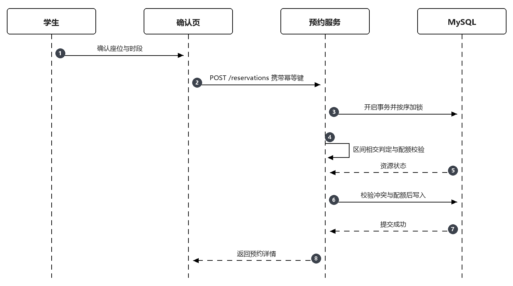

图 5-7 预约创建时序图

**（三）接口定义**

表 5-3 预约接口

| 接口 | 方法 | 路径 | 说明 | 请求参数 | 响应数据 |
| --- | --- | --- | --- | --- | --- |
| 创建预约 | POST | /reservations | 提交预约 | roomId, seatId, reserveDate, slotId | id, status, startAt, endAt |
| 我的预约 | GET | /me/reservations | 分页查询 | status, page | items, total |
| 预约详情 | GET | /reservations/:id | 详情与时间线 | 无 | reservation, logs |
| 取消预约 | POST | /reservations/:id/cancel | 取消 | reason | reservation |

**（四）关键代码**

代码 5-3 预约创建的事务与加锁

```ts
export async function createReservation(userId: number, input: CreateInput, key: string) {
  return sequelize.transaction(async (tx) => {
    const existed = await Reservation.findOne({
      where: { userId, idempotencyKey: key }, transaction: tx
    })
    if (existed) return existed

    const now = new Date()
    const user = await User.findByPk(userId, { transaction: tx, lock: tx.LOCK.UPDATE })
    if (user.restrictionUntil && user.restrictionUntil > now) {
      throw new AppError('FORBIDDEN', '当前账号处于预约限制期')
    }
    const room = await StudyRoom.findByPk(input.roomId, { transaction: tx, lock: tx.LOCK.SHARE })
    const slot = await RoomTimeSlot.findByPk(input.slotId, { transaction: tx, lock: tx.LOCK.SHARE })
    if (!room || !slot || slot.roomId !== room.id) throw new AppError('BAD_REQUEST', '资源不匹配')
    if (room.status !== 'open' || slot.status !== 'active') {
      throw new AppError('CONFLICT', '当前资源不可预约')
    }

    const seat = await Seat.findByPk(input.seatId, { transaction: tx, lock: tx.LOCK.UPDATE })
    if (!seat || seat.roomId !== room.id || seat.status !== 'available') {
      throw new AppError('CONFLICT', '该座位暂不可预约')
    }

    const { startAt, endAt } = resolveSlotWindow(input.reserveDate, slot, env.TZ)
    await assertNoOverlap(userId, startAt, endAt, tx)
    await assertDailyQuota(userId, input.reserveDate, tx)

    const reservation = await Reservation.create({
      userId, roomId: room.id, seatId: seat.id, slotId: slot.id,
      roomNameSnapshot: room.name, roomLocationSnapshot: room.location,
      seatNoSnapshot: seat.seatNo, reserveDate: input.reserveDate,
      startAt, endAt,
      checkInOpenAt: subMinutes(startAt, 30),
      checkInDeadline: addMinutes(startAt, 15),
      status: 'pending', idempotencyKey: key
    }, { transaction: tx })

    await ReservationStatusLog.create({
      reservationId: reservation.id, fromStatus: null, toStatus: 'pending',
      actorType: 'user', actorId: userId, occurredAt: new Date()
    }, { transaction: tx })

    return reservation
  })
}
```

**（五）界面实现**

预约确认页如图 5-8 所示。页面汇总自习室、座位、日期与时段，显示签到窗口的起止时间与取消规则，底部为确认按钮。提交成功后跳转预约详情，失败时按错误码给出提示，座位冲突提示“该座位在所选时段已被预约”，并刷新座位图。

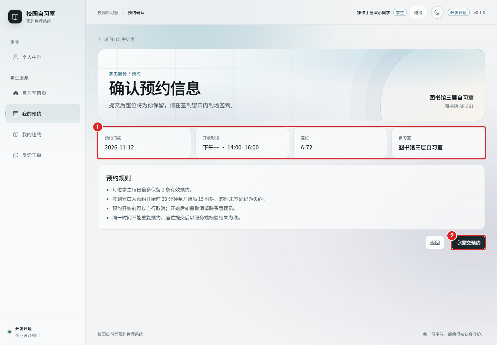

图 5-8 预约确认页面

冲突判定是本节最容易出错的地方，值得单独说明。最初的实现把判定写成“新预约的开始时间既不早于已有结束、也不晚于已有开始”，看起来覆盖了重叠，实际上漏掉了三种情形：起点相同、一个区间包含另一个、以及部分交叉。漏判的原因是把时间点与时间区间混用了。

正确的判定是区间相交：只要满足“已有开始 < 新结束 且 已有结束 > 新开始”，两个区间就必然重叠；反之，若新预约恰好从已有结束时刻开始，则两个条件之一不成立，判定为不重叠，符合“相邻可连约”的规则。这条判定同时用于两个对象：一是座位，检查该座位在该日期时段是否已有有效预约；二是学生，检查该学生在该时间区间是否已有其他预约。两处使用同一个函数，避免一处改对、另一处仍是旧逻辑。

判定完成后还要依赖唯一索引兜底。两个并发请求可能同时通过区间校验，此时只有数据库能裁决。服务层捕获唯一键冲突后转换为 409，并把“座位冲突”与“用户冲突”区分为不同提示，前者提示换座，后者提示调整时间。这一区分对用户是有意义的：看到“座位已被预约”，学生会换一个座位；看到“与已有预约重叠”，学生需要先处理已有预约。

### 5.1.4 签到

**（一）功能描述**

签到支持两种方式：学生用手机摄像头扫描管理员端展示的自习室二维码，或上传二维码图片由前端识别，识别结果包含自习室标识、随机数、签发时间与签名；管理员在二维码不可用时执行人工核验。服务端对扫码签到校验五项内容：令牌有效且为本人、签名正确、二维码归属的自习室与预约一致、当前时间落在签到窗口内、该预约处于待签到状态。校验通过后写入签到记录并把预约置为已签到。

**（二）业务流程**

签到流程如图 5-9 所示。前端识别二维码后提交解析出的字段，服务端重算签名并比对，随后校验窗口与预约状态，写入签到记录与状态日志。

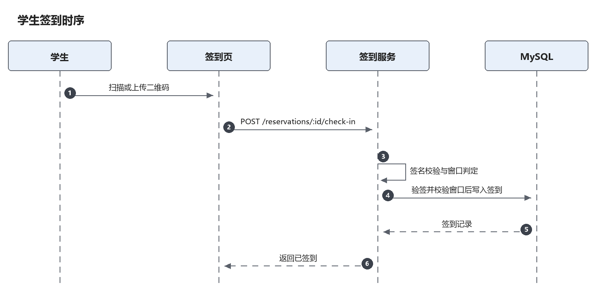

图 5-9 学生签到时序图

**（三）接口定义**

表 5-4 签到接口

| 接口 | 方法 | 路径 | 说明 | 请求参数 | 响应数据 |
| --- | --- | --- | --- | --- | --- |
| 生成签到码 | GET | /admin/check-in-codes | 按自习室生成 | roomId | roomId, nonce, issuedAt, signature |
| 学生签到 | POST | /reservations/:id/check-in | 提交签到数据 | roomId, nonce, issuedAt, signature | reservation |
| 人工核验 | POST | /admin/reservations/:id/check-in | 管理员核验 | remark | reservation |

**（四）关键代码**

代码 5-4 签到校验

```ts
export async function checkIn(reservationId: number, payload: QrPayload, userId: number) {
  const reservation = await Reservation.findByPk(reservationId)
  if (!reservation || reservation.userId !== userId) {
    throw new AppError('FORBIDDEN', '无权操作该预约')
  }
  if (reservation.status !== 'pending') {
    throw new AppError('CONFLICT', '该预约已签到或已结束')
  }

  const expected = signQr(payload.roomId, payload.nonce, payload.issuedAt, env.QR_SECRET)
  if (expected !== payload.signature) throw new AppError('BAD_REQUEST', '签到码无效')
  if (payload.roomId !== reservation.roomId) throw new AppError('BAD_REQUEST', '签到码不属于该自习室')

  const now = new Date()
  if (now < reservation.checkInOpenAt) throw new AppError('CONFLICT', '尚未到签到时间')
  if (now > reservation.checkInDeadline) throw new AppError('CONFLICT', '已超过签到截止时间')

  return sequelize.transaction(async (tx) => {
    await CheckIn.create({
      reservationId: reservation.id,
      checkedInAt: now,
      businessDate: reservation.reserveDate,
      method: 'qr',
      nonce: payload.nonce
    }, { transaction: tx })

    await reservation.update({ status: 'checked_in' }, { transaction: tx })
    await ReservationStatusLog.create({
      reservationId: reservation.id, fromStatus: 'pending', toStatus: 'checked_in',
      actorType: 'user', actorId: userId, occurredAt: now
    }, { transaction: tx })
    return reservation
  })
}
```

**（五）界面实现**

签到页如图 5-10 所示。页面展示当前预约的座位、时段与签到窗口，中部为二维码图案，下方提供“打开摄像头”与“上传图片”两个入口。签到成功后页面切换为已签到状态并显示签到时间；失败时给出具体原因，如“尚未到签到时间”或“已超过签到截止时间”。

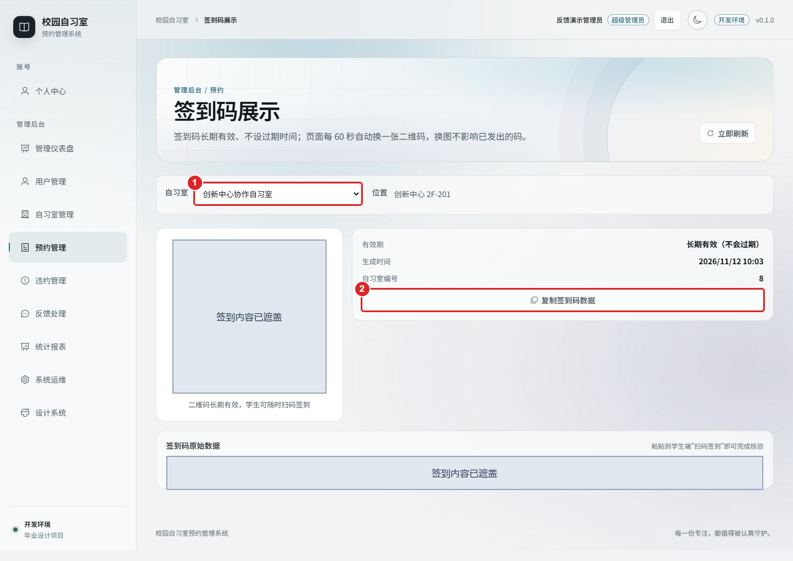

图 5-10 签到与签到码页面

### 5.1.5 取消与状态流转

**（一）功能描述**

学生在预约开始前可以取消。取消时服务端复核预约归属与状态，记录取消原因与操作时间，把状态置为已取消并写入状态日志，座位随即释放。开始时间之后取消入口关闭。所有状态变更统一由一个状态转换函数完成，该函数校验“当前状态是否允许迁移到目标状态”，并保证状态日志与主记录在同一事务内写入。

**（二）业务流程**

取消流程如图 5-11 所示。前端二次确认后提交取消请求，服务端校验时间与状态，更新预约并释放座位，返回最新的状态与时间线。

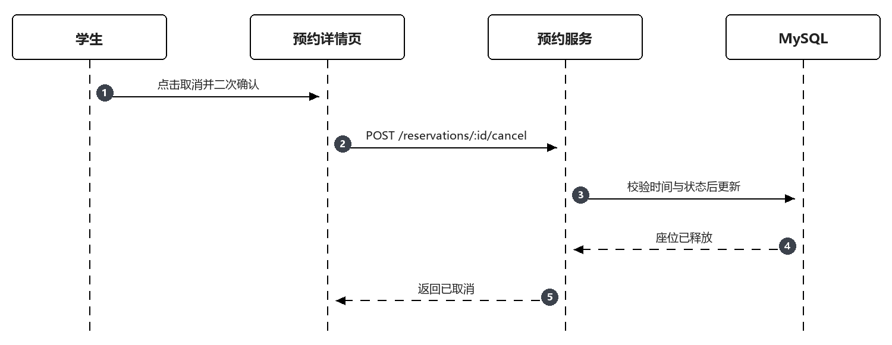

图 5-11 学生取消预约时序图

**（三）接口定义**

表 5-5 取消与状态接口

| 接口 | 方法 | 路径 | 说明 | 请求参数 | 响应数据 |
| --- | --- | --- | --- | --- | --- |
| 取消预约 | POST | /reservations/:id/cancel | 学生或管理员取消 | reason | reservation |
| 预约详情 | GET | /reservations/:id | 含状态时间线 | 无 | reservation, logs |

**（四）关键代码**

代码 5-5 状态转换

```ts
const ALLOWED: Record<ReservationStatus, ReservationStatus[]> = {
  pending: ['checked_in', 'cancelled', 'no_show'],
  checked_in: ['completed'],
  completed: [],
  cancelled: [],
  no_show: []
}

export async function transit(
  reservation: Reservation,
  to: ReservationStatus,
  actor: { type: 'user' | 'admin' | 'system'; id?: number },
  reason: string | null,
  tx: Transaction
) {
  if (!ALLOWED[reservation.status].includes(to)) {
    throw new AppError('CONFLICT', '当前状态不允许该操作')
  }
  const from = reservation.status
  await reservation.update({ status: to }, { transaction: tx })
  await ReservationStatusLog.create({
    reservationId: reservation.id, fromStatus: from, toStatus: to,
    actorType: actor.type, actorId: actor.id ?? null,
    reason, occurredAt: new Date()
  }, { transaction: tx })
  return reservation
}
```

**（五）界面实现**

取消确认弹窗如图 5-12 所示。弹窗说明“取消后座位将立即释放，且不可恢复”，要求填写取消原因，确认按钮为危险色。取消成功后列表中的状态标签变为已取消，详情页时间线新增一条记录，标明操作人与时间。

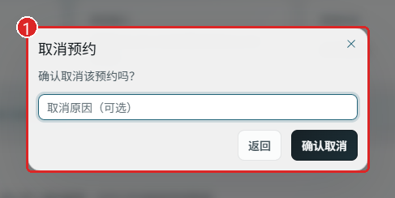
图 5-12 取消预约确认弹窗

我的预约列表如图 5-13 所示。列表按状态分为待签到、已签到、已完成、已取消、已失约五类，支持按状态筛选；每条记录显示自习室、座位、日期时段与操作入口，待签到的记录提供签到与取消两个按钮。

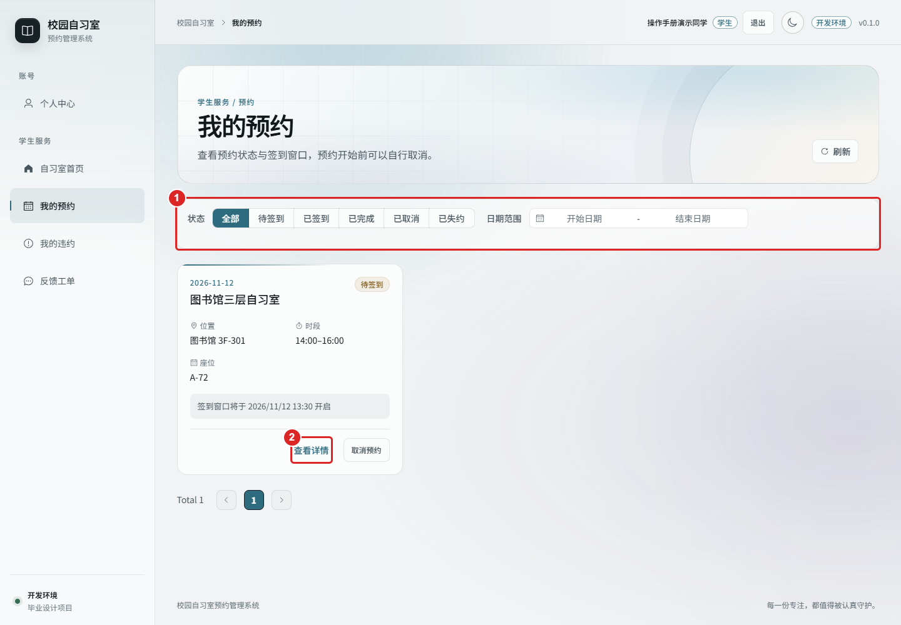

图 5-13 我的预约列表

### 5.1.6 违约查询与反馈

**（一）功能描述**

学生在个人中心查看违约情况，包括累计有效违约次数、每次失约的发生时间与原因、当前是否处于限制期以及限制截止时间。若因占座问题需要反馈，学生可提交工单，选择类型（占座、设备、环境、其他），填写描述并可指定自习室与座位，提交后可在“我的反馈”中查看状态与管理员填写的处理结果。

**（二）业务流程**

反馈提交流程如图 5-14 所示。提交时服务端校验描述长度与资源归属，写入工单并记录资源快照，工单进入待处理状态，等待管理员受理。

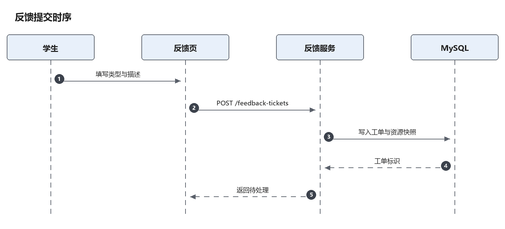

图 5-14 反馈提交时序图

**（三）接口定义**

表 5-6 违约与反馈接口

| 接口 | 方法 | 路径 | 说明 | 请求参数 | 响应数据 |
| --- | --- | --- | --- | --- | --- |
| 我的违约 | GET | /me/violations | 违约记录与限制期 | page | items, restriction |
| 提交反馈 | POST | /feedback-tickets | 新建工单 | type, description, roomId, seatId | ticket |
| 我的反馈 | GET | /me/feedback-tickets | 工单列表 | status, page | items, total |
| 工单详情 | GET | /me/feedback-tickets/:id | 详情与结果 | 无 | ticket |

**（四）关键代码**

代码 5-6 违约写入与限制刷新

```ts
export async function createFromNoShow(reservationId: number, tx: Transaction) {
  const reservation = await Reservation.findByPk(reservationId, { transaction: tx, lock: tx.LOCK.UPDATE })
  if (!reservation || reservation.status !== 'no_show') return null

  const exists = await Violation.findOne({ where: { reservationId }, transaction: tx })
  if (exists) return exists

  const violation = await Violation.create({
    userId: reservation.userId,
    reservationId,
    type: 'no_show',
    status: 'active',
    reason: '预约后未在规定时间签到',
    occurredAt: reservation.checkInDeadline
  }, { transaction: tx })

  const user = await User.findByPk(reservation.userId, { transaction: tx, lock: tx.LOCK.UPDATE })
  const rule = await getViolationRule(tx)
  const activeCount = await Violation.count({
    where: { userId: user.id, status: 'active' }, transaction: tx
  })
  await user.update({ violationCount: activeCount }, { transaction: tx })

  if (activeCount >= rule.threshold) {
    await user.update({
      restrictionStartedAt: user.restrictionStartedAt ?? new Date(),
      restrictionUntil: addDays(new Date(), rule.restrictDays)
    }, { transaction: tx })
  }
  return violation
}
```

**（五）界面实现**

反馈提交页如图 5-15 所示。页面上方为类型选择，中部为情况描述文本框，下方可选择关联的自习室与座位，提交后跳转“我的反馈”列表。列表按状态标注待处理、处理中、已解决、已驳回，点击进入详情可看到处理结果与处理时间。

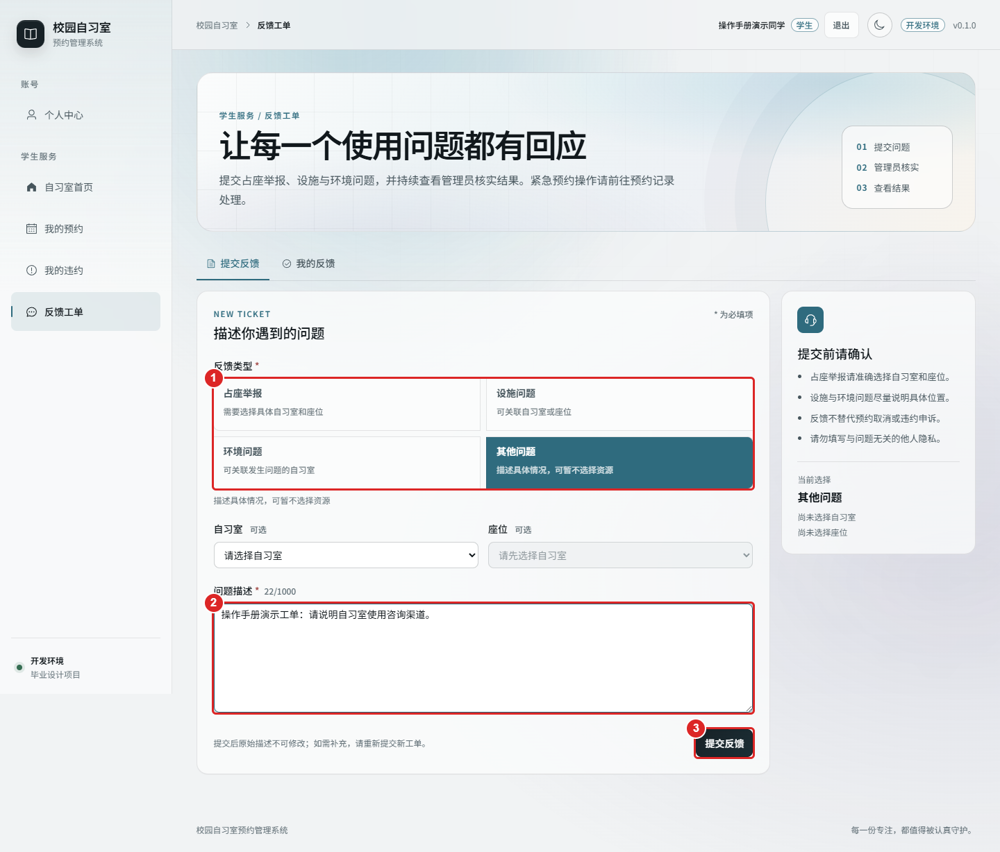

图 5-15 提交反馈页面

## 5.2 管理端功能

### 5.2.1 统计与报表

**（一）功能描述**

管理端仪表盘展示当日与近七日的核心指标：预约量、签到率、失约率与座位利用率。指标按日期范围与自习室筛选，趋势接口返回按日聚合的时间序列，报表页以表格展示分时段的明细，并支持把当前筛选条件导出为 CSV。利用率的分母来自当日容量快照，分子来自已签到预约的实际使用时长。

**（二）业务流程**

统计聚合流程如图 5-16 所示。请求进入后，服务端先校验日期范围不超过 366 天，再按维度选择当前日实时聚合或读取已冻结的历史快照，两者拼接后返回。

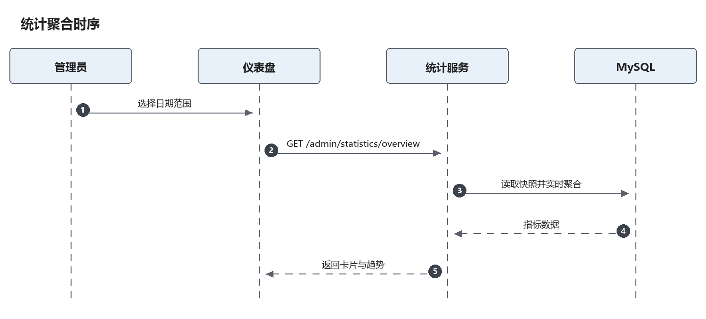

图 5-16 统计聚合时序图

**（三）接口定义**

表 5-7 统计与报表接口

| 接口 | 方法 | 路径 | 说明 | 请求参数 | 响应数据 |
| --- | --- | --- | --- | --- | --- |
| 概览 | GET | /admin/statistics/overview | 核心指标卡片 | date, roomId | metrics |
| 趋势 | GET | /admin/statistics/trend | 按日序列 | startDate, endDate, roomId | series |
| 导出 | GET | /admin/statistics/export | CSV 下载 | 同趋势参数 | CSV 流 |

**（四）关键代码**

代码 5-7 分时段指标聚合

```ts
export async function aggregateRange(startDate: string, endDate: string, roomId?: number) {
  const rows = await DailySlotMetrics.findAll({
    where: {
      statDate: { [Op.between]: [startDate, endDate] },
      ...(roomId ? { roomId } : {})
    },
    order: [['statDate', 'ASC'], ['slotStartTime', 'ASC']]
  })

  return rows.map((row) => {
    const valid = row.checkedInCount + row.noShowCount + row.outageCancelledCount
    return {
      statDate: row.statDate,
      roomName: row.roomNameSnapshot,
      slotLabel: row.slotLabel,
      reservationCount: row.reservationCount,
      checkInRate: valid === 0 ? 0 : round((row.checkedInCount) / valid, 4),
      noShowRate: valid === 0 ? 0 : round(row.noShowCount / valid, 4),
      utilization: row.availableSeatMinutes === 0
        ? 0
        : round(row.usedSeatMinutes / row.availableSeatMinutes, 4),
      finalized: Boolean(row.finalizedAt)
    }
  })
}
```

**（五）界面实现**

仪表盘如图 5-17 所示。顶部为四张指标卡片，中部为预约量与签到率的双轴趋势图，下方为分时段利用率柱状图与最近预约列表。切换日期范围时图表同步刷新，历史日期的数据标注为已冻结。

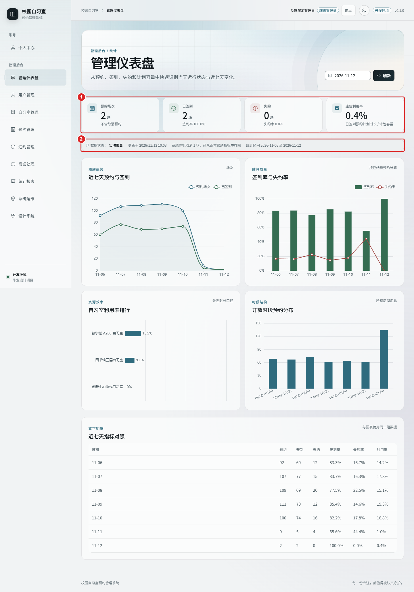
图 5-17 管理端仪表盘

统计报表页如图 5-18 所示。页面上方为日期范围与自习室筛选，中部为与仪表盘一致的趋势图，下方为分时段明细表，列出自习室、时段、预约数、签到数、失约数与利用率，右下角提供 CSV 导出按钮。

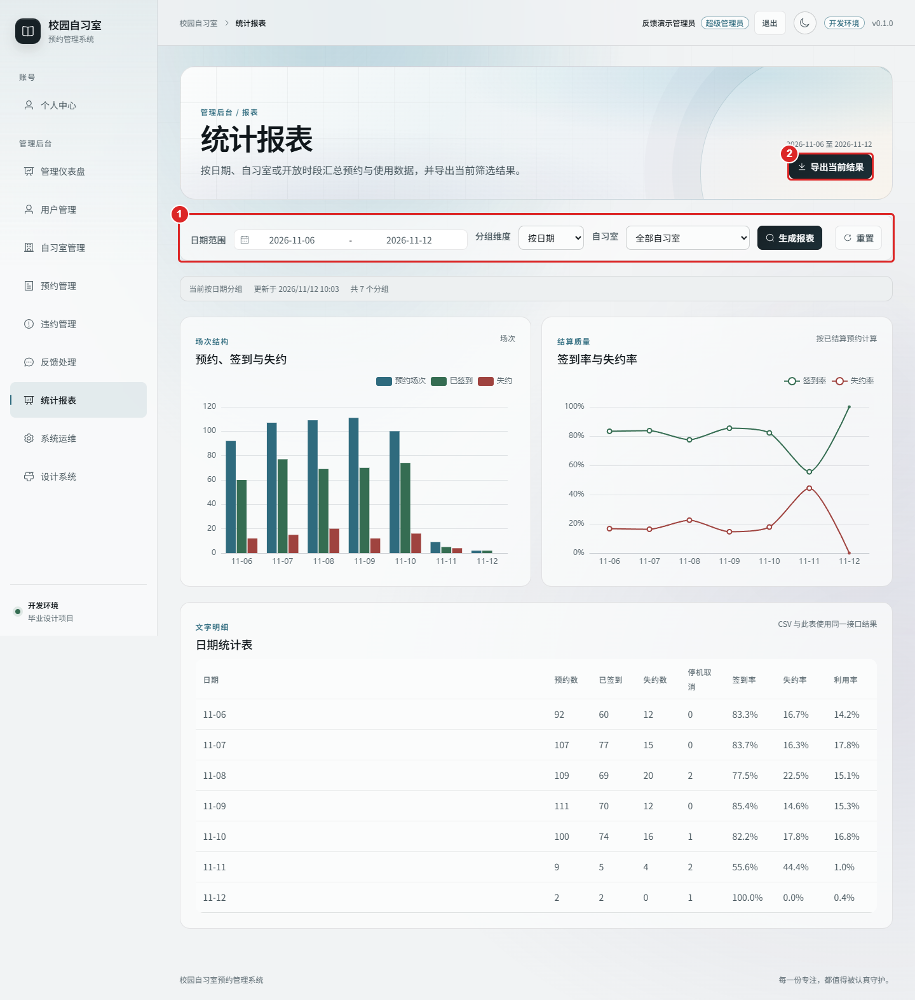

图 5-18 统计报表页面

### 5.2.2 自习室与座位维护

**（一）功能描述**

管理员可新增自习室，填写名称、位置、描述与平面图行列数，并设置状态。自习室新建后默认为关闭状态，配置好时段与座位后再开放。开放时段在自习室内维护，要求开始早于结束、长度在 30 分钟到 4 小时之间、同一自习室内时段不重叠。座位支持按批次批量生成：指定批次前缀与行列范围，系统按“前缀-序号”规则生成座位编号与坐标，已存在的编号或坐标自动跳过。单个座位可设为维修或停用，维修中的座位不参与预约。

**（二）业务流程**

批量生成座位流程如图 5-19 所示。服务端先校验批次前缀在自习室内唯一，再在事务中逐行插入，遇到唯一键冲突则跳过该坐标，最后返回生成数量与跳过数量。

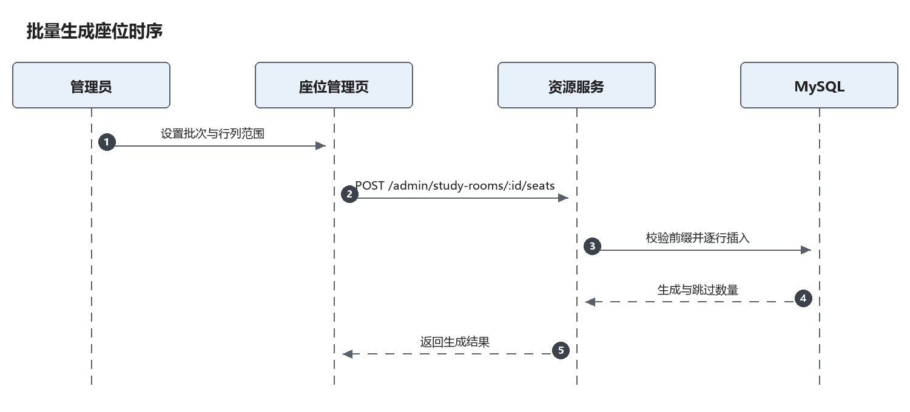

图 5-19 批量生成座位时序图

**（三）接口定义**

表 5-8 资源维护接口

| 接口 | 方法 | 路径 | 说明 | 请求参数 | 响应数据 |
| --- | --- | --- | --- | --- | --- |
| 新增自习室 | POST | /admin/study-rooms | 创建 | name, location, gridRows, gridColumns | room |
| 修改自习室 | PATCH | /admin/study-rooms/:roomId | 修改或停用 | 同新增，可选 | room |
| 新增时段 | POST | /admin/study-rooms/:roomId/time-slots | 配置时段 | label, startTime, endTime | slot |
| 启停时段 | PATCH | /admin/time-slots/:slotId | 修改状态 | status | slot |
| 批量生成座位 | POST | /admin/study-rooms/:roomId/seats | 按批次生成 | batchPrefix, rowFrom, rowTo, columnFrom, columnTo | created, skipped |
| 修改座位 | PATCH | /admin/seats/:seatId | 维修或停用 | status, remark | seat |

**（四）关键代码**

代码 5-8 座位批量生成

```ts
export async function createSeatBatch(roomId: number, input: SeatBatchInput) {
  const room = await StudyRoom.findByPk(roomId)
  if (!room) throw new AppError('NOT_FOUND', '自习室不存在')
  if (input.rowTo > room.gridRows || input.columnTo > room.gridColumns) {
    throw new AppError('VALIDATION_ERROR', '批次范围超出平面图尺寸')
  }

  const prefixUsed = await Seat.findOne({ where: { roomId, batchPrefix: input.batchPrefix } })
  if (prefixUsed) throw new AppError('CONFLICT', '批次前缀已存在')

  let created = 0
  let skipped = 0
  await sequelize.transaction(async (tx) => {
    for (let row = input.rowFrom; row <= input.rowTo; row += 1) {
      for (let column = input.columnFrom; column <= input.columnTo; column += 1) {
        const seatNo = `${input.batchPrefix}-${String(row)}${String(column).padStart(2, '0')}`
        const [seat, isNew] = await Seat.findOrCreate({
          where: { roomId, seatNo },
          defaults: { roomId, batchPrefix: input.batchPrefix, seatNo, rowNo: row, columnNo: column, status: 'available', bookableFrom: input.bookableFrom },
          transaction: tx
        })
        if (isNew) created += 1
        else skipped += 1
      }
    }
  })
  return { created, skipped }
}
```

**（五）界面实现**

座位管理页如图 5-20 所示。页面以平面图展示所有座位，维修中的座位以灰色标注并可点击切换；工具栏提供“批量生成”按钮，弹窗内填写批次前缀、行列范围与生效日期；右侧显示当前自习室的座位统计与时段列表。


图 5-20 座位管理页面

时段配置页如图 5-21 所示。页面列出自习室下的全部时段，显示名称、起止时间与状态，可新增时段、启用或停用；新增时校验开始早于结束、长度在 30 分钟到 4 小时之间、与同时段不重叠。


图 5-21 开放时段配置页面

### 5.2.3 预约管理

**（一）功能描述**

管理员可查询全量预约，按日期、自习室、状态与学生筛选，查看预约详情与完整状态时间线。对二维码不可用的情况，管理员可在详情页执行人工核验签到，签到方式记为人工并记录操作人。对异常预约，管理员可取消待签到状态的预约，取消必须填写原因，取消后记入状态日志。

**（二）业务流程**

人工核验签到流程如图 5-22 所示。管理员在详情页点击“人工签到”，服务端校验预约状态为待签到且当前时间在窗口内，写入签到记录并把状态置为已签到，操作人记入签到表。


图 5-22 人工核验签到时序图

**（三）接口定义**

表 5-9 预约管理接口

| 接口 | 方法 | 路径 | 说明 | 请求参数 | 响应数据 |
| --- | --- | --- | --- | --- | --- |
| 预约列表 | GET | /admin/reservations | 多条件查询 | date, roomId, status, keyword, page | items, total |
| 预约详情 | GET | /reservations/:id | 详情与时间线 | 无 | reservation, logs |
| 人工签到 | POST | /admin/reservations/:id/check-in | 核验签到 | remark | reservation |
| 管理员取消 | POST | /reservations/:id/cancel | 取消并记录原因 | reason | reservation |

**（四）关键代码**

代码 5-9 管理员取消预约

```ts
export async function adminCancel(reservationId: number, adminId: number, reason: string) {
  if (!reason || reason.trim().length < 2) {
    throw new AppError('VALIDATION_ERROR', '请填写取消原因')
  }
  return sequelize.transaction(async (tx) => {
    const reservation = await Reservation.findByPk(reservationId, {
      transaction: tx, lock: tx.LOCK.UPDATE
    })
    if (!reservation) throw new AppError('NOT_FOUND', '预约不存在')
    if (reservation.status !== 'pending') {
      throw new AppError('CONFLICT', '只能取消待签到预约')
    }

    await reservation.update({
      status: 'cancelled',
      cancelReason: reason,
      cancelledBy: adminId,
      cancelledAt: new Date()
    }, { transaction: tx })

    await ReservationStatusLog.create({
      reservationId, fromStatus: 'pending', toStatus: 'cancelled',
      actorType: 'admin', actorId: adminId, reason, occurredAt: new Date()
    }, { transaction: tx })
    return reservation
  })
}
```

**（五）界面实现**

预约管理页如图 5-23 所示。页面上方为筛选区，支持日期范围、自习室、状态与关键字组合查询；表格列包含学生、自习室、座位、时段、状态与操作；操作列提供详情、人工签到与取消三个入口，取消时弹出原因输入框。


图 5-23 预约管理页面

预约详情页如图 5-24 所示。页面左侧为预约信息与资源快照，右侧为状态时间线，按时间顺序列出每次状态变更的操作人、时间与原因；底部提供人工签到与取消两个操作入口。


图 5-24 预约详情与状态时间线

### 5.2.4 违约管理

**（一）功能描述**

违约管理包括记录查看、规则配置与撤销三部分。管理员可按学生与状态查询违约记录，查看违约原因、发生时间与关联预约；可在线调整失约阈值与限制天数，调整只对之后新触发的限制生效，已生效的限制区间保持不变；可撤销违约，撤销时必须填写原因，撤销后重新统计有效违约数，低于阈值时清空该学生的预约限制，但原预约的失约状态不改变。

**（二）业务流程**

撤销违约流程如图 5-25 所示。服务端锁定用户行，更新违约记录状态并记录撤销人与原因，重新计算有效违约数，按阈值决定是否清空限制，最后写入审计日志。


图 5-25 撤销违约时序图

**（三）接口定义**

表 5-10 违约管理接口

| 接口 | 方法 | 路径 | 说明 | 请求参数 | 响应数据 |
| --- | --- | --- | --- | --- | --- |
| 违约列表 | GET | /admin/violations | 查询记录 | userId, status, page | items, total |
| 撤销违约 | PATCH | /admin/violations/:id | 撤销 | resolutionReason | violation |
| 查询规则 | GET | /admin/violation-rules | 当前规则 | 无 | threshold, restrictDays |
| 修改规则 | PUT | /admin/violation-rules | 更新规则 | threshold, restrictDays | rule |

**（四）关键代码**

代码 5-10 撤销违约与限制期重算

```ts
export async function revokeViolation(violationId: number, adminId: number, reason: string) {
  return sequelize.transaction(async (tx) => {
    const violation = await Violation.findByPk(violationId, { transaction: tx, lock: tx.LOCK.UPDATE })
    if (!violation) throw new AppError('NOT_FOUND', '违约记录不存在')
    if (violation.status === 'revoked') throw new AppError('CONFLICT', '该记录已撤销')

    const user = await User.findByPk(violation.userId, { transaction: tx, lock: tx.LOCK.UPDATE })
    await violation.update({
      status: 'revoked', resolvedBy: adminId, resolvedAt: new Date(), resolutionReason: reason
    }, { transaction: tx })

    const activeCount = await Violation.count({
      where: { userId: user.id, status: 'active' }, transaction: tx
    })
    const rule = await getViolationRule(tx)
    const updates: Partial<User> = { violationCount: activeCount }
    if (activeCount < rule.threshold) {
      updates.restrictionStartedAt = null
      updates.restrictionUntil = null
    }
    await user.update(updates, { transaction: tx })
    await writeAudit(tx, adminId, 'violation.revoke', violation.id, reason)
    return violation
  })
}
```

**（五）界面实现**

违约管理页如图 5-26 所示。页面分两个区域：上方为规则配置卡片，展示当前阈值与限制天数并提供编辑入口；下方为违约记录表，列出学生、原因、发生时间、状态与操作，撤销按钮弹出原因输入框，提交后记录状态变为已撤销并显示撤销人。


图 5-26 违约管理页面

### 5.2.5 反馈工单处理

**（一）功能描述**

管理员查看全部工单，按状态、类型与时间筛选，进入详情后可看到学生提交的描述、关联资源与提交时间。处理时先受理把状态置为处理中，核实后填写处理结果并关闭工单，结果对学生可见。工单状态只能按“待处理→处理中→已解决”或“待处理/处理中→已驳回”流转，跳过处理中直接解决会被拒绝。

**（二）业务流程**

工单处理流程如图 5-27 所示。服务端校验目标状态是否在允许集合内，更新状态、处理结果与处理时间，同时写入审计日志，学生在“我的反馈”中即可看到结果。


图 5-27 反馈工单处理时序图

**（三）接口定义**

表 5-11 反馈工单接口

| 接口 | 方法 | 路径 | 说明 | 请求参数 | 响应数据 |
| --- | --- | --- | --- | --- | --- |
| 工单列表 | GET | /admin/feedback-tickets | 查询 | status, type, page | items, total |
| 工单详情 | GET | /admin/feedback-tickets/:id | 详情 | 无 | ticket |
| 处理工单 | PATCH | /admin/feedback-tickets/:id | 状态与结果 | status, result | ticket |

**（四）关键代码**

代码 5-11 工单状态机

```ts
const TICKET_FLOW: Record<TicketStatus, TicketStatus[]> = {
  pending: ['processing', 'rejected'],
  processing: ['resolved', 'rejected'],
  resolved: [],
  rejected: []
}

export async function handleTicket(
  ticketId: number, adminId: number,
  input: { status: TicketStatus; result?: string }
) {
  return sequelize.transaction(async (tx) => {
    const ticket = await FeedbackTicket.findByPk(ticketId, { transaction: tx, lock: tx.LOCK.UPDATE })
    if (!ticket) throw new AppError('NOT_FOUND', '工单不存在')
    if (!TICKET_FLOW[ticket.status].includes(input.status)) {
      throw new AppError('CONFLICT', '不允许的状态变更')
    }
    if (input.status === 'resolved' && !input.result?.trim()) {
      throw new AppError('VALIDATION_ERROR', '请填写处理结果')
    }

    await ticket.update({
      status: input.status,
      result: input.result ?? ticket.result,
      handledBy: adminId,
      processedAt: ticket.processedAt ?? new Date(),
      closedAt: ['resolved', 'rejected'].includes(input.status) ? new Date() : null
    }, { transaction: tx })

    await writeAudit(tx, adminId, 'feedback.handle', ticket.id, input.status)
    return ticket
  })
}
```

**（五）界面实现**

工单详情页如图 5-28 所示。页面左侧为学生描述与关联资源，右侧为处理面板，包含状态选择、结果文本框与提交按钮。提交后状态标签更新，处理时间与处理人显示在信息区，学生在学生端可看到同一份结果。


图 5-28 工单详情页面

处理完成后的工单如图 5-29 所示。状态标签变为已解决，处理结果、处理人与处理时间显示在信息区，学生在学生端可看到同一份结果与时间。


图 5-29 工单处理结果

### 5.2.6 系统设置与运维

**（一）功能描述**

系统设置页集中管理可调参数：预约窗口天数（默认 7 天，上限 30 天）、每日预约上限（默认 2 条）、违约阈值（默认 3 次）与限制天数（默认 7 天）。参数保存后写入配置表并立即生效，正在进行的预约不受影响。运维页展示服务与数据库状态、定时任务最近运行时间、各定时任务的待处理数量，并提供审计日志查询。配置变更与管理员关键操作均写入审计日志，记录操作人、变更前后值与原因。

**（二）业务流程**

配置保存流程如图 5-30 所示。服务端校验参数范围，写入配置表并记录变更前后值，同时刷新内存中的参数缓存，返回最新配置；前端在下次请求时即可感知新的预约窗口。


图 5-30 系统配置保存时序图

**（三）接口定义**

表 5-12 系统配置与运维接口

| 接口 | 方法 | 路径 | 说明 | 请求参数 | 响应数据 |
| --- | --- | --- | --- | --- | --- |
| 公开配置 | GET | /system/public-config | 学生端读取 | 无 | bookingWindowDays, dailyLimit |
| 查询配置 | GET | /admin/system/settings | 全部参数 | 无 | settings |
| 更新配置 | PUT | /admin/system/settings | 批量更新 | settings[] | settings |
| 运维状态 | GET | /admin/system/status | 服务与任务 | 无 | health, jobs |
| 健康检查 | GET | /health | 存活检查 | 无 | status |

**（四）界面实现**

系统设置页如图 5-31 所示。页面按业务分组展示参数，每项右侧为当前值与编辑控件，底部为保存按钮；保存前校验数值范围，超出范围时在输入框下方提示。运维状态区展示数据库连接、最近一次任务运行时间与积压数量，异常项以警示色标出。


图 5-31 系统设置页面

运行状态区如图 5-32 所示。页面展示服务与数据库连通性、各定时任务最近一次运行时间与待处理数量，异常项以警示色标出；下方为审计日志入口，可按时间与操作人筛选。


图 5-32 系统运行状态

## 5.3 关键问题处理

前面按功能说明了实现，但有几个问题横跨多个模块，单独放在某一节都不合适。本节集中说明这些问题的成因与处理方式。

### 5.3.1 并发预约的一致性保障

抢座是系统唯一存在真实并发的场景。开放预约的时刻，多名学生可能同时对同一座位提交请求。如果处理不当，会出现两种错误：两人都预约成功，导致同一座位被重复占用；或者两人都失败，座位空置而请求被拒。

系统的处理分三层。第一层是事务。预约创建、取消与管理员取消都在事务中执行，事务内完成校验与写入，异常时整体回滚，不会留下“预约写入了但状态日志没写”这类半成品数据。

第二层是加锁顺序。事务开始时按“用户→自习室→时段→座位”的固定顺序获取锁，用户行与座位行使用排他锁，自习室与时段使用共享锁。固定顺序的作用是避免死锁：如果两个事务分别先锁座位再锁用户，就可能形成互相等待。共享锁用在自习室与时段上，是因为这两个资源在预约中只读不改，多个事务可以同时持有，不必排队。

第三层是唯一约束。加锁之后仍可能存在问题：锁只能约束数据库中的行，而“同一座位同一日期时段唯一”是一个由多个字段组合而成的条件，无法直接用行锁表达。系统用生成列 `active_slot_key` 解决：该列在预约处于待签到或已签到状态时取“座位:日期:时段”的拼接值，其他状态取空值，再对该列建立唯一索引。写入时若违反约束，数据库返回唯一键冲突，服务层捕获后转换为 409，提示“该座位在所选时段已被预约”。

三层之间的关系是递进的：事务保证原子性，锁保证校验与写入之间资源状态不被打断，唯一约束保证即使前两层都被绕过也不会出现重复占用。实际测试中，两名用户同时提交同一座位，结果是一条 201、一条 409，符合预期。

### 5.3.2 时区与跨日处理

时间处理是预约系统最容易出错的地方。数据库中的 `DATETIME` 按 UTC 存储与比较，而学生看到的日期与时段是东八区时间。若在某一层混用两个口径，就会出现八小时偏移：例如学生在本地 23:59 提交的预约被记为第二天的记录，或者签到窗口在错误的时刻开启。

系统的做法是明确三个边界。存储边界：所有 `DATETIME` 一律为 UTC，Sequelize 连接与 MySQL 会话都固定 `+00:00`，不依赖服务器本地时区。业务边界：业务日期 `reserve_date` 是东八区的自然日，时段起止是东八区的本地时刻，两者组合成具体时刻后再转换为 UTC 写入 `start_at` 与 `end_at`。展示边界：接口返回带时区的 ISO 8601 字符串，前端按本地时区渲染。

签到窗口在预约创建时就被计算并写入 `check_in_open_at` 与 `check_in_deadline`，而不是在签到时按当前配置重新计算。这样做的原因是配置可能被调整，若按当前规则重算，历史预约的窗口会跟着变化，已经失效的预约可能重新变得可签到。窗口写入预约表后，签到校验只读取快照，行为稳定。

测试中对跨日场景单独设计了用例：在东八区 23:59 提交预约，检查业务日期是否仍为当日、`start_at` 的 UTC 值是否正确、次日查询时记录是否出现在正确日期下。这类问题在白天测试时不会暴露，必须构造边界时刻。

### 5.3.3 幂等与重复提交

预约接口是写操作，网络抖动或用户连点都可能造成重复提交。若每次提交都创建一条预约，学生可能在不知情的情况下占用多个座位，或者因为重复请求触发每日上限而被拒绝，体验很差。

系统要求创建预约时携带 `Idempotency-Key` 请求头，服务端在预约表上建立“用户 + 幂等键”的唯一索引。处理逻辑是：先按用户与幂等键查询，若已存在则直接返回原预约；不存在则执行创建。并发情况下两个相同请求可能同时查不到记录，此时唯一索引会使其中一个失败，失败方重新查询后返回已创建的记录。

前端在进入确认页时生成幂等键，同一次确认动作复用同一个键，用户返回列表再重新进入则生成新键。这样既保证重试不会重复创建，也不会把两次真实的预约误判为重复。

### 5.3.4 定时任务的幂等与停机恢复

定时任务每分钟执行一次，负责两件事：把超时未签到的预约转为失约，把已签到且到期的预约转为完成。任务由 cron 触发，可能因为服务重启、数据库不可用等原因中断。

任务的设计遵循三个原则。第一，条件更新。更新语句带上“当前状态仍为待签到”的条件，只有匹配才更新，重复执行不会把已处理的记录再处理一次。第二，同事务写日志。状态更新与状态日志在同一事务中完成，保证时间线不会缺失。第三，失败不重试堆积。单次执行出错只记录错误，等待下一周期重新扫描，避免错误累积成队列。

停机恢复单独处理。若服务中断时间较长，中断期间到期的预约会集中出现。这些预约的学生在停机期间无法签到，若一律判为失约显然不合理。系统规定：超窗时间超过 30 分钟的候选记录说明任务曾中断，将其转为已取消（操作人为系统）而不是失约，不生成违约记录，同时输出告警等待人工复核。这个阈值就是停机豁免。

### 5.3.5 统计快照与历史一致性

统计模块有一个容易被忽略的问题：如果每次查询都按当前资源聚合历史预约，那么自习室改名、座位停用、时段调整之后，历史数据会随之变化。昨天利用率还是 60%，今天因为减少了 5 个座位变成 75%，这样的报表无法用于比较。

系统采用快照策略。每天 00:05 由任务按日期、自习室与时段生成容量快照，记录当日的可预约座位数、开放分钟数与时段名称；次日 01:10 冻结前一天的数据，把预约数、签到数、失约数、停机取消数与已用座位分钟写入快照，并标记冻结时间。查询历史时读取快照而不是实时聚合，只有当天的数据才实时计算。

快照同时保存了名称与起止时间的副本。资源改名后，历史报表仍显示当时的名称，这与预约表中的快照字段是同一思路：把“当时的事实”固定下来，避免后续变更污染历史。

冻结任务还承担一个检查职责：冻结前确认当天的预约状态都已收敛，若仍有待签到记录说明任务异常，冻结会被推迟并告警，避免把未完成的数据固化。

### 5.3.6 错误处理与安全约束

错误处理的目标是让前端能区分“用户做错了”与“系统出问题了”。系统定义了十种错误码，覆盖参数错误、未登录、越权、资源不存在、状态冲突、校验失败、限流、数据库不可用与未知异常。前端按错误码分支：401 清除会话并跳转登录，403 提示无权限，409 展示冲突原因，422 定位到具体字段，其余统一提示稍后重试。

安全约束集中在中间件与服务层。认证中间件解析令牌并校验会话状态，注销后的令牌立即失效；权限中间件按角色判断，资源归属由服务层二次校验，避免“知道别人预约编号就能查看”的越权；校验中间件使用统一的规则描述字段类型与范围；限流中间件对登录、注册、预约与反馈分别设置窗口。密码使用 bcrypt 哈希，响应与日志不出现密码、令牌与完整个人信息，数据库错误不向前端透出。

这些处理并不复杂，但需要在每个入口保持一致。系统的做法是把它们写进中间件与统一响应封装，业务代码只关心成功分支与少数需要区分语义的冲突，从而避免每个接口重复实现一遍。

### 5.3.7 审计与可追溯

预约与违约涉及学生的使用权，管理员的一次误操作可能直接影响学生能否预约。因此系统对管理员的关键操作保留了审计记录，记录内容包括操作人、动作、资源类型与标识、变更前后的值、操作原因以及请求标识。

审计的写入时机与业务更新在同一事务中。以撤销违约为例，违约记录的状态、用户的限制区间与审计记录三者要么全部成功，要么全部回滚。这样做是为了避免出现“记录撤销了但没有痕迹”的情况。请求标识来自网关层为每次请求生成的编号，同一个编号可以关联到访问日志中的方法、路径与耗时，排查问题时能把业务记录与请求对上。

审计记录只追加、不修改、不删除。资源下线时通过状态字段停用，审计记录保留；用户注销后其操作记录仍保留，只是不再出现在常规列表中。记录中的变更前后值以 JSON 保存，只包含业务字段，不包含密码哈希、令牌与完整联系方式，避免审计表本身成为敏感信息的聚集地。

学生端不直接接触审计表，但通过状态时间线获得同等的可追溯性。预约详情页的时间线来自状态日志，每条记录标明变更前后的状态、操作人类型与时间。两条链路互补：状态日志面向学生，说明预约经历了什么；审计日志面向管理，说明管理员做了什么。

### 5.3.8 前端状态与加载性能

前端的问题不在于功能多少，而在于状态散落与首屏过重。页面数量增加之后，如果没有统一约定，每个页面都会各自处理加载中、无数据、请求失败与无权限四种状态，最终出现同一类提示在不同页面文案不一、行为不一的情况。

系统的处理是把四种状态收敛为可复用的组件。列表页与详情页统一使用状态容器：加载中显示骨架占位，无数据给出引导文案，请求失败提供重试按钮，无权限跳转提示页。组件只负责呈现，状态由页面根据请求结果设置。这样新增页面时不必重新设计交互，直接套用即可。

首屏体积主要来自图表库与组件库。图表只在管理端使用，但若在入口处静态引入，学生端也会被加载。系统把管理端路由改为动态导入，图表组件在进入仪表盘时才加载；组件库按需注册，未使用的组件不进入构建产物。测试中发现统计页面的图表资源约 558 KB，属于可接受范围，但仍列为后续优化项。

主题切换是另一个影响体验的细节。系统在全局样式中定义了颜色与间距变量，组件读取变量而不是写死色值，明暗主题切换时只改变量，页面无需重新渲染结构。图表同样从 CSS 变量读取配色，切换后重新设置一次配置即可。这一约定写进了视觉规范文档，避免新页面各自定义颜色导致主题切换失效。

# 6  系统测试

## 6.1 测试方法与测试环境

测试按四个层次开展<sup>[29]</sup>。单元测试针对服务层函数与校验器，使用 Node.js 内置的测试运行器，覆盖状态转换、签到窗口判定、违约阈值计算与时间工具；接口测试直接调用 HTTP 接口，验证请求响应、权限与数据隔离；集成测试在前端与后端联调状态下执行，覆盖事务、定时任务与并发请求；验收测试按真实角色走完整业务流程，从注册开始直到预约完成或失约。

用例设计采用黑盒方法<sup>[30]</sup>。对每个功能先按等价类划分确定有效输入与无效输入，再对边界取值单独设计用例，例如签到窗口取开始前 30 分钟、开始后 15 分钟与超出 1 分钟三个点；对状态转换类功能，依据状态迁移表逐条覆盖合法迁移与非法迁移<sup>[29]</sup>。功能用例覆盖正常流程与异常流程，异常流程约占三分之一。

测试环境如表 6-1 所示。测试使用本地真实的 MySQL 8 数据库，未使用内存数据库替代，以保证事务、锁与唯一约束的行为与生产一致。涉及时间推进的场景使用隔离夹具与原业务任务，不修改系统时钟，也不修改全局规则。

表 6-1 测试环境

| 项目 | 配置 |
| --- | --- |
| 操作系统 | Windows 11 |
| 运行时 | Node.js 24 |
| 数据库 | MySQL 8，InnoDB，utf8mb4 |
| 浏览器 | Chrome 最新版 |
| 后端服务 | 本地 43080 端口，API 前缀 /api/v1 |
| 前端服务 | 本地 43081 端口 |
| 测试数据 | 演示自习室与座位、测试学生账号 |

测试数据按照业务规则准备，而不是随手填入。自习室建两间，一间状态开放、一间关闭，用于验证资源状态对可选性的影响；每间配置两个时段，其中一组相邻、一组跨午间，用于验证重叠判定；座位批量生成两批，包含一个维修状态与一个停用状态。学生账号准备三类：正常账号、当日已约满两条的账号、处于限制期的账号。预约数据按状态分布准备，待签到、已签到、已取消各若干条，便于同时验证列表筛选与状态展示。违约与工单各准备一条已处理记录，用于验证结果回填。

数据准备本身也验证了一个设计点：状态之间的依赖顺序不能乱。若先造违约记录再改预约状态，会触发唯一约束；若先冻结统计快照再补当天预约，快照与明细会不一致。测试中按照“用户→资源→预约→签到/违约→工单→统计”的顺序造数，这个顺序与系统的依赖方向一致，也从侧面说明模块划分是合理的。

## 6.2 功能测试用例

账户管理模块的测试用例如表 6-2 所示。

表 6-2 账户管理模块测试用例

| 用例 ID | 用例标题 | 前置条件 | 测试步骤 | 预期结果 | 优先级 | 类型 |
| --- | --- | --- | --- | --- | --- | --- |
| TC-ACC-001 | 学生正常注册 | 学号未被使用 | 1.打开注册页 2.填写学号与用户名 3.提交 | 注册成功并跳转登录 | P0 | 功能 |
| TC-ACC-002 | 学号重复注册 | 学号已存在 | 1.填写已存在学号 2.提交 | 提示学号已被使用 | P0 | 异常 |
| TC-ACC-003 | 密码长度不足 | 无 | 1.密码填 6 位 2.提交 | 提示密码长度为 8-32 位 | P1 | 异常 |
| TC-ACC-004 | 正常登录 | 账号已注册 | 1.输入正确账号密码 2.提交 | 登录成功并进入首页 | P0 | 功能 |
| TC-ACC-005 | 密码错误登录 | 账号已注册 | 1.输入错误密码 2.提交 | 提示账号或密码错误 | P0 | 异常 |
| TC-ACC-006 | 停用账号登录 | 账号已停用 | 1.输入正确密码 2.提交 | 提示账号已停用 | P1 | 异常 |
| TC-ACC-007 | 修改密码 | 已登录 | 1.填写旧密码与新密码 2.提交 | 修改成功，旧令牌失效 | P1 | 功能 |
| TC-ACC-008 | 退出登录 | 已登录 | 1.点击退出 2.用旧令牌请求 /me | 返回 401 | P1 | 功能 |

座位查询模块的测试用例如表 6-3 所示。

表 6-3 座位查询模块测试用例

| 用例 ID | 用例标题 | 前置条件 | 测试步骤 | 预期结果 | 优先级 | 类型 |
| --- | --- | --- | --- | --- | --- | --- |
| TC-SEAT-001 | 查看自习室列表 | 存在开放自习室 | 1.进入首页 | 显示自习室卡片与座位数 | P0 | 功能 |
| TC-SEAT-002 | 按名称筛选 | 存在多间自习室 | 1.输入名称关键字 | 列表只剩匹配项 | P1 | 功能 |
| TC-SEAT-003 | 查看座位平面图 | 已选日期时段 | 1.进入详情页 | 按行列渲染座位图 | P0 | 功能 |
| TC-SEAT-004 | 已预约座位显示占用 | 存在有效预约 | 1.选择对应日期时段 | 该座位显示已预约且不可点 | P0 | 功能 |
| TC-SEAT-005 | 维修座位不可选 | 座位处于维修 | 1.查看该座位 | 显示维修状态且不可点 | P1 | 异常 |
| TC-SEAT-006 | 关闭自习室不可预约 | 自习室状态为关闭 | 1.进入详情页 | 提示当前不可预约 | P1 | 异常 |
| TC-SEAT-007 | 跨自习室按时间查询 | 两间自习室时段不同 | 1.按统一起止时间筛选 | 各房间匹配自身时段 | P2 | 功能 |
| TC-SEAT-008 | 已开始时段不可选 | 当前时间已过时段开始 | 1.查看时段列表 | 该时段置灰不可选 | P1 | 异常 |

预约模块的测试用例如表 6-4 所示。

表 6-4 预约模块测试用例

| 用例 ID | 用例标题 | 前置条件 | 测试步骤 | 预期结果 | 优先级 | 类型 |
| --- | --- | --- | --- | --- | --- | --- |
| TC-RSV-001 | 正常创建预约 | 座位空闲且未达上限 | 1.选座 2.确认提交 | 创建成功，状态为待签到 | P0 | 功能 |
| TC-RSV-002 | 同座位并发抢座 | 两个学生同时提交同座 | 1.并发发起两次请求 | 一次 201，一次 409 | P0 | 异常 |
| TC-RSV-003 | 同学生时段重叠 | 已有同段预约 | 1.再约其他座位同段 | 提示时间冲突 | P0 | 异常 |
| TC-RSV-004 | 相邻时段可连约 | 已有前一时段预约 | 1.预约紧邻后一时段 | 创建成功 | P1 | 功能 |
| TC-RSV-005 | 超过每日上限 | 当日已有 2 条有效预约 | 1.再提交预约 | 提示已达每日上限 | P1 | 异常 |
| TC-RSV-006 | 幂等重复提交 | 已用同一幂等键提交 | 1.重放同一请求 | 返回同一条预约 | P1 | 功能 |
| TC-RSV-007 | 限制期内预约 | 账号处于限制期 | 1.提交预约 | 提示处于限制期 | P0 | 异常 |
| TC-RSV-008 | 越权查看他人预约 | 存在他人预约 | 1.请求该预约详情 | 返回 403 | P0 | 异常 |

签到模块的测试用例如表 6-5 所示。

表 6-5 签到模块测试用例

| 用例 ID | 用例标题 | 前置条件 | 测试步骤 | 预期结果 | 优先级 | 类型 |
| --- | --- | --- | --- | --- | --- | --- |
| TC-CHK-001 | 窗口内扫码签到 | 处于签到窗口 | 1.识别二维码 2.提交 | 签到成功，状态为已签到 | P0 | 功能 |
| TC-CHK-002 | 提前签到 | 早于窗口开始 1 分钟 | 1.提交签到 | 提示尚未到签到时间 | P1 | 异常 |
| TC-CHK-003 | 超时签到 | 晚于截止 1 分钟 | 1.提交签到 | 提示已超过截止时间 | P0 | 异常 |
| TC-CHK-004 | 伪造签名 | 修改二维码签名 | 1.提交签到 | 提示签到码无效 | P0 | 异常 |
| TC-CHK-005 | 错误自习室二维码 | 使用其他房间二维码 | 1.提交签到 | 提示签到码不属于该自习室 | P1 | 异常 |
| TC-CHK-006 | 重复签到 | 已签到 | 1.再次提交 | 返回 409 冲突 | P1 | 异常 |
| TC-CHK-007 | 人工核验签到 | 二维码不可用 | 1.管理员点击人工签到 | 签到成功，方式记为人工 | P1 | 功能 |
| TC-CHK-008 | 无待签到预约签到 | 无有效预约 | 1.提交签到 | 提示无待签到预约 | P1 | 异常 |

违约与反馈模块的测试用例如表 6-6 所示。

表 6-6 违约与反馈模块测试用例

| 用例 ID | 用例标题 | 前置条件 | 测试步骤 | 预期结果 | 优先级 | 类型 |
| --- | --- | --- | --- | --- | --- | --- |
| TC-VIO-001 | 超窗生成失约 | 预约超过签到截止 | 1.等待定时任务执行 | 状态转为失约并生成违约 | P0 | 功能 |
| TC-VIO-002 | 任务重复执行 | 已生成违约 | 1.再次执行任务 | 违约数不重复增加 | P0 | 异常 |
| TC-VIO-003 | 达到阈值进入限制 | 累计 2 次违约 | 1.再产生 1 次失约 | 进入限制期并记录截止时间 | P0 | 功能 |
| TC-VIO-004 | 限制期内不可预约 | 处于限制期 | 1.提交预约 | 提示处于限制期 | P0 | 异常 |
| TC-VIO-005 | 撤销违约解除限制 | 处于限制期 | 1.管理员撤销至低于阈值 | 限制清空，可再次预约 | P1 | 功能 |
| TC-FBK-001 | 提交占座反馈 | 已登录 | 1.填写描述 2.提交 | 工单创建，状态待处理 | P0 | 功能 |
| TC-FBK-002 | 描述为空提交 | 已登录 | 1.描述留空 2.提交 | 提示描述不能为空 | P1 | 异常 |
| TC-FBK-003 | 查看处理结果 | 工单已解决 | 1.学生查看详情 | 显示处理结果与时间 | P0 | 功能 |

管理端模块的测试用例如表 6-7 所示。

表 6-7 管理端功能测试用例

| 用例 ID | 用例标题 | 前置条件 | 测试步骤 | 预期结果 | 优先级 | 类型 |
| --- | --- | --- | --- | --- | --- | --- |
| TC-ADM-001 | 新增自习室 | 管理员登录 | 1.填写信息 2.提交 | 创建成功，默认关闭 | P0 | 功能 |
| TC-ADM-002 | 时段长度越界 | 管理员登录 | 1.设置 20 分钟时段 2.提交 | 提示长度 30 分钟至 4 小时 | P1 | 异常 |
| TC-ADM-003 | 批量生成座位 | 平面图已配置 | 1.设置批次与范围 2.提交 | 生成成功并返回数量 | P0 | 功能 |
| TC-ADM-004 | 批次前缀重复 | 前缀已存在 | 1.用相同前缀生成 | 提示前缀已存在 | P1 | 异常 |
| TC-ADM-005 | 人工取消预约 | 存在待签到预约 | 1.填写原因 2.取消 | 状态改为已取消并记录 | P0 | 功能 |
| TC-ADM-006 | 取消已签到预约 | 预约已签到 | 1.点击取消 | 拒绝并提示状态不允许 | P1 | 异常 |
| TC-ADM-007 | 修改违约规则 | 管理员登录 | 1.阈值改为 4 2.保存 | 保存成功，仅影响新限制 | P1 | 功能 |
| TC-ADM-008 | 导出报表 | 存在统计数据 | 1.选择日期范围 2.导出 | 下载 CSV 且中文表头正常 | P1 | 功能 |

## 6.3 业务规则与边界测试

功能用例之外，针对容易出错的业务规则单独设计了边界用例，如表 6-8 所示。这些用例不验证界面，只验证规则本身，多数以接口调用或单元测试方式执行。

表 6-8 业务规则与边界测试用例

| 用例 ID | 规则 | 测试要点 | 预期结果 |
| --- | --- | --- | --- |
| TC-BND-001 | 同座位同时段唯一 | 两个用户同时提交同一座位同一时段 | 仅一条成功，另一条返回 409 |
| TC-BND-002 | 重叠判定 | 已有 09:00-11:00，新约 08:00-09:30 | 判定重叠并拒绝 |
| TC-BND-003 | 重叠判定 | 已有 09:00-11:00，新约 11:00-13:00 | 判定不重叠并允许 |
| TC-BND-004 | 每日上限 | 当日已有 2 条有效预约，再约第 3 条 | 拒绝并提示上限 |
| TC-BND-005 | 签到窗口边界 | 开始前 30 分钟、开始后 15 分钟、后 16 分钟 | 前两者成功，后者拒绝 |
| TC-BND-006 | 跨日时区 | 本地 23:59 提交预约，业务日期为当日 | 预约日期与本地区间一致，无 8 小时偏移 |
| TC-BND-007 | 停机豁免 | 定时任务中断 40 分钟后恢复 | 超窗预约转为取消，不记违约 |
| TC-BND-008 | 历史快照稳定 | 冻结后修改座位数 | 历史利用率不随之变化 |

## 6.4 非功能性测试

非功能测试覆盖权限、限流与稳定性三类。权限方面，以学生身份请求管理员接口全部返回 403，未携带令牌请求受保护接口返回 401，请求他人预约或反馈返回 403；数据隔离方面，学生查询本人预约时不会返回他人记录，管理员查询用户详情时响应中不含密码哈希与会话标识。限流方面，对登录接口连续发起超过阈值的请求，超出部分返回 429 并携带 `Retry-After`，等待后恢复。稳定性方面，停止数据库后 `/ready` 返回 503 而 `/health` 仍可响应，恢复数据库后重新检测通过。

本轮未执行的项目包括：摄像头硬件扫码的真机验证、完整自习时长的耐久测试、生产环境部署与备份恢复演练、多浏览器与无障碍专项测试。这些项目需要独立环境，测试报告仅记录已执行部分。

## 6.5 测试结果分析

本轮共执行真实接口检查 56 项，全部通过；后端单元与回归测试 49 项通过；前端时间规则测试 3 项通过；预约生命周期补测 16 项通过，覆盖图片扫码签到、人工核验、自动完成、自动失约、停机豁免与撤销恢复。

测试过程中发现并修复了四个问题。第一，重叠预约存在漏拦截：原判定把开始时间同时与新时段起止时间的比较，导致同起点、包含与部分交叉三种情况未被识别。修改为区间相交判定后，补充 6 项回归测试覆盖上述情形，复测时两名用户抢同一座位仅一人成功。第二，已开始的时段仍可选择：页面原本在时段结束后才禁用，与后端规则不一致，改为开始瞬间禁用并按东八区计算，进入确认页前再次校验。第三，预约天数被写死为 7 天：详情页改为读取公开配置，实测临时调整为 10 天后可显示第 8 天日期，随后恢复原值。第四，签到码页面加载失败：开发依赖缓存失效导致懒加载异常，重新预构建相关依赖后恢复。

遗留问题主要有三项：统计页面的图表资源体积偏大，首次加载约 558 KB，后续需要按需引入图表类型；失约判定依赖定时任务，任务周期为每分钟，极端情况下失约状态存在不超过一分钟的延迟；同一时段的容量只按座位数计算，未考虑座位布局对实际可用性的影响。上述问题不影响核心流程，已列入后续改进计划。

## 6.6 测试覆盖范围与局限

测试结论需要说明边界，否则容易被误读为“系统没有问题”。

已覆盖的部分包括：六类角色的权限边界，包括学生访问管理接口、未登录访问受保护资源、查看他人数据；预约全流程，从选座、提交、签到到完成与失约；并发场景，包括两用户抢同一座位与同用户重复提交；时间边界，包括签到窗口的前后沿、跨日提交与停机恢复；异常输入，包括缺字段、越界值、非法枚举与超长文本。

未覆盖的部分同样明确：一是摄像头扫码的真机验证，本轮只在浏览器中通过图片上传完成识别，未在多种手机型号上测试摄像头授权、对焦与弱光识别；二是耐久性，未模拟连续数小时的高频预约；三是部署与恢复，未在独立的生产环境执行备份恢复与故障切换演练；四是兼容性与无障碍，未覆盖多浏览器矩阵、键盘操作与读屏软件。这些项目需要额外的硬件、时间与环境，本轮不具备条件。

另一个需要说明的问题是测试数据的规模。测试库中的预约记录数量有限，索引带来的性能差异在数据量小时并不明显。并发测试只验证了正确性，没有验证吞吐量与响应时间在压力下的表现。因此本文的测试结论限于功能正确性与规则一致性，不构成性能结论。

即便如此，测试仍然发现了有价值的问题。四个缺陷中有三个属于“规则实现与规则描述不一致”，而非代码报错：重叠判定的逻辑覆盖不全、页面禁用时机与后端规则不同步、预约天数被写死在代码中。这类缺陷不会让程序崩溃，只会让系统悄悄偏离设计，单靠冒烟测试很难发现，必须针对规则本身设计用例。这一点对后续维护同样适用：规则变更时，应先改用例，再改实现。

# 7  结束语

## 7.1 论文总结

本文完成了一套校园自习室预约管理系统的设计与实现，工作沿软件工程的基本流程展开，从需求梳理到系统测试形成了完整链路。

在需求层面，本文没有停留在“把选座搬到线上”，而是把预约行为拆解为五个状态，明确了签到窗口、每日上限、失约阈值与限制期四条规则，并用状态迁移表把规则固定下来。这一层工作决定了系统的边界：哪些动作允许，哪些状态互斥，异常场景如何处理，都在编码之前有了明确答案。需求分析阶段确定的权限矩阵与时间口径，在后续设计与实现中未再反复，说明前期梳理是有效的。

在数据设计层面，本文用一张生成列上的唯一索引解决了“同一座位同一时段只能有一条有效预约”的问题。相比在应用层先查询再写入，把约束交给数据库可以从根本上避免并发下的双重占用，应用层只需处理冲突异常。围绕预约建立的快照字段解决了另一类问题：自习室更名或座位调整后，历史记录仍能还原当时的信息，统计口径不会随资源变更而漂移。

在实现层面，前端按角色划分路由，把跨页面共享的状态收敛到三个 store，页面只保留与自身相关的筛选与加载状态；后端按路由、控制器、服务、模型四层组织，事务与状态转换集中在服务层。前后端通过统一响应结构与一组稳定的错误码协作，前端得以按错误码而非提示文本做分支处理。定时任务承担了两类自动流转：超窗未签到转失约，已签到到期转完成，任务使用条件更新保证重复执行安全。

在验证层面，除功能用例外，本文针对并发抢座、重叠判定、签到窗口、跨日时区与停机豁免设计了边界用例。这些用例发现了重叠判定逻辑的缺陷，该缺陷在功能测试中并不明显，只有构造同起点与包含关系时才会暴露，说明边界用例对预约类系统是必要的。

## 7.2 目前不足与未来展望

系统已能支撑单校区的日常预约管理，但受开发周期与测试条件限制，仍存在若干不足。

第一，缺少容量与压力测试。当前只在本地环境验证了并发抢座，未在高并发与大数据量下评估接口的响应时间与数据库负载。预约表随时间增长，索引的维护成本会上升，历史数据的分区或归档策略尚未设计。后续可在压测环境中模拟考试周的访问峰值，据此决定是否需要读写分离或缓存热点座位状态。

第二，签到方式依赖二维码与人工核验。二维码方案不依赖定位权限，隐私成本低，但需要学生主动扫码；若自习室网络不稳定，图片识别可能失败。后续可考虑接入校园无线网络的接入点信息，或增加管理员批量核验入口，作为二维码之外的补充手段。

第三，移动端为响应式适配而非独立应用。当前页面在手机浏览器中可以使用，但没有推送能力，学生无法在预约即将超时时收到提醒。失约在很大程度上源于遗忘，提醒是降低失约率的有效手段，后续可开发小程序版本并接入订阅消息。

第四，统计维度仍显单一。现有统计按日期、自习室与时段聚合，能回答“哪个时段紧张”，但回答不了“哪类学生更容易失约”“哪些座位长期闲置”。后续可在脱敏前提下增加行为维度的分析，为座位布局调整与规则优化提供依据。

第五，异常处理仍有手工环节。管理员取消已签到预约、处理争议失约等场景目前只能线下协调，系统未提供完整的异常终止流程与申诉通道。后续可增加申诉工单类型，把争议处理纳入线上流程，同时保留审计痕迹。

总体来看，本系统在功能完整性与规则严谨性上达到了预期目标，把“约而不用”的行为成本显性化，为自习室资源的公平分配提供了一种可执行的方案。上述不足也为后续工作指明了方向。

回看整个开发过程，有三点体会值得记录。

第一，约束机制的价值取决于执行的一致性。规则写在文档里只是描述，写进状态机与数据库约束才是执行。本文把“同一座位同一时段唯一”从应用层的查询判断改为数据库的唯一索引，把“超窗失约”从人工判断改为定时任务的状态推进，这些改动让规则不再依赖操作者的自觉。评审时老师问过一个问题：如果学生在签到窗口内来了但二维码扫不出来怎么办。这个问题提醒我，任何自动化规则都必须留一条人工通道，否则规则的刚性会转化为用户的损失，人工核验签到与违约撤销就是为此保留的。

第二，边界条件比主流程更能暴露设计缺陷。四个缺陷中有三个出现在边界：同起点与包含关系的重叠判定、已开始时段的选择、跨日提交的日期归属。主流程在开发过程中被反复验证，边界只有在专门构造测试数据时才会暴露。这让我理解了为什么测试用例要按等价类与边界值设计，而不是按页面逐个点一遍。

第三，可维护性来自可追溯。状态日志与快照字段看起来是“多存了一份数据”，但正是它们让问题可以被还原：预约详情能显示每一步是谁在什么时间改的，历史报表能说明当时的资源情况。没有这些记录，出现争议时只能凭记忆判断。对毕业设计这样规模的项目而言，这部分工作不产生看得见的功能，却决定了系统能否被继续维护。

# 参考文献

[1] 冯兵, 冯利娜, 明均仁, 孙细明. 高校图书馆空间预约服务调查与研究[J]. 图书馆工作与研究, 2020, 1(3): 13-20.

[2] 陈武, 钱青, 赵熊, 马雪梅, 姜爱蓉, 朱京徽. 清华大学智能座位管理系统的设计与实现[J]. 现代图书情报技术, 2013, 29(10): 90-95.

[3] 王彦, 田文夫, 冯晴. 高校图书馆座位管理系统中预约系统的现状与实现[J]. 科技情报开发与经济, 2013, 23(14): 12-14.

[4] 刘丹. 启用座位管理系统——高校图书馆治理占座乱象之策略[J]. 农业图书情报学刊, 2014, 26(7).

[5] 王孝亮, 胡军, 王威, 林婷. 图书馆座位在线预约系统的设计与实现——以中国药科大学图书馆为例[J]. 农业图书情报学刊, 2014, 26(5).

[6] 李海华. 华南农业大学图书馆座位自动管理系统初探[J]. 农业图书情报学刊, 2015, 27(1).

[7] 张昕阳. 图书馆自习区智能管理系统的升级与改造[J]. 农业图书情报学刊, 2013, 25(12).

[8] 田元, 马微. 图书馆座位管理系统设计与实现[J]. 农业图书情报学报, 2018, 30(9): 64-67.

[9] 胡月文, 张铷钫. 图书馆选座系统分析与创新[J]. 电声技术, 2018(11): 54-56.

[10] 于琦. 高校图书馆智能化管理研究——以河南财经政法大学图书馆座位预约系统为例[J]. 创新科技, 2018, 18(3): 93-96.

[11] 温红超. 高校图书馆读者使用座位预约管理系统的经济学分析[J]. 图书情报工作, 2019, 63(17).

[12] 张若友. 高校图书馆座位预约系统实施与存在问题探讨[J]. 科技视界, 2020(34): 6-8.

[13] 吴丽珍. 座位预约系统在高校图书馆中的应用[J]. 福建电脑, 2021, 37(6): 79-80.

[14] 林妍, 毛梦雅, 丁邹倩, 刘爱华. 基于GPS定位的图书馆座位管理系统的设计与实现[J]. 电脑知识与技术, 2021, 17(27): 5-7.

[15] 熊辉, 陈家豪, 刘永乐, 王晨阳, 陈兰丽, 孙建冬. 一种基于Python的图书馆自习室管理系统[J]. 科技创新与应用, 2022, 12(11): 193-196.

[16] 卢春华, 卢新华, 朱雨. 高校图书馆选位系统设计[J]. 信息技术与信息化, 2021(8): 143-145.

[17] 高许雷. 基于物联网的公共场所座位智能管理系统设计[J]. 电子测试, 2020, 31(12): 77-78.

[18] 王赛群, 余礼, 胡秀琴. 图书馆微信座位管理系统作用最大化的实现途径——以湖南农业大学图书馆为例[J]. 现代信息科技, 2020, 4(10): 22-24.

[19] 贺一轩, 秦立静. 基于微信小程序的图书馆座位预定系统的设计[J]. 现代信息科技, 2023, 7(1).

[20] 刘浩然, 刘彬. 基于微信小程序的答题软件设计开发[J]. 现代信息科技, 2021, 5(1): 28-30.

[21] 沈奎林, 赵华, 邵波. 研究小间预约系统的设计与实现[J]. 现代图书情报技术, 2013, 29(5): 87-91.

[22] 杨敏, 王文韬, 李建礼, 刘咏梅, 谢阳群. “双一流”大学图书馆信息共享空间预约服务现状调查与分析[J]. 图书馆工作与研究, 2020, 1(3): 21-26.

[23] 崔明. 座位管理系统会员制管理模式探析——以“我去图书馆”为例[J]. 科技创新导报, 2020, 17(8): 143-144.

[24] 魏瑾瑞, 黄月, 陈旭, 倪凯来. 自助选座系统资源分配效率评价与优化[J]. 运筹与管理, 2021, 30(12): 136-143.

[25] 朱英兰, 马蓉. 高校图书馆自习室占座的原因与对策研究[J]. 科教导刊(电子版), 2021(13): 130-131.

[26] 周珞. 高校图书馆综合实力调研与优化研究[J]. 科学大众(科技创新), 2021(4): 279-281.

[27] 卢媛慧. 基于新冠肺炎疫情防控下图书馆座位管理系统的SWOT分析[J]. 科技创新导报, 2021, 18(13): 189-192.

[28] 张志鹏, 黄素娟, 蒋龙玉, 马嘉敏. 基于Vue.js的车险报价系统的设计与实现[J]. 微型电脑应用, 2020, 36(4).

[29] 章晓芳, 陈林, 徐宝文, 聂长海. 测试用例集约简问题研究及其进展[J]. 计算机科学与探索, 2008(3): 15-27.

[30] 杨劲涛, 郭荷清. 黑盒测试用例基的研究[J]. 计算机工程与科学, 2006, 28(5): 130-132.

# 致谢

本科阶段的最后一项工作即将结束，回看这篇论文从选题到定稿的过程，需要感谢的人很多。

首先要感谢我的指导教师黄媛媛老师。选题阶段我一度想把系统做得很大，是黄老师提醒我先明确业务边界，把预约这件事讲清楚比堆功能更重要。开题报告修改时，黄老师逐段指出论证跳跃的地方，要求我把“为什么需要约束机制”讲成一个完整的问题链。初稿完成后，黄老师在章节结构、图表规范与文字表述上给出了具体意见，尤其是关于状态机部分应该如何与需求分析呼应，让我重新组织了第 3 章与第 5 章的对应关系。论文能够形成现在的结构，与这些意见直接相关。

感谢计算机学院各位老师在四年中的教导。软件工程、数据库原理、Web 开发与软件测试几门课程构成了这次开发的知识基础，课程中的实验与课程设计让我第一次完整走过需求、设计、编码与测试的流程，这些经验在本次开发中被反复用到。

感谢我的家人。求学期间他们的支持让我可以专注于学业，遇到困难时也始终有可以回去的地方。

感谢一起做课程设计、一起在自习室复习的同学们。系统测试阶段，几位同学帮忙从学生视角试用，指出了座位图选中反馈不明显、取消弹窗文案不清晰等问题，这些反馈比我自己测试更容易发现真实使用中的障碍。

最后，感谢学校提供的学习环境。四年的时间里，图书馆与自习室是我停留最久的地方，也正是因为这些场所里真实存在的占座与找座问题，才有了这篇论文的选题。
